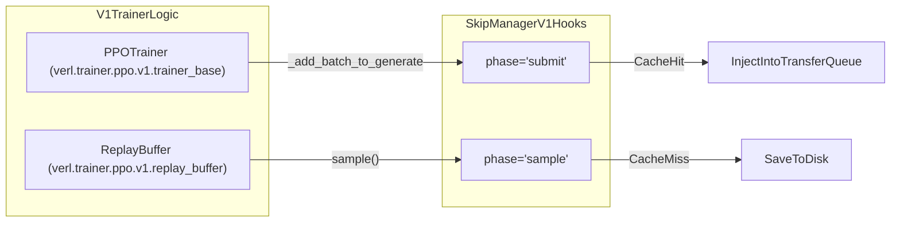

<!-- source: DeepWiki mcp.deepwiki.com · repo volcengine/verl · page 10.8 SkipManager: Pipeline Step Skipping for Development · fetched 2026-10-21 -->

# SkipManager: Pipeline Step Skipping for Development

<details>
<summary>Relevant source files</summary>

The following files were used as context for generating this wiki page:

- [docs/advance/skip_manager.rst](docs/advance/skip_manager.rst)
- [tests/trainer/ppo/v1/test_streaming_feed_on_cpu.py](tests/trainer/ppo/v1/test_streaming_feed_on_cpu.py)
- [tests/utils/test_utils_skip.py](tests/utils/test_utils_skip.py)
- [tests/workers/rollout/perf/vllm_async_rollout.py](tests/workers/rollout/perf/vllm_async_rollout.py)
- [verl/utils/skip/__init__.py](verl/utils/skip/__init__.py)
- [verl/utils/skip/config.py](verl/utils/skip/config.py)
- [verl/utils/skip/rollout_skip.py](verl/utils/skip/rollout_skip.py)
- [verl/utils/skip/skip_manager.py](verl/utils/skip/skip_manager.py)

</details>


The **SkipManager** framework (`verl.utils.skip.skip_manager`) is a general-purpose utility designed to bypass expensive stages in reinforcement learning training pipelines during development, debugging, and experimentation [tests/workers/rollout/perf/vllm_async_rollout.py:14-31](). By skipping selected steps—such as sequence generation or model rollouts—developers can achieve rapid iteration cycles, perform deterministic replays of specific training iterations, and save computational resources when bisecting bugs or tuning downstream components [docs/advance/skip_manager.rst:12-35]().

Sources: [tests/workers/rollout/perf/vllm_async_rollout.py:14-31](), [verl/utils/skip/skip_manager.py:24-30](), [docs/advance/skip_manager.rst:12-35]()

---

## 1. System Architecture and Data Flow

SkipManager operates via a centralized configuration class (`SkipManagerConfig`) and a decorator-based registration system [verl/utils/skip/skip_manager.py:39-49](). Modules register under specific roles (e.g., `rollout`, `rollout_tq`, `async_rollout`) inside `SKIP_REGISTRY` and use decorators like `@SkipManager.annotate` or `@SkipManager.annotate_tq` to wrap pipeline execution functions [verl/utils/skip/skip_manager.py:79-151](), [verl/utils/skip/base_skip.py:22]() (imported via [verl/utils/skip/__init__.py:15-20]()).

### Code Entity Map: SkipManager Orchestration
The following diagram illustrates how the `SkipManager` class interacts with the registry and configuration to manage specific skip instances and wrap target functions.

```mermaid
graph TD
    subgraph "RegistrySpace"
        REG["SKIP_REGISTRY (verl.utils.skip.base_skip)"]
    end

    subgraph "ConfigurationSpace"
        HYDRA["HydraSkipKey"]
        SMC["SkipManagerConfig (verl.utils.skip.config)"]
    end

    subgraph "CoreEntities"
        SM["SkipManager (verl.utils.skip.skip_manager)"]
        BS["BaseSkip (verl.utils.skip.base_skip)"]
        RS["RolloutSkip (verl.utils.skip.rollout_skip)"]
        ARS["AsyncRolloutSkip (verl.utils.skip.rollout_skip)"]
    end

    HYDRA --> SMC
    SMC --> SM
    REG -- "instantiates" --> BS
    BS <|-- RS
    BS <|-- ARS
    SM -- "manages" --> BS
    SM -- "@annotate" --> FUNC["TargetPipelineFunction"]
```

Sources: [verl/utils/skip/skip_manager.py:39-49](), [verl/utils/skip/config.py:72-77](), [verl/utils/skip/skip_manager.py:79-125]()

---

## 2. Skip Actions and Resolution Logic

`SkipManager` supports multiple actions for handling data during a skipped step, defined via `SkipAction` [verl/utils/skip/rollout_skip.py:29-70]():

1. **CACHE**: If a valid cache dump exists for the current step, it is loaded via `DataProto.load_from_disk()` and the wrapped function execution is bypassed. Otherwise, the function executes normally and its output is dumped to disk for subsequent runs [verl/utils/skip/rollout_skip.py:48-58]().
2. **REPEAT**: If any valid dump exists, the manager loads from a substitute step according to resolution rules. If no dump exists, the function runs and dumps the result [verl/utils/skip/rollout_skip.py:60-69]().

### Substitute Step Selection for REPEAT
When `action=repeat` is active and data for the current step is missing, `RolloutSkip._find_latest_step` selects a substitute step using the following priority order [verl/utils/skip/rollout_skip.py:148-159]():
1. Use the **current** step if valid [verl/utils/skip/rollout_skip.py:150-151]().
2. Else use the **largest** available step **strictly less than** the current step [verl/utils/skip/rollout_skip.py:156-158]().
3. Else use the **smallest** available step **strictly greater than** the current step [verl/utils/skip/rollout_skip.py:159]().

Sources: [verl/utils/skip/rollout_skip.py:29-70](), [verl/utils/skip/rollout_skip.py:148-159]()

---

## 3. Concrete Skip Implementations

### RolloutSkip (Legacy/Colocated)
`RolloutSkip` targets sequence generation in standard PPO trainers. It intercepts `generate_sequences` calls, loading or saving `DataProto` objects directly to disk [verl/utils/skip/rollout_skip.py:25-93](). It extracts experiment metadata such as `gen_batch_size`, `max_response_length`, and `max_prompt_length` to construct deterministic dump paths [verl/utils/skip/rollout_skip.py:34-45]().

### AsyncRolloutSkip and RolloutTqSkip (V1 Trainer & TransferQueue)
The V1 trainer uses a split architecture where prompts are submitted and trajectories are sampled asynchronously via a `TransferQueue` [verl/utils/skip/skip_manager.py:128-147](). Skip modules handle multi-phase hooks via `SkipManager.annotate_tq`:
* **Submit Phase (`phase="submit"`)**: Decorates batch addition to ensure the dataloader stays aligned by calling batch advancement methods even on cache hits, while bypassing engine rollout submissions [verl/utils/skip/skip_manager.py:128-141]().
* **Sample Phase (`phase="sample"`)**: Decorates replay buffer sampling (`ReplayBuffer.sample`), persisting sampled trajectories to disk or merging mini-batches [verl/utils/skip/skip_manager.py:142-147]().

Sources: [verl/utils/skip/rollout_skip.py:25-93](), [verl/utils/skip/skip_manager.py:128-147]()

---

## 4. Trainer Integration and V1 Hooks

The `PPOTrainer` and its asynchronous variants integrate with `SkipManager` to control profiling, data submission, and weight synchronization during skipped steps [verl/utils/skip/skip_manager.py:128-151]().

### Data Flow in V1 Skip Implementation
The following diagram bridges the V1 trainer code entities to the SkipManager's phase-based logic.



Sources: [verl/utils/skip/skip_manager.py:128-151](), [tests/trainer/ppo/v1/test_streaming_feed_on_cpu.py:15-30]()

---

## 5. Hydra Configuration System

Skip behavior is configured under the top-level `skip` Hydra key [docs/advance/skip_manager.rst:17-18](). Each role (`rollout`, `rollout_tq`, `async_rollout`) has its own sub-config sharing structures defined in `RolloutSkipConfig`, `RolloutTqSkipConfig`, and `AsyncRolloutSkipConfig` [verl/utils/skip/config.py:21-77]().

| Parameter | Type | Description |
| :--- | :--- | :--- |
| `enable` | bool | Master switch for the specific skip role [verl/utils/skip/config.py:24]() |
| `dump_dir` | str | Root directory for cached data shards (defaults to `~/.verl/rollout_dump`) [verl/utils/skip/config.py:25]() |
| `steps` | list[int] | List of integer steps where skip logic is active [verl/utils/skip/config.py:26]() |
| `action` | str | Strategy action: `cache` or `repeat` [verl/utils/skip/config.py:27]() |

**Example Hydra Command:**
```bash
python main_ppo.py \
    skip.rollout.enable=True \
    skip.rollout.steps=[1,2,3,10] \
    skip.rollout.action=cache
```

Sources: [verl/utils/skip/config.py:21-77](), [docs/advance/skip_manager.rst:17-18]()

---

## 6. On-Disk Cache Layout

Caches are organized by experiment name, project name, and rollout hyperparameters to prevent collisions across runs [verl/utils/skip/rollout_skip.py:112-122]().

```text
{dump_dir}/{experiment_name}_{project_name}/
    └── GBS{gbs}_N{n}_in{prompt_len}_out{response_len}/
        ├── {step}/
        │   ├── gen_batch.dp      # DataProto for rollout/async_rollout
        │   ├── tq_batch.pt       # torch.save for rollout_tq
        │   └── meta.json         # Step metadata {"global_steps": step}
```

Sources: [verl/utils/skip/rollout_skip.py:31-32](), [verl/utils/skip/rollout_skip.py:112-122]()

---

