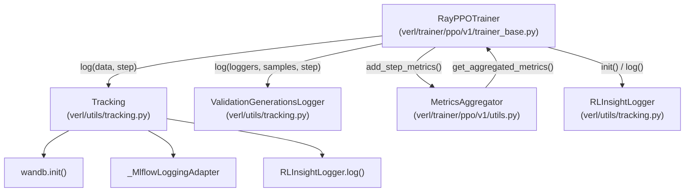
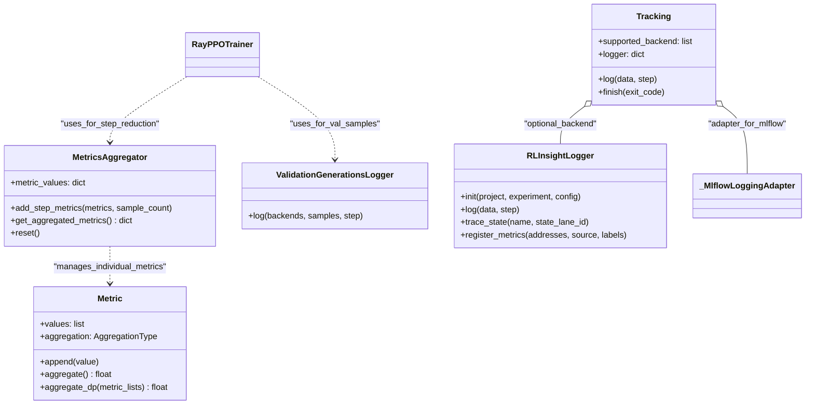

<!-- source: DeepWiki mcp.deepwiki.com · repo volcengine/verl · page 11 Monitoring and Logging · fetched 2026-10-21 -->

# Monitoring and Logging

Relevant source files

The following files were used as context for generating this wiki page:

- [docs/advance/grafana_prometheus.md](docs/advance/grafana_prometheus.md)
- [docs/advance/rl_insight.md](docs/advance/rl_insight.md)
- [docs/ascend_tutorial/zh/model_support/examples/ascend_vllm_best_practices.rst](docs/ascend_tutorial/zh/model_support/examples/ascend_vllm_best_practices.rst)
- [docs/low_precision/fp8.md](docs/low_precision/fp8.md)
- [docs/low_precision/nvfp4_qat.md](docs/low_precision/nvfp4_qat.md)
- [tests/utils/test_mlflow_key_sanitization.py](tests/utils/test_mlflow_key_sanitization.py)
- [tests/utils/test_rl_insight_logger_on_cpu.py](tests/utils/test_rl_insight_logger_on_cpu.py)
- [tests/utils/test_tracking_on_cpu.py](tests/utils/test_tracking_on_cpu.py)
- [verl/utils/tracking.py](verl/utils/tracking.py)

This page serves as a high-level parent guide to experiment tracking, metrics collection, and logging infrastructure within the `verl` framework. The monitoring system captures scalar metrics, hardware telemetry, rollout traces, and qualitative text generations during distributed reinforcement learning training.

For detailed instructions, see the child pages:
- [Experiment Tracking Backends](#11.1) — Integration with WandB, MLflow, console logging, Prometheus/Grafana, and configuration options.
- [Metrics Collection and Logging](#11.2) — Coverage of training metrics (loss, KL, rewards, advantages), logging frequency, and custom metrics.
- [Validation and Generation Logging](#11.3) — Explanation of the validation loop, generation logging, rollout tracing backends, and model output inspection.

---

## Overview

The monitoring and logging infrastructure in `verl` coordinates telemetry across distributed Ray workers, aggregation systems, and persistent logging backends. The primary entry point for tracking is the `Tracking` class defined in `verl/utils/tracking.py` [verl/utils/tracking.py:38-60](). It fans out logged parameters and metrics to multiple backends including WandB, MLflow, SwanLab, TensorBoard, and console [verl/utils/tracking.py:49-60]().

### Monitoring System Architecture

Sources: [verl/utils/tracking.py:38-184](), [verl/trainer/ppo/v1/trainer_base.py:20-25](), [verl/trainer/ppo/v1/utils.py:26-36](), [verl/utils/tracking.py:463-500]()

---

## 11.1. Experiment Tracking Backends

The `Tracking` class manages configuration, authentication variables (such as `WANDB_ENTITY` or `SWANLAB_API_KEY`), proxy configurations, and MLflow run connections [verl/utils/tracking.py:82-151](). It supports a unified interface over multiple third-party tracking services [verl/utils/tracking.py:38-47](). 

For comprehensive documentation on integrating WandB, MLflow, console logging, Prometheus/Grafana, and configuring backend properties, see [Experiment Tracking Backends](#11.1).

Sources: [verl/utils/tracking.py:38-184](), [tests/utils/test_mlflow_key_sanitization.py:22-49]()

---

## 11.2. Metrics Collection and Logging

`verl` collects extensive telemetry during training, including policy loss values, token-level KL divergence, reward components, advantage statistics, and timing information [verl/trainer/ppo/metric_utils.py:1-15](). To handle decoupled multi-iteration steps, metrics aggregators combine per-iteration telemetry into global step values using rule-based strategies [verl/trainer/ppo/v1/utils.py:26-140]().

For a complete breakdown of collected metrics, logging frequencies, custom metric registration, and aggregation rules, see [Metrics Collection and Logging](#11.2).

Sources: [verl/trainer/ppo/v1/utils.py:26-140](), [verl/trainer/ppo/metric_utils.py:1-192](), [verl/utils/metric/utils.py:25-156]()

---

## 11.3. Validation and Generation Logging

During validation loops, `verl` pairs quantitative reward scores with qualitative generation logging. `ValidationGenerationsLogger` formats prompt-response-score samples into backend-compatible tables or trace logs [verl/utils/tracking.py:347-433](), [tests/utils/test_tracking_on_cpu.py:86-111](). Additionally, the RL-Insight integration provides detailed state timelines for rollout generation, which can be visualized in Grafana dashboards [docs/advance/rl_insight.md:127-137]().

For details on validation loop execution, text generation logging, rollout tracing backends (Weave/MLflow), and qualitative inspection methods, see [Validation and Generation Logging](#11.3).

Sources: [verl/utils/tracking.py:347-460](), [tests/utils/test_tracking_on_cpu.py:33-111](), [docs/advance/rl_insight.md:127-137]()

---

## Class and Module Map

### Code Entity Map for Monitoring and Logging

Sources: [verl/utils/tracking.py:38-59](), [verl/trainer/ppo/v1/utils.py:26-36](), [verl/utils/metric/utils.py:72-90](), [verl/utils/tracking.py:347-352](), [verl/utils/tracking.py:463-475]()

---

