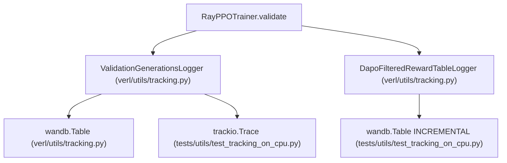

<!-- source: DeepWiki mcp.deepwiki.com · repo volcengine/verl · page 11.1 Experiment Tracking Backends · fetched 2026-10-21 -->

# Experiment Tracking Backends

<details>
<summary>Relevant source files</summary>

The following files were used as context for generating this wiki page:

- [docs/advance/grafana_prometheus.md](docs/advance/grafana_prometheus.md)
- [docs/advance/rl_insight.md](docs/advance/rl_insight.md)
- [docs/ascend_tutorial/zh/model_support/examples/ascend_vllm_best_practices.rst](docs/ascend_tutorial/zh/model_support/examples/ascend_vllm_best_practices.rst)
- [docs/low_precision/fp8.md](docs/low_precision/fp8.md)
- [docs/low_precision/nvfp4_qat.md](docs/low_precision/nvfp4_qat.md)
- [tests/utils/test_mlflow_key_sanitization.py](tests/utils/test_mlflow_key_sanitization.py)
- [tests/utils/test_rl_insight_logger_on_cpu.py](tests/utils/test_rl_insight_logger_on_cpu.py)
- [tests/utils/test_tracking_on_cpu.py](tests/utils/test_tracking_on_cpu.py)
- [verl/utils/tracking.py](verl/utils/tracking.py)

</details>


This document describes the experiment tracking and observability infrastructure in `verl`, which enables logging of training metrics, validation results, and model generations to various backends. The framework provides a unified interface to integrate with popular experiment tracking systems like Weights & Biases (WandB), MLflow, TensorBoard, SwanLab, and specialized observability platforms including RL-Insight, Trackio, and Prometheus/Grafana.

---

## 1. Unified Tracking Architecture

Verl implements a centralized tracking system through the `Tracking` class [verl/utils/tracking.py:38-47](). This class acts as a dispatcher, allowing the framework to log experiment metrics, parameters, and artifacts to multiple backends simultaneously [verl/utils/tracking.py:38-43](). The system is initialized with a project name, experiment name, and a set of default backends [verl/utils/tracking.py:62-73]().

The `supported_backend` attribute lists all natively integrated tracking targets:
- `"wandb"` [verl/utils/tracking.py:50]()
- `"mlflow"` [verl/utils/tracking.py:51]()
- `"swanlab"` [verl/utils/tracking.py:52]()
- `"vemlp_wandb"` [verl/utils/tracking.py:53]()
- `"tensorboard"` [verl/utils/tracking.py:54]()
- `"console"` [verl/utils/tracking.py:55]()
- `"clearml"` [verl/utils/tracking.py:56]()
- `"trackio"` [verl/utils/tracking.py:57]()
- `"file"` [verl/utils/tracking.py:58]()
- `"rl_insight"` [verl/utils/tracking.py:59]()

Sources: [verl/utils/tracking.py:38-60]()

---

## 2. Configuration and Environment Variables

### Logger Backend Selection

Tracking backends are configured via the `trainer.logger` Hydra configuration option, which accepts a string or a list of backend identifiers [verl/utils/tracking.py:62-65]().

| Parameter | Type | Description | Default |
|-----------|------|-------------|---------|
| `trainer.project_name` | string | Project identifier for grouping experiments | `verl_examples` |
| `trainer.experiment_name` | string | Unique run name | `gsm8k` |
| `trainer.logger` | list[str] | List of backend identifiers [verl/utils/tracking.py:49-60]() | `["console"]` |
| `trainer.wandb_proxy` | string | Optional HTTPS proxy configuration for WandB [verl/utils/tracking.py:82-83]() | `None` |

Sources: [verl/utils/tracking.py:49-85]()

### Environment Variables

Distributed and cloud-hosted runs rely on environment variables to configure authentication and connection URIs:
*   `MLFLOW_TRACKING_URI`: URI for the MLflow tracking server (defaults to `sqlite:////tmp/mlruns.db`) [verl/utils/tracking.py:104]().
*   `MLFLOW_RUN_ID`: Attaches to an existing MLflow run when set (commonly used in Azure ML or Databricks) [verl/utils/tracking.py:110-112]().
*   `WANDB_ENTITY`: Specifies the WandB entity (user or team) [verl/utils/tracking.py:84]().
*   `SWANLAB_API_KEY`: Authentication key for SwanLab cloud logging [verl/utils/tracking.py:136]().
*   `VOLC_ACCESS_KEY_ID`: Access key for Volcengine ML Platform integration [verl/utils/tracking.py:160]().
*   `MLP_TRACKING_REGION`: Region setting for Volcengine ML Platform tracking [verl/utils/tracking.py:162]().
*   `RL_INSIGHT_SERVER_URL`: Connection URL for the RL-Insight monitoring server [docs/advance/rl_insight.md:73-74]().

Sources: [verl/utils/tracking.py:84-162](), [docs/advance/rl_insight.md:73-74]()

---

## 3. Core Backend Implementations and Adapters

### MLflow Logging Adapter and Key Sanitization
The MLflow backend wraps metric logging through `_MlflowLoggingAdapter` [verl/utils/tracking.py:120](). Because MLflow enforces strict naming rules, the adapter automatically sanitizes metric keys [tests/utils/test_mlflow_key_sanitization.py:22-33](). Invalid characters like `@`, `!`, or `#` are converted (e.g., `@` becomes `_at_` and `#` becomes `_`), and consecutive slashes are collapsed to a single `/` [tests/utils/test_mlflow_key_sanitization.py:42-49](). Initialization includes a retry loop governed by `MLFLOW_MAX_ATTEMPTS` and `MLFLOW_SLEEP_SECONDS` [verl/utils/tracking.py:34-35, 102-127]().

Sources: [verl/utils/tracking.py:34-127](), [tests/utils/test_mlflow_key_sanitization.py:22-49]()

### Trackio Trace Integration
The `trackio` backend uses `_TrackioLoggingAdapter` and `ValidationGenerationsLogger` to support conversational LLM traces [verl/utils/tracking.py:88-94](). Validation generations are formatted into `trackio.Trace` objects capturing user prompts, assistant responses, and metadata such as evaluation scores [tests/utils/test_tracking_on_cpu.py:85-111]().

Sources: [verl/utils/tracking.py:88-94](), [tests/utils/test_tracking_on_cpu.py:85-111]()

### DAPO Filtered Reward Table Logger
For algorithms like DAPO, `DapoFilteredRewardTableLogger` handles incremental metric logging [tests/utils/test_tracking_on_cpu.py:44-61](). It attempts to use `wandb.Table` with `log_mode="INCREMENTAL"` (supported in WandB >= 0.20.0), falling back to full-history table creation for older versions [tests/utils/test_tracking_on_cpu.py:47-83]().

Sources: [tests/utils/test_tracking_on_cpu.py:44-83]()

---

## 4. Specialized Observability: RL-Insight and Prometheus/Grafana

### RL-Insight Deep Observability
`RLInsightLogger` provides online observability for RL training processes, integrating metrics from trainers, async vLLM/SGLang rollout engines, and TransferQueue components [docs/advance/rl_insight.md:5](). Key features include:
*   **Lazy Initialization**: Initialized on the first call to `log` or `trace_state` [tests/utils/test_rl_insight_logger_on_cpu.py:94-117]().
*   **State Tracing**: Wraps generation execution paths with `trace_state` contexts to capture RL timelines [docs/advance/rl_insight.md:109](), [tests/utils/test_rl_insight_logger_on_cpu.py:44-50]().
*   **Metric Endpoint Registration**: Automatically registers server endpoints for Prometheus scraping via `update_prometheus_config` [docs/advance/rl_insight.md:109](), [tests/utils/test_rl_insight_logger_on_cpu.py:90]().

Sources: [docs/advance/rl_insight.md:5-109](), [tests/utils/test_rl_insight_logger_on_cpu.py:23-148]()

### Prometheus and Grafana Rollout Monitoring
When using async rollout engines (`actor_rollout_ref.rollout.mode="async"`), `verl` can automatically configure Prometheus to scrape rollout server metrics by enabling `actor_rollout_ref.rollout.prometheus.enable=True` [docs/advance/grafana_prometheus.md:102-103](). Grafana dashboards visualize throughput, cache hit rates, and generation latencies [docs/advance/grafana_prometheus.md:66-67]().

Sources: [docs/advance/grafana_prometheus.md:9-12, 66-67, 102-103]()

---

## 5. Validation and Generation Logging

Model outputs generated during validation are processed by `ValidationGenerationsLogger` [verl/utils/tracking.py:222]() and formatted according to the active backend:
*   **WandB**: Logged as `wandb.Table` instances containing prompts, responses, and rewards.
*   **Trackio**: Logged as structured `trackio.Trace` records [tests/utils/test_tracking_on_cpu.py:85-111]().
*   **Console**: Printed directly to stdout.

Sources: [verl/utils/tracking.py:222](), [tests/utils/test_tracking_on_cpu.py:85-111]()

---

## 6. Architecture and Data Flow

The following diagrams illustrate how experiment tracking integrates with internal code structures and execution routines.

Diagram 1: Natural Language Space to Code Entity Space mapping for metric dispatching.

```mermaid
graph TD
    UserConfig[""User_Config: trainer.logger""] --> TrackingInit[""Tracking.__init__ (verl/utils/tracking.py)""]
    TrackingInit --> Dispatch[""Tracking.logger Dispatcher""]
    Dispatch --> Mlflow["""_MlflowLoggingAdapter (verl/utils/tracking.py)"""]
    Dispatch --> Wandb["""wandb SDK (verl/utils/tracking.py)"""]
    Dispatch --> RLInsight["""RLInsightLogger (verl/utils/tracking.py)"""]
    Dispatch --> Trackio["""_TrackioLoggingAdapter (verl/utils/tracking.py)"""]
    Dispatch --> Console["""LocalLogger / Console (verl/utils/tracking.py)"""]
```
Sources: [verl/utils/tracking.py:38-177]()

Diagram 2: Natural Language Space to Code Entity Space mapping for validation and generation logging workflows.


Sources: [verl/utils/tracking.py:222-267](), [tests/utils/test_tracking_on_cpu.py:44-111]()

---

