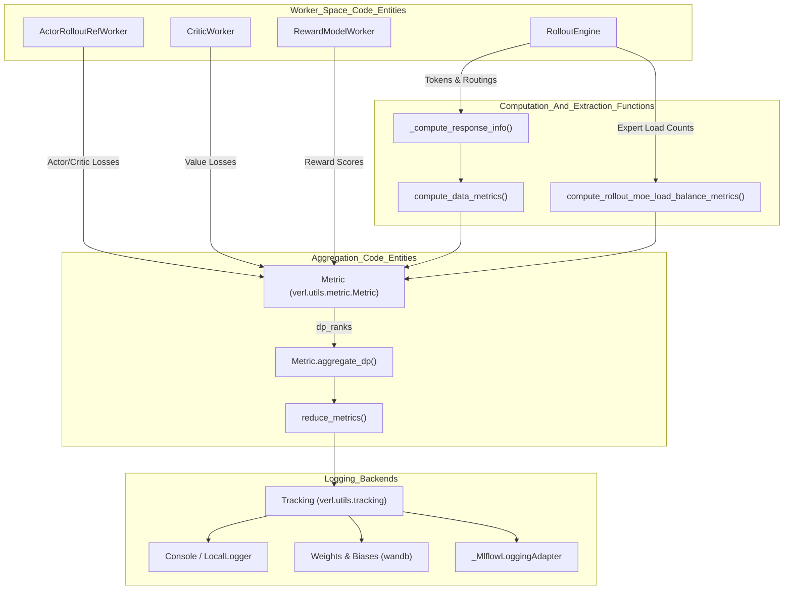
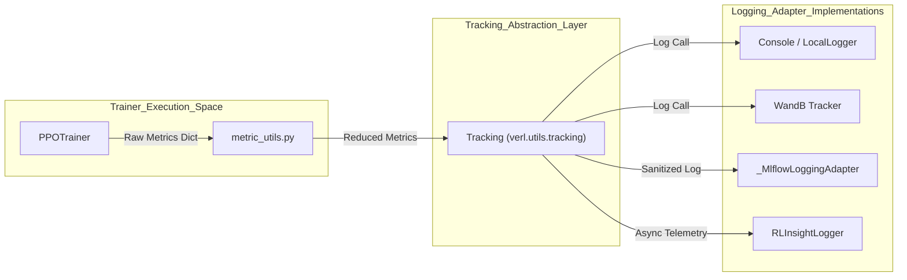

<!-- source: DeepWiki mcp.deepwiki.com · repo volcengine/verl · page 11.2 Metrics Collection and Logging · fetched 2026-10-21 -->

# Metrics Collection and Logging

<details>
<summary>Relevant source files</summary>

The following files were used as context for generating this wiki page:

- [tests/trainer/ppo/test_metric_utils_on_cpu.py](tests/trainer/ppo/test_metric_utils_on_cpu.py)
- [tests/trainer/ppo/test_rollout_moe_lb_metrics_on_cpu.py](tests/trainer/ppo/test_rollout_moe_lb_metrics_on_cpu.py)
- [verl/trainer/ppo/metric_utils.py](verl/trainer/ppo/metric_utils.py)
- [verl/utils/metric/__init__.py](verl/utils/metric/__init__.py)
- [verl/utils/metric/utils.py](verl/utils/metric/utils.py)

</details>


This page covers the metrics collection, aggregation, and logging infrastructure in `verl`, explaining how training metrics (such as loss values, KL divergence, rewards, advantages, and custom metrics) are gathered from distributed workers, reduced across data-parallel ranks, and dispatched to experiment tracking backends during reinforcement learning training.

Sources: [verl/trainer/ppo/metric_utils.py:14-34](), [verl/utils/metric/utils.py:14-16]()

---

## Metrics Collection Architecture

The `verl` framework implements a distributed metrics collection architecture that decouples metric generation in worker processes (`ActorRolloutRefWorker`, `CriticWorker`, `RewardModelWorker`, rollout engines) from metric aggregation in the central training orchestrator (`PPOTrainer`).

### Natural Language to Code Mapping: Metric Data Flow

Title: "Metric Data Flow from Distributed Workers to Reduction and Logging"


Sources: [verl/trainer/ppo/metric_utils.py:60-93](), [verl/utils/metric/utils.py:72-163]()

---

## Metric Types and Collection Points

### Actor, Critic, and Advantage Metrics
After each optimization step, training workers return dictionary structures containing optimizer, loss, reward, and advantage metrics:
- **Actor Metrics**: `actor/pg_loss`, `actor/entropy`, `actor/kl`, `actor/approx_kl`, `actor/clipfrac`.
- **Critic Metrics**: `critic/vf_loss`, `critic/vf_clipfrac`, `critic/vpred`.
- **Advantages and Rewards**: Advantage statistics (mean, variance, min/max values derived from GAE, GRPO, RLOO, etc.) and reward components (model scores, rule-based rewards) collected per training batch.

### Data and Response Metrics
Prompt lengths and generated response lengths are extracted via `_compute_response_info` or `compute_data_metrics` [verl/trainer/ppo/metric_utils.py:60-74]().
- `response_length`: The token count of generated completions, computed from `attention_mask` or response tensors [verl/trainer/ppo/metric_utils.py:81-87]().
- `prompt_length`: The token count of the input prompt extracted from the attention mask [verl/trainer/ppo/metric_utils.py:83-86]().

### Mixture-of-Experts (MoE) Load Balancing Metrics
For MoE models (e.g., `gpt_oss`, `mixtral`), `verl` evaluates token routing efficiency and load distribution [verl/trainer/ppo/metric_utils.py:36-36]():
- **Inference**: `infer_moe_num_experts` and `infer_rollout_moe_num_experts` inspect model configurations (`hf_config`, `override_config`) to locate `num_experts`, `n_routed_experts`, or `num_local_experts` [verl/trainer/ppo/metric_utils.py:117-173]().
- **Accumulation**: `RolloutMoELoadBalanceMetricsAccumulator` aggregates expert assignment counts across rollout sequences while masking out padding and trailing filler tokens [tests/trainer/ppo/test_rollout_moe_lb_metrics_on_cpu.py:143-160]().
- **Metrics Generated**: `rollout/moe/max_vio/layer_X`, `rollout/moe/min_vio/layer_X`, and `rollout/moe/avg_vio/layer_X` tracking deviations from uniform expert utilization [tests/trainer/ppo/test_rollout_moe_lb_metrics_on_cpu.py:58-66]().

Sources: [verl/trainer/ppo/metric_utils.py:36-183](), [tests/trainer/ppo/test_rollout_moe_lb_metrics_on_cpu.py:58-160]()

---

## Metric Aggregation and Reduction

Metric reduction is governed by the `Metric` class and `reduce_metrics` utility functions [verl/utils/metric/utils.py:25-163]().

### The `Metric` Class
The `Metric` class aggregates numeric observations (scalars, Python floats/ints, or single-element tensors) using a specified `AggregationType` (`MEAN`, `SUM`, `MIN`, `MAX`) [verl/utils/metric/utils.py:72-91]().

```python
class Metric:
    def __init__(self, aggregation: str | AggregationType, value: Optional[Numeric | list[Numeric]] = None) -> None:
        ...
```
*File Reference*: `verl/utils/metric/utils.py:72-92`

- **`append()`**: Adds a value, detaching and extracting scalar tensor values when necessary [verl/utils/metric/utils.py:103-114]().
- **`extend()`**: Appends multiple values or merges another `Metric` instance's values, ensuring aggregation type consistency [verl/utils/metric/utils.py:116-122]().
- **`aggregate()`**: Computes the final statistic (`np.mean`, `np.sum`, `np.min`, or `np.max`) over accumulated entries [verl/utils/metric/utils.py:123-136]().
- **`aggregate_dp()`**: Combines metric lists across Data Parallel ranks. For `SUM` and `MEAN`, it takes the mean across DP ranks before aggregating over accumulation steps; for `MIN` and `MAX`, it flattens and computes the global extremum [verl/utils/metric/utils.py:139-157]().

### `reduce_metrics` Logic
The `reduce_metrics` function maps a dictionary of metric lists to single values based on substring heuristics [verl/utils/metric/utils.py:25-58]():
- If the value is a `Metric` instance, its `aggregate()` method is called [verl/utils/metric/utils.py:49-51]().
- If the key contains `"max"`, `np.max` is applied [verl/utils/metric/utils.py:52-53]().
- If the key contains `"min"`, `np.min` is applied [verl/utils/metric/utils.py:54-55]().
- Otherwise, `np.mean` is used as the default reduction [verl/utils/metric/utils.py:57-57]().

Sources: [verl/utils/metric/utils.py:25-163]()

---

## Logging Frequency and Custom Metrics

Logging frequency is determined by configuration parameters (e.g., logging every $N$ steps or epochs) controlling how often aggregated metrics are flushed to tracking backends. 

Custom metrics can be injected into the logging pipeline by appending them to the metrics dictionary inside custom reward functions, environment steps, or rollout callbacks using the `Metric` class or standard Python containers. These custom metrics automatically flow through `reduce_metrics` and `aggregate_dp` as long as they follow the expected naming conventions (`min`, `max`, or mean-reduced defaults).

Sources: [verl/trainer/ppo/metric_utils.py:60-93](), [verl/utils/metric/utils.py:25-58]()

---

## Logging Backends and Tracking Infrastructure

### Natural Language to Code Mapping: Tracking Architecture

Title: "Tracking Backend Integration and Adapter Routing"


Sources: [verl/trainer/ppo/metric_utils.py:14-34](), [verl/utils/tracking.py:38-60]()

- **Supported Backends (`Tracking`)**: `verl` provides a unified `Tracking` interface [verl/utils/tracking.py:38-60]() supporting `wandb`, `mlflow`, `swanlab`, `vemlp_wandb`, `tensorboard`, `console`, `clearml`, `trackio`, `file`, and `rl_insight`.
- **Key Sanitization**: Adapters like `_MlflowLoggingAdapter` sanitize metric keys by replacing invalid punctuation with underscores and collapsing consecutive path separators [tests/utils/test_mlflow_key_sanitization.py:22-61]().
- **RL-Insight Integration**: `RLInsightLogger` manages online observability, capturing trainer metrics, asynchronous rollout server telemetry, and TransferQueue statistics [docs/advance/rl_insight.md:5-15]().

Sources: [verl/utils/tracking.py:38-176](), [docs/advance/rl_insight.md:1-115]()

---

## Validation and Generation Logging

During evaluation loops, model generations and rule-based reward components are tracked separately from training step metrics:
- **Validation Metrics Processing**: `process_validation_metrics` consolidates reward breakdowns, format compliance scores, and task accuracy [tests/trainer/ppo/test_metric_utils_on_cpu.py:30-31]().
- **Generation Logging**: The `ValidationGenerationsLogger` captures sample outputs along with metadata (rewards, ground truths, rollout traces) for inspection during training [tests/utils/test_tracking_on_cpu.py:85-111]().
- **DAPO Reward Filtering Tables**: `DapoFilteredRewardTableLogger` records reward distributions for filtered rollout groups to assist with hyperparameter tuning in advanced algorithms [tests/utils/test_tracking_on_cpu.py:44-61]().

Sources: [tests/trainer/ppo/test_metric_utils_on_cpu.py:30-31](), [tests/utils/test_tracking_on_cpu.py:44-111]()

---

