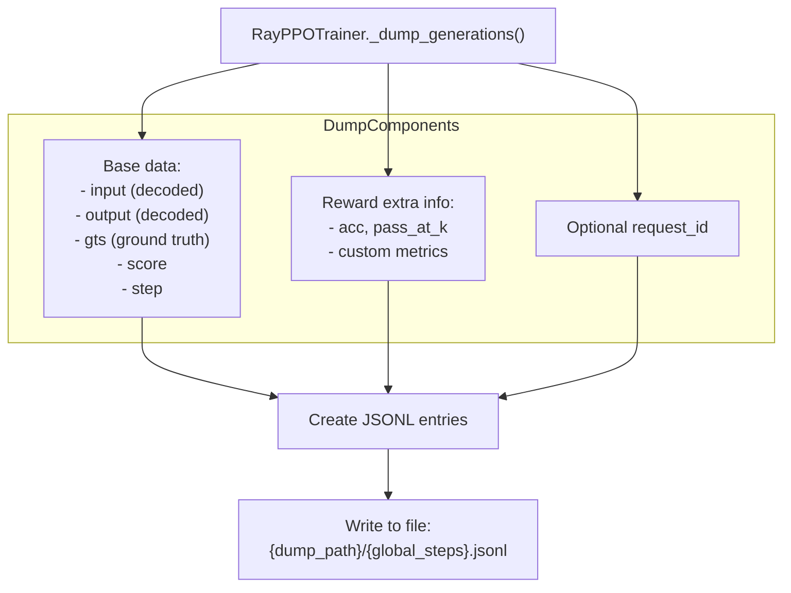

<!-- source: DeepWiki mcp.deepwiki.com · repo volcengine/verl · page 11.3 Validation and Generation Logging · fetched 2026-10-21 -->

# Validation and Generation Logging

<details>
<summary>Relevant source files</summary>

The following files were used as context for generating this wiki page:

- [.github/workflows/check-pr-title.yml](.github/workflows/check-pr-title.yml)
- [.github/workflows/doc.yml](.github/workflows/doc.yml)
- [docs/README.md](docs/README.md)
- [docs/advance/rollout_trace.rst](docs/advance/rollout_trace.rst)
- [docs/algo/spin.md](docs/algo/spin.md)
- [docs/algo/sppo.md](docs/algo/sppo.md)
- [docs/sglang_multiturn/sandbox_fusion.rst](docs/sglang_multiturn/sandbox_fusion.rst)
- [scripts/rollout_viewer.py](scripts/rollout_viewer.py)
- [tests/special_sanity/check_pr_description.py](tests/special_sanity/check_pr_description.py)
- [tests/utils/test_rollout_trace_on_cpu.py](tests/utils/test_rollout_trace_on_cpu.py)
- [verl/utils/rollout_trace.py](verl/utils/rollout_trace.py)

</details>


This page explains the validation loop execution, generation logging system, rollout tracing backends (`weave`, `mlflow`, `trackio`), and data dumping mechanisms in `verl`.

For information about experiment tracking backend configuration (wandb, mlflow, tensorboard), see [Experiment Tracking Backends](11.1). For general metrics collection during training, see [Metrics Collection and Logging](11.2).

## Overview

The validation and generation logging system provides mechanisms to:
1. Execute periodic validation runs during training to evaluate model performance.
2. Log generated text samples to experiment tracking backends for qualitative analysis.
3. Dump complete generation data to JSONL files for offline analysis.
4. Compute and track validation metrics aggregated by data source.
5. Provide advanced rollout tracing for agentic RL and multi-turn interactions using Weave, MLflow, or Trackio backends.

The primary entry point for validation is the `_validate()` method in `RayPPOTrainer`, which orchestrates the entire validation pipeline `[verl/trainer/ppo/ray_trainer.py:544-544]()`. Generation logging is handled by `_maybe_log_val_generations()` `[verl/trainer/ppo/ray_trainer.py:456-456]()` and `_dump_generations()` `[verl/trainer/ppo/ray_trainer.py:396-396]()`, while metrics are processed by `process_validation_metrics()` `[verl/trainer/ppo/metric_utils.py:30-31]()`.

Sources: `[verl/trainer/ppo/ray_trainer.py:396-544]`, `[verl/trainer/ppo/metric_utils.py:30-31]()`

---

## Validation Loop Execution

### Validation Orchestration Flow

The validation loop is triggered based on the `test_freq` configuration parameter or `val_before_train` `[docs/start/quickstart.rst:121-122]()`. The `RayPPOTrainer._validate()` method iterates through the validation dataloader and executes sequence generation, reward computation, and metric aggregation.

Diagram: Validation Loop and Code Entity Mapping
```mermaid
graph TB
    TriggerVal[""RayPPOTrainer.fit() validation trigger<br/>test_freq or val_before_train""]
    ValidateEntry[""RayPPOTrainer._validate() in verl/trainer/ppo/ray_trainer.py""]
    
    subgraph "BatchProcessingLoop"
        GetBatch[""DataProto(val_dataset)""]
        AddUID[""add_ulid_to_data_proto()""]
        RepeatBatch[""repeat_interleave()""]
        PadBatch[""pad_dataproto_to_divisor()""]
        GenSeq[""actor_rollout_wg.generate_sequences()""]
        ComputeReward[""compute_reward() / reward_loop""]
        UnpadBatch[""unpad_dataproto()""]
    end
    
    LogGen[""RayPPOTrainer._maybe_log_val_generations()""]
    DumpJSON[""RayPPOTrainer._dump_generations()""]
    ProcessMetrics[""process_validation_metrics() in verl/trainer/ppo/metric_utils.py""]
    
    TriggerVal --> ValidateEntry
    ValidateEntry --> GetBatch
    GetBatch --> AddUID
    AddUID --> RepeatBatch
    RepeatBatch --> PadBatch
    PadBatch --> GenSeq
    GenSeq --> ComputeReward
    ComputeReward --> UnpadBatch
    UnpadBatch --> LogGen
    LogGen --> DumpJSON
    DumpJSON --> ProcessMetrics
```
Sources: `[verl/trainer/ppo/ray_trainer.py:544-687]`, `[docs/start/quickstart.rst:121-122]()`

### Validation Batch Construction

The validation batch is constructed via `DataProto` to ensure evaluation consistency. Key differences from training batches include setting `meta_info['validate'] = True` `[verl/trainer/ppo/ray_trainer.py:587-587]`, `meta_info['recompute_log_prob'] = False` `[verl/trainer/ppo/ray_trainer.py:586-586]`, and using `val_kwargs.do_sample` `[verl/trainer/ppo/ray_trainer.py:583-583]()`.

Sources: `[verl/trainer/ppo/ray_trainer.py:556-589]`, `[docs/api/data.rst:8-12]()`

---

## Generation Text Logging

### Logging to Experiment Tracking Backends

The `RayPPOTrainer._maybe_log_val_generations()` method handles logging generated text samples to configured experiment tracking backends `[verl/trainer/ppo/ray_trainer.py:456-478]()`.

Diagram: Generation Logging and Code Entity Mapping
```mermaid
graph TB
    CheckConfig[""RayPPOTrainer._maybe_log_val_generations()<br/>Check log_val_generations config""]
    IsZero{"log_val_generations == 0?"}
    Return[""Return (no logging)""]
    
    CreateTuples[""Create (input, output, score) tuples""]
    Sort[""Sort by input text""]
    Shuffle[""Shuffle with fixed seed 42<br/>random.Random(42)""]
    TakeN[""Take first N samples""]
    
    LogToBackends[""ValidationGenerationsLogger.log() in verl/utils/tracking.py""]
    
    CheckConfig --> IsZero
    IsZero -- "No" --> CreateTuples
    CreateTuples --> Sort
    Sort --> Shuffle
    Shuffle --> TakeN
    TakeN --> LogToBackends
```
Features include deterministic sampling using a fixed random seed (42) `[verl/trainer/ppo/ray_trainer.py:470-472]()` and delegation to `ValidationGenerationsLogger` `[verl/utils/tracking.py:19-19]()` for backend-specific formatting (`wandb.Table` or `trackio.Trace`) `[verl/utils/tracking.py:74-101]()`.

Sources: `[verl/trainer/ppo/ray_trainer.py:456-478]`, `[verl/utils/tracking.py:19-101]()`

---

## Rollout Tracing (Agentic RL)

For complex scenarios like Agentic RL involving multiple turns or tool calls, `verl` provides a Rollout Tracing system integrated with **WandB Weave**, **MLflow**, and **Trackio**.

### Configuration and Control

Tracing is configured via the `actor_rollout_ref.rollout.trace` section:
* `backend`: Set to `weave`, `mlflow`, or `trackio` `[verl/utils/rollout_trace.py:83-111]()`.
* `token2text`: Decodes tokens to text in the trace view `[verl/utils/rollout_trace.py:40-40]()`. When enabled, `prompt_text` and `response_text` are added to the traced output for both the complete agent loop and each per-turn LLM generation call `[docs/advance/rollout_trace.rst:20-21]()`.
* `max_samples_per_step_per_worker`: Limits trace volume by sampling N trajectories per worker `[verl/utils/rollout_trace.py:43-46]()`. This is useful to manage data volume and cost, especially for backends like Weave or MLflow `[docs/advance/rollout_trace.rst:26-28]()`.

### Rollout Tracing Architecture and Code Mapping

Diagram: Rollout Tracing Code Entity Mapping
```mermaid
graph TD
    Config[""RolloutTraceConfig.init() in verl/utils/rollout_trace.py""] --> SetBackend["Configure backend:<br/>weave, mlflow, trackio"]
    
    subgraph "TracingExecution"
        ContextMgr[""rollout_trace_attr() in verl/utils/rollout_trace.py""] --> Decorator["@rollout_trace_op"]
        Decorator --> ClientCall["backend.client methods"]
    end
    
    SetBackend --> ContextMgr

    subgraph "RolloutTraceConfig Class"
        RTC_Init["init(...)"]
        RTC_GetBackend["get_backend()"]
        RTC_GetClient["get_client()"]
        RTC_EnableToken2Text["enable_token2text()"]
        RTC_Reset["reset()"]
    end

    subgraph "rollout_trace_attr Context Manager"
        RTA_Enter["__enter__:<br/>Sets _trace_attributes ContextVar<br/>Starts backend span"]
        RTA_Exit["__exit__:<br/>Resets _trace_attributes ContextVar"]
    end

    subgraph "rollout_trace_op Decorator"
        RTO_Wrap["Wraps async functions<br/>Calls rollout_trace_attr internally"]
    end

    RTC_Init --> RTA_Enter
    RTA_Enter --> RTO_Wrap
    RTO_Wrap --> ClientCall
```
The `RolloutTraceConfig` class is a singleton that manages the configuration for rollout tracing `[verl/utils/rollout_trace.py:48-69]()`. The `rollout_trace_attr` context manager is used to add attributes to a trace for the configured backend, such as `sample_index`, `step`, `rollout_n`, and `validate` status `[verl/utils/rollout_trace.py:132-144]()`. The `@rollout_trace_op` decorator marks functions to be traced `[tests/utils/test_rollout_trace_on_cpu.py:83-84]()`.

Sources: `[verl/utils/rollout_trace.py:31-206]`, `[docs/advance/rollout_trace.rst:65-72]`, `[tests/utils/test_rollout_trace_on_cpu.py:83-84]()`

### MLflow Integration Details

The `Tracking` class initializes MLflow by setting the tracking URI (defaulting to a local SQLite DB) `[verl/utils/tracking.py:91-112]()`. Metric keys are sanitized via `_MlflowLoggingAdapter` `[verl/utils/tracking.py:228-261]()`. `RolloutTraceConfig` also initializes MLflow with the tracking URI and experiment name `[verl/utils/rollout_trace.py:93-103]()`.

Sources: `[verl/utils/tracking.py:91-125]`, `[verl/utils/rollout_trace.py:93-103]()`

---

## JSONL Data Dumps and Interactive Viewer

The `RayPPOTrainer._dump_generations()` method writes generation data to JSONL files for offline analysis `[verl/trainer/ppo/ray_trainer.py:396-422]()`.


The `rollout_viewer.py` script provides a Textual-based TUI (`JsonLineViewer`) to view these JSONL files interactively `[scripts/rollout_viewer.py:129-148]()`. This viewer supports features like searching, navigating samples and steps, and switching display modes `[scripts/rollout_viewer.py:130-148]()`.

Sources: `[verl/trainer/ppo/ray_trainer.py:396-422]`, `[scripts/rollout_viewer.py:129-148]()`

---

## Validation Metrics Processing

Validation metrics are processed by `process_validation_metrics()`, aggregating metrics by data source and computing statistics like mean, majority vote (`maj`), and best-of-N (`best`) `[verl/trainer/ppo/metric_utils.py:30-31]()`.

* `reduce_metrics`: Computes means/max/min for metric lists `[verl/utils/metric/utils.py:25-58]()`.
* `Metric` class: Aggregator for collecting numeric values `[verl/utils/metric/utils.py:72-125]()`.
* `bootstrap_metric`: Computes confidence intervals `[verl/trainer/ppo/metric_utils.py:25-25]()`.
* `calc_maj_val`: Computes majority vote results `[verl/trainer/ppo/metric_utils.py:26-26]()`.
* MoE Load Balance metrics track `max_vio` and `avg_vio` `[verl/trainer/ppo/metric_utils.py:176-190]()`.

Sources: `[verl/trainer/ppo/metric_utils.py:21-31]`, `[verl/utils/metric/utils.py:25-125]`, `[verl/trainer/ppo/metric_utils.py:176-190]()`

---

