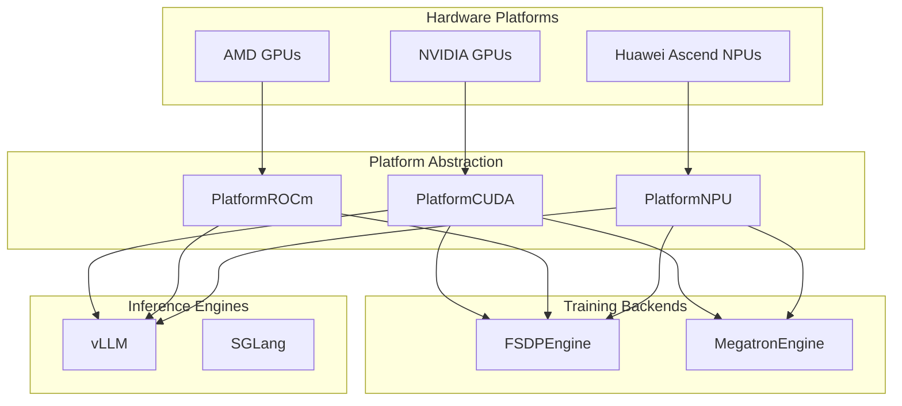
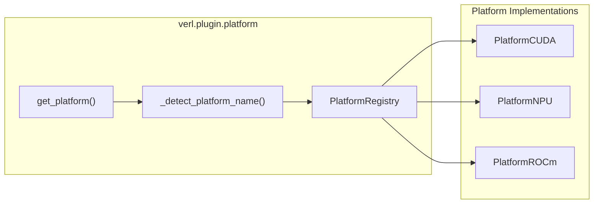

<!-- source: DeepWiki mcp.deepwiki.com · repo volcengine/verl · page 12 Hardware Support · fetched 2026-10-21 -->

# Hardware Support

Relevant source files

The following files were used as context for generating this wiki page:

- [tests/utils/test_check_ipc_version_support_on_npu.py](tests/utils/test_check_ipc_version_support_on_npu.py)
- [tests/utils/test_shared_memory.py](tests/utils/test_shared_memory.py)
- [verl/plugin/platform/platform_npu.py](verl/plugin/platform/platform_npu.py)
- [verl/utils/device.py](verl/utils/device.py)

This document provides a high-level overview of the hardware platforms supported by the `verl` framework, including NVIDIA GPUs, AMD GPUs (via ROCm), and Huawei Ascend NPUs. The framework utilizes a hardware-agnostic platform abstraction layer (`verl.plugin.platform`) to manage device detection, memory allocation, and optimized kernel dispatch across heterogeneous accelerators.

For installation instructions, see [Installation and Environment Setup](#2.1). For backend-specific configuration, see [Training Engines and Distributed Backends](#8). For performance tuning, see [Performance Optimization](#10).

---

## Supported Hardware Platforms Overview

`verl` supports multiple hardware platforms through a unified plugin system. The architecture separates vendor-agnostic training and rollout logic from hardware-specific implementations via the **Platform Plugin System** (`verl.plugin.platform`) and **Engine Plugin System** (`verl.workers.engine.base`).

| Platform | Training Backends | Inference Engines | Maturity |
|----------|-------------------|-------------------|----------|
| **NVIDIA GPUs** | FSDP, Megatron, VeOmni, TorchTitan | vLLM, SGLang, TensorRT-LLM | Production |
| **AMD GPUs (ROCm)** | FSDP, Megatron | vLLM, SGLang | Stable |
| **Ascend NPUs** | Megatron-LM, FSDP, VeOmni | vllm-ascend, SGLang | Stable |

Sources: [.github/CODEOWNERS:1-31]()

---

## Platform Abstraction Layer

The platform abstraction layer isolates vendor-specific code by routing all device queries and initializations through `PlatformBase` subclasses. Functions in `verl.utils.device` dynamically dispatch calls based on the active platform singleton retrieved via `get_platform()` [verl/utils/device.py:11-16]().

### Core Platform Utilities

- `get_platform()`: Returns the auto-detected `PlatformBase` singleton.
- `PlatformRegistry`: Registry mapping vendor names to concrete implementations.
- `auto_set_device()`: Automatically configures trainer settings based on detected hardware [verl/utils/device.py:151-166]().
- `get_resource_name()`: Returns the Ray resource name (e.g., `"GPU"`, `"NPU"`) [verl/utils/device.py:65-71]().
- `get_vendor()`: Returns the hardware vendor string (e.g., `"nvidia"`, `"huawei"`) [verl/utils/device.py:73-80]().

Sources: [verl/plugin/platform/platform_manager.py:1-174](), [verl/utils/device.py:11-166]()

---

## NVIDIA GPU Support

NVIDIA GPUs serve as the primary execution target for `verl`, offering native support for all training backends (FSDP, Megatron, TorchTitan, VeOmni) and inference engines (vLLM, SGLang, TensorRT-LLM). `PlatformCUDA` manages memory allocators, CUDA streams, and NCCL communication backends.

For deep technical details, configuration options, Docker images, and optimizations, see [NVIDIA GPU Support](#12.1).

Sources: [verl/plugin/platform/platform_cuda.py:1-186]()

---

## AMD GPU (ROCm) Support

AMD ROCm integration enables high-performance RL training and inference on accelerators like the MI300 series. `PlatformROCm` subclasses `PlatformCUDA` while overriding environment variables (e.g., `HIP_VISIBLE_DEVICES`, `SGLANG_USE_AITER`) and ROCm-specific diagnostic probes via `rocm-smi`.

For deep technical details, compatibility guides, and ROCm configurations, see [AMD GPU (ROCm) Support](#12.2).

Sources: [verl/plugin/platform/platform_rocm.py:1-76]()

---

## Ascend NPU Support

Huawei Ascend NPUs (Atlas A2/A3 910B series, A5 950 series) are supported via `PlatformNPU` [verl/plugin/platform/platform_npu.py:38-38](), integrating with `torch_npu`, the CANN SDK, MindSpeed-LLM for training, and `vllm-ascend` for inference. It dynamically configures HCCL or FlagCX communication backends [verl/plugin/platform/platform_npu.py:129-131]() and validates CANN software versions using helper functions like `get_npu_versions()` [verl/utils/device.py:195-215]() and `is_ipc_supported()` [verl/plugin/platform/platform_npu.py:164-179]().

For comprehensive guides on CANN requirements, Docker images, and NPU performance analysis, see [Ascend NPU Support](#12.3).

Sources: [verl/plugin/platform/platform_npu.py:1-201](), [verl/utils/device.py:37-58](), [verl/utils/device.py:195-215](), [tests/utils/test_check_ipc_version_support_on_npu.py:20-20]()

---

## Platform Plugin System and Multi-Chip Extensibility

`verl` allows seamless integration of new accelerators via Python entry points and the `PlatformRegistry` decorator pattern [verl/plugin/platform/platform_manager.py:29-40](). The `verl.utils.device` module acts as a backward-compatible facade, delegating internal calls to the platform abstraction layer [verl/utils/device.py:11-16](). Weight transfer between training and rollout workers is managed via shared memory primitives (`create_shared_memory`, `rebuild_shared_memory`) and bucketed weight transfer mechanisms [tests/utils/test_shared_memory.py:21-22]().

For details on implementing `PlatformBase`, registering custom engines via `EngineRegistry`, and shared memory weight transfer mechanisms, see [Platform Plugin System and Multi-Chip Extensibility](#12.4).

Sources: [verl/plugin/platform/platform_manager.py:1-174](), [tests/utils/test_shared_memory.py:21-22](), [verl/utils/device.py:11-16](), [verl/utils/device.py:65-71](), [verl/utils/device.py:73-80](), [verl/utils/device.py:96-102]()

---

