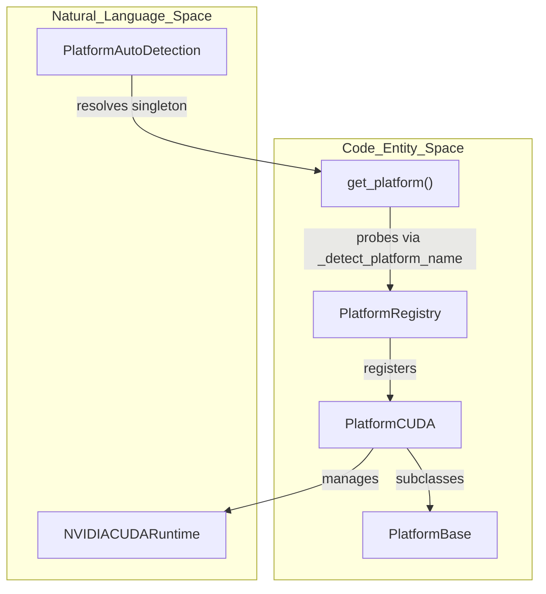
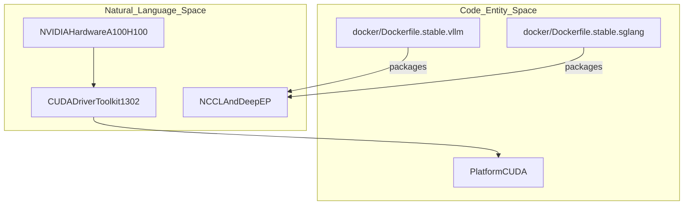

<!-- source: DeepWiki mcp.deepwiki.com · repo volcengine/verl · page 12.1 NVIDIA GPU Support · fetched 2026-10-21 -->

# NVIDIA GPU Support

Relevant source files

The following files were used as context for generating this wiki page:

- [.github/CODEOWNERS](.github/CODEOWNERS)
- [docker/Dockerfile.stable.sglang](docker/Dockerfile.stable.sglang)
- [docker/Dockerfile.stable.vllm](docker/Dockerfile.stable.vllm)
- [docker/verl0.6.1-experimental/Dockerfile.sglang056exp](docker/verl0.6.1-experimental/Dockerfile.sglang056exp)
- [docker/verl0.6.1-experimental/Dockerfile.vllm012exp](docker/verl0.6.1-experimental/Dockerfile.vllm012exp)
- [tests/utils/veomni/test_special_export_unfused_experts.py](tests/utils/veomni/test_special_export_unfused_experts.py)
- [verl/plugin/platform/platform_cuda.py](verl/plugin/platform/platform_cuda.py)
- [verl/plugin/platform/platform_manager.py](verl/plugin/platform/platform_manager.py)
- [verl/plugin/platform/platform_rocm.py](verl/plugin/platform/platform_rocm.py)

This page covers verl's support for NVIDIA GPUs, detailing hardware requirements, CUDA and driver prerequisites, containerized Docker environments, the `PlatformCUDA` plugin implementation, and NVIDIA-specific hardware optimizations such as NCCL communication enhancements, FP8 execution, and DeepEP Mixture-of-Experts (MoE) acceleration.

verl is engineered to fully harness NVIDIA's CUDA ecosystem for high-performance Large Language Model (LLM) reinforcement learning workflows via the HybridFlow architecture. For AMD GPU support, see [AMD GPU (ROCm) Support](12.2). For Huawei Ascend NPU support, see [Ascend NPU Support](12.3). For details on the hardware-agnostic platform abstraction layer, see [Platform Plugin System and Multi-Chip Extensibility](12.4).

Sources: [verl/plugin/platform/platform_cuda.py:19-21](), [verl/plugin/platform/platform_manager.py:29-38]()

---

## 1. Overview and Architecture

verl supports NVIDIA GPU architectures across multiple generations, with validated compatibility on A100, H100, L20, and Blackwell hardware. The framework natively integrates with NVIDIA's deep learning software stack—including CUDA, cuDNN, NCCL, TransformerEngine, and Megatron-LM—to deliver high-throughput training and rollout generation.

Key aspects of NVIDIA GPU support in verl include:
- **Platform Abstraction**: Concrete `PlatformCUDA` implementation [verl/plugin/platform/platform_cuda.py:19-21]() registered via `PlatformRegistry` [verl/plugin/platform/platform_manager.py:29-38]().
- **Distributed Training Backends**: PyTorch FSDP (including FSDP2) and Megatron-LM using optimized CUDA kernels.
- **Inference Engines**: vLLM and SGLang backends equipped with NVIDIA-optimized attention kernels and FP8 support.
- **Collective Communication**: NCCL bindings configured for high-speed multi-GPU weight synchronization and checkpoint persistence.
- **Advanced MoE Interconnects**: Integration with DeepEP (DeepSeek-AI) for ultra-low latency all-to-all communication on Hopper and newer architectures [docker/Dockerfile.stable.vllm:106-121]().

Sources: [verl/plugin/platform/platform_cuda.py:19-21](), [verl/plugin/platform/platform_manager.py:29-38](), [docker/Dockerfile.stable.vllm:106-121]()

---

## 2. Hardware Requirements and Software Prerequisites

### Supported GPU Models

| GPU Model | Architecture | VRAM | Typical Use Case |
|-----------|-------------|------|------------------|
| A100 (40GB/80GB) | Ampere | 40GB / 80GB | Standard training and inference for 7B-70B models. |
| H100/H800/H200 | Hopper | 80GB/141GB | Large-scale training (70B+ models) and FP8 execution. |
| L20 | Ada Lovelace | 48GB | Primary CI/CD validation hardware for verl [.github/CODEOWNERS:1-31](). |
| Blackwell (GB200) | Blackwell | - | Supported via aarch64 and x86_64 Docker builds [docker/Dockerfile.stable.vllm:1-161](). |

### Software Stack Prerequisites

- **CUDA Toolkit**: verl stable Docker environments target CUDA 13.0.2 [docker/Dockerfile.stable.vllm:4-5](). Hardware detection is handled by `PlatformCUDA.is_platform_available()`, which verifies `torch.cuda.is_available()` and provides fallback checks using `nvidia-smi` [verl/plugin/platform/platform_cuda.py:41-70]().
- **TransformerEngine**: Integrated (v2.16.1) for FP8 execution and optimized transformer layers [docker/Dockerfile.stable.vllm:16-16]().
- **Flash Attention**: Built explicitly using `FLASH_ATTENTION_FORCE_BUILD` to guarantee binary compatibility with specific PyTorch releases [docker/Dockerfile.stable.vllm:90-90]().
- **cuDNN**: Version 9.x network packages (`cudnn9-cuda-13`) are standard in the NVIDIA software stack [docker/Dockerfile.stable.vllm:63-75]().
- **DeepEP**: High-performance communication library for Mixture-of-Experts (MoE) workloads, built with GDRCopy and NVSHMEM bindings [docker/Dockerfile.stable.vllm:106-121]().

Sources: [.github/CODEOWNERS:1-31](), [verl/plugin/platform/platform_cuda.py:41-70](), [docker/Dockerfile.stable.vllm:4-161]()

---

## 3. Platform Plugin Integration (`PlatformCUDA`)

verl decouples accelerator-specific runtime operations behind the `PlatformBase` interface. For NVIDIA hardware, `PlatformCUDA` implements device management, random number generator seeding, memory allocator configurations, distributed communication bindings, and NVTX profiling helpers [verl/plugin/platform/platform_cuda.py:19-184]().

### Core Implementation Methods

- `device_name()`: Returns `"cuda"` [verl/plugin/platform/platform_cuda.py:27-28]().
- `vendor_name()`: Returns `"nvidia"` [verl/plugin/platform/platform_cuda.py:31-32]().
- `set_allocator_settings(settings)`: Configures PyTorch CUDA memory allocators via `torch.cuda.memory._set_allocator_settings()` [verl/plugin/platform/platform_cuda.py:98-99]().
- `rollout_env_vars()`: Returns environment variables such as `NCCL_CUMEM_ENABLE` to prevent crashes or hangs during weight synchronization between actors and rollout engines in disaggregated mode [verl/plugin/platform/platform_cuda.py:147-152]().
- `nvtx_range(msg)`: Context manager wrapping `torch.cuda.nvtx.range(msg)` for profiling integration [verl/plugin/platform/platform_cuda.py:170-173]().

**Diagram: Platform Plugin Architecture Mapping for NVIDIA CUDA**

Sources: [verl/plugin/platform/platform_cuda.py:19-184](), [verl/plugin/platform/platform_manager.py:29-148]()

---

## 4. Docker Environments and Containerized Software Stack

verl provides production-ready stable Dockerfiles tailored for NVIDIA CUDA environments, integrating vLLM, SGLang, Megatron-LM, and custom communication libraries.

### Stable vLLM Image (`Dockerfile.stable.vllm`)
The stable vLLM image builds upon `nvidia/cuda:13.0.2-devel-ubuntu24.04` and installs:
- PyTorch, Torchvision, and Torchaudio [docker/Dockerfile.stable.vllm:9-11]()
- cuDNN 9 network packages (`cudnn9-cuda-13`) [docker/Dockerfile.stable.vllm:63-75]()
- TransformerEngine and Apex [docker/Dockerfile.stable.vllm:79-86]()
- DeepEP with GDRCopy and NVSHMEM bindings [docker/Dockerfile.stable.vllm:106-121]()
- Megatron-LM and Megatron-Bridge [docker/Dockerfile.stable.vllm:148-150]()

### Stable SGLang Image (`Dockerfile.stable.sglang`)
The stable SGLang image builds upon `lmsysorg/sglang:v0.5.12` and includes:
- cuDNN 9 network packages (`cudnn9-cuda-13`) [docker/Dockerfile.stable.sglang:17-30]()
- TransformerEngine and Apex [docker/Dockerfile.stable.sglang:36-38]()
- Flash Attention [docker/Dockerfile.stable.sglang:50-50]()
- Megatron-LM and Megatron-Bridge [docker/Dockerfile.stable.sglang:81-83]()

**Diagram: NVIDIA Hardware to Containerized Software Stack**

Sources: [docker/Dockerfile.stable.vllm:4-150](), [docker/Dockerfile.stable.sglang:4-83](), [verl/plugin/platform/platform_cuda.py:19-21]()

---

## 5. NVIDIA-Specific Optimizations

### 1. NCCL Enhancements and Process Control
verl configures NCCL for high-speed inter-GPU communication across distributed worker groups. For asynchronous rollout workflows, it leverages vLLM's process group abstractions to establish data-plane communication channels between training processes and rollout workers [verl/plugin/platform/platform_cuda.py:117-119](). Furthermore, verl requires `nvidia-nccl-cu13 >= 2.29.7` to support advanced communication control operations like `ncclCommSuspend` and `ncclCommResume` [docker/Dockerfile.stable.sglang:115]().

### 2. FP8 Quantization and Weight Synchronization
verl supports FP8 training and rollout execution on Hopper and newer NVIDIA architectures:
- **Parameter Metadata Preservation**: Ensures subclass attributes such as `weight_loader` remain attached across parameter re-sharding and rebuilding operations [verl/plugin/platform/platform_cuda.py:147-152]().
- **MoE Layout Patching**: Patches weight loaders for Mixture-of-Experts layers to guarantee proper sharding during weight synchronization.

### 3. Mixture-of-Experts (MoE) and DeepEP Integration
For models utilizing expert parallelism (such as DeepSeek and Qwen MoE architectures), verl integrates DeepEP (`hybrid-ep` branch) for ultra-low latency all-to-all communication [docker/Dockerfile.stable.vllm:106-121](). Specialized parameter handlers (`MOE_PARAM_HANDERS`) correctly format and un-fuse expert weights during distributed checkpointing and evaluation [tests/utils/veomni/test_special_export_unfused_experts.py:40-56]().

Sources: [docker/Dockerfile.stable.vllm:106-121](), [docker/Dockerfile.stable.sglang:115](), [verl/plugin/platform/platform_cuda.py:117-152](), [tests/utils/veomni/test_special_export_unfused_experts.py:40-56]()

---

