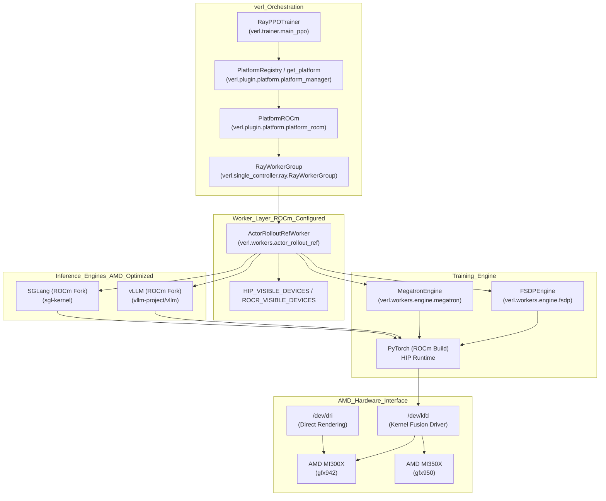

<!-- source: DeepWiki mcp.deepwiki.com · repo volcengine/verl · page 12.2 AMD GPU (ROCm) Support · fetched 2026-10-21 -->

# AMD GPU (ROCm) Support

<details>
<summary>Relevant source files</summary>

The following files were used as context for generating this wiki page:

- [.github/CODEOWNERS](.github/CODEOWNERS)
- [.github/workflows/e2e_ppo_trainer_megatron_vllm_rocm.yml](.github/workflows/e2e_ppo_trainer_megatron_vllm_rocm.yml)
- [docker/rocm/Dockerfile.rocm](docker/rocm/Dockerfile.rocm)
- [docker/rocm/Dockerfile.rocm.deepseek-v4](docker/rocm/Dockerfile.rocm.deepseek-v4)
- [docs/data/transfer_queue.md](docs/data/transfer_queue.md)
- [tests/utils/veomni/test_special_export_unfused_experts.py](tests/utils/veomni/test_special_export_unfused_experts.py)
- [verl/plugin/platform/platform_cuda.py](verl/plugin/platform/platform_cuda.py)
- [verl/plugin/platform/platform_manager.py](verl/plugin/platform/platform_manager.py)
- [verl/plugin/platform/platform_rocm.py](verl/plugin/platform/platform_rocm.py)
- [verl/trainer/config/transfer_queue/transfer_queue.yaml](verl/trainer/config/transfer_queue/transfer_queue.yaml)
- [verl/utils/transferqueue_utils.py](verl/utils/transferqueue_utils.py)

</details>


This page documents AMD GPU support in `verl` using the ROCm platform. It explains how `verl` integrates with AMD hardware via the hardware-agnostic platform abstraction plugin (`PlatformROCm`), ROCm-compatible Docker environments targeting MI300 and MI350 series accelerators, rollout engine configurations, and training backend adaptations.

For NVIDIA GPU support, see [NVIDIA GPU Support](#12.1). For Huawei Ascend NPU support, see [Ascend NPU Support](#12.3). For details on the underlying platform plugin registry system, see [Platform Plugin System and Multi-Chip Extensibility](#12.4).

## Overview

`verl` supports AMD GPUs through the ROCm (Radeon Open Compute) platform plugin layer, enabling reinforcement learning training and inference on AMD hardware. The framework utilizes specialized Docker-based environments to manage the dependency stack required for ROCm compatibility, specifically targeting the MI300 (`gfx942`) and MI350 (`gfx950`) series.

**Current Support Status:**
- **Runtime Modes**: Fully supports **Fully Async** and **Colocated** modes [docs/amd_tutorial/amd_quick_start.rst:17-17]().
- **Training Backends**: FSDP, FSDP2, and Megatron-Core are fully supported [docs/amd_tutorial/amd_quick_start.rst:19-19]().
- **Inference Engines**: vLLM and SGLang are supported via ROCm-patched forks [docs/amd_tutorial/amd_quick_start.rst:18-18]().
- **Hardware Targets**: MI300X / MI325X (`gfx942`) and MI350X / MI355X (`gfx950`) [docs/amd_tutorial/amd_quick_start.rst:22-23]().

Sources: [docs/amd_tutorial/amd_quick_start.rst:9-24](), [docker/rocm/README.md:15-24]()

## AMD ROCm Integration Architecture and Platform Plugin

`verl` abstracts hardware vendors through `PlatformBase` and registers ROCm via `PlatformROCm`, which subclasses `PlatformCUDA` to reuse the PyTorch HIP-ified `torch.cuda.*` API surface while overriding device probing, environment variable handling, and Ray resource parameters [verl/plugin/platform/platform_rocm.py:16-76]().

The following diagram illustrates how `verl` components interface with the ROCm software stack and AMD hardware, mapping natural language concepts to exact codebase entities.

**Natural Language to Code Entity Mapping: ROCm Execution Flow**



Sources: [verl/plugin/platform/platform_rocm.py:20-76](), [verl/plugin/platform/platform_manager.py:83-148](), [docs/amd_tutorial/amd_quick_start.rst:17-23]()

## Environment Setup and Docker Configuration

Running `verl` on AMD GPUs requires a specialized Docker container containing ROCm-patched versions of PyTorch, vLLM, SGLang, and Megatron-LM [docker/rocm/Dockerfile.rocm:1-98]().

### ROCm Docker Build Process

The framework provides Dockerfiles for standard ROCm stacks and advanced architectures [docker/rocm/Dockerfile.rocm:1-3](), [docker/rocm/Dockerfile.rocm.deepseek-v4:1-3]().

**Key Component Build Configuration (ROCm Stack):**

| Component | Repository / Source | Configuration / Version |
|-----------|----------------------|-----------------------|
| **Base Image** | `rocm/primus:v26.4` | [docker/rocm/Dockerfile.rocm:1-1]() |
| **PyTorch** | `Prebuilt in base` | ROCm HIP Build [verl/plugin/platform/platform_rocm.py:31-35]() |
| **vLLM** | `vllm-project/vllm` | `PYTORCH_ROCM_ARCH="gfx942;gfx950"` [docker/rocm/Dockerfile.rocm:11-11]() |
| **SGLang** | `sgl-project/sglang` | `SGLANG_ATTENTION_BACKEND=triton` [docker/rocm/Dockerfile.rocm:76-76]() |

Sources: [docs/amd_tutorial/amd_quick_start.rst:27-39](), [docker/rocm/Dockerfile.rocm:1-80]()

### Launching the Container

To ensure proper hardware access, containers must be launched with specific device nodes (`/dev/kfd` and `/dev/dri`) and security options [.github/workflows/e2e_ppo_trainer_megatron_vllm_rocm.yml:99-113]():

```bash
docker run -it --name verl_release --device /dev/kfd --device /dev/dri \
  --privileged --network=host \
  --group-add video --cap-add=SYS_PTRACE --security-opt seccomp=unconfined \
  --shm-size=2048g \
  --ulimit memlock=-1 --ulimit stack=67108864 \
  -w /workspace \
  $DOCKER /bin/bash
```

Sources: [docs/amd_tutorial/amd_quick_start.rst:50-63](), [.github/workflows/e2e_ppo_trainer_megatron_vllm_rocm.yml:99-113]()

## Rollout Engine Integration

### vLLM Support
vLLM is a primary rollout engine on AMD ROCm. The Dockerfile applies patches for ROCm compatibility, including a zeroing fix for `hipMemset` in `cumem_allocator.cpp` to prevent stale VRAM data [docker/rocm/Dockerfile.rocm:34-36]() and unquantized weight storage bugfixes for MoE layers [docker/rocm/Dockerfile.rocm:37-44](). Additionally, `vllm.disable_custom_all_reduce: True` is injected into `rollout.yaml` via `sed` to avoid memory allocation conflicts [docker/rocm/Dockerfile.rocm:55-55]().

### SGLang Support
SGLang is supported with the `triton` attention backend [docker/rocm/Dockerfile.rocm:76-76](). Build routines patch `layernorm.py` to prevent crashes in `fused_add_rms_norm` by ensuring contiguous tensors [docker/rocm/Dockerfile.rocm:81-86](), and compile `sgl-kernel` specifically for `gfx942` and `gfx950` architectures [docker/rocm/Dockerfile.rocm:93-97]().

Sources: [docker/rocm/Dockerfile.rocm:34-86](), [docs/amd_tutorial/amd_quick_start.rst:18-18]()

## Performance Optimizations and Platform Properties

The ROCm platform plugin (`PlatformROCm`) configures environment variables and runtime behaviors specific to AMD accelerators [verl/plugin/platform/platform_rocm.py:20-76]().

| Method / Setting | Return Value / Behavior | Purpose |
|------------------|-------------------------|---------|
| `ray_noset_envvars()` | `RAY_EXPERIMENTAL_NOSET_HIP_VISIBLE_DEVICES`, `RAY_EXPERIMENTAL_NOSET_ROCR_VISIBLE_DEVICES` | Prevents Ray from overwriting AMD visibility variables [verl/plugin/platform/platform_rocm.py:70-76]() |
| `rollout_env_vars()` | `SGLANG_USER_AITER=1` (default) | Routes SGLang non-attention kernels through AITER [verl/plugin/platform/platform_rocm.py:60-68]() |
| `PYTORCH_ALLOC_CONF` | `expandable_segments:True` | Mitigates memory fragmentation and OOM on ROCm [docs/amd_tutorial/amd_quick_start.rst:149-149]() |

Sources: [verl/plugin/platform/platform_rocm.py:20-76](), [docs/amd_tutorial/amd_quick_start.rst:146-151]()

## Training Backend Support

### FSDP and FSDP2
Fully supported for production training on AMD hardware [docs/amd_tutorial/amd_quick_start.rst:110-121](). FSDP2 handles sharded parameters across MI300 device meshes seamlessly via PyTorch's distributed APIs.

### Megatron
Megatron-Core is supported for large-scale training. 
- **Distributed Optimizer Fix**: The ROCm environment applies patches to Megatron-LM's `DistributedOptimizer` to detach FP32 parameter shards as leaf tensors, preventing `torch.optim` validation errors [docker/rocm/patches/non-leaf-fix.patch:1-27]().
- **DeepSeek DSA Kernel Shim**: Since DeepSeek-V4 sparse attention requires `fast_hadamard_transform` which lacks a native ROCm kernel, `verl.models.mcore.patch` provides a pure-PyTorch fallback shim [verl/models/mcore/patch.py:47-93]().

Sources: [docs/amd_tutorial/amd_quick_start.rst:15-24](), [docker/rocm/patches/non-leaf-fix.patch:1-27](), [verl/models/mcore/patch.py:47-102]()

## Continuous Integration for ROCm

`verl` maintains an automated CI workflow (`e2e_ppo_trainer_megatron_vllm_rocm.yml`) to validate end-to-end PPO training using Megatron and vLLM on ROCm-enabled MI300 runners [.github/workflows/e2e_ppo_trainer_megatron_vllm_rocm.yml:32-32]().

- **Triggers**: Runs on pushes and pull requests to `main` and `v0.*` branches [.github/workflows/e2e_ppo_trainer_megatron_vllm_rocm.yml:39-56]().
- **Runner Fleet**: Executes on `rocm-mi300` self-hosted runner nodes inside container images equipped with ROCm runtimes [.github/workflows/e2e_ppo_trainer_megatron_vllm_rocm.yml:97-101]().
- **Environment Overrides**: Sets `VERL_USE_UV: 0` to use ambient container Python and injects `VLLM_ROCM_OVERRIDE` to disable custom all-reduce during testing [.github/workflows/e2e_ppo_trainer_megatron_vllm_rocm.yml:90-124]().

Sources: [.github/workflows/e2e_ppo_trainer_megatron_vllm_rocm.yml:32-160]()

---

