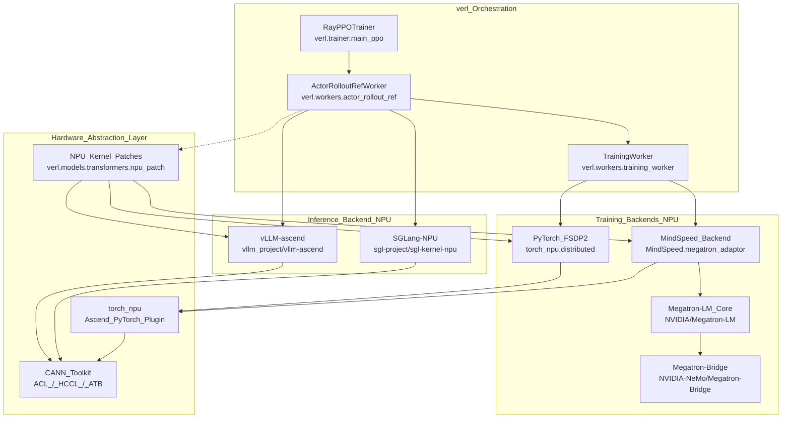
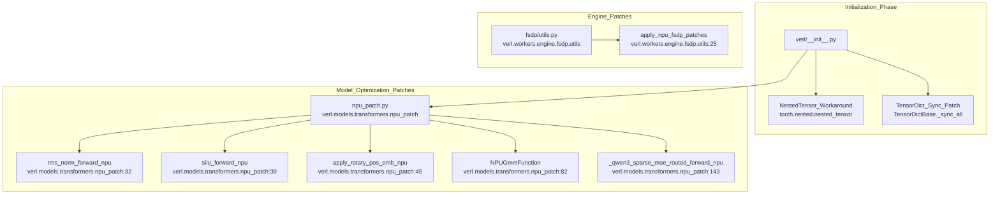

<!-- source: DeepWiki mcp.deepwiki.com · repo volcengine/verl · page 12.3 Ascend NPU Support · fetched 2026-10-21 -->

# Ascend NPU Support

<details>
<summary>Relevant source files</summary>

The following files were used as context for generating this wiki page:

- [.github/workflows/e2e_ascend.yml](.github/workflows/e2e_ascend.yml)
- [.github/workflows/e2e_ppo_trainer_megatron_vllm_2_ascend.yml](.github/workflows/e2e_ppo_trainer_megatron_vllm_2_ascend.yml)
- [.github/workflows/e2e_ppo_trainer_veomni_vllm_ascend.yml](.github/workflows/e2e_ppo_trainer_veomni_vllm_ascend.yml)
- [.github/workflows/e2e_sft_llm_ascend.yml](.github/workflows/e2e_sft_llm_ascend.yml)
- [.github/workflows/e2e_v1_separate_async_ascend.yml](.github/workflows/e2e_v1_separate_async_ascend.yml)
- [.github/workflows/model_ascend.yml](.github/workflows/model_ascend.yml)
- [.github/workflows/nightly_ascend.yml](.github/workflows/nightly_ascend.yml)
- [.github/workflows/npu_unit_tests.yml](.github/workflows/npu_unit_tests.yml)
- [.github/workflows/reward_model_vllm_ascend.yml](.github/workflows/reward_model_vllm_ascend.yml)
- [.github/workflows/vllm_ascend.yml](.github/workflows/vllm_ascend.yml)
- [docker/ascend/Dockerfile.ascend_9.1.0_a2](docker/ascend/Dockerfile.ascend_9.1.0_a2)
- [docker/ascend/Dockerfile.ascend_9.1.0_a3](docker/ascend/Dockerfile.ascend_9.1.0_a3)
- [docs/ascend_tutorial/zh/contribution_guide/ascend_ci_guide.rst](docs/ascend_tutorial/zh/contribution_guide/ascend_ci_guide.rst)
- [docs/ascend_tutorial/zh/dev_guide/model_dev/parameter_and_metrics.md](docs/ascend_tutorial/zh/dev_guide/model_dev/parameter_and_metrics.md)
- [docs/ascend_tutorial/zh/dev_guide/model_dev/transfer_to_npu_guide.md](docs/ascend_tutorial/zh/dev_guide/model_dev/transfer_to_npu_guide.md)
- [docs/ascend_tutorial/zh/dev_guide/performance/ascend_performance_analysis_guide.md](docs/ascend_tutorial/zh/dev_guide/performance/ascend_performance_analysis_guide.md)
- [docs/ascend_tutorial/zh/dev_guide/performance/ascend_profiling.rst](docs/ascend_tutorial/zh/dev_guide/performance/ascend_profiling.rst)
- [docs/ascend_tutorial/zh/dev_guide/performance/perf_tuning_on_ascend.rst](docs/ascend_tutorial/zh/dev_guide/performance/perf_tuning_on_ascend.rst)
- [docs/ascend_tutorial/zh/feature_support/ascend_backend_features.md](docs/ascend_tutorial/zh/feature_support/ascend_backend_features.md)
- [docs/ascend_tutorial/zh/get_start/dockerfile_build_guidance.rst](docs/ascend_tutorial/zh/get_start/dockerfile_build_guidance.rst)
- [docs/ascend_tutorial/zh/get_start/install_guidance.rst](docs/ascend_tutorial/zh/get_start/install_guidance.rst)
- [docs/ascend_tutorial/zh/get_start/install_guidance_950.rst](docs/ascend_tutorial/zh/get_start/install_guidance_950.rst)
- [docs/ascend_tutorial/zh/get_start/quick_start.rst](docs/ascend_tutorial/zh/get_start/quick_start.rst)
- [docs/ascend_tutorial/zh/index.rst](docs/ascend_tutorial/zh/index.rst)
- [docs/ascend_tutorial/zh/model_support/examples/gspo_optimization_practice.md](docs/ascend_tutorial/zh/model_support/examples/gspo_optimization_practice.md)
- [docs/ascend_tutorial/zh/model_support/model_and_algorithm_support.md](docs/ascend_tutorial/zh/model_support/model_and_algorithm_support.md)
- [examples/grpo_trainer/run_qwen3_8_27b_megatron.sh](examples/grpo_trainer/run_qwen3_8_27b_megatron.sh)
- [requirements-npu.txt](requirements-npu.txt)
- [scripts/install_vllm_mcore_npu.sh](scripts/install_vllm_mcore_npu.sh)
- [tests/special_sanity/check_docstrings.py](tests/special_sanity/check_docstrings.py)
- [verl/__init__.py](verl/__init__.py)
- [verl/models/transformers/npu_patch.py](verl/models/transformers/npu_patch.py)
- [verl/workers/engine/fsdp/utils.py](verl/workers/engine/fsdp/utils.py)

</details>


## Purpose and Scope

This page provides a comprehensive technical guide to Huawei Ascend NPU support within the `verl` framework. It details the integration with the CANN (Compute Architecture for Neural Networks) runtime, MindSpeed for distributed training, `vllm-ascend` for optimized inference, and VeOmni/FSDP training backends. The documentation covers Docker container deployment, runtime patching via `torch_npu`, model and algorithm support across Atlas 200T A2, Atlas 900 A2, Atlas 800T A3, and Ascend 950 series platforms, precision alignment practices, and performance profiling.

For NVIDIA GPU setup, see [NVIDIA GPU Support](). For AMD GPU setup, see [AMD GPU (ROCm) Support]().

Sources: [docs/ascend_tutorial/zh/get_start/dockerfile_build_guidance.rst:1-21](), [docs/ascend_tutorial/zh/get_start/install_guidance.rst:1-12]()

## Ascend NPU Integration Architecture

The `verl` framework integrates with Ascend hardware by abstracting training and inference engines while leveraging Huawei's AI software stack. `verl` implements dedicated runtime patches via `torch_npu` and bridges frameworks like PyTorch FSDP, FSDP2, VeOmni, and Megatron-LM with MindSpeed optimizations.

### System Components and Data Flow

The following diagram bridges `verl` orchestration layers with NPU-specific code entities and libraries:


Sources: [docker/ascend/Dockerfile.ascend_9.1.0_a2:32-68](), [verl/models/transformers/npu_patch.py:28-170](), [docs/ascend_tutorial/zh/feature_support/ascend_backend_features.md:120-138]()

## Installation and Environment Setup

### Docker-based Environment

`verl` provides specialized Dockerfiles for different CANN versions (e.g., CANN 9.1.0) and hardware architectures (Atlas A2, A3, and Ascend 950) [docs/ascend_tutorial/zh/get_start/dockerfile_build_guidance.rst:7-21](). Daily-built and release images are hosted on `quay.io/ascend/verl` [docs/ascend_tutorial/zh/get_start/dockerfile_build_guidance.rst:10]().

Release images follow the naming format `{verl_release_version}-{CANN_version}-{TorchNPU_version}[-{product_info}-{os}]-{Python_version}[-{inference_backend}-{other_fields}]` [docs/ascend_tutorial/zh/get_start/dockerfile_build_guidance.rst:12-14](). For instance, `verl v0.9.1` utilizes CANN 9.1.0, Python 3.12, PyTorch 2.10.0, and vLLM 0.23.0 [docs/ascend_tutorial/zh/get_start/dockerfile_build_guidance.rst:16-20](). NPU-specific requirements are listed in `requirements-npu.txt`, which includes packages such as `triton-ascend==3.2.2` and `TransferQueue==0.1.11` [requirements-npu.txt:23-24]().

| Component | Version | Description |
|-----------|---------|-------------|
| CANN | 9.1.0 | Ascend computing architecture for neural networks |
| Python | 3.12 | Runtime environment |
| PyTorch | 2.10.0 | Deep learning framework core |
| torch_npu | 2.10.0.post4 | Ascend PyTorch adapter plugin |
| vLLM / vLLM-Ascend | 0.23.0 | High-performance inference engine and NPU plugin |
| Megatron-LM | core_r0.18.0 | Distributed training framework |
| MindSpeed | core_r0.18.0 | Ascend optimization library for Megatron |
| Megatron-Bridge | 0.5.0 | Model construction and HF weight translation |
| Triton-Ascend | 3.2.2 | NPU Triton compiler and custom kernel support |
| TransferQueue | 0.1.11 | Asynchronous queue communication for v1 separate architectures |

Sources: [docs/ascend_tutorial/zh/get_start/dockerfile_build_guidance.rst:16-60](), [docs/ascend_tutorial/zh/get_start/install_guidance.rst:83-104](), [requirements-npu.txt:23-24]()

### Custom Installation and Source Deployment

For manual deployment, `verl` provides automated installation scripts such as `scripts/install_vllm_mcore_npu.sh` [docs/ascend_tutorial/zh/get_start/install_guidance.rst:133-145]().

```bash
# Enable CANN environment variables
source /usr/local/Ascend/ascend-toolkit/set_env.sh
source /usr/local/Ascend/nnal/atb/set_env.sh

# Create and activate conda environment
conda create -n verl-vllm-npu python=3.12 -y
conda activate verl-vllm-npu

# Clone and install verl with NPU requirements
git clone --recursive https://github.com/verl-project/verl.git
cd verl
bash scripts/install_vllm_mcore_npu.sh
```

Sources: [docs/ascend_tutorial/zh/get_start/install_guidance.rst:133-148]()

## NPU-Specific Patches and Runtime Initializations

`verl` automatically detects NPU availability via `is_npu_available` and applies structural workarounds and kernel optimizations upon initialization [verl/__init__.py:33]().

### Initialization and Patch Mapping


Sources: [verl/__init__.py:88-135](), [verl/models/transformers/npu_patch.py:32-172](), [verl/workers/engine/fsdp/utils.py:25-34]()

- **Nested Tensor Workaround**: Bypasses `torch_npu` limitations regarding jagged layouts by unwrapping `torch.nested.nested_tensor` and `torch.nested.as_nested_tensor` [verl/__init__.py:101-107]().
- **TensorDict Synchronization**: Patches `TensorDictBase._sync_all` for `tensordict < 0.10.0` to invoke `device_module.synchronize()` on NPU devices, preventing race conditions on non-blocking host-device memory transfers [verl/__init__.py:122-135]().
- **Kernel Optimization**: Maps standard operations to `torch_npu.npu_rms_norm`, `torch_npu.npu_swiglu`, `torch_npu.npu_rotary_mul`, and grouped matrix multiplications (`NPUGmmFunction`) [verl/models/transformers/npu_patch.py:32-101]().

Sources: [verl/__init__.py:88-135](), [verl/models/transformers/npu_patch.py:32-172]()

## Model and Algorithm Support Status

`verl` supports various reinforcement learning algorithms (e.g., PPO, GRPO, DAPO, SAPO, GSPO) combined with FSDP, FSDP2, VeOmni, and Megatron training backends alongside vLLM and SGLang rollout engines on Ascend NPU.

| Model Architecture | Algorithm | Training Strategy | Rollout Engine | Target Hardware |
|---|---|---|---|---|
| Qwen2.5-7B-Instruct | DAPO | FSDP | vLLM | Atlas 200T A2 Box16, Atlas 800T A3 |
| Qwen2.5-VL-3B-Instruct | DAPO | FSDP2 | vLLM | Atlas 900 A2 PoD |
| Qwen2.5-32B | GRPO | FSDP | vLLM | Atlas 200T A2 Box16, Atlas 800T A3 |
| Qwen3-8B | GRPO | FSDP | vLLM / SGLang | Atlas 900 A2 PoD, Atlas 800T A3 |
| Qwen3-8B | SAPO | FSDP | vLLM | Atlas 900 A2 PoD, Atlas 200T A2 Box16 |
| Qwen3-8B | GSPO | FSDP2 | vLLM | Atlas 900 A2 PoD, Atlas 200T A2 Box16 |
| Qwen3-30B-A3B | GRPO | Megatron | SGLang | Atlas 200T A2 Box16, Atlas 800T A3 |
| Qwen3-235B-A22B | GRPO | Megatron | vLLM | Atlas 900 A2 PoD, Atlas 200T A2 Box16 |

Sources: [docs/ascend_tutorial/zh/model_support/model_and_algorithm_support.md:5-37]()

## Performance Analysis, Precision Alignment, and MoE Stability

### Precision Alignment and Monitoring

To verify rollouts against training computations, configure `actor_rollout_ref.rollout.calculate_log_probs=True` and monitor key metrics:
- `training/rollout_probs_diff_mean`: Measures rollout probability divergence (recommended < 0.01) [docs/ascend_tutorial/zh/dev_guide/model_dev/transfer_to_npu_guide.md:68-70]().
- `training/rollout_actor_probs_pearson_corr`: Evaluates correlation between inference rollout and training policy log probabilities [docs/ascend_tutorial/zh/dev_guide/model_dev/transfer_to_npu_guide.md:69]().

When discrepancies occur, msprobe debugging tools can be utilized to inspect layer inputs (`layer.0.input_layernorm`) and correct framework differences (e.g., fusing FFN activations via `swiglu=True` and `use_fused_swiglu=True`) [docs/ascend_tutorial/zh/dev_guide/model_dev/transfer_to_npu_guide.md:62-112]().

### MoE Routing Replay

For Mixture-of-Experts (MoE) models (e.g., Qwen3-30B-A3B), minor environment differences can cause tokens to route to different experts between rollout and training phases. `verl` supports **Routing Replay** (R2/R3 modes) to lock routing paths, ensuring training stability [docs/ascend_tutorial/zh/dev_guide/model_dev/transfer_to_npu_guide.md:148-156]().

Sources: [docs/ascend_tutorial/zh/dev_guide/model_dev/transfer_to_npu_guide.md:58-156]()

## CI/CD and Verification Workflows

Automated verification runs via GitHub Actions workflows (`e2e_ascend.yml`, `nightly_ascend.yml`, `npu_unit_tests.yml`, `e2e_sft_llm_ascend.yml`, `e2e_ppo_trainer_veomni_vllm_ascend.yml`, `e2e_v1_separate_async_ascend.yml`) [.github/workflows/e2e_ascend.yml:32-74](), [.github/workflows/nightly_ascend.yml:32-55]().

- **Container Builds & Unit Tests**: Runs NPU unit tests and container validation via `.github/workflows/npu_unit_tests.yml` and `.github/workflows/e2e_ascend.yml` [.github/workflows/e2e_ascend.yml:119-140](), [.github/workflows/npu_unit_tests.yml:68-115]().
- **End-to-End Scenarios**: Executes script tests such as:
  - PPO on Qwen3-0.6B with FSDP (`tests/special_npu/run_qwen3_06b_ppo.sh`) [.github/workflows/e2e_ascend.yml:119-122]()
  - GRPO on Qwen3-8B with profiling (`tests/special_npu/run_qwen3_8b_grpo_profiling.sh`) [.github/workflows/e2e_ascend.yml:124-130]()
  - MoE GRPO on Qwen3-30B with MindSpeed (`tests/special_npu/run_qwen3_30b_grpo_mindspeed.sh`) [.github/workflows/e2e_ascend.yml:137-140]()
  - V1 separate async architectures with FSDP2 and Megatron (`tests/special_e2e/run_v1_separate_async_ascend.sh`) [.github/workflows/e2e_v1_separate_async_ascend.yml:91-147]()

Sources: [.github/workflows/e2e_ascend.yml:32-141](), [.github/workflows/nightly_ascend.yml:32-108](), [.github/workflows/npu_unit_tests.yml:68-124](), [.github/workflows/e2e_v1_separate_async_ascend.yml:44-147]()

---

