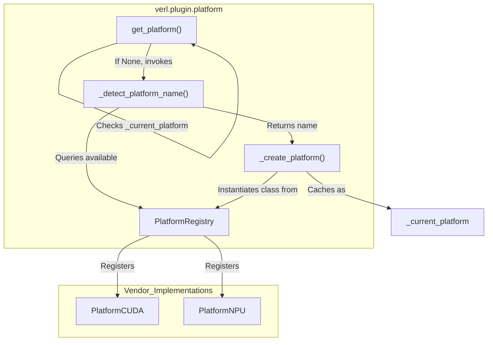
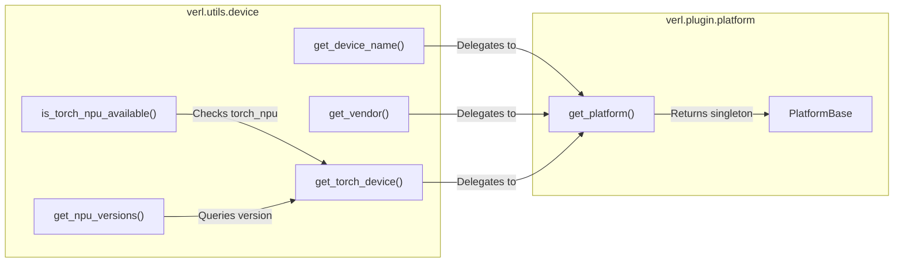

<!-- source: DeepWiki mcp.deepwiki.com · repo volcengine/verl · page 12.4 Platform Plugin System and Multi-Chip Extensibility · fetched 2026-10-21 -->

# Platform Plugin System and Multi-Chip Extensibility

<details>
<summary>Relevant source files</summary>

The following files were used as context for generating this wiki page:

- [.github/CODEOWNERS](.github/CODEOWNERS)
- [docs/hardware/multi_chip_support.rst](docs/hardware/multi_chip_support.rst)
- [examples/README.md](examples/README.md)
- [examples/tpu/grpo/Dockerfile](examples/tpu/grpo/Dockerfile)
- [examples/tpu/grpo/README.md](examples/tpu/grpo/README.md)
- [examples/tpu/grpo/ray-tpu-v6e4-2slice.yaml](examples/tpu/grpo/ray-tpu-v6e4-2slice.yaml)
- [examples/tpu/grpo/run_qwen3_0_6b_torchtitan.sh](examples/tpu/grpo/run_qwen3_0_6b_torchtitan.sh)
- [examples/tpu/grpo/run_qwen3_4b_torchtitan.sh](examples/tpu/grpo/run_qwen3_4b_torchtitan.sh)
- [tests/special_sanity/check_example_naming.py](tests/special_sanity/check_example_naming.py)
- [tests/utils/test_check_ipc_version_support_on_npu.py](tests/utils/test_check_ipc_version_support_on_npu.py)
- [tests/utils/test_shared_memory.py](tests/utils/test_shared_memory.py)
- [tests/utils/veomni/test_special_export_unfused_experts.py](tests/utils/veomni/test_special_export_unfused_experts.py)
- [verl/experimental/separation/engine_workers.py](verl/experimental/separation/engine_workers.py)
- [verl/plugin/platform/platform_base.py](verl/plugin/platform/platform_base.py)
- [verl/plugin/platform/platform_cuda.py](verl/plugin/platform/platform_cuda.py)
- [verl/plugin/platform/platform_manager.py](verl/plugin/platform/platform_manager.py)
- [verl/plugin/platform/platform_npu.py](verl/plugin/platform/platform_npu.py)
- [verl/plugin/platform/platform_rocm.py](verl/plugin/platform/platform_rocm.py)
- [verl/utils/device.py](verl/utils/device.py)

</details>


This page documents the hardware-agnostic platform abstraction layer (`verl.plugin.platform`), covering `PlatformBase`, `PlatformRegistry`, auto-detection mechanisms, the engine registry lookup system, and procedures for extending `verl` to support new hardware accelerators [docs/hardware/multi_chip_support.rst:9-17]() [verl/plugin/platform/platform_base.py:1-25]().

---

## 1. Platform Abstraction Layer Architecture

The `verl` framework decouples core RLHF training and inference logic from hardware-specific implementations via a centralized platform abstraction layer (`verl.plugin.platform`) [docs/hardware/multi_chip_support.rst:9-13](). Instead of directly calling vendor modules like `torch.cuda` or `torch.npu`, the codebase interacts with a unified singleton instance managed by `PlatformRegistry` and retrieved through `get_platform()` [verl/utils/device.py:11-28]().

### PlatformBase and Vendor Implementations

The `PlatformBase` class defines the abstract interface that every hardware backend must implement [verl/plugin/platform/platform_base.py:20-30](). Concrete built-in implementations include `PlatformCUDA` for NVIDIA GPUs and `PlatformNPU` for Huawei Ascend NPUs, while external platforms (such as Intel XPU, Cambricon MLU, MetaX, and Google TPU) integrate via external plugins [docs/hardware/multi_chip_support.rst:21-37]().

| Category | Key Methods / Properties | Purpose | Cited Source |
| :--- | :--- | :--- | :--- |
| **Identity** | `device_name`, `vendor_name` | Identifies the chip type (`cuda`, `npu`) and vendor (`nvidia`, `huawei`). | [verl/plugin/platform/platform_base.py:62-72]() |
| **Device Control** | `device_module`, `set_device`, `synchronize` | Exposes the torch device module (`torch.cuda`, `torch.npu`) and synchronization primitives. | [verl/plugin/platform/platform_base.py:75-116]() |
| **Memory Management** | `empty_cache`, `set_allocator_settings` | Manages memory pools and allocator properties (e.g., expandable segments). | [verl/plugin/platform/platform_base.py:136-144]() |
| **Distributed / Ray** | `communication_backend_name`, `ray_resource_name` | Specifies distributed backends (`nccl`, `hccl`) and Ray resource identifiers (`GPU`, `NPU`). | [verl/plugin/platform/platform_base.py:160-167]() [verl/plugin/platform/platform_cuda.py:127-128]() |

Sources: [verl/plugin/platform/platform_base.py:1-167]() [verl/plugin/platform/platform_cuda.py:26-128]()

### Backward-Compatible Device Utilities

To maintain compatibility with extensive legacy imports across the codebase, `verl.utils.device` exposes standard module-level functions that delegate directly to `get_platform()` [verl/utils/device.py:11-16](). Functions such as `get_device_name()`, `get_torch_device()`, `get_nccl_backend()`, and `auto_set_device()` query the active platform instance at runtime [verl/utils/device.py:87-130](), [verl/utils/device.py:151-167]().

For example, `is_torch_npu_available()` checks for the presence of `torch.npu` and its availability, delegating to the platform abstraction for the actual check [verl/utils/device.py:37-59](). Similarly, `get_npu_versions()` provides detailed NPU hardware and software version information, which is crucial for features like IPC support checks [verl/utils/device.py:195-215]() [tests/utils/test_check_ipc_version_support_on_npu.py:20-21]().

Sources: [verl/utils/device.py:11-16](), [verl/utils/device.py:37-59](), [verl/utils/device.py:87-167](), [verl/utils/device.py:195-215](), [tests/utils/test_check_ipc_version_support_on_npu.py:20-21]()

---

## 2. Platform Auto-Detection and Registry Mechanics

The `PlatformRegistry` manages dynamic registration and lookup of platform classes [docs/hardware/multi_chip_support.rst:48-55]().

### Auto-Detection Lifecycle

When `get_platform()` is invoked for the first time, the system initializes the singleton through the following discovery sequence:
1. **Environment Override**: Checks the `VERL_PLATFORM` environment variable [docs/hardware/multi_chip_support.rst:52-55]().
2. **External Module Loading**: Discovers plugins via `setuptools` entry points (`verl.plugins` group) or the `VERL_USE_EXTERNAL_MODULES` environment variable [docs/hardware/multi_chip_support.rst:110-121]().
3. **Platform Probing**: Iterates through registered platform implementations, calling `is_platform_available(use_smi_check=True)` to inspect system tools like `nvidia-smi` or importable modules [verl/plugin/platform/platform_base.py:85-96](), [docs/hardware/multi_chip_support.rst:52-55]().
4. **Fallback**: Defaults to standard platform priorities (`nvidia`) if no specific accelerator environment is verified [docs/hardware/multi_chip_support.rst:139-144]().

Sources: [verl/plugin/platform/platform_base.py:85-96](), [docs/hardware/multi_chip_support.rst:48-121]()

---

## 3. Code Entity Architecture: Platform Registry and Singleton Initialization

This diagram bridges natural language concepts to concrete code entities within `verl.plugin.platform` and vendor implementations.

Title: "Platform Registry and Singleton Initialization Flow"

Sources: [verl/plugin/platform/platform_base.py:20-30](), [verl/plugin/platform/platform_cuda.py:18-19]()

---

## 4. Engine Plugin System and Two-Dimensional Lookup

Training backends utilize an engine registry system (`EngineRegistry`) combined with the platform layer to resolve hardware-optimized execution engines [docs/hardware/multi_chip_support.rst:14-17]().

### Two-Dimensional Resolution

Engines are resolved using a 2D key comprising `device` and `vendor` [docs/hardware/multi_chip_support.rst:57-63](). The resolution hierarchy evaluates:
1. **Exact Match**: `(device, vendor)` yielding vendor-optimized engines (e.g. `("cuda", "metax")` or `("npu", "huawei")`) [docs/hardware/multi_chip_support.rst:59-60]().
2. **Device Fallback**: `(device, None)` yielding base engine implementations for that device type (e.g. `("cuda", None)` or `("npu", None)`) [docs/hardware/multi_chip_support.rst:61-62]().
3. **CUDA Compatibility Fallback**: For CUDA-compatible devices, fallback to the base CUDA engine [docs/hardware/multi_chip_support.rst:63]().

Environment variables such as `VERL_ENGINE_DEVICE` and `VERL_ENGINE_VENDOR` allow manual overrides of the detected device and vendor names during engine lookup [docs/hardware/multi_chip_support.rst:166-170]().

Sources: [docs/hardware/multi_chip_support.rst:45-170]()

---

## 5. Code Entity Architecture: Utility Delegation

This diagram illustrates how consumer utilities in `verl.utils.device` bridge high-level calls to the underlying platform instance.

Title: "Device Utility Delegation Routing"

Sources: [verl/utils/device.py:37-112](), [verl/utils/device.py:195-215](), [verl/plugin/platform/platform_base.py:20-30]()

---

## 6. Adding Support for New Hardware Accelerators

Adding a new accelerator (e.g., Intel XPU, Cambricon MLU, Google TPU) requires implementing the platform abstraction and registering vendor-specific execution classes [docs/hardware/multi_chip_support.rst:35-44]().

### Step 1: Implement PlatformBase
Create a concrete subclass inheriting from `PlatformBase` and register it using `@PlatformRegistry.register` [docs/hardware/multi_chip_support.rst:125-138]().

```python
@PlatformRegistry.register(platform="my_vendor")
class PlatformMyDevice(PlatformBase):
    @property
    def device_name(self) -> str:
        return "my_device"  # torch device type

    @property
    def vendor_name(self) -> str:
        return "my_vendor"  # used for engine lookup
```

### Step 2: Register Hardware-Specific Engines
Register training engines with the `EngineRegistry` specifying both device and vendor keys [docs/hardware/multi_chip_support.rst:145-165]().

```python
@EngineRegistry.register(
    model_type="language_model",
    backend=["fsdp", "fsdp2"],
    device="my_device",
    vendor="my_vendor",
)
class FSDPMyVendorEngineWithLMHead(FSDPEngineWithLMHead):
    def initialize(self):
        super().initialize()
        # vendor-specific initialization
```

### Step 3: Configure Environment Entrypoints
External plugins can hook into `verl` by defining `setuptools` entry points under the `verl.plugins` group or by setting `VERL_USE_EXTERNAL_MODULES` [docs/hardware/multi_chip_support.rst:110-121]().

Sources: [docs/hardware/multi_chip_support.rst:35-170]()

---

