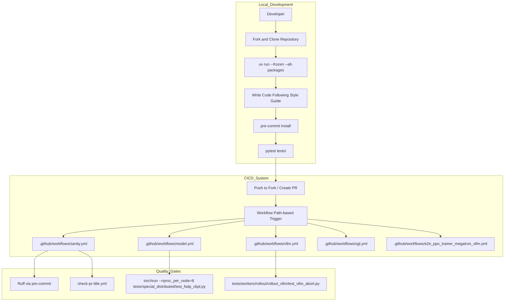
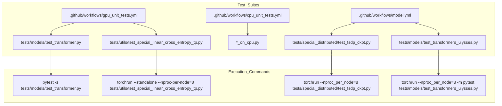

<!-- source: DeepWiki mcp.deepwiki.com · repo volcengine/verl · page 13 Development and Testing · fetched 2026-10-21 -->

# Development and Testing

Relevant source files

The following files were used as context for generating this wiki page:

- [.github/workflows/cpu_unit_tests.yml](.github/workflows/cpu_unit_tests.yml)
- [.github/workflows/e2e_ppo_trainer.yml](.github/workflows/e2e_ppo_trainer.yml)
- [.github/workflows/e2e_ppo_trainer_megatron_sglang.yml](.github/workflows/e2e_ppo_trainer_megatron_sglang.yml)
- [.github/workflows/e2e_ppo_trainer_megatron_sglang_2.yml](.github/workflows/e2e_ppo_trainer_megatron_sglang_2.yml)
- [.github/workflows/e2e_ppo_trainer_megatron_vllm.yml](.github/workflows/e2e_ppo_trainer_megatron_vllm.yml)
- [.github/workflows/e2e_ppo_trainer_megatron_vllm_2.yml](.github/workflows/e2e_ppo_trainer_megatron_vllm_2.yml)
- [.github/workflows/gpu_unit_tests.yml](.github/workflows/gpu_unit_tests.yml)
- [.github/workflows/model.yml](.github/workflows/model.yml)
- [.github/workflows/reward_model_sglang.yml](.github/workflows/reward_model_sglang.yml)
- [.github/workflows/reward_model_vllm.yml](.github/workflows/reward_model_vllm.yml)
- [.github/workflows/sanity.yml](.github/workflows/sanity.yml)
- [.github/workflows/sgl.yml](.github/workflows/sgl.yml)
- [.github/workflows/vllm.yml](.github/workflows/vllm.yml)

This page serves as documentation for contributors to the verl framework, covering CI/CD infrastructure, testing frameworks, package structure, and contribution workflows. As a parent page, it provides high-level overviews and links to detailed child pages.

For testing details, see [Testing Framework and Organization](#13.2). For CI/CD workflows, see [CI/CD Infrastructure and Workflows](#13.1). For package and dependency management, see [Package Structure, Scripts, and Dependencies](#13.3). For contribution workflows, see [Contributing Guidelines](#13.4).

Title: Development and CI/CD Workflow Architecture

Sources: [.github/workflows/vllm.yml:1-30](), [.github/workflows/model.yml:1-30](), [.github/workflows/e2e_ppo_trainer_megatron_vllm.yml:1-30](), [.github/workflows/sgl.yml:1-30](), [.github/workflows/sanity.yml:1-30]()

## Testing Organization and Structure

The verl test suite is organized into namespace-aligned directories under `tests/` and special-purpose test categories targeting multi-GPU, CPU-only, NPU, and end-to-end scenarios. For detailed execution guides, environment matrices, and directory breakdowns, see [Testing Framework and Organization](#13.2).

Tests map directly to codebase sub-namespaces and specialized runner environments:
- `tests/trainer`: Tests for functionality related to `verl/trainer` [.github/workflows/vllm.yml:4-4]()
- `tests/models`: Tests for functionality related to `verl/models` [.github/workflows/vllm.yml:5-5]()
- `tests/workers/rollout`: Tests for rollout backends like vLLM and SGLang, including specific tests for vLLM abort functionality [.github/workflows/vllm.yml:62-62](), [.github/workflows/vllm.yml:152-152]()
- `tests/experimental`: Tests for experimental modules such as the Agent Loop [.github/workflows/vllm.yml:143-143]()
- `tests/utils`: Tests for utility functions, including vLLM weight name normalization and special linear cross entropy TP tests [.github/workflows/vllm.yml:134-136](), [.github/workflows/gpu_unit_tests.yml:140-142]()
- `tests/special_distributed`: Unit tests that must run with multiple GPUs, including FSDP checkpoint and TensorDict tests [.github/workflows/model.yml:9-9](), [.github/workflows/model.yml:50-51]()
- `tests/special_e2e`: End-to-end tests with training/generation scripts, such as PPO trainer with Megatron and vLLM/SGLang [.github/workflows/e2e_ppo_trainer_megatron_vllm.yml:10-10]()
- `tests/special_npu`: Tests specifically for NPUs [.github/workflows/vllm.yml:11-11]()
- `tests/special_sanity`: A suite of quick sanity tests, including documentation validation [.github/workflows/sanity.yml:12-12](), [.github/workflows/sanity.yml:99-100]()
- `tests/special_standalone`: A set of tests designed to run in dedicated environments [.github/workflows/vllm.yml:13-13]()

Tests ending with `_on_cpu.py` are explicitly executed on CPU resources [.github/workflows/vllm.yml:16-17]().

Title: Test Execution and Code Entity Mapping

Sources: [.github/workflows/vllm.yml:3-17](), [.github/workflows/vllm.yml:62-62](), [.github/workflows/vllm.yml:134-136](), [.github/workflows/vllm.yml:143-143](), [.github/workflows/model.yml:9-9](), [.github/workflows/model.yml:50-51](), [.github/workflows/model.yml:115-124](), [.github/workflows/e2e_ppo_trainer_megatron_vllm.yml:10-10](), [.github/workflows/sanity.yml:12-12](), [.github/workflows/sanity.yml:99-100](), [.github/workflows/gpu_unit_tests.yml:115-145](), [.github/workflows/cpu_unit_tests.yml:115-118]()

## CI/CD Infrastructure and Workflows

The CI/CD pipeline runs on GitHub Actions combined with dynamic GPU runner provisioning (`volcengine/vemlp-github-runner@v1`) for elasticity across NVIDIA GPU fleets (`L20x8`) [.github/workflows/vllm.yml:83-96](), [.github/workflows/gpu_unit_tests.yml:88-102](). The `setup` job in workflows creates these dynamic runners, and cleanup jobs destroy them after completion [.github/workflows/gpu_unit_tests.yml:147-153](). For deep dives into dynamic runner provisioning, FaaS endpoints, and workflow definitions, see [CI/CD Infrastructure and Workflows](#13.1).

| Workflow File | Purpose | Primary Triggers |
|---------------|---------|------------------|
| `model.yml` | Multi-GPU unit tests for models, including FSDP, Ulysses, and `rmpad` tests. | `verl/**/*.py`, `tests/models/**`, `tests/special_distributed/test_fsdp_ckpt.py` [.github/workflows/model.yml:33-51]() |
| `vllm.yml` | vLLM backend integration tests, including CPU unit tests for vLLM and agent loop tests. | `tests/workers/rollout`, `verl/trainer/main_ppo.py` [.github/workflows/vllm.yml:32-66]() |
| `sgl.yml` | SGLang backend integration tests, including agent loop tests and checkpoint engine tests. | `tests/rollout/*sglang*`, `tests/experimental/agent_loop` [.github/workflows/sgl.yml:32-76]() |
| `gpu_unit_tests.yml` | Comprehensive GPU unit test suite, excluding CPU/NPU and special distributed tests. | `tests/**test_*.py` [.github/workflows/gpu_unit_tests.yml:32-72]() |
| `sanity.yml` | Quick sanity tests and documentation validation checks. | `tests/special_sanity/**` [.github/workflows/sanity.yml:33-54]() |
| `cpu_unit_tests.yml` | Pytest execution on scripts matching `*_on_cpu.py`. | `tests/**` (CPU filtered) [.github/workflows/cpu_unit_tests.yml:32-53]() |
| `reward_model_vllm.yml` | vLLM generative/discriminative reward model and agent loop tests. | `tests/experimental/reward_loop/**` [.github/workflows/reward_model_vllm.yml:33-56]() |
| `reward_model_sglang.yml` | SGLang generative/discriminative reward model and agent loop tests. | `tests/experimental/reward_loop/**` (similar to `reward_model_vllm.yml`) |
| `e2e_ppo_trainer_megatron_vllm.yml` | End-to-end PPO training tests using Megatron and vLLM, including full training save/load and various parallelism configurations. | `tests/special_e2e/run_ppo_trainer_megatron.sh`, `verl/trainer/main_ppo.py` [.github/workflows/e2e_ppo_trainer_megatron_vllm.yml:34-89]() |
| `e2e_ppo_trainer_megatron_vllm_2.yml` | Additional end-to-end PPO training tests with Megatron and vLLM, focusing on MoE expert parallelism and fused kernels. | `tests/special_e2e/run_ppo_trainer_megatron.sh`, `verl/trainer/main_ppo.py` [.github/workflows/e2e_ppo_trainer_megatron_vllm_2.yml:34-89]() |
| `e2e_ppo_trainer_megatron_sglang.yml` | End-to-end PPO training tests using Megatron and SGLang. | `tests/special_e2e/run_ppo_trainer_megatron.sh`, `verl/trainer/main_ppo.py` [.github/workflows/e2e_ppo_trainer_megatron_sglang.yml:34-87]() |
| `e2e_ppo_trainer_megatron_sglang_2.yml` | Additional end-to-end PPO training tests with Megatron and SGLang, including FSDP with SGLang. | `tests/special_e2e/run_ppo_trainer_megatron.sh`, `verl/trainer/main_ppo.py` [.github/workflows/e2e_ppo_trainer_megatron_sglang_2.yml:34-87]() |

Sources: [.github/workflows/model.yml:33-51](), [.github/workflows/vllm.yml:32-66](), [.github/workflows/sgl.yml:32-76](), [.github/workflows/gpu_unit_tests.yml:32-72](), [.github/workflows/sanity.yml:33-54](), [.github/workflows/cpu_unit_tests.yml:32-53](), [.github/workflows/reward_model_vllm.yml:33-56](), [.github/workflows/e2e_ppo_trainer_megatron_vllm.yml:34-89](), [.github/workflows/e2e_ppo_trainer_megatron_vllm_2.yml:34-89](), [.github/workflows/e2e_ppo_trainer_megatron_sglang.yml:34-87](), [.github/workflows/e2e_ppo_trainer_megatron_sglang_2.yml:34-87]()

## Package Structure and Dependencies

Package management relies on `uv` for reproducible, frozen virtual environments (`uv.lock`) and modular dependency profiles (extras like `vllm`, `megatron`, `sglang`, `math`, `ci`) [.github/workflows/vllm.yml:110-112](), [.github/workflows/model.yml:96-99](). The `UV_RUN` environment variable executes commands within this `uv` managed environment, ensuring consistent dependencies across jobs [.github/workflows/vllm.yml:112-112](), [.github/workflows/model.yml:99-99](). For installation prerequisites, environment setup scripts, and utility scripts (`diagnose.py`, `model_merger.py`, `rollout_viewer.py`), see [Package Structure, Scripts, and Dependencies](#13.3).

Sources: [.github/workflows/vllm.yml:110-112](), [.github/workflows/model.yml:96-99]()

## Contributing Guidelines

Contributions must adhere to code style guidelines enforced via `pre-commit` hooks (such as Ruff and static analysis), proper PR title formats, and license checks. For complete contribution workflows, documentation building instructions, and community standards, see [Contributing Guidelines](#13.4).

Sources: [.github/workflows/sanity.yml:93-95]()

---

