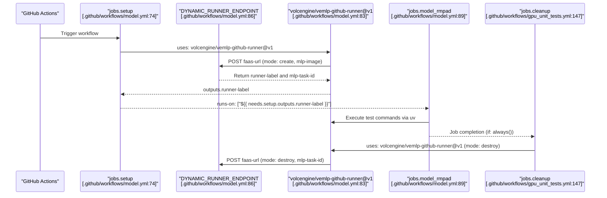
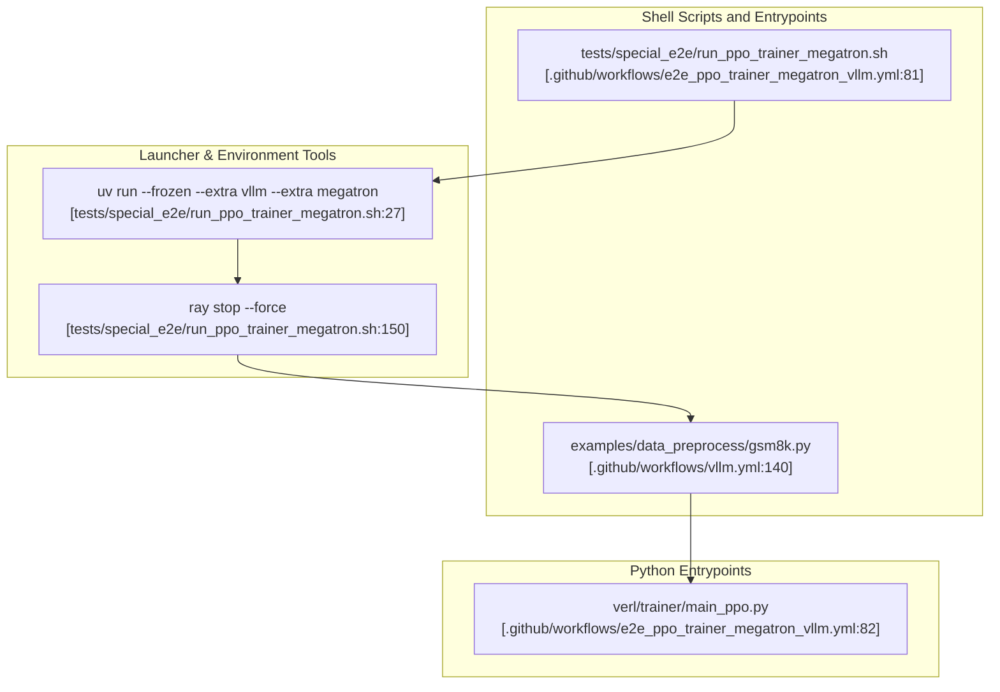

<!-- source: DeepWiki mcp.deepwiki.com · repo volcengine/verl · page 13.1 CI/CD Infrastructure and Workflows · fetched 2026-10-21 -->

# CI/CD Infrastructure and Workflows

Relevant source files

The following files were used as context for generating this wiki page:

- [.github/workflows/cpu_unit_tests.yml](.github/workflows/cpu_unit_tests.yml)
- [.github/workflows/e2e_ascend.yml](.github/workflows/e2e_ascend.yml)
- [.github/workflows/e2e_ppo_trainer.yml](.github/workflows/e2e_ppo_trainer.yml)
- [.github/workflows/e2e_ppo_trainer_megatron_sglang.yml](.github/workflows/e2e_ppo_trainer_megatron_sglang.yml)
- [.github/workflows/e2e_ppo_trainer_megatron_sglang_2.yml](.github/workflows/e2e_ppo_trainer_megatron_sglang_2.yml)
- [.github/workflows/e2e_ppo_trainer_megatron_sglang_2_ascend.yml](.github/workflows/e2e_ppo_trainer_megatron_sglang_2_ascend.yml)
- [.github/workflows/e2e_ppo_trainer_megatron_sglang_ascend.yml](.github/workflows/e2e_ppo_trainer_megatron_sglang_ascend.yml)
- [.github/workflows/e2e_ppo_trainer_megatron_vllm.yml](.github/workflows/e2e_ppo_trainer_megatron_vllm.yml)
- [.github/workflows/e2e_ppo_trainer_megatron_vllm_2.yml](.github/workflows/e2e_ppo_trainer_megatron_vllm_2.yml)
- [.github/workflows/e2e_ppo_trainer_megatron_vllm_2_ascend.yml](.github/workflows/e2e_ppo_trainer_megatron_vllm_2_ascend.yml)
- [.github/workflows/e2e_ppo_trainer_veomni_vllm_ascend.yml](.github/workflows/e2e_ppo_trainer_veomni_vllm_ascend.yml)
- [.github/workflows/e2e_sft_llm_ascend.yml](.github/workflows/e2e_sft_llm_ascend.yml)
- [.github/workflows/e2e_v1_separate_async_ascend.yml](.github/workflows/e2e_v1_separate_async_ascend.yml)
- [.github/workflows/gpu_unit_tests.yml](.github/workflows/gpu_unit_tests.yml)
- [.github/workflows/model.yml](.github/workflows/model.yml)
- [.github/workflows/model_ascend.yml](.github/workflows/model_ascend.yml)
- [.github/workflows/nightly_ascend.yml](.github/workflows/nightly_ascend.yml)
- [.github/workflows/npu_unit_tests.yml](.github/workflows/npu_unit_tests.yml)
- [.github/workflows/reward_model_sglang.yml](.github/workflows/reward_model_sglang.yml)
- [.github/workflows/reward_model_sglang_ascend.yml](.github/workflows/reward_model_sglang_ascend.yml)
- [.github/workflows/reward_model_vllm.yml](.github/workflows/reward_model_vllm.yml)
- [.github/workflows/reward_model_vllm_ascend.yml](.github/workflows/reward_model_vllm_ascend.yml)
- [.github/workflows/sanity.yml](.github/workflows/sanity.yml)
- [.github/workflows/sgl.yml](.github/workflows/sgl.yml)
- [.github/workflows/sgl_ascend.yml](.github/workflows/sgl_ascend.yml)
- [.github/workflows/vllm.yml](.github/workflows/vllm.yml)
- [.github/workflows/vllm_ascend.yml](.github/workflows/vllm_ascend.yml)
- [requirements-npu.txt](requirements-npu.txt)

This document describes verl's GitHub Actions-based continuous integration and continuous delivery (CI/CD) infrastructure. It covers the organization of workflow files, dynamic runner provisioning via `volcengine/vemlp-github-runner@v1` [.github/workflows/model.yml:83](), test triggering logic across multi-accelerator fleets (NVIDIA GPUs and Huawei Ascend NPUs), and build pipelines. For information about the test framework and test organization, see [13.2 Testing Framework and Organization](). For details on package structure and dependencies, see [13.3 Package Structure and Dependencies]().

## Overview

verl uses GitHub Actions to automate testing across multiple training backends (FSDP, Megatron), inference engines (vLLM, SGLang), and hardware platforms (NVIDIA GPUs, Ascend NPUs). The CI/CD system is designed to:

- Run fast sanity checks on every pull request (PR).
- Execute comprehensive multi-GPU unit tests on specialized hardware.
- Validate end-to-end (E2E) training scenarios with multiple backend combinations (e.g., Megatron + vLLM, Megatron + SGLang).
- Maintain code quality through linting via `pre-commit`.
- Dynamically provision GPU runners for cost efficiency.
- Support specialized hardware like Ascend NPUs with dedicated workflow logic.

All workflow configurations are located in `.github/workflows/`. The workflows fall into categories: always-on CPU checks, multi-GPU unit/integration tests, and end-to-end training tests.

Sources: [.github/workflows/model.yml:1-30](), [.github/workflows/vllm.yml:1-30](), [.github/workflows/gpu_unit_tests.yml:1-30]()

## Workflow Organization

The CI/CD system follows a tiered structure to balance coverage and resource usage.

### Workflow Categories and Resource Mapping

```mermaid
graph TB
    subgraph "CPU_Fast" ["Always Triggered (CPU, Fast)"]
        Sanity["check-pr-title.yml<br/>pre-commit.yml<br/>doc.yml<br/>secrets_scan.yml"]
        CPUUnit["cpu_unit_tests.yml<br/>pytest *_on_cpu.py"]
    end

    subgraph "MultiGPU" ["Multi-GPU Tests (Dynamic NVIDIA Runners)"]
        Model["model.yml<br/>FSDP, Ulysses, Megatron engine<br/>L20x8"]
        VLLM["vllm.yml<br/>vLLM rollout, checkpoint engine<br/>L20x8"]
        SGLang["sgl.yml<br/>SGLang rollout, checkpoint engine<br/>L20x8"]
        GPU["gpu_unit_tests.yml<br/>Broad GPU unit tests<br/>L20x8"]
        RewardVLLM["reward_model_vllm.yml<br/>GenRM/DisRM Agent Loop<br/>L20x8"]
        RewardSGL["reward_model_sglang.yml<br/>SGLang RM tests<br/>L20x8"]
    end

    subgraph "E2E" ["End-to-End Tests (Complex Scenarios)"]
        E2EMegatron["e2e_ppo_trainer_megatron_vllm.yml<br/>Megatron + vLLM (DeepSeek/LoRA)"]
        E2EMoe["e2e_ppo_trainer_megatron_vllm_2.yml<br/>Qwen MoE Expert Parallel"]
        E2ESGL["e2e_ppo_trainer_megatron_sglang.yml<br/>Megatron + SGLang E2E"]
        E2ESGL2["e2e_ppo_trainer_megatron_sglang_2.yml<br/>SGLang MoE E2E"]
        E2EPPO["e2e_ppo_trainer.yml<br/>Pre-commit for PPO"]
        E2ESFTLLM["e2e_sft_llm.yml<br/>SFT LLM E2E"]
        E2ESFTVLM["e2e_sft_vlm.yml<br/>SFT VLM E2E"]
        E2EVeOmni["e2e_ppo_trainer_veomni_vllm.yml<br/>VeOmni + vLLM E2E"]
    end

    subgraph "NPU" ["Ascend NPU Tests (Dedicated Runners)"]
        NPUUnit["npu_unit_tests.yml<br/>NPU-specific unit tests"]
        E2EAscend["e2e_ascend.yml<br/>LLM/VLM RL training on Ascend"]
        NightlyAscend["nightly_ascend.yml<br/>Nightly Ascend E2E tests"]
        ModelAscend["model_ascend.yml<br/>Ascend model tests"]
        VLLMAscend["vllm_ascend.yml<br/>vLLM on Ascend"]
        SGLAscend["sgl_ascend.yml<br/>SGLang on Ascend"]
        E2EMegatronAscend["e2e_ppo_trainer_megatron_vllm_2_ascend.yml<br/>Megatron + vLLM on Ascend"]
        E2ESGLAscend["e2e_ppo_trainer_megatron_sglang_ascend.yml<br/>Megatron + SGLang on Ascend"]
        E2ESGL2Ascend["e2e_ppo_trainer_megatron_sglang_2_ascend.yml<br/>SGLang MoE on Ascend"]
        E2ESFTLLMAscend["e2e_sft_llm_ascend.yml<br/>SFT LLM on Ascend"]
        E2EVeOmniAscend["e2e_ppo_trainer_veomni_vllm_ascend.yml<br/>VeOmni + vLLM on Ascend"]
        RewardVLLMAscend["reward_model_vllm_ascend.yml<br/>Reward Model vLLM on Ascend"]
        RewardSGLAscend["reward_model_sglang_ascend.yml<br/>Reward Model SGLang on Ascend"]
    end

    subgraph "DockerBuild" ["Docker Image Builds"]
        DockerA2["docker-build-ascend-a2.yml<br/>Ascend A2 Docker images"]
        DockerA3["docker-build-ascend-a3.yml<br/>Ascend A3 Docker images"]
        DockerSGLA2["docker-build-ascend-sglang-a2.yml<br/>Ascend A2 SGLang Docker images"]
        DockerSGLA3["docker-build-ascend-sglang-a3.yml<br/>Ascend A3 SGLang Docker images"]
    end

    subgraph "DynProv" ["volcengine/vemlp-github-runner@v1"]
        SetupJob["setup job<br/>mode: create"]
        CleanupJob["cleanup job<br/>mode: destroy (if: always())"]
    end

    SetupJob -->|"runner-label"| Model
    SetupJob -->|"runner-label"| VLLM
    SetupJob -->|"runner-label"| SGLang
    SetupJob -->|"runner-label"| GPU
    SetupJob -->|"runner-label"| E2EMegatron
    SetupJob -->|"runner-label"| E2EMoe
    SetupJob -->|"runner-label"| E2ESGL
    SetupJob -->|"runner-label"| E2ESGL2
    SetupJob -->|"runner-label"| E2ESFTLLM
    SetupJob -->|"runner-label"| E2ESFTVLM
    SetupJob -->|"runner-label"| E2EVeOmni
    SetupJob -->|"runner-label"| RewardVLLM
    SetupJob -->|"runner-label"| RewardSGL

    Model --> CleanupJob
    VLLM --> CleanupJob
    SGLang --> CleanupJob
    GPU --> CleanupJob
    E2EMegatron --> CleanupJob
    E2EMoe --> CleanupJob
    E2ESGL --> CleanupJob
    E2ESGL2 --> CleanupJob
    E2ESFTLLM --> CleanupJob
    E2ESFTVLM --> CleanupJob
    E2EVeOmni --> CleanupJob
    RewardVLLM --> CleanupJob
    RewardSGL --> CleanupJob
```

Sources: [.github/workflows/model.yml:19-30](), [.github/workflows/vllm.yml:19-30](), [.github/workflows/gpu_unit_tests.yml:1-30](), [.github/workflows/e2e_ppo_trainer_megatron_vllm.yml:1-30](), [.github/workflows/e2e_ascend.yml:1-30](), [.github/workflows/nightly_ascend.yml:1-30](), [.github/workflows/docker-build-ascend-a2.yml:1-30](), [.github/workflows/docker-build-ascend-a3.yml:1-30]()

## Workflow Categories and Purpose

| Workflow File | Purpose | Hardware | Timeout | Docker Image |
| :--- | :--- | :--- | :--- | :--- |
| `model.yml` | FSDP, Ulysses SP, Megatron engine, rmpad tests | L20x8 | 20 min | `uv.cu130` [.github/workflows/model.yml:69-90]() |
| `vllm.yml` | vLLM Rollout, Agent Loop, Checkpoint Engine (NCCL) | L20x8 | 35 min | `uv.cu130` [.github/workflows/vllm.yml:82-100]() |
| `sgl.yml` | SGLang Rollout, ServerAdapter, Agent Loop | L20x8 | 35 min | `uv.cu130` [.github/workflows/sgl.yml:87-99]() |
| `gpu_unit_tests.yml` | Megatron KL Loss TP, LinearCrossEntropyTP | L20x8 | 60 min | `uv.cu130` [.github/workflows/gpu_unit_tests.yml:83-100]() |
| `reward_model_vllm.yml` | GenRM/DisRM Agent Loop, V1 Trainer integration | L20x8 | 30 min | `uv.cu130` [.github/workflows/reward_model_vllm.yml:63-85]() |
| `e2e_ppo_trainer_megatron_vllm.yml` | Megatron + vLLM E2E (DeepSeek, LoRA) | L20x8 | 60 min | `uv.cu130` [.github/workflows/e2e_ppo_trainer_megatron_vllm.yml:99-116]() |
| `e2e_ppo_trainer_megatron_vllm_2.yml` | Qwen MoE Expert Parallel, Fused Kernels | L20x8 | 60 min | `uv.cu130` [.github/workflows/e2e_ppo_trainer_megatron_vllm_2.yml:99-116]() |
| `e2e_ppo_trainer.yml` | Pre-commit checks for PPO trainer related files | ubuntu-latest | N/A | N/A [.github/workflows/e2e_ppo_trainer.yml:55-61]() |
| `e2e_ascend.yml` | E2E RL training for LLM/VLM models on Ascend NPUs | linux-aarch64-a3-800i-8 | 120 min | `verl:latest-vllm-a3-ubuntu` [.github/workflows/e2e_ascend.yml:67-76](), [.github/workflows/e2e_ascend.yml:139-148]() |
| `nightly_ascend.yml` | Nightly E2E tests for PPO/GRPO on Ascend NPUs | linux-aarch64-a3-800i-8 | 180 min | `verl:latest-vllm-a3-ubuntu` [.github/workflows/nightly_ascend.yml:53-61]() |
| `docker-build-ascend-a2.yml` | Builds Ascend A2 Docker images | ubuntu-latest, ubuntu-22.04-arm | N/A | N/A [.github/workflows/docker-build-ascend-a2.yml:29-42]() |
| `docker-build-ascend-a3.yml` | Builds Ascend A3 Docker images | ubuntu-latest, ubuntu-22.04-arm | N/A | N/A [.github/workflows/docker-build-ascend-a3.yml:29-42]() |
| `npu_unit_tests.yml` | Unit tests specifically for Ascend NPU functionality | linux-aarch64-a3-800i-8 | 60 min | `verl:latest-vllm-a3-ubuntu` [.github/workflows/npu_unit_tests.yml:78-83]() |
| `e2e_ppo_trainer_megatron_sglang_ascend.yml` | Megatron + SGLang E2E on Ascend NPUs | linux-aarch64-a3-800i-8 | 90 min | `verl:latest-sglang-a3-ubuntu` [.github/workflows/e2e_ppo_trainer_megatron_sglang_ascend.yml:96-101]() |

Sources: [.github/workflows/model.yml:69-90](), [.github/workflows/vllm.yml:82-100](), [.github/workflows/sgl.yml:87-99](), [.github/workflows/gpu_unit_tests.yml:83-100](), [.github/workflows/reward_model_vllm.yml:63-85](), [.github/workflows/e2e_ppo_trainer_megatron_vllm.yml:99-116](), [.github/workflows/e2e_ppo_trainer.yml:55-61](), [.github/workflows/e2e_ascend.yml:67-76](), [.github/workflows/e2e_ascend.yml:139-148](), [.github/workflows/nightly_ascend.yml:53-61](), [.github/workflows/docker-build-ascend-a2.yml:29-42](), [.github/workflows/docker-build-ascend-a3.yml:29-42](), [.github/workflows/npu_unit_tests.yml:78-83](), [.github/workflows/e2e_ppo_trainer_megatron_sglang_ascend.yml:96-101]()

## Dynamic Runner Provisioning System

For NVIDIA GPU workloads, verl uses a dynamic provisioning system to optimize resource usage on Volcengine MLP via `volcengine/vemlp-github-runner@v1` [.github/workflows/model.yml:83]().

Sources: [.github/workflows/model.yml:73-88](), [.github/workflows/vllm.yml:87-101](), [.github/workflows/gpu_unit_tests.yml:88-102](), [.github/workflows/gpu_unit_tests.yml:147-153]()

## Path Filtering and Trigger Logic

Workflows use path filtering to minimize CI overhead by only running relevant tests for a given change.

### model.yml Path Filter
Triggers when changes affect core Python logic or specific model/distributed tests:
- `verl/**/*.py` [.github/workflows/model.yml:47]()
- `tests/models/**` [.github/workflows/model.yml:52]()
- `tests/special_distributed/test_fsdp_ckpt.py` [.github/workflows/model.yml:50]()

### vllm.yml Path Filter
Triggers on general Python changes but excludes Megatron, SGLang, and FSDP specific files to avoid redundant heavy runs:
- `!verl/workers/**/*dp_*.py` [.github/workflows/vllm.yml:53]()
- `!verl/workers/**/megatron_*.py` [.github/workflows/vllm.yml:55]()
- `!**/*sglang*` [.github/workflows/vllm.yml:57]()

### e2e_ppo_trainer_megatron_vllm.yml Path Filter
Triggers on changes to core Python files, data preprocessing examples, and specific E2E test scripts for Megatron + vLLM. It explicitly excludes FSDP-related files:
- `**/*.py` [.github/workflows/e2e_ppo_trainer_megatron_vllm.yml:44]()
- `!verl/workers/**/*dp_*.py` [.github/workflows/e2e_ppo_trainer_megatron_vllm.yml:48]()
- `tests/special_e2e/run_ppo_trainer_megatron.sh` [.github/workflows/e2e_ppo_trainer_megatron_vllm.yml:81]()

### e2e_ascend.yml Path Filter
Triggers on changes to core Python files, data preprocessing examples, and specific NPU test scripts:
- `verl/**` [.github/workflows/e2e_ascend.yml:41]()
- `examples/data_preprocess/**` [.github/workflows/e2e_ascend.yml:45]()
- `tests/special_npu/**` [.github/workflows/e2e_ascend.yml:49]()

### npu_unit_tests.yml Path Filter
Triggers on changes to any Python file, but specifically includes workflow configuration and test paths while ignoring CPU-specific tests and examples.

Sources: [.github/workflows/model.yml:35-54](), [.github/workflows/vllm.yml:34-67](), [.github/workflows/e2e_ppo_trainer_megatron_vllm.yml:39-89](), [.github/workflows/e2e_ascend.yml:38-57]()

## Integration and Unit Test Details

### Model and Engine Tests (`model.yml`)
- **model_rmpad**: Validates transformer models with remove-padding and FlashAttention [.github/workflows/model.yml:113-118]().
- **model_rmpad_fsdp2_unstable**: Dedicated job for FSDP2 rmpad model tests to isolate instability [.github/workflows/model.yml:136-154]().
- **model_engine**: Runs Megatron-Core engine tests and validates model configurations [.github/workflows/model.yml:155-176]().

### vLLM Integration (`vllm.yml`)
- **Agent Loop**: Tests vLLM rollout async with the experimental `AgentLoopManager` using `tests/experimental/agent_loop` [.github/workflows/vllm.yml:141-143]().
- **Determinism**: Validates vLLM generation determinism across same and cross-instances [.github/workflows/vllm.yml:153-157]().
- **CPU Unit Tests**: Runs specific vLLM logic tests on CPU (e.g., CLI args, placeholder tokens) [.github/workflows/vllm.yml:129-136]().

### SGLang Integration (`sgl.yml`)
- **Checkpoint Engine**: Validates `ServerAdapter` integration with the `CheckpointEngine` (NCCL) for weight synchronization [.github/workflows/sgl.yml:148-165]().
- **Continuous Token**: Tests SGLang agent loop with `ENABLE_CONTINUOUS_TOKEN=1` [.github/workflows/sgl.yml:141-146]().

### Ascend NPU Tests (`e2e_ascend.yml`, `nightly_ascend.yml`, `npu_unit_tests.yml`)
- **LLM RL Training**: Runs GSM8K E2E training tests with PPO and GRPO on Ascend NPUs using FSDP and MindSpeed backends [.github/workflows/e2e_ascend.yml:114-136]().
- **VLM RL Training**: Executes E2E RL training scenarios for VLM models on Ascend NPUs, including specific image sizes and shm-size configurations [.github/workflows/e2e_ascend.yml:138-146]().
- **Nightly Checks**: `nightly_ascend.yml` performs scheduled runs for PPO and GRPO on Ascend, including baseline comparisons using `check_npu.py` and `ASCEND_RECIPE_BASELINE_URL` [.github/workflows/nightly_ascend.yml:94-99](), [.github/workflows/nightly_ascend.yml:143-148]().
- **NPU Unit Tests**: `npu_unit_tests.yml` runs a comprehensive suite of unit tests specifically tailored for the Ascend NPU environment, excluding GPU-specific, CPU-specific, and E2E tests. This includes profiling unit tests and checkpoint engine correctness tests on NPU [.github/workflows/npu_unit_tests.yml:121-124]().

Sources: [.github/workflows/model.yml:113-176](), [.github/workflows/vllm.yml:129-157](), [.github/workflows/sgl.yml:141-165](), [.github/workflows/e2e_ascend.yml:114-136](), [.github/workflows/e2e_ascend.yml:138-146](), [.github/workflows/nightly_ascend.yml:94-99](), [.github/workflows/nightly_ascend.yml:143-148](), [.github/workflows/npu_unit_tests.yml:121-124]()

## Build and Environment Management

Workflows consistently follow a standard initialization pattern powered by `uv`:
1. **Checkout**: Uses `actions/checkout@v4` with full fetch depth for proper versioning [.github/workflows/model.yml:101-103]().
2. **UV Execution**: Most commands run through `uv run --frozen --all-packages` with specific extras (e.g., `--extra vllm --extra megatron`) to ensure dependency consistency from the `uv.lock` file [.github/workflows/model.yml:99](), [.github/workflows/vllm.yml:112](). For NPU workflows, `uv pip install` is used directly with `requirements-npu.txt` for specific dependencies like `TransferQueue` [.github/workflows/e2e_ascend.yml:106-107](). The `VERL_USE_UV` environment variable can be set to `0` to use the system Python instead of `uv run`, which is common for NPU images that ship their own `torch-npu` stack [.github/workflows/e2e_ppo_trainer_megatron_sglang_ascend.yml:88-91](), [.github/workflows/npu_unit_tests.yml:87]().
3. **Data Preprocessing**: Prepares standard datasets (GSM8K, Geo3K) using preprocessing scripts such as `examples/data_preprocess/gsm8k.py` [.github/workflows/vllm.yml:137-140](), [.github/workflows/e2e_ascend.yml:111-113]().
4. **Environment Cleanup**: `ray stop --force` is called before each test step to ensure no orphaned Ray processes interfere with execution [.github/workflows/vllm.yml:139](), [.github/workflows/sgl.yml:136]().

Sources: [.github/workflows/model.yml:99-112](), [.github/workflows/vllm.yml:112-142](), [.github/workflows/sgl.yml:120-137](), [.github/workflows/gpu_unit_tests.yml:105-116](), [.github/workflows/e2e_ascend.yml:106-113](), [.github/workflows/e2e_ppo_trainer_megatron_sglang_ascend.yml:88-91](), [tests/special_e2e/run_ppo_trainer_megatron.sh:1-182]()

---

