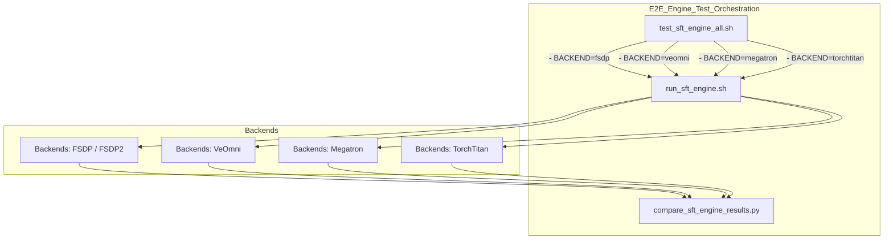
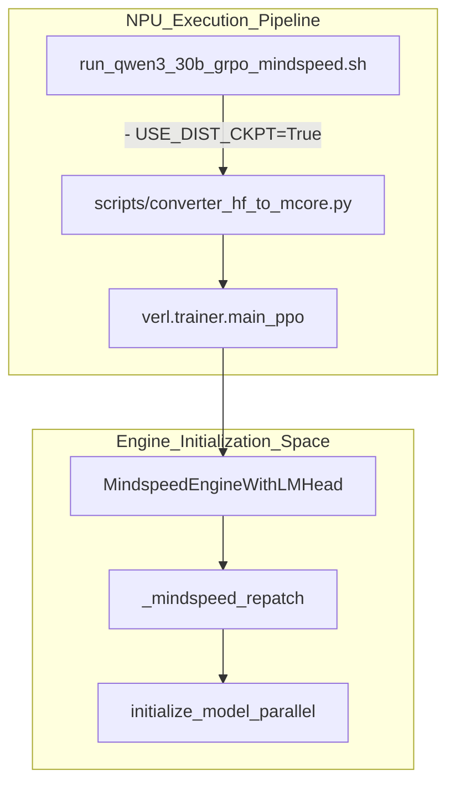

<!-- source: DeepWiki mcp.deepwiki.com · repo volcengine/verl · page 13.2 Testing Framework and Organization · fetched 2026-10-21 -->

# Testing Framework and Organization

<details>
<summary>Relevant source files</summary>

The following files were used as context for generating this wiki page:

- [.github/workflows/README.md](.github/workflows/README.md)
- [.github/workflows/e2e_ppo_trainer_veomni_vllm.yml](.github/workflows/e2e_ppo_trainer_veomni_vllm.yml)
- [.github/workflows/e2e_sft_llm.yml](.github/workflows/e2e_sft_llm.yml)
- [.github/workflows/e2e_sft_vlm.yml](.github/workflows/e2e_sft_vlm.yml)
- [docs/workers/engine_workers.rst](docs/workers/engine_workers.rst)
- [tests/special_e2e/ppo_trainer/run_function_reward.sh](tests/special_e2e/ppo_trainer/run_function_reward.sh)
- [tests/special_e2e/run_ppo_trainer_veomni.sh](tests/special_e2e/run_ppo_trainer_veomni.sh)
- [tests/special_e2e/run_v1_separate_async_ascend.sh](tests/special_e2e/run_v1_separate_async_ascend.sh)
- [tests/special_e2e/sft/run_sft_engine.sh](tests/special_e2e/sft/run_sft_engine.sh)
- [tests/special_e2e/sft/test_sft_engine_all.sh](tests/special_e2e/sft/test_sft_engine_all.sh)
- [tests/special_npu/nightly_ci_ascend/run_dapo_moonlight-16b_megatron_npu.sh](tests/special_npu/nightly_ci_ascend/run_dapo_moonlight-16b_megatron_npu.sh)
- [tests/special_npu/nightly_ci_ascend/run_grpo_qwen3_30b_megatron_sglang_npu.sh](tests/special_npu/nightly_ci_ascend/run_grpo_qwen3_30b_megatron_sglang_npu.sh)
- [tests/special_npu/nightly_ci_ascend/run_grpo_qwen3_5_35b_megatron_npu.sh](tests/special_npu/nightly_ci_ascend/run_grpo_qwen3_5_35b_megatron_npu.sh)
- [tests/special_npu/nightly_ci_ascend/run_gspo_qwen3_30b_megatron_npu.sh](tests/special_npu/nightly_ci_ascend/run_gspo_qwen3_30b_megatron_npu.sh)
- [tests/special_npu/nightly_ci_ascend/run_gspo_qwen3_8b_fsdp2_npu.sh](tests/special_npu/nightly_ci_ascend/run_gspo_qwen3_8b_fsdp2_npu.sh)
- [tests/special_npu/nightly_ci_ascend/run_ppo_qwen3-8b_fsdp_npu.sh](tests/special_npu/nightly_ci_ascend/run_ppo_qwen3-8b_fsdp_npu.sh)
- [tests/special_npu/quick_start/run_qwen3_0_6b_fsdp2_vllm_ascend.sh](tests/special_npu/quick_start/run_qwen3_0_6b_fsdp2_vllm_ascend.sh)
- [tests/special_npu/quick_start/run_qwen3_0_6b_megatron_vllm_ascend.sh](tests/special_npu/quick_start/run_qwen3_0_6b_megatron_vllm_ascend.sh)
- [tests/special_npu/run_qwen3_06b_grpo_mindspeed.sh](tests/special_npu/run_qwen3_06b_grpo_mindspeed.sh)
- [tests/special_npu/run_qwen3_06b_ppo.sh](tests/special_npu/run_qwen3_06b_ppo.sh)
- [tests/special_npu/run_qwen3_30b_grpo_mindspeed.sh](tests/special_npu/run_qwen3_30b_grpo_mindspeed.sh)
- [tests/special_npu/run_qwen3_5_2b_fsdp_turbo.sh](tests/special_npu/run_qwen3_5_2b_fsdp_turbo.sh)
- [tests/special_npu/run_qwen3_vl_8b_Instruct_fsdp2_npu.sh](tests/special_npu/run_qwen3_vl_8b_Instruct_fsdp2_npu.sh)
- [tests/special_sanity/check_device_api_usage.py](tests/special_sanity/check_device_api_usage.py)
- [verl/workers/engine/__init__.py](verl/workers/engine/__init__.py)
- [verl/workers/engine/fsdp/__init__.py](verl/workers/engine/fsdp/__init__.py)
- [verl/workers/engine/megatron/__init__.py](verl/workers/engine/megatron/__init__.py)
- [verl/workers/engine/mindspeed/__init__.py](verl/workers/engine/mindspeed/__init__.py)
- [verl/workers/engine/mindspeed/transformer_impl.py](verl/workers/engine/mindspeed/transformer_impl.py)
- [verl/workers/engine/mindspeed/utils.py](verl/workers/engine/mindspeed/utils.py)

</details>


This page covers the layout of the `tests/` directory, file naming conventions, test categories (unit, distributed, e2e, special, sanity), and execution workflows. For details on CI/CD trigger conditions and runner provisioning, see [CI/CD Infrastructure and Workflows](13.1). For dependency management and installation scripts, see [Package Structure and Dependencies](13.3).

---

## Directory Structure and Namespace Mapping

The `tests/` tree mirrors the `verl/` package namespace. Each subdirectory under `tests/` corresponds to a sub-namespace in `verl/`, supplemented by `special_*` folders for runtime-specific or multi-node topologies [.github/workflows/e2e_ppo_trainer_veomni_vllm.yml:3-14]().

**Standard namespace directories** (run by default CPU and GPU test jobs):
- `tests/trainer/`: Tests for training loops, trainer configs, and algorithm implementations.
- `tests/models/`: Tests for model correctness and engine integration.
- `tests/workers/`: Tests for actor, critic, rollout, and reward model workers.
- `tests/utils/`: Tests for utility functions (math, device management, data structures).
- `tests/rollout/`: Rollout backend tests.
- `tests/checkpoint_engine/`: Checkpoint engine weight transfer mechanisms.
- `tests/experimental/`: Experimental features (agent loop, reward loop, async rollout).
- `tests/single_controller/`: SingleController abstractions, Ray resource pools, and scheduling APIs.

**Special-purpose directories** (`special_*` prefix):
- `tests/special_distributed/`: Multi-GPU distributed unit tests.
- `tests/special_e2e/`: End-to-end training and generation scripts (e.g., SFT and PPO pipelines).
- `tests/special_npu/`: Huawei Ascend NPU specific tests.
- `tests/special_sanity/`: Quick sanity checks and static analysis tools.
- `tests/special_standalone/`: Tests requiring dedicated standalone environments.

Sources: [.github/workflows/e2e_ppo_trainer_veomni_vllm.yml:3-14](), [.github/workflows/e2e_sft_llm.yml:3-14]()

---

## File Naming Conventions

Test file naming patterns dictate execution environments and filtering rules across CI workflows:

| Name Pattern | Execution Target | Scope |
|---|---|---|
| `test_*.py` (default) | GPU via `pytest` | Standard unit and integration tests |
| `test_*_on_cpu.py` | CPU Linux container | Non-accelerated logic tests |
| `test_*_on_npu.py` | Huawei Ascend NPU | NPU-specific functional validation |
| `test_special_*.py` | Excluded from default runs | Handled by dedicated special workflows |

Sources: [.github/workflows/e2e_ppo_trainer_veomni_vllm.yml:15-18](), [.github/workflows/e2e_sft_llm.yml:15-18]()

---

## Test Categories and Execution Strategies

verl employs distinct execution strategies to support single-process unit tests, multi-GPU distributed operations, and end-to-end training loops.

### 1. Unit and Distributed Tests
Standard unit tests run via `pytest`. Multi-process distributed tests (such as FSDP or Tensor Parallel sharding) invoke `torch` or `torchrun` wrappers [tests/special_e2e/sft/run_sft_engine.sh:10-14]().

### 2. End-to-End (E2E) Training Tests
End-to-end workflows under `tests/special_e2e/` validate complete model training pipelines across multiple backends (FSDP, Megatron, VeOmni, TorchTitan) [tests/special_e2e/sft/test_sft_engine_all.sh:13-45](). For instance, `tests/special_e2e/sft/test_sft_engine_all.sh` executes sequential SFT runs comparing FSDP strategy variants, sequence parallelism, and remove-padding configurations before invoking comparison scripts [tests/special_e2e/sft/test_sft_engine_all.sh:13-56]().


Sources: [tests/special_e2e/sft/test_sft_engine_all.sh:1-58](), [tests/special_e2e/sft/run_sft_engine.sh:1-184]()

### 3. Static Analysis and Sanity Checks
The `tests/special_sanity/` directory houses quality-assurance scripts that execute without accelerator hardware. A key component is `check_device_api_usage.py`, which statically inspects Python files under `verl/recipe` and `verl/verl` for irregular device management calls [tests/special_sanity/check_device_api_usage.py:16-18]().

- **Device API Compliance**: `check_device_api_usage.py` scans for raw occurrences of `.cuda`, `"cuda"`, or `"nccl"` strings [tests/special_sanity/check_device_api_usage.py:72]().
- **Whitelist Management**: Files explicitly permitted to use direct CUDA or NCCL calls (such as `verl/utils/device.py`, hardware platform plugins, and profiler bindings) are defined in `CUDA_KEYWORD_CHECK_WHITELIST` and `NCCL_KEYWORD_CHECK_WHITELIST` [tests/special_sanity/check_device_api_usage.py:26-68](). All other modules must route device-related calls through `verl/utils/device.py` [tests/special_sanity/check_device_api_usage.py:114-117]().

Sources: [tests/special_sanity/check_device_api_usage.py:1-117]()

---

## Hardware-Specific Testing: NPU and Mindspeed Integration

Tests targeting Huawei Ascend NPUs reside under `tests/special_npu/` [,.github/workflows/e2e_ppo_trainer_veomni_vllm.yml:11-14](). These scripts validate Megatron-LM and Mindspeed engine integrations.

- **Mindspeed Patching**: During initialization, Mindspeed-adapted engines invoke `_mindspeed_repatch()` to register distributed communication and attention adaptations before `initialize_model_parallel` is called [verl/workers/engine/mindspeed/transformer_impl.py:40-74]().
- **Execution Scripts**: Workflows such as `tests/special_npu/run_qwen3_30b_grpo_mindspeed.sh` automate model conversion from Hugging Face format to Megatron distributed checkpoints, configure rollout backends (`vllm`), and launch PPO training jobs with custom context parallelism settings [tests/special_npu/run_qwen3_30b_grpo_mindspeed.sh:34-126]().


Sources: [tests/special_npu/run_qwen3_30b_grpo_mindspeed.sh:34-126](), [verl/workers/engine/mindspeed/transformer_impl.py:40-75]()

---

## Local Development and Test Execution

Developers can replicate CI validation checks locally. Distributed tests require cleaning up existing Ray clusters prior to execution to prevent port and resource conflicts [.github/workflows/e2e_ppo_trainer_veomni_vllm.yml:136]().

```bash
# Clean Ray state and run CPU unit tests via uv
uv run --frozen --all-packages --extra cpu pytest -s -x --asyncio-mode=auto tests/

# Execute SFT engine compatibility suite
bash tests/special_e2e/sft/test_sft_engine_all.sh

# Run VeOmni trainer end-to-end integration test
FSDP_SIZE=4 SP_SIZE=2 bash tests/special_e2e/run_ppo_trainer_veomni.sh
```

Sources: [.github/workflows/e2e_ppo_trainer_veomni_vllm.yml:136-145](), [tests/special_e2e/sft/test_sft_engine_all.sh:1-57]()

---

