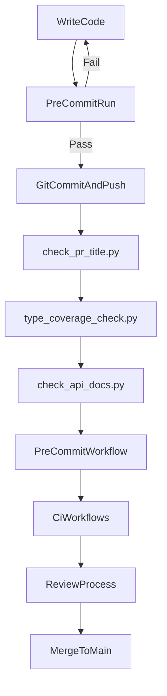
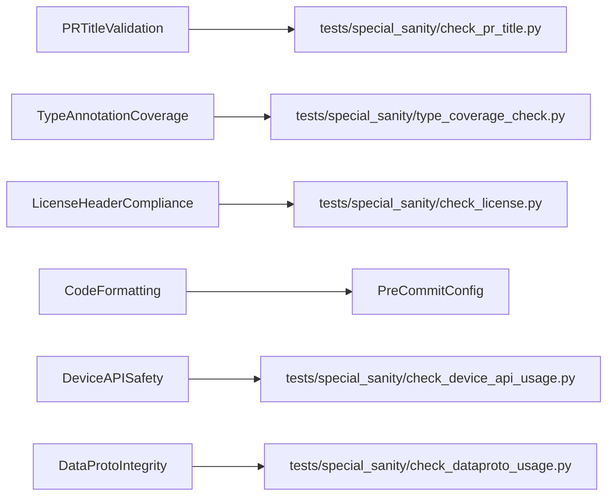
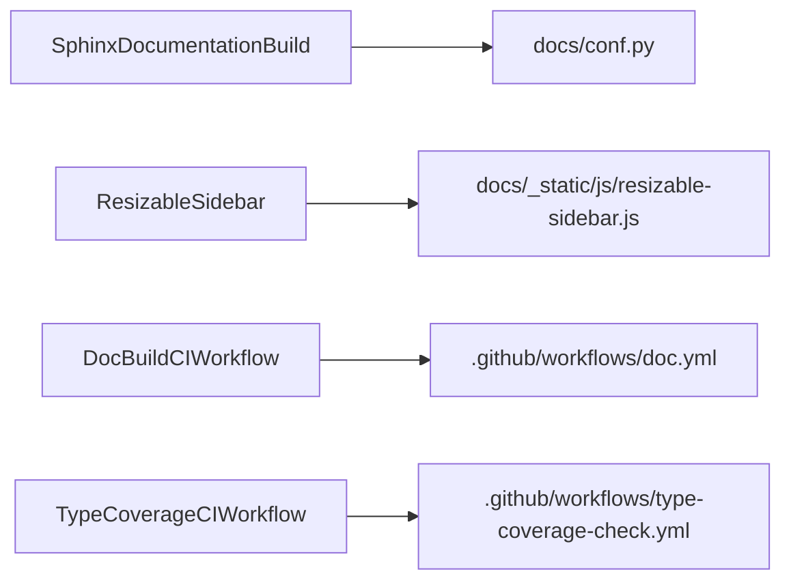

<!-- source: DeepWiki mcp.deepwiki.com · repo volcengine/verl · page 13.4 Contributing Guidelines · fetched 2026-10-21 -->

# Contributing Guidelines

<details>
<summary>Relevant source files</summary>

The following files were used as context for generating this wiki page:

- [.github/PULL_REQUEST_TEMPLATE.md](.github/PULL_REQUEST_TEMPLATE.md)
- [.github/workflows/check-pr-title.yml](.github/workflows/check-pr-title.yml)
- [.github/workflows/doc.yml](.github/workflows/doc.yml)
- [.github/workflows/type-coverage-check.yml](.github/workflows/type-coverage-check.yml)
- [CONTRIBUTING.md](CONTRIBUTING.md)
- [docs/README.md](docs/README.md)
- [docs/_static/custom.css](docs/_static/custom.css)
- [docs/_static/js/resizable-sidebar.js](docs/_static/js/resizable-sidebar.js)
- [docs/_static/js/runllm-widget.js](docs/_static/js/runllm-widget.js)
- [docs/algo/spin.md](docs/algo/spin.md)
- [docs/algo/sppo.md](docs/algo/sppo.md)
- [docs/conf.py](docs/conf.py)
- [docs/requirements-docs.txt](docs/requirements-docs.txt)
- [docs/sglang_multiturn/sandbox_fusion.rst](docs/sglang_multiturn/sandbox_fusion.rst)
- [examples/router_replay/README.md](examples/router_replay/README.md)
- [scripts/rollout_viewer.py](scripts/rollout_viewer.py)
- [tests/special_sanity/check_pr_description.py](tests/special_sanity/check_pr_description.py)
- [tests/special_sanity/check_pr_title.py](tests/special_sanity/check_pr_title.py)
- [tests/special_sanity/type_coverage_check.py](tests/special_sanity/type_coverage_check.py)
- [verl/utils/megatron/router_replay_patch.py](verl/utils/megatron/router_replay_patch.py)

</details>


This document provides guidelines for contributing code to the verl project, including code style conventions, development environment setup, testing practices, and submission requirements. It covers the technical standards and automated checks that ensure code quality and consistency across the codebase.

For information about package structure and dependencies, see [Package Structure, Scripts, and Dependencies](#13.3). For information about testing infrastructure, see [Testing Framework and Organization](#13.2).

Sources: [CONTRIBUTING.md:1-12]()

---

## Development Environment Setup

### Installing Development Dependencies

The verl project supports multiple installation modes depending on the features you need to develop or test.

**Basic Installation for Development:**
```bash
pip install -e .[test,vllm]
# or
pip install -e .[test,sglang]
```
Sources: [CONTRIBUTING.md:23-23]()

### Pre-commit Hook Installation

We rely on `pre-commit` to keep the code consistent. To set it up:
```bash
pip install pre-commit hydra-core
pre-commit install
```
Sources: [CONTRIBUTING.md:30-31]()

This installs the hooks defined in `.pre-commit-config.yaml` which run automatically on `git commit`. These hooks include code linting, type checking, and configuration auto-generation.

Sources: [CONTRIBUTING.md:23-31]()

---

## Code Style and Formatting

### Ruff and MyPy
The project uses **Ruff** for linting and formatting, and **MyPy** for type checking. These are integrated into the pre-commit workflow. Ruff is configured with `--fix` and `--show-fixes` to automate common corrections.

Sources: [CONTRIBUTING.md:25-40]()

### Type Annotation Coverage
Verl enforces a minimum threshold for type annotations on changed lines (default 30%) [tests/special_sanity/type_coverage_check.py:119-119](). This is checked via a custom script `tests/special_sanity/type_coverage_check.py` which uses the `ast` module to inspect function definitions [tests/special_sanity/type_coverage_check.py:69-84](). The `type-coverage-check.yml` workflow automates this verification in CI [.github/workflows/type-coverage-check.yml:26-28]().

**Exemptions from Type Checking:**
- Private methods (starting with `_`) [tests/special_sanity/type_coverage_check.py:71-71]()
- Arguments named `self` or `cls` [tests/special_sanity/type_coverage_check.py:62-63]()
- Variadic arguments (`*args`, `**kwargs`) [tests/special_sanity/type_coverage_check.py:64-65]()
- Files under the `tests/` directory [tests/special_sanity/type_coverage_check.py:137-138]()

Sources: [tests/special_sanity/type_coverage_check.py:61-138](), [.github/workflows/type-coverage-check.yml:26-28]()

---

## Pull Request Process

### PR Title Convention
To maintain a clean history and trigger the correct CI workflows, PR titles must follow a specific format:
`[{modules}] {type}: {description}`

The validity of the PR title is enforced by `tests/special_sanity/check_pr_title.py`, which validates the prefix against a whitelist of modules and types [tests/special_sanity/check_pr_title.py:19-27]().

**Allowed Modules:**
`fsdp`, `megatron`, `veomni`, `sglang`, `vllm`, `trtllm`, `rollout`, `trainer`, `tests`, `training_utils`, `recipe`, `hardware`, `deployment`, `ray`, `worker`, `single_controller`, `misc`, `docker`, `ci`, `perf`, `model`, `algo`, `env`, `tool`, `ckpt`, `doc`, `data`, `cfg`, `reward`, `fully_async`, `one_step_off` [tests/special_sanity/check_pr_title.py:22-26]().

**Allowed Types:**
`feat`, `fix`, `refactor`, `chore`, `test` [tests/special_sanity/check_pr_title.py:27-27]().

**Special Prefixes:**
- `[BREAKING]`: Used for API-breaking changes [.github/PULL_REQUEST_TEMPLATE.md:12-12]().
- `[1/N]`: Used for multi-part PR series [tests/special_sanity/check_pr_title.py:30-32]().

Sources: [.github/PULL_REQUEST_TEMPLATE.md:8-13](), [tests/special_sanity/check_pr_title.py:19-32]()

### PR Checklist
Before requesting a review, ensure you have completed the following:
1. Format the PR title correctly (checked by CI) [.github/PULL_REQUEST_TEMPLATE.md:8-8]().
2. Run pre-commit checks: `pre-commit run --all-files --show-diff-on-failure --color=always` [.github/PULL_REQUEST_TEMPLATE.md:37-37]().
3. Add or update documentation in the `docs/` folder [.github/PULL_REQUEST_TEMPLATE.md:38-38]().
4. Add unit or end-to-end tests to cover new code [.github/PULL_REQUEST_TEMPLATE.md:39-39]().
5. If modifying the `recipe` submodule, update the reference via `git submodule update --remote` [.github/PULL_REQUEST_TEMPLATE.md:41-41]().

Sources: [.github/PULL_REQUEST_TEMPLATE.md:31-41]()

---

## Automated Checks and Workflow

The following diagram illustrates the automated validation pipeline that a contribution undergoes from local development to CI.

### Contribution Validation Flow

Sources: [.github/workflows/type-coverage-check.yml:1-31](), [tests/special_sanity/check_pr_title.py:1-73]()

### Hook Details

| Hook ID | Tool/Script | Purpose |
|---------|-------------|---------|
| `ruff` | `Ruff` | Lints code and applies automatic fixes |
| `ruff-format` | `Ruff` | Enforces consistent code formatting |
| `mypy` | `MyPy` | Performs static type checking |
| `autogen-trainer-cfg` | `scripts/generate_trainer_config.sh` | Synchronizes generated YAML configs with code |
| `check-docstrings` | `tests/special_sanity/check_docstrings.py` | Validates API documentation coverage |
| `check-license` | `tests/special_sanity/check_license.py` | Ensures approved license headers are present |
| `check-device-api-usage` | `tests/special_sanity/check_device_api_usage.py` | Validates correct usage of device-specific APIs |
| `check-dataproto-usage` | `tests/special_sanity/check_dataproto_usage.py` | Validates DataProto usage in engine workers |
| `compileall` | `compileall` | Checks for Python syntax errors |

Sources: [CONTRIBUTING.md:25-40]()

---

## Code Entity Association

The following diagrams bridge natural language requirements to the specific code entities responsible for enforcing them.

### CI Enforcement Mapping

Sources: [tests/special_sanity/check_pr_title.py:1-73](), [tests/special_sanity/type_coverage_check.py:1-182]()

### Documentation and Validation Mapping

Sources: [docs/conf.py:1-113](), [docs/_static/js/resizable-sidebar.js:1-130](), [.github/workflows/doc.yml:1-103](), [.github/workflows/type-coverage-check.yml:1-31]()

---

## Documentation Standards

### Building Docs Locally
To verify documentation changes before submitting, the project uses Sphinx with the `myst_parser` for Markdown support [docs/conf.py:46-48]().
```bash
# Ensure verl is on your PYTHONPATH
pip install -e .[test]

# Install documentation dependencies
cd docs
pip install -r requirements-docs.txt

# Generate HTML docs
make clean
make html

# Preview locally
python -m http.server -d _build/html/
```
Sources: [CONTRIBUTING.md:61-75](), [docs/conf.py:1-113]()

### Sidebar and Layout
The documentation uses a custom resizable sidebar implemented in `docs/_static/js/resizable-sidebar.js` [docs/_static/js/resizable-sidebar.js:2-11]() and styled via `docs/_static/custom.css` [docs/_static/custom.css:46-57](). This allows users to adjust the navigation width between 200px and 600px [docs/_static/js/resizable-sidebar.js:97-97]().

### License Headers
All new Python files must include a valid license header. The `check-license` hook validates this against a list of approved headers.

Approved headers include:
- `Copyright 2024 Bytedance Ltd. and/or its affiliates` [docs/conf.py:1-1]()
- `Copyright 2025 Bytedance Ltd. and/or its affiliates` [tests/special_sanity/check_pr_title.py:1-1]()

Sources: [CONTRIBUTING.md:1-101](), [docs/conf.py:1-13](), [tests/special_sanity/check_pr_title.py:1-13]()

---

