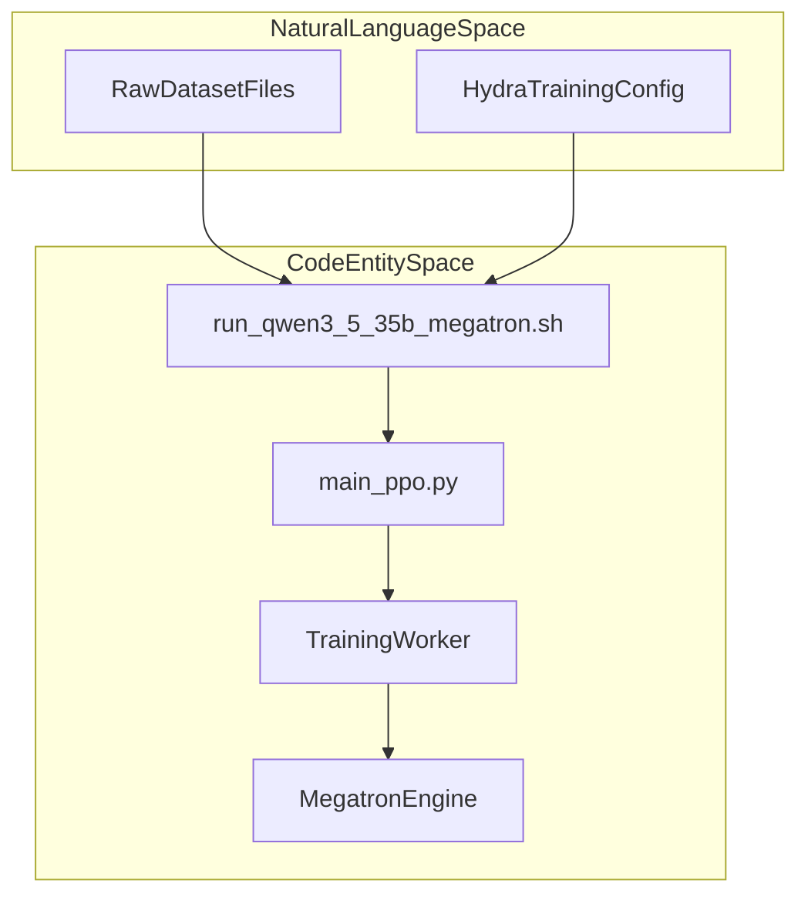
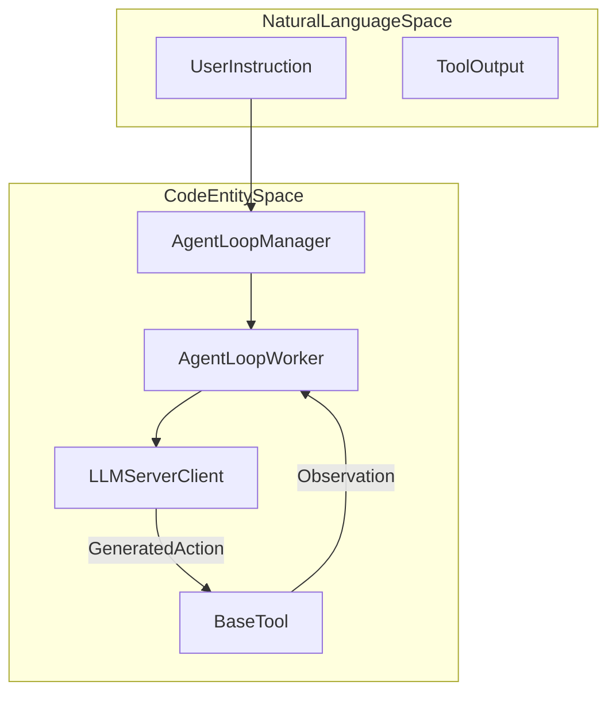
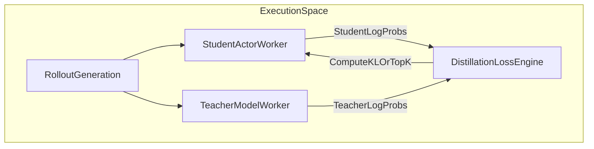
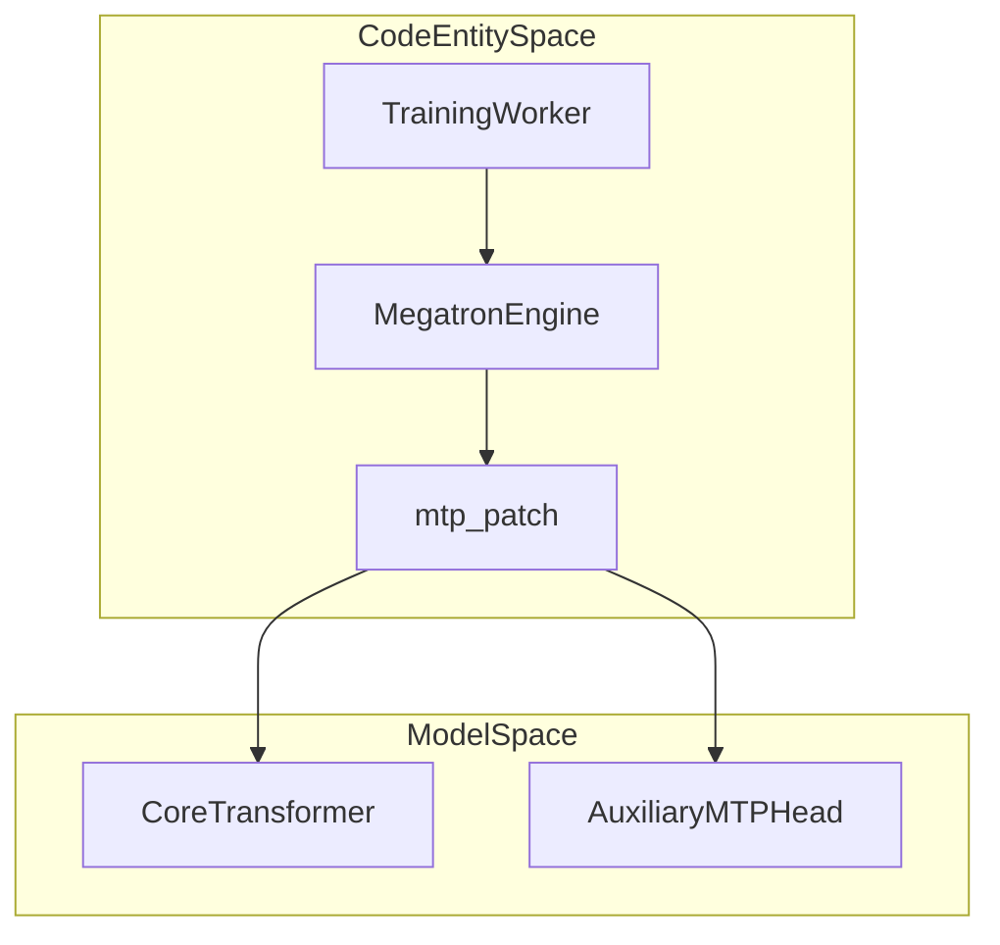

<!-- source: DeepWiki mcp.deepwiki.com · repo volcengine/verl · page 14 Experimental Features and Examples · fetched 2026-10-21 -->

# Experimental Features and Examples

Relevant source files

The following files were used as context for generating this wiki page:

- [examples/ascend_extras/grpo_trainer/run_qwen3_5_122b_a10b_32k_megatron.sh](examples/ascend_extras/grpo_trainer/run_qwen3_5_122b_a10b_32k_megatron.sh)
- [examples/ascend_extras/ppo_trainer/run_qwen3_8b_fsdp.sh](examples/ascend_extras/ppo_trainer/run_qwen3_8b_fsdp.sh)
- [examples/grpo_trainer/run_deepseek_v3_671b_megatron.sh](examples/grpo_trainer/run_deepseek_v3_671b_megatron.sh)
- [examples/grpo_trainer/run_hy_v3_megatron.sh](examples/grpo_trainer/run_hy_v3_megatron.sh)
- [examples/grpo_trainer/run_nemotron_nano_v3_30b_a3b_megatron.sh](examples/grpo_trainer/run_nemotron_nano_v3_30b_a3b_megatron.sh)
- [examples/grpo_trainer/run_qwen3_5_122b_a10b_megatron.sh](examples/grpo_trainer/run_qwen3_5_122b_a10b_megatron.sh)
- [examples/grpo_trainer/run_qwen3_5_35b_fsdp.sh](examples/grpo_trainer/run_qwen3_5_35b_fsdp.sh)
- [examples/grpo_trainer/run_qwen3_5_35b_megatron.sh](examples/grpo_trainer/run_qwen3_5_35b_megatron.sh)
- [examples/grpo_trainer/run_qwen3_5_397b_megatron.sh](examples/grpo_trainer/run_qwen3_5_397b_megatron.sh)
- [examples/grpo_trainer/run_qwen3_vl_30b_a3b_megatron.sh](examples/grpo_trainer/run_qwen3_vl_30b_a3b_megatron.sh)
- [examples/ppo_trainer/run_qwen3_8b_fsdp.sh](examples/ppo_trainer/run_qwen3_8b_fsdp.sh)
- [examples/tuning/lora/run_qwen3_30b_a3b_megatron.sh](examples/tuning/lora/run_qwen3_30b_a3b_megatron.sh)

This page provides an overview of experimental features and the `examples/` directory tree that extend the core `verl` framework beyond standard PPO workflows. These include specialized distributed training scripts (such as Megatron-Core configurations for large-scale MoE models), agentic tools and interaction frameworks, on-policy distillation, and multi-token prediction (MTP) architectures.

As a parent page, this section offers a high-level summary of each sub-topic. For comprehensive implementation details, configuration guides, and usage examples, follow the links provided in each subsection.

## Examples Directory and Training Scripts {#14.1}

The `examples/` directory contains a wide variety of training scripts, algorithm implementations, and utility pipelines that demonstrate how to adapt `verl` for diverse post-training paradigms [examples/grpo_trainer/run_qwen3_5_35b_megatron.sh:1-41](), [examples/tuning/lora/run_qwen3_30b_a3b_megatron.sh:1-44](). This includes per-algorithm trainer scripts for GRPO, DPPO, GDPO, GMPO, GPG, GSPO, OTB, CISPO, ReMax, RLOO, and REINFORCE++, alongside advanced Supervised Fine-Tuning (SFT), LoRA/PEFT tuning recipes [examples/tuning/lora/run_qwen3_30b_a3b_megatron.sh:24-31](), profiling utilities, and data preprocessing scripts for models like Qwen3.5, DeepSeek-V3, and Qwen3-VL [examples/grpo_trainer/run_qwen3_5_122b_a10b_megatron.sh:1-40](), [examples/grpo_trainer/run_deepseek_v3_671b_megatron.sh:1-13](), [examples/grpo_trainer/run_qwen3_vl_30b_a3b_megatron.sh:1-24]().

Diagram: Data and Script Orchestration Flow

Sources: [examples/grpo_trainer/run_qwen3_5_35b_megatron.sh:1-41](), [examples/grpo_trainer/run_qwen3_5_122b_a10b_megatron.sh:1-40](), [examples/tuning/lora/run_qwen3_30b_a3b_megatron.sh:1-44]()

For details on directory layout, training scripts, and data preprocessing workflows, see [Examples Directory and Training Scripts](#14.1).

## Tools and Interactions Framework {#14.2}

For agentic RL scenarios where models interact with external environments, execute multi-turn reasoning, and call tools, `verl` provides an extensible interaction framework [verl/experimental/agent_loop/agent_loop.py](). This framework defines abstract base classes like `BaseTool` and `BaseInteraction` to manage tool schemas, execution lifecycles, and environment feedback loops.

Built-in tools cover domains such as GSM8K math reasoning, Geo3K geometry solvers, SandboxFusion execution environments, and Model Context Protocol (MCP) integrations, orchestrating multi-turn conversations through the `AgentLoopManager`.

Diagram: Agentic Tool Interaction Workflow

Sources: [verl/experimental/fully_async_policy/fully_async_rollouter.py:27-27]()

For details on building agentic RL environments, tool schemas, and interaction lifecycles, see [Tools and Interactions Framework](#14.2).

## On-Policy Distillation and Teacher-Student Training {#14.3}

The on-policy distillation system enables a student model to learn directly from a teacher model during live RL rollouts [verl/experimental/separation/engine_workers.py:46-57](). By utilizing specialized distillation loss modes and teacher loop management, the algorithm (OPD) mitigates exposure bias and aligns student generation paths with reference teacher distributions.

Diagram: Teacher-Student Distillation Pipeline

Sources: [verl/experimental/separation/engine_workers.py:46-57]()

For details on the on-policy distillation trainer, loss modes, and teacher loop management, see [On-Policy Distillation and Teacher-Student Training](#14.3).

## Multi-Token Prediction (MTP) Training {#14.4}

`verl` includes experimental support for Multi-Token Prediction (MTP) architectures, enabling models to predict multiple future tokens simultaneously and improve training efficiency. This feature integrates custom configuration parameters, engine compatibility layers, inference support, and the `mtp_patch` utilities designed for Megatron-Core integration [examples/grpo_trainer/run_deepseek_v3_671b_megatron.sh:10-13]().

Diagram: MTP Integration Architecture

Sources: [verl/experimental/separation/engine_workers.py:46-57](), [examples/grpo_trainer/run_deepseek_v3_671b_megatron.sh:10-13]()

For details on MTP configuration parameters, engine compatibility, and inference patches, see [Multi-Token Prediction (MTP) Training](#14.4).

---

