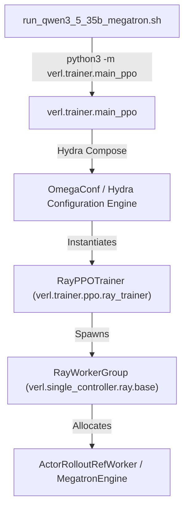
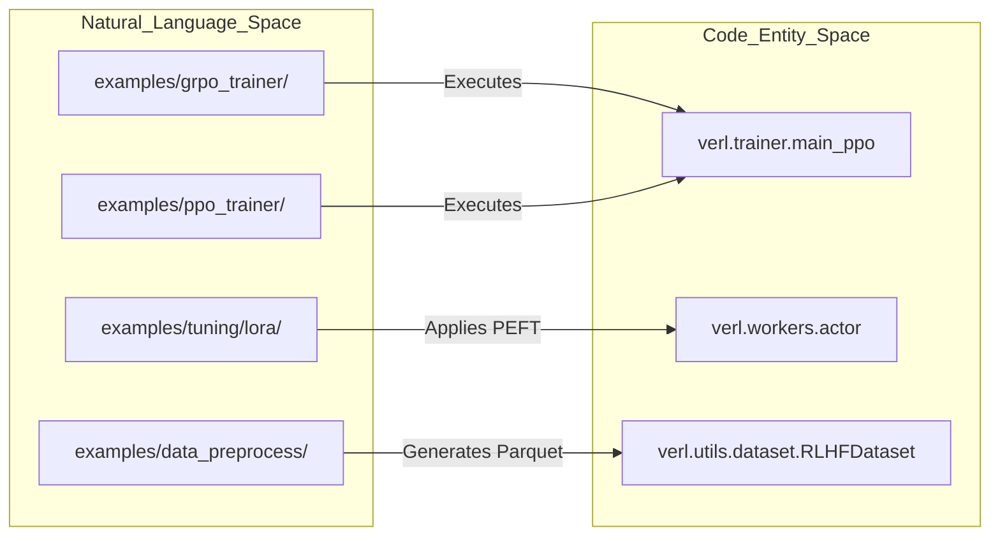

<!-- source: DeepWiki mcp.deepwiki.com · repo volcengine/verl · page 14.1 Examples Directory and Training Scripts · fetched 2026-10-21 -->

# Examples Directory and Training Scripts

<details>
<summary>Relevant source files</summary>

The following files were used as context for generating this wiki page:

- [docs/algo/grpo.md](docs/algo/grpo.md)
- [docs/algo/ppo.md](docs/algo/ppo.md)
- [docs/hardware/multi_chip_support.rst](docs/hardware/multi_chip_support.rst)
- [examples/README.md](examples/README.md)
- [examples/ascend_extras/grpo_trainer/run_qwen3_235b_256k_megatron.sh](examples/ascend_extras/grpo_trainer/run_qwen3_235b_256k_megatron.sh)
- [examples/ascend_extras/grpo_trainer/run_qwen3_30b_a3b_megatron.sh](examples/ascend_extras/grpo_trainer/run_qwen3_30b_a3b_megatron.sh)
- [examples/ascend_extras/grpo_trainer/run_qwen3_32b_fsdp.sh](examples/ascend_extras/grpo_trainer/run_qwen3_32b_fsdp.sh)
- [examples/ascend_extras/grpo_trainer/run_qwen3_5_122b_a10b_32k_megatron.sh](examples/ascend_extras/grpo_trainer/run_qwen3_5_122b_a10b_32k_megatron.sh)
- [examples/ascend_extras/grpo_trainer/run_qwen3_next_80b_fsdp.sh](examples/ascend_extras/grpo_trainer/run_qwen3_next_80b_fsdp.sh)
- [examples/ascend_extras/ppo_trainer/run_qwen3_8b_fsdp.sh](examples/ascend_extras/ppo_trainer/run_qwen3_8b_fsdp.sh)
- [examples/dppo_trainer/run_qwen3_30b_a3b_megatron.sh](examples/dppo_trainer/run_qwen3_30b_a3b_megatron.sh)
- [examples/grpo_trainer/README.md](examples/grpo_trainer/README.md)
- [examples/grpo_trainer/run_deepseek_v3_671b_megatron.sh](examples/grpo_trainer/run_deepseek_v3_671b_megatron.sh)
- [examples/grpo_trainer/run_gpt_oss_20b_veomni.sh](examples/grpo_trainer/run_gpt_oss_20b_veomni.sh)
- [examples/grpo_trainer/run_hy_v3_megatron.sh](examples/grpo_trainer/run_hy_v3_megatron.sh)
- [examples/grpo_trainer/run_nemotron_nano_v3_30b_a3b_megatron.sh](examples/grpo_trainer/run_nemotron_nano_v3_30b_a3b_megatron.sh)
- [examples/grpo_trainer/run_qwen2_5_32b_fsdp.sh](examples/grpo_trainer/run_qwen2_5_32b_fsdp.sh)
- [examples/grpo_trainer/run_qwen2_5_vl_7b_fsdp.sh](examples/grpo_trainer/run_qwen2_5_vl_7b_fsdp.sh)
- [examples/grpo_trainer/run_qwen3_235b_a22b_megatron.sh](examples/grpo_trainer/run_qwen3_235b_a22b_megatron.sh)
- [examples/grpo_trainer/run_qwen3_30b_a3b_megatron.sh](examples/grpo_trainer/run_qwen3_30b_a3b_megatron.sh)
- [examples/grpo_trainer/run_qwen3_4b_fsdp.sh](examples/grpo_trainer/run_qwen3_4b_fsdp.sh)
- [examples/grpo_trainer/run_qwen3_5_122b_a10b_megatron.sh](examples/grpo_trainer/run_qwen3_5_122b_a10b_megatron.sh)
- [examples/grpo_trainer/run_qwen3_5_27b_fsdp.sh](examples/grpo_trainer/run_qwen3_5_27b_fsdp.sh)
- [examples/grpo_trainer/run_qwen3_5_35b_fsdp.sh](examples/grpo_trainer/run_qwen3_5_35b_fsdp.sh)
- [examples/grpo_trainer/run_qwen3_5_35b_megatron.sh](examples/grpo_trainer/run_qwen3_5_35b_megatron.sh)
- [examples/grpo_trainer/run_qwen3_5_397b_megatron.sh](examples/grpo_trainer/run_qwen3_5_397b_megatron.sh)
- [examples/grpo_trainer/run_qwen3_vl_30b_a3b_megatron.sh](examples/grpo_trainer/run_qwen3_vl_30b_a3b_megatron.sh)
- [examples/grpo_trainer/run_qwen3_vl_8b_fsdp.sh](examples/grpo_trainer/run_qwen3_vl_8b_fsdp.sh)
- [examples/ppo_trainer/README.md](examples/ppo_trainer/README.md)
- [examples/ppo_trainer/run_qwen3_8b_fsdp.sh](examples/ppo_trainer/run_qwen3_8b_fsdp.sh)
- [examples/tpu/grpo/Dockerfile](examples/tpu/grpo/Dockerfile)
- [examples/tpu/grpo/README.md](examples/tpu/grpo/README.md)
- [examples/tpu/grpo/ray-tpu-v6e4-2slice.yaml](examples/tpu/grpo/ray-tpu-v6e4-2slice.yaml)
- [examples/tpu/grpo/run_qwen3_0_6b_torchtitan.sh](examples/tpu/grpo/run_qwen3_0_6b_torchtitan.sh)
- [examples/tpu/grpo/run_qwen3_4b_torchtitan.sh](examples/tpu/grpo/run_qwen3_4b_torchtitan.sh)
- [examples/tuning/lora/run_qwen3_30b_a3b_megatron.sh](examples/tuning/lora/run_qwen3_30b_a3b_megatron.sh)
- [tests/special_sanity/check_example_naming.py](tests/special_sanity/check_example_naming.py)
- [tests/utils/veomni/test_moe_param_export_on_cpu.py](tests/utils/veomni/test_moe_param_export_on_cpu.py)
- [verl/experimental/separation/engine_workers.py](verl/experimental/separation/engine_workers.py)
- [verl/plugin/platform/platform_base.py](verl/plugin/platform/platform_base.py)
- [verl/workers/engine/veomni/utils.py](verl/workers/engine/veomni/utils.py)

</details>


## Purpose and Scope
This page documents the layout, organization, and execution semantics of the `examples/` directory within the `verl` framework. The `examples/` directory provides production-ready reference implementations, shell launching scripts, and configuration overrides for a broad spectrum of reinforcement learning algorithms (such as GRPO, PPO, DPPO, RLOO, REINFORCE++, and specialized policy objectives), supervised fine-tuning (SFT), PEFT/LoRA tuning, profiling benchmarks, and data preprocessing pipelines.

Sources: [examples/README.md:1-15](), [examples/grpo_trainer/README.md:40-65]()

---

## Examples Directory Layout and Architecture
The `examples/` directory is partitioned by training paradigms, algorithmic variants, and utility workflows. Each subdirectory contains standalone shell scripts that pass Hydra command-line overrides to core entrypoints like `verl.trainer.main_ppo`.

```
examples/
├── ppo_trainer/          # Standard PPO training scripts (FSDP & Megatron backends)
├── grpo_trainer/         # Group Relative Policy Optimization scripts (dense & MoE models)
├── dppo_trainer/         # Distributed PPO and alternative algorithmic scripts
├── sft_trainer/          # Supervised Fine-Tuning scripts for base models
├── data_preprocess/      # Dataset conversion and preprocessing pipelines (GSM8K, Geo3K, etc.)
├── tuning/               # Parameter-Efficient Fine-Tuning (PEFT) and LoRA scripts
│   └── lora/             # LoRA adaptation recipes for actor/critic models
├── profile/              # Benchmarking and profiling scripts for FLOPs, memory, and latency
├── ascend_extras/        # Hardware-specific Ascend NPU training recipes and overrides
└── tpu/                  # Cloud TPU training recipes and TorchTitan integration scripts
```

Sources: [examples/grpo_trainer/README.md:40-102](), [examples/ppo_trainer/README.md:81-93](), [examples/tpu/grpo/README.md:1-11]()

---

## Per-Algorithm Trainer Scripts and Naming Conventions
Training scripts across the `examples/` directory adhere to a strict canonical naming convention enforced by sanity checks to simplify cross-model and cross-backend experimentation:

$$\text{run\_}\langle\text{model}\rangle\_\langle\text{train-backend}\rangle\text{.sh}$$

- **`<model>`**: The canonical model size and family (e.g., `qwen3_8b`, `qwen3_30b_a3b`, `qwen3_5_35b_megatron`, `deepseek_v3_671b`).
- **`<train-backend>`**: The distributed training engine, belonging to `{fsdp, fsdp2, fsdp_turbo, megatron, megatron_lite, mindspeed, automodel, veomni, torchtitan}`. Hardware vendors (like `npu`, `amd`), inference servers (`vllm`, `sglang`, `trtllm`), and quantization flags (`fp8`) are exposed via environment variables (`DEVICE`, `INFER_BACKEND`, `QUANT`) rather than embedded into filenames.

### Supported Algorithms and Configuration Flags
The table below maps algorithm identifiers used in the examples to their configuration parameters and core entry points:

| Algorithm | Advantage Estimator (`algorithm.adv_estimator`) | Key Configuration Flags / Overrides | Reference Script Path |
| :--- | :--- | :--- | :--- |
| **GRPO** | `grpo` | `actor_rollout_ref.rollout.n >= 2`, `actor_rollout_ref.actor.loss_agg_mode` | [examples/grpo_trainer/run_qwen3_5_35b_megatron.sh:86]() |
| **PPO** | `gae` | `algorithm.gamma`, `algorithm.lam`, `critic.ppo_mini_batch_size` | [examples/ppo_trainer/README.md:42-47]() |
| **DPPO** | `dppo` | Distributed PPO specific sequence scaling parameters | [examples/dppo_trainer/run_qwen3_30b_a3b_megatron.sh:1-25]() |
| **RLOO** | `rloo` / `rloo_vectorized` | REINFORCE Leave-One-Out group normalization | [examples/ppo_trainer/README.md:46]() |
| **REINFORCE++** | `reinforce_plus_plus` | Token-level or sequence-level baseline adjustment | [examples/ppo_trainer/README.md:46]() |
| **GPG** | `gpg` | Gradient-based policy optimization objectives | [docs/algo/ppo.md:48]() |
| **GSPO** | `gspo` | Group-wise scaled policy optimization | [examples/grpo_trainer/README.md:1-10]() |
| **OTB** | `optimal_token_baseline` | Token-level optimal baseline computation | [docs/algo/ppo.md:48]() |
| **CISPO** | `cispo` | Preference alignment for reasoning tasks | [examples/grpo_trainer/README.md:1-10]() |
| **GMPO / SAPO** | `gmpo` / `sapo` | Group-wise and smoothed surrogate policy clipping | [examples/grpo_trainer/README.md:1-10]() |
| **GDPO** | `gdpo` | Preference-guided distillation and policy optimization | [examples/grpo_trainer/README.md:1-10]() |

Sources: [tests/special_sanity/check_example_naming.py:15-83](), [examples/grpo_trainer/README.md:20-30](), [examples/ppo_trainer/README.md:46]()

---

## Hardware-Specific and Multi-Backend Recipes
Beyond standard NVIDIA GPU configurations, the `examples/` directory incorporates tailored execution scripts for alternative hardware backends:

- **Ascend NPU (`examples/ascend_extras/`)**: Integrates MindSpeed, Megatron-Bridge, and CANN runtime optimizations. Scripts like `examples/ascend_extras/grpo_trainer/run_qwen3_5_122b_a10b_32k_megatron.sh` enable specialized context parallelism (`kvallgather_cp_algo`), kernel fusion (`use_fused_rmsnorm`, `use_fused_swiglu`), and vLLM-Ascend sequence optimizations [examples/ascend_extras/grpo_trainer/run_qwen3_5_122b_a10b_32k_megatron.sh:1-112]().
- **Cloud TPU (`examples/tpu/`)**: Implements decoupled asynchronous training topologies (e.g., `trainer.v1.trainer_mode=separate_async`) combining TorchTitan on trainer chips and vLLM on rollout chips with `tpu-sync` checkpoint engines via `verl-hardware-plugin` [examples/tpu/grpo/run_qwen3_4b_torchtitan.sh:70-115](), [examples/tpu/grpo/README.md:1-10]().

Sources: [examples/tpu/grpo/run_qwen3_4b_torchtitan.sh:70-115](), [examples/ascend_extras/grpo_trainer/run_qwen3_5_122b_a10b_32k_megatron.sh:1-112]()

---

## Supervised Fine-Tuning (SFT) and LoRA Tuning
Supervised Fine-Tuning and Parameter-Efficient Fine-Tuning recipes are located under `examples/sft_trainer/` and `examples/tuning/lora/`. These scripts prepare base models for downstream RL alignment by establishing stable formatting, tokenization, and PEFT adapter wrappers.

- **LoRA Configuration**: Integration with PEFT is exposed via configuration flags that wrap actor models with low-rank adaptation matrices without requiring full-parameter updates across all worker ranks.
- **Dataset Integration**: SFT scripts ingest standard instruction-following datasets, converting them into internal `DataProto` compatible tensors through `examples/data_preprocess/`.

Sources: [examples/tuning/lora/run_qwen3_30b_a3b_megatron.sh:1-25](), [examples/grpo_trainer/README.md:100-102]()

---

## Data Preprocessing Pipelines
The `examples/data_preprocess/` directory contains ingestion scripts for turning raw JSON/JSONL benchmark datasets into Parquet files optimized for distributed data loading (`RLHFDataset`). 

- **Supported Datasets**: GSM8K, MATH, Geo3K, AIME 2024, and DAPO-Math-17k.
- **Preprocessing Actions**: Tokenization, truncation control (`data.truncation='error'`), prompt/response length boundary enforcement, and multi-turn conversation parsing.

Sources: [examples/grpo_trainer/run_qwen3_5_122b_a10b_megatron.sh:49-51](), [examples/ascend_extras/grpo_trainer/run_qwen3_next_80b_fsdp.sh:10-15]()

---

## Architecture and Execution Flow Diagrams

### Diagram: "Training Script to Code Entity Mapping"
This diagram bridges the natural language space of launching training scripts to the underlying code entity space of the `verl` framework.


Sources: [examples/grpo_trainer/run_qwen3_5_35b_megatron.sh:1-120](), [examples/grpo_trainer/README.md:40-65]()

### Diagram: "Examples Directory Structure and Runtime Target Mapping"
This diagram maps the structural layout of the `examples/` directory to their respective runtime execution targets within the codebase.


Sources: [examples/README.md:1-15](), [examples/grpo_trainer/README.md:40-102](), [examples/ppo_trainer/README.md:81-93]()

---

