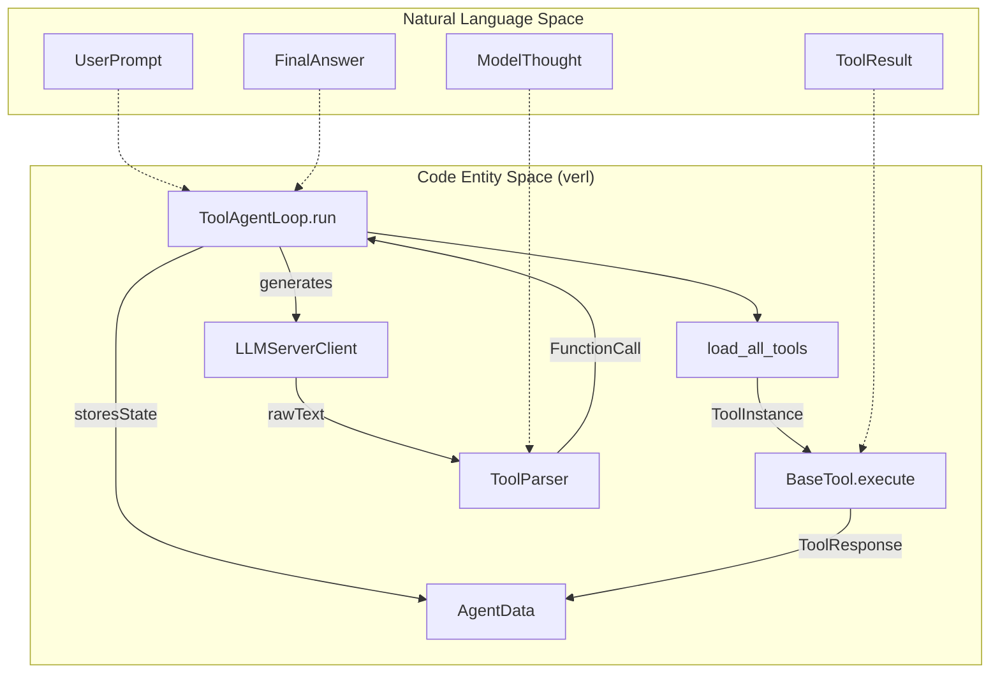
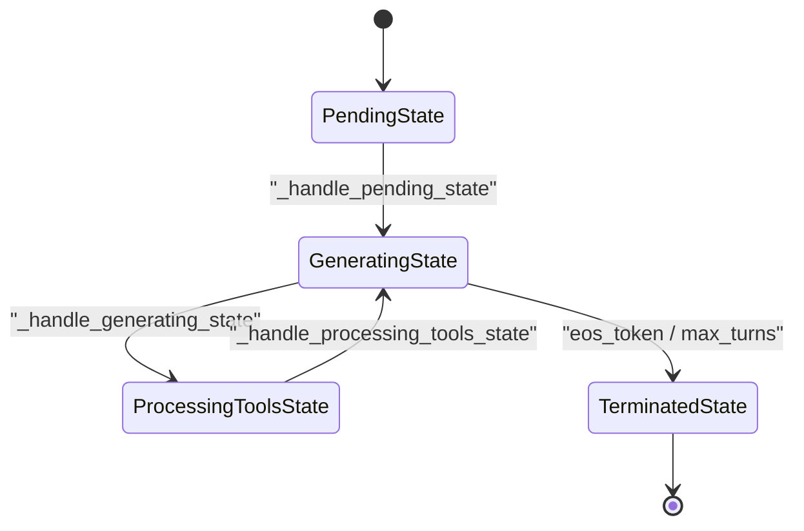
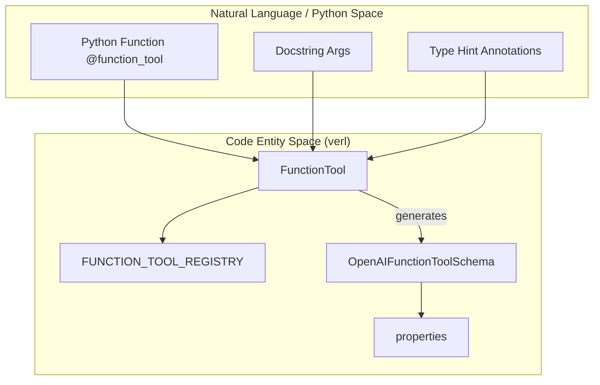

<!-- source: DeepWiki mcp.deepwiki.com · repo volcengine/verl · page 14.2 Tools and Interactions Framework · fetched 2026-10-21 -->

# Tools and Interactions Framework

Relevant source files

The following files were used as context for generating this wiki page:

- [docs/examples/sandbox_fusion_example.rst](docs/examples/sandbox_fusion_example.rst)
- [docs/sglang_multiturn/multiturn.rst](docs/sglang_multiturn/multiturn.rst)
- [tests/experimental/agent_loop/test_gpt_oss_tool_parser.py](tests/experimental/agent_loop/test_gpt_oss_tool_parser.py)
- [tests/experimental/agent_loop/test_qwen3_tool_parser_on_cpu.py](tests/experimental/agent_loop/test_qwen3_tool_parser_on_cpu.py)
- [tests/utils/reward_score/reward_score/test_sandbox_fusion_on_cpu.py](tests/utils/reward_score/reward_score/test_sandbox_fusion_on_cpu.py)
- [tests/workers/rollout/test_sglang_async_rollout_multimodal_delta.py](tests/workers/rollout/test_sglang_async_rollout_multimodal_delta.py)
- [verl/experimental/agent_loop/tool_parser.py](verl/experimental/agent_loop/tool_parser.py)
- [verl/tools/base_tool.py](verl/tools/base_tool.py)
- [verl/tools/schemas.py](verl/tools/schemas.py)
- [verl/utils/reward_score/sandbox_fusion/__init__.py](verl/utils/reward_score/sandbox_fusion/__init__.py)
- [verl/utils/reward_score/sandbox_fusion/utils.py](verl/utils/reward_score/sandbox_fusion/utils.py)
- [verl/workers/rollout/schemas.py](verl/workers/rollout/schemas.py)

The Tools and Interactions Framework provides a modular abstraction for building agentic Reinforcement Learning (RL) environments within `verl`. It enables Large Language Models (LLMs) to interact with external tools (such as code interpreters, calculators, and search engines) and manage multi-turn interaction lifecycles during RL training. This framework decouples the agent's logic from the underlying inference engine, allowing for asynchronous tool execution, dynamic multi-turn conversation handling, and multi-modal feedback loops.

---

## 1. System Architecture and Component Overview

The framework is orchestrated by the `AgentLoopManager`, which manages the lifecycle of agentic behaviors during rollout. It coordinates between the inference gateway (e.g., vLLM or SGLang via `LLMServerManager`) and external tools or interaction environments [tests/experimental/agent_loop/agent_utils.py:92-97]().

### Component Overview Table

| Component | Role / Responsibility | Code Citation |
| :--- | :--- | :--- |
| `AgentLoopBase` | Abstract base class for agent loops, managing chat templates, processing classes, and initialization. | [verl/experimental/agent_loop/agent_loop.py:182-192]() |
| `ToolAgentLoop` | Implements a state-machine based multi-turn loop for tool-calling agents during rollout. | [verl/experimental/agent_loop/tool_agent_loop.py:100-112]() |
| `SingleTurnAgentLoop` | A simplified loop for standard chat completion without multi-turn tool interactions. | [verl/experimental/agent_loop/single_turn_agent_loop.py:28-36]() |
| `AgentData` | Encapsulates trajectory state, including messages, metrics, and tool call history. | [verl/experimental/agent_loop/tool_agent_loop.py:56-91]() |
| `BaseTool` | Abstract interface defining the standard lifecycle for external capabilities. | [verl/tools/base_tool.py:24-34]() |
| `AgentLoopWorker` | Worker class for running agent loop coroutines in parallel via Ray. | [verl/experimental/agent_loop/agent_loop.py:19-20]() |

Sources: [verl/experimental/agent_loop/agent_loop.py:15-192](), [verl/experimental/agent_loop/tool_agent_loop.py:56-112](), [verl/tools/base_tool.py:24-34]()

### Natural Language Space to Code Entity Mapping: Interaction Flow

The following diagram bridges the conceptual "Natural Language Space" with the specific classes and functions in the codebase.

**Agentic Interaction Lifecycle**

Sources: [verl/experimental/agent_loop/tool_agent_loop.py:125-175](), [verl/tools/base_tool.py:62-74](), [verl/experimental/agent_loop/agent_loop.py:182-192]()

---

## 2. Tool Abstraction (`BaseTool`)

All external capabilities are implemented by inheriting from `BaseTool`. This class defines the lifecycle of a tool instance during a single trajectory [verl/tools/base_tool.py:24-34]().

### Key Methods
*   `get_openai_tool_schema()`: Returns the tool definition in `OpenAIFunctionToolSchema` format for model prompting [verl/tools/base_tool.py:43-44]().
*   `create()`: Initializes a tool instance for a specific trajectory, often associated with an `instance_id`. It returns the ID and a `ToolResponse` [verl/tools/base_tool.py:46-59]().
*   `execute()`: The primary entry point for tool invocation. It takes parameters (JSON dict) and returns a `ToolResponse`, a reward score, and metrics [verl/tools/base_tool.py:62-74]().
*   `calc_reward()`: Allows tools to contribute to the reward signal based on their internal state [verl/tools/base_tool.py:76-85]().
*   `release()`: Cleans up resources associated with a tool instance [verl/tools/base_tool.py:87-93]().

Sources: [verl/tools/base_tool.py:24-93]()

---

## 3. Interaction Lifecycle (`ToolAgentLoop`)

The `ToolAgentLoop` implements a state machine to handle multi-turn RL training with tools [verl/experimental/agent_loop/tool_agent_loop.py:49-54]().

### State Machine Transitions
1.  **PENDING**: Initial state. The loop prepares the prompt and extracts multimodal data [verl/experimental/agent_loop/tool_agent_loop.py:166-167]().
2.  **GENERATING**: The model generates tokens. The loop monitors for tool-call patterns using the `ToolParser` [verl/experimental/agent_loop/tool_agent_loop.py:168-169]().
3.  **PROCESSING_TOOLS**: If a tool call is detected, the loop executes the tool(s) via `_handle_processing_tools_state` and appends results to history [verl/experimental/agent_loop/tool_agent_loop.py:170-171]().
4.  **TERMINATED**: The loop ends when the model generates an end-of-turn token or reaches turn limits [verl/experimental/agent_loop/tool_agent_loop.py:165-174]().

**State Transition Diagram**

Sources: [verl/experimental/agent_loop/tool_agent_loop.py:49-174]()

---

## 4. Tool Schemas and Data Models

The framework relies on Pydantic models to ensure consistency between the LLM's output and the tool's expected input.

### Tool Schema Objects
*   `OpenAIFunctionToolSchema`: Defines the tool's name, description, and parameters in the format expected by OpenAI-compatible models [verl/tools/schemas.py:52-57]().
*   `ToolResponse`: Encapsulates the output of a tool, which can include `text`, `image` (list of objects), or `video` [verl/tools/schemas.py:98-104]().
*   `AsyncRolloutRequest`: The primary data model for multi-turn requests, maintaining state, messages, and multimodal inputs [verl/workers/rollout/schemas.py:81-115]().
*   `OpenAIFunctionCallSchema`: A Pydantic model representing a specific function name and its dictionary arguments [verl/tools/schemas.py:66-70]().

Sources: [verl/tools/schemas.py:52-104](), [verl/workers/rollout/schemas.py:81-115]()

---

## 5. Tool Parsing and Function Tool Framework

The `ToolParser` class extracts structured tool calls from raw model text [verl/experimental/agent_loop/tool_parser.py:44-46]().

*   **HermesToolParser**: Uses regular expressions to locate `<tool_call>...</tool_call>` blocks and decodes the inner JSON [verl/experimental/agent_loop/tool_parser.py:92-127]().
*   **GptOssToolParser**: Specialized for SGLang/GPT-OSS formats, handling `<|channel|>analysis` and `functions.name` patterns [verl/experimental/agent_loop/tool_parser.py:128-182]().
*   **Qwen3XMLToolParser**: Handles XML-style tool calling for Qwen models using safe parsing primitives [tests/experimental/agent_loop/test_qwen3_tool_parser_on_cpu.py:65-82]().

### Function Tool Framework (`@function_tool`)
For stateless tools, the `@function_tool` decorator simplifies registration by inferring schemas from Python type hints and docstrings [docs/sglang_multiturn/multiturn.rst:77-80](). 

*   **Schema Inference**: Automatically generates JSON schemas using `transformers.utils.get_json_schema` [docs/sglang_multiturn/multiturn.rst:80]().
*   **Async Dispatch**: Synchronous functions are dispatched through `asyncio.to_thread` to prevent blocking the event loop [docs/sglang_multiturn/multiturn.rst:125]().

**Natural Language Space to Code Entity Mapping: Function Tool Schema Inference**

Sources: [verl/experimental/agent_loop/tool_parser.py:44-182](), [docs/sglang_multiturn/multiturn.rst:77-136]()

---

## 6. Built-in Tools and Secure Sandboxes (`SandboxFusion`, GSM8K, Geo3K, MCP)

The framework includes several built-in tool categories and integrations for agentic workflows.

### Built-in Tool Implementations

| Tool Class / Mechanism | Description | Implementation Detail |
| :--- | :--- | :--- |
| `SandboxFusion` | Executes code in a secure remote environment. | Uses `call_sandbox_api` with retry logic and `check_correctness` for verification [verl/utils/reward_score/sandbox_fusion/utils.py:67-92](). |
| `GSM8K` | Specialized tool for mathematical verification. | Computes scores for mathematical completions. |
| `Geo3K` | Tooling for geometry-related problem solving. | Calculates rewards based on geometry task ground truth. |
| `MCP` | Integrates with the Model Context Protocol (MCP). | Standardized interface for model-tool communication. |
| `@function_tool` | Decorator for registering plain Python functions as tools. | Uses `transformers.utils.get_json_schema` for schema inference [docs/sglang_multiturn/multiturn.rst:77-80](). |

### Code Execution Sandbox (`SandboxFusion`)
`SandboxFusion` is a remote code sandbox service providing secure evaluation of LLM-generated code [docs/examples/sandbox_fusion_example.rst:6-12]().

*   **Language Support**: Supports languages including Python, C++, Java, Go, Rust, and CUDA [verl/utils/reward_score/sandbox_fusion/utils.py:34-64]().
*   **Secure Execution**: Runs code in remote instances with configurable memory limits (e.g., `memory_limit_mb=1024`) and timeouts [docs/examples/sandbox_fusion_example.rst:36-40]().
*   **Retry Logic**: Implements linear backoff for Gateway Timeouts (504) to improve robustness against transient network failures [verl/utils/reward_score/sandbox_fusion/utils.py:119-145]().
*   **Scoring Integration**: `compute_score` extracts code blocks from model completions and evaluates correctness across test cases [verl/utils/reward_score/sandbox_fusion/__init__.py:28-121]().

Sources: [verl/utils/reward_score/sandbox_fusion/utils.py:34-145](), [verl/utils/reward_score/sandbox_fusion/__init__.py:28-121](), [docs/examples/sandbox_fusion_example.rst:6-40]()

---

## 7. Multi-Modal Interactions

The framework supports multi-modal tools that can return images or videos via `ToolResponse` [verl/tools/schemas.py:98-121]().

*   **Processing**: Tools should process images/videos using `verl.utils.dataset.vision_utils` (e.g., `process_image`, `process_video`) before returning [docs/sglang_multiturn/multiturn.rst:54-72]().
*   **Delta Updates**: The framework supports appending tool responses (including images) to an existing `AsyncRolloutRequest` message history, preserving input tensor alignment across turns [tests/workers/rollout/test_sglang_async_rollout_multimodal_delta.py:108-150]().

Sources: [verl/tools/schemas.py:98-121](), [docs/sglang_multiturn/multiturn.rst:54-72](), [tests/workers/rollout/test_sglang_async_rollout_multimodal_delta.py:108-150]()

---

