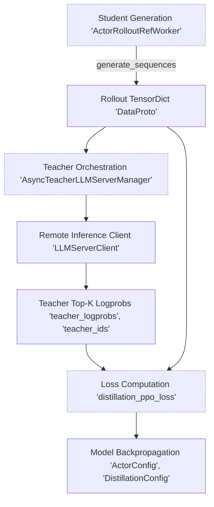
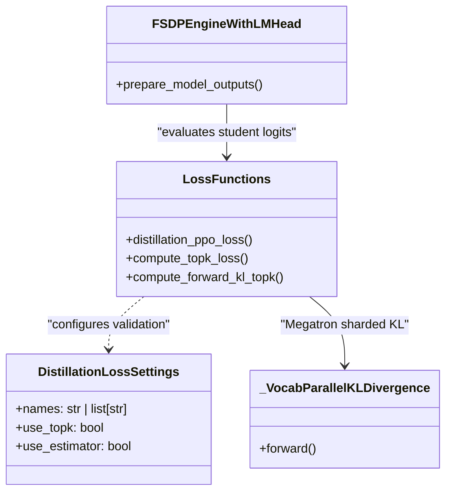

<!-- source: DeepWiki mcp.deepwiki.com · repo volcengine/verl · page 14.3 On-Policy Distillation and Teacher-Student Training · fetched 2026-10-21 -->

# On-Policy Distillation and Teacher-Student Training

Relevant source files

The following files were used as context for generating this wiki page:

- [docs/algo/opd.md](docs/algo/opd.md)
- [examples/on_policy_distillation_trainer/README.md](examples/on_policy_distillation_trainer/README.md)
- [examples/on_policy_distillation_trainer/run_qwen3_8b_mopd_fsdp.sh](examples/on_policy_distillation_trainer/run_qwen3_8b_mopd_fsdp.sh)
- [scripts/chat_template_checker.py](scripts/chat_template_checker.py)
- [scripts/chat_template_mock_trajectories.py](scripts/chat_template_mock_trajectories.py)
- [tests/experimental/agent_loop/test_tool_call_id_on_cpu.py](tests/experimental/agent_loop/test_tool_call_id_on_cpu.py)
- [tests/utils/test_continuous_token_on_cpu.py](tests/utils/test_continuous_token_on_cpu.py)
- [tests/utils/test_special_megatron_kl_loss_tp.py](tests/utils/test_special_megatron_kl_loss_tp.py)
- [tests/utils/test_turn_separator_on_cpu.py](tests/utils/test_turn_separator_on_cpu.py)
- [tests/workers/rollout/test_router_on_cpu.py](tests/workers/rollout/test_router_on_cpu.py)
- [tests/workers/test_chunked_topk_log_probs_on_cpu.py](tests/workers/test_chunked_topk_log_probs_on_cpu.py)
- [tests/workers/test_distillation_topk_symmetry_on_cpu.py](tests/workers/test_distillation_topk_symmetry_on_cpu.py)
- [tests/workers/test_packed_pad_to_length_on_cpu.py](tests/workers/test_packed_pad_to_length_on_cpu.py)
- [verl/experimental/agent_loop/utils.py](verl/experimental/agent_loop/utils.py)
- [verl/experimental/teacher_loop/teacher_manager.py](verl/experimental/teacher_loop/teacher_manager.py)
- [verl/experimental/teacher_loop/teacher_model.py](verl/experimental/teacher_loop/teacher_model.py)
- [verl/trainer/distillation/fsdp/losses.py](verl/trainer/distillation/fsdp/losses.py)
- [verl/trainer/distillation/losses.py](verl/trainer/distillation/losses.py)
- [verl/trainer/distillation/megatron/losses.py](verl/trainer/distillation/megatron/losses.py)
- [verl/trainer/ppo/padding_utils.py](verl/trainer/ppo/padding_utils.py)
- [verl/utils/tokenizer/chat_template.py](verl/utils/tokenizer/chat_template.py)
- [verl/utils/tokenizer/continuous_token.py](verl/utils/tokenizer/continuous_token.py)
- [verl/utils/tokenizer/continuous_token_wiring.py](verl/utils/tokenizer/continuous_token_wiring.py)
- [verl/utils/tokenizer/deepseek.py](verl/utils/tokenizer/deepseek.py)
- [verl/workers/config/distillation.py](verl/workers/config/distillation.py)

## Purpose and Scope

This wiki page documents the on-policy distillation (OPD) framework in `verl`, detailing the teacher-student training architecture, teacher loop management, distillation loss modes (`k1`, `k3`, `forward_kl_topk`), and strategy-specific loss implementations for distributed execution backends like FSDP and Megatron.

---

## 1. Architectural Overview and OPD Algorithm

On-policy distillation (OPD) transfers capabilities from a larger teacher model to a student model during reinforcement learning by evaluating teacher log probabilities on student-generated states [docs/algo/opd.md:29-33](). Unlike offline Supervised Fine-Tuning (SFT) or standard knowledge distillation, OPD samples rollouts directly from the student policy $\pi_{\theta}$, aligning training-time states with inference-time states to eliminate exposure bias [docs/algo/opd.md:15-22]() [docs/algo/opd.md:29-33]().

The framework supports multiple loss configurations managed via `DistillationLossConfig` [verl/workers/config/distillation.py:32-63]() and computes per-token divergence using estimators like `k1`, `k3`, or forward KL top-K distributions [verl/trainer/distillation/losses.py:123-162]().

**Diagram: On-Policy Distillation Execution Flow (Natural Language to Code Entities)**

Sources: [docs/algo/opd.md:29-33](), [verl/trainer/distillation/losses.py:165-180](), [verl/workers/config/distillation.py:32-63]()

Sources: [docs/algo/opd.md:15-33](), [verl/workers/config/distillation.py:32-89](), [verl/trainer/distillation/losses.py:123-180]()

---

## 2. Teacher Loop Management and Model Infrastructure

The teacher infrastructure manages dedicated inference replicas for teacher models across distributed Ray clusters.

### Teacher Model Manager Initialization
`DistillationTeacherModelConfig` configures teacher paths, replicas, and inference options [verl/workers/config/distillation.py:128-151](). Sampling parameters for the teacher model enforce `temperature=1.0` and configure top-K prompt log probabilities to supply the distillation loss pipeline.

Sources: [verl/workers/config/distillation.py:128-151]()

---

## 3. Distillation Loss Modes and Implementations

Distillation objectives are registered in `DISTILLATION_LOSS_REGISTRY` and configured via `DistillationLossSettings` [verl/trainer/distillation/losses.py:46-88]().

### Supported Loss Modes
*   **`k1`**: Single-sample reverse KL estimator where teacher and student logprobs are contrasted via stop-gradient [docs/algo/opd.md:83-114]().
*   **`k3`**: KL divergence evaluated and weighted across the top-3 token distribution [verl/trainer/distillation/fsdp/losses.py:71-146]().
*   **`forward_kl_topk`**: Forward KL divergence computed from the teacher's top-K distribution and student logits [docs/algo/opd.md:62-81]() [verl/trainer/distillation/losses.py:123-162]().

### Strategy-Specific Implementations
*   **FSDP / VeOmni**: `compute_forward_kl_topk` handles partitioned sequences across sequence/context parallel groups [verl/trainer/distillation/fsdp/losses.py:26-94](). It features a memory-efficient chunked logsumexp path (`use_chunked_topk`) to avoid vocabulary-dimension out-of-memory errors on long contexts [verl/trainer/distillation/fsdp/losses.py:113-120](). The `_chunked_topk_log_probs` function computes `log_softmax(logits).gather(topk_ids)` without materializing the full `[B, T, V]` log_softmax tensor, streaming the reduction in chunks along the `(B*T)` dimension [verl/trainer/distillation/fsdp/losses.py:26-63](). This is crucial for long-context scenarios where the full tensor would lead to OOM errors [verl/workers/config/distillation.py:72-82]().
*   **Megatron**: Uses `_VocabParallelKLDivergence` to compute forward KL directly on vocab-parallel logits without gathering the entire vocabulary tensor to a single rank [verl/trainer/distillation/megatron/losses.py:58-71](). This implementation handles global vocabulary coordinates and masks out target top-k entries that do not belong to the local shard [verl/trainer/distillation/megatron/losses.py:73-110]().

**Diagram: Loss & Engine Sharding Architecture (Natural Language to Code Entities)**

Sources: [verl/trainer/distillation/losses.py:46-162](), [verl/trainer/distillation/fsdp/losses.py:26-148](), [verl/trainer/distillation/megatron/losses.py:58-71](), [verl/workers/config/distillation.py:72-82]()

Sources: [docs/algo/opd.md:62-114](), [verl/trainer/distillation/losses.py:46-162](), [verl/trainer/distillation/fsdp/losses.py:26-148](), [verl/trainer/distillation/megatron/losses.py:58-71](), [verl/workers/config/distillation.py:72-82]()

---

## 4. Diagnostic Metrics and Verification

To monitor distillation training dynamics, the system tracks specific metrics during backward passes and loss computation:
*   **`overlap_count`**: Number of token positions where the student's top-K predictions overlap with the teacher's top-K predictions [verl/trainer/distillation/fsdp/losses.py:134-135]().
*   **`overlap_token_advantage`**: Relative probability mass or advantage of tokens inside the overlap set [verl/trainer/distillation/fsdp/losses.py:136-141]().
*   **`distillation/loss_min` / `distillation/loss_max`**: Minimum and maximum distillation loss bounds across valid response tokens [verl/trainer/distillation/losses.py:109-121]().

Regression guards such as `test_distillation_outputs_emitted_in_both_padding_modes` ensure distillation metadata and top-K tensors are correctly propagated across padded and unpadded (`use_remove_padding=True`) FSDP execution paths [tests/workers/test_distillation_topk_symmetry_on_cpu.py:82-171](). The `_make_logits_processor` function in tests simulates the distillation output for verification [tests/workers/test_distillation_topk_symmetry_on_cpu.py:68-79]().

Sources: [verl/trainer/distillation/losses.py:109-121](), [tests/workers/test_distillation_topk_symmetry_on_cpu.py:51-171](), [verl/trainer/distillation/fsdp/losses.py:134-141]()

---

