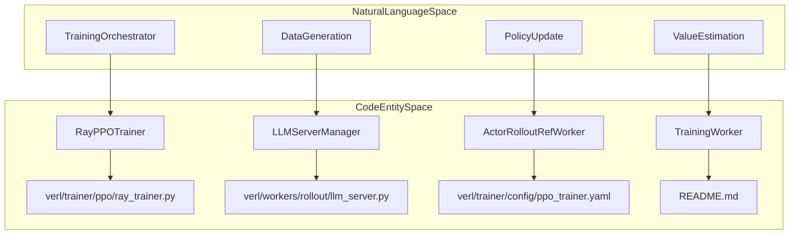
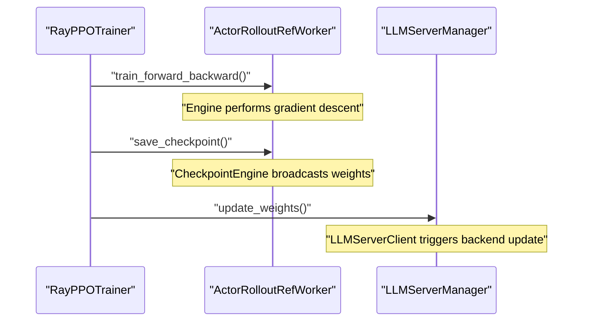
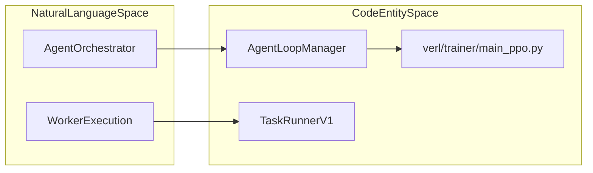

<!-- source: DeepWiki mcp.deepwiki.com · repo volcengine/verl · page 15 Glossary · fetched 2026-10-21 -->

# Glossary

Relevant source files

The following files were used as context for generating this wiki page:

- [README.md](README.md)
- [docs/examples/config.rst](docs/examples/config.rst)
- [docs/faq/faq.rst](docs/faq/faq.rst)
- [docs/index.rst](docs/index.rst)
- [docs/perf/perf_tuning.rst](docs/perf/perf_tuning.rst)
- [tests/single_controller/test_decorator_on_cpu.py](tests/single_controller/test_decorator_on_cpu.py)
- [tests/special_e2e/sft/compare_sft_engine_results.py](tests/special_e2e/sft/compare_sft_engine_results.py)
- [tests/special_sanity/validate_structure.py](tests/special_sanity/validate_structure.py)
- [tests/test_protocol_on_cpu.py](tests/test_protocol_on_cpu.py)
- [tests/test_protocol_v2_on_cpu.py](tests/test_protocol_v2_on_cpu.py)
- [verl/protocol.py](verl/protocol.py)
- [verl/single_controller/base/decorator.py](verl/single_controller/base/decorator.py)
- [verl/trainer/config/ppo_megatron_trainer.yaml](verl/trainer/config/ppo_megatron_trainer.yaml)
- [verl/trainer/config/ppo_trainer.yaml](verl/trainer/config/ppo_trainer.yaml)
- [verl/trainer/main_ppo.py](verl/trainer/main_ppo.py)
- [verl/trainer/ppo/core_algos.py](verl/trainer/ppo/core_algos.py)
- [verl/trainer/ppo/ray_trainer.py](verl/trainer/ppo/ray_trainer.py)
- [verl/utils/dataset/dataset_utils.py](verl/utils/dataset/dataset_utils.py)
- [verl/utils/tensordict_utils.py](verl/utils/tensordict_utils.py)

This page provides definitions and technical details for codebase-specific terms, jargon, and domain concepts used throughout the `verl` framework. It serves as a reference for onboarding engineers to understand the underlying implementation, architecture, and data structures.

## Core Architecture Concepts

### HybridFlow
The programming model that enables flexible representation and efficient execution of complex RL post-training workflows. It combines the strengths of single-controller (for easy logic definition) and multi-controller (for distributed performance) paradigms [README.md:26-30]().
Sources: [README.md:26-30]()

### 3D-HybridEngine
A specialized engine designed to optimize the transition between the training phase and the generation (rollout) phase. It eliminates memory redundancy and significantly reduces communication overhead by efficiently resharding weights between different model placements (e.g., from FSDP training shards to vLLM inference shards) [README.md:42-43]().
Sources: [README.md:42-43]()

### RayWorkerGroup
An abstraction over a group of Ray actors that allows treating them as a single logical unit for execution. It manages resource allocation and task dispatching across distributed nodes [verl/trainer/ppo/ray_trainer.py:38-39](). It is initialized by the trainer to manage different roles such as Actor, Critic, and Reference Policy [verl/trainer/ppo/ray_trainer.py:38-39]().
Sources: [verl/trainer/ppo/ray_trainer.py:38-39]()

### ResourcePoolManager
The component responsible for managing GPU resources and mapping logical model roles (Actor, Critic, etc.) to physical devices using Ray placement groups [verl/trainer/ppo/ray_trainer.py:38-39](). It is used in the trainer to partition GPUs for different model components [verl/trainer/ppo/ray_trainer.py:38-39]().
Sources: [verl/trainer/ppo/ray_trainer.py:38-39]()

## Data Structures

### DataProto
The primary data container used in `verl` to pass information between different workers (Actor, Critic, Rollout). It encapsulates tensors and provides utility methods for padding, unpadding, and batching [verl/trainer/ppo/ray_trainer.py:36-36](). DataProto is used to transfer rollout results back to the trainer for advantage estimation and loss calculation [verl/trainer/ppo/ray_trainer.py:78-117]().
Sources: [verl/trainer/ppo/ray_trainer.py:36-36](), [verl/trainer/ppo/ray_trainer.py:78-117]()

### TensorDict
A dictionary-like object that holds PyTorch tensors, allowing for collective operations (like slicing or moving to device) on all contained tensors simultaneously. It is used extensively to handle batches of data throughout the training loop [verl/trainer/ppo/ray_trainer.py:62-62]().
Sources: [verl/trainer/ppo/ray_trainer.py:62-62]()

## Training & Algorithm Jargon

### Advantage Estimator
A function used to estimate the "advantage" of an action compared to a baseline. `verl` supports multiple estimators defined in the `AdvantageEstimator` enum [verl/trainer/ppo/core_algos.py:88-111]().

| Term | Description | Code Pointer |
| :--- | :--- | :--- |
| **GAE** | Generalized Advantage Estimation, used in standard PPO. | [verl/trainer/ppo/core_algos.py:97-97]() |
| **GRPO** | Group Relative Policy Optimization, estimates advantage relative to a group of samples. | [verl/trainer/ppo/core_algos.py:98-98]() |
| **RLOO** | REINFORCE Leave-One-Out estimator. | [verl/trainer/ppo/core_algos.py:102-102]() |
| **REINFORCE++** | An improved version of REINFORCE advantage estimation. | [verl/trainer/ppo/core_algos.py:99-99]() |
| **Optimal Token Baseline** | A token-level baseline for variance reduction. | [verl/trainer/ppo/core_algos.py:108-108]() |
| **GDPO** | Generalized Direct Policy Optimization advantage. | [verl/trainer/ppo/core_algos.py:111-111]() |

Sources: [verl/trainer/ppo/core_algos.py:88-111](), [verl/trainer/config/ppo_trainer.yaml:70-78]()

### KL Controller
A mechanism to control the Kullback-Leibler (KL) divergence between the current policy and a reference policy.
*   **AdaptiveKLController**: Dynamically adjusts the coefficient based on a target KL value [verl/trainer/ppo/core_algos.py:153-163]().
*   **FixedKLController**: Uses a constant coefficient `kl_coef` [verl/trainer/ppo/core_algos.py:177-181]().
Sources: [verl/trainer/ppo/core_algos.py:153-163](), [verl/trainer/ppo/core_algos.py:177-181]()

### Policy Loss Mode
Different strategies for calculating the policy update loss, registered in `POLICY_LOSS_REGISTRY` [verl/trainer/ppo/core_algos.py:50-50]().
*   **vanilla**: Standard PPO clipping loss.
*   **GPG**: Generalized Policy Gradient [verl/trainer/ppo/core_algos.py:105-105]().
*   **DPPO**: Distributed PPO variants.
Sources: [verl/trainer/ppo/core_algos.py:50-50](), [verl/trainer/ppo/core_algos.py:105-105]()

## Worker Roles

In a typical PPO loop, workers are assigned specific roles that define their computational graph and data dependencies [verl/trainer/ppo/utils.py:52-61]().

### ActorRolloutRefWorker
A "hybrid" worker implementation that can switch between Actor (training), Rollout (generation), and Reference Policy (log-prob calculation) modes. This is the core of the HybridEngine [verl/trainer/config/ppo_trainer.yaml:53-60]().
Sources: [verl/trainer/config/ppo_trainer.yaml:53-60]()

### TrainingWorker
The base class for workers that perform gradient updates. It integrates with backend engines to handle distributed training backends like FSDP or Megatron.
Sources: [README.md:32-33]()

### RolloutReplica
An abstraction for the inference engine. It can be deployed in different modes [verl/workers/rollout/replica.py:34-40]():
*   **HYBRID**: Shared weights with the training actor on the same GPUs [verl/trainer/config/ppo_trainer.yaml:53-60]().
*   **COLOCATED**: Weights are on the same node but potentially different GPUs.
*   **STANDALONE**: Dedicated GPUs for inference, separate from training.
Sources: [verl/trainer/config/ppo_trainer.yaml:53-60](), [verl/workers/rollout/replica.py:34-40]()

## System Components Mapping

Title: "RL Loop to Code Entity Mapping"

Sources: [verl/trainer/ppo/ray_trainer.py:17-41](), [verl/trainer/ppo/utils.py:52-61](), [verl/trainer/config/ppo_trainer.yaml:53-60](), [README.md:32-33]()

## Data Flow and Transitions

Title: "Weight Synchronization Flow"

Sources: [verl/trainer/ppo/ray_trainer.py:17-41](), [README.md:42-43]()

## Distributed Training Terms

### FSDP (Fully Sharded Data Parallel)
A PyTorch distributed backend that shards model parameters, gradients, and optimizer states across data-parallel ranks.
Sources: [README.md:32-33]()

### Megatron-LM / MCore
A large-scale training framework from NVIDIA. `verl` integrates with Megatron-Core (MCore) for Tensor Parallelism (TP) and Pipeline Parallelism (PP).
Sources: [README.md:32-33]()

### Ulysses Sequence Parallel
A technique to parallelize the attention computation across the sequence dimension, particularly useful for long-context training.
Sources: [docs/examples/config.rst:143-143]()

### Remove Padding (Sequence Packing)
An optimization where tokens from different sequences in a batch are concatenated into a single long sequence to eliminate computation on padding tokens.
Sources: [docs/examples/config.rst:119-119]()

### Router Replay
A mechanism for MoE (Mixture of Experts) models to ensure deterministic routing during training and generation by caching and replaying routing decisions.
Sources: [docs/examples/config.rst:114-115]()

## Configuration Jargon

`verl` uses Hydra for configuration. Key terms in the YAML files:
*   **gamma**: Discount factor for future rewards [verl/trainer/config/ppo_trainer.yaml:71-72]().
*   **lam**: Trade-off between bias and variance in the GAE estimator [verl/trainer/config/ppo_trainer.yaml:74-75]().
*   **balance_batch**: Whether to balance batch sizes across distributed workers [verl/trainer/config/ppo_trainer.yaml:141-141]().
Sources: [verl/trainer/config/ppo_trainer.yaml:71-75](), [verl/trainer/config/ppo_trainer.yaml:141-141]()

## Agentic RL Jargon

### AgentLoopManager
The component responsible for orchestrating the multi-turn interaction loop, coordinating between the LLM server and external tools. In V1 PPO, `AgentLoopManagerTQ` is used [verl/trainer/main_ppo.py:118-124]().
Sources: [verl/trainer/main_ppo.py:118-124]()

### AgentLoopWorker
A worker class that executes agent loop coroutines in parallel across distributed resources.
Sources: [verl/trainer/main_ppo.py:103-110]()

### LLMServerClient
A client-side abstraction used by agent loops to request completions from distributed LLM inference backends (vLLM, SGLang).
Sources: [verl/trainer/main_ppo.py:128-128]()

Title: "Agent Loop Natural Language to Code Mapping"

Sources: [verl/trainer/main_ppo.py:103-124]()

## TransferQueue System

### TransferQueue (TQ)
A high-performance data transfer mechanism for asynchronous training. It allows the `AgentLoopManager` to stream rollout data to the trainer without blocking [verl/trainer/main_ppo.py:66-70]().
Sources: [verl/trainer/main_ppo.py:66-70]()

## Performance & Optimization

### PrefixGrouper
An optimization for algorithms like GRPO where multiple responses share the same prompt prefix, reducing redundant computation by processing the shared prefix only once.
Sources: [docs/index.rst:157-157]()

### SkipManager
A utility to skip specific pipeline steps (e.g., rollout, reward computation) during development or debugging to save time or replay cached data [verl/trainer/ppo/ray_trainer.py:70-70]().
Sources: [verl/trainer/ppo/ray_trainer.py:70-70]()

### Dynamic Context Parallel (DCP)
A technique to handle sequence parallelism for varying sequence lengths in a batch, supported in distributed backends.
Sources: [docs/index.rst:106-106]()