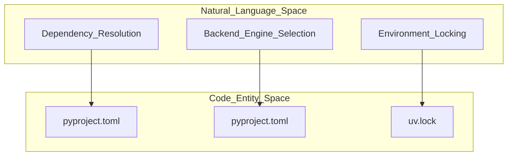
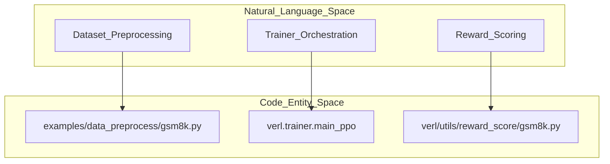

<!-- source: DeepWiki mcp.deepwiki.com · repo volcengine/verl · page 2 Getting Started · fetched 2026-10-21 -->

# Getting Started

Relevant source files

The following files were used as context for generating this wiki page:

- [docker/Dockerfile.uv.cu130](docker/Dockerfile.uv.cu130)
- [docker/README.md](docker/README.md)
- [docs/advance/dpo_extension.rst](docs/advance/dpo_extension.rst)
- [docs/algo/baseline.md](docs/algo/baseline.md)
- [docs/algo/dapo.md](docs/algo/dapo.md)
- [docs/api/data.rst](docs/api/data.rst)
- [docs/api/single_controller.rst](docs/api/single_controller.rst)
- [docs/examples/gsm8k_example.rst](docs/examples/gsm8k_example.rst)
- [docs/examples/ppo_code_architecture.rst](docs/examples/ppo_code_architecture.rst)
- [docs/hybrid_flow.rst](docs/hybrid_flow.rst)
- [docs/perf/device_tuning.rst](docs/perf/device_tuning.rst)
- [docs/preparation/reward_function.rst](docs/preparation/reward_function.rst)
- [docs/start/install.rst](docs/start/install.rst)
- [docs/start/multinode.rst](docs/start/multinode.rst)
- [docs/start/quickstart.rst](docs/start/quickstart.rst)
- [docs/workers/model_engine.rst](docs/workers/model_engine.rst)
- [examples/tutorial/slurm/ray_on_slurm.slurm](examples/tutorial/slurm/ray_on_slurm.slurm)
- [manage_envs.py](manage_envs.py)
- [pyproject.toml](pyproject.toml)
- [requirements.txt](requirements.txt)
- [setup.py](setup.py)
- [uv.lock](uv.lock)

## Purpose and Scope

This page provides an architectural overview of how to install `verl`, set up required environments, and execute quick start workflows for reinforcement learning post-training. As a parent page, it summarizes core installation paths, execution tutorials, and deployment strategies, directing readers to specialized child pages for deep technical details. 

For comprehensive guides, refer to:
- **Installation and Environment Setup**: Guide users through Docker installation, uv/conda environment setup, and dependency installation for different backends. See [Installation and Environment Setup](#2.1).
- **Quick Start: PPO Training**: Walkthrough of launching a basic PPO training job with example commands and minimal configuration. See [Quick Start: PPO Training](#2.2).
- **Quick Start: GRPO and Other Algorithms**: Examples of running GRPO, RLOO, DAPO, and other RL algorithms with configuration snippets. See [Quick Start: GRPO and Other Algorithms](#2.3).
- **Quick Start: Supervised Fine-Tuning**: Guide for running SFT with LoRA/PEFT, including data preparation and training launch. See [Quick Start: Supervised Fine-Tuning](#2.4).
- **Multinode Deployment and Hardware Selection**: Instructions for scaling to multi-node clusters and choosing appropriate hardware configurations. See [Multinode Deployment and Hardware Selection](#2.5).

Sources: [docs/start/quickstart.rst:1-133](), [docs/examples/gsm8k_example.rst:1-185]()

---

## Installation and Environment Setup

The `verl` framework relies on a hybrid backend design that decouples training computation (`FSDP`, `Megatron-LM`) from rollout generation (`vLLM`, `SGLang`) [docs/start/install.rst:10-14](). Environment management is driven by `uv` with a committed `uv.lock` file or via pre-built Docker containers [docs/start/install.rst:31-36](). Users select backend combinations as explicit extras [docs/start/install.rst:34-40]().

For detailed instructions on resolving dependencies, managing virtual environments, and setting up specific backend configurations, see [Installation and Environment Setup](#2.1).

Title: "Installation and Environment Mapping"

Sources: [docs/start/install.rst:31-58](), [pyproject.toml:1-172](), [uv.lock:1-33]()

---

## Quick Start: PPO Training

Launching a standard Proximal Policy Optimization (PPO) training job involves dataset preparation (e.g., preprocessing math datasets into Parquet format), downloading a base instruction model, and executing the training entrypoint managed by the trainer [docs/start/quickstart.rst:40-127](). The `verl.trainer.main_ppo` script is used for this purpose [docs/start/quickstart.rst:102]().

For a full walkthrough using the GSM8K benchmark, configuration tuning, and log analysis, see [Quick Start: PPO Training](#2.2) [docs/start/quickstart.rst:1-133](), [docs/examples/gsm8k_example.rst:1-185]().

Title: "PPO Training Execution Mapping"

Sources: [docs/start/quickstart.rst:40-127](), [docs/examples/gsm8k_example.rst:43-178]()

---

## Quick Start: GRPO and Other Algorithms

Beyond standard PPO, `verl` supports diverse reinforcement learning algorithms such as Group Relative Policy Optimization (GRPO), ReMax, DAPO, and RLOO. These algorithms modify the advantage calculation and policy loss formulation without changing the underlying distributed worker communication pattern.

For complete example scripts, algorithm-specific configurations, and usage instructions for alternative post-training workflows, see [Quick Start: GRPO and Other Algorithms](#2.3).

Sources: [docs/examples/gsm8k_example.rst:1-185]()

---

## Quick Start: Supervised Fine-Tuning

Before executing reinforcement learning workflows, models can be adapted using Supervised Fine-Tuning (SFT) with PyTorch FSDP, LoRA, or PEFT integrations [docs/examples/gsm8k_example.rst:73-97](). The SFT trainer consumes formatted conversation datasets and handles gradient accumulation, sequence packing, and checkpoint persistence [docs/examples/gsm8k_example.rst:76-97]().

For detailed instructions on preparing SFT datasets, configuring learning rates, and launching distributed SFT jobs, see [Quick Start: Supervised Fine-Tuning](#2.4) [docs/examples/gsm8k_example.rst:73-97]().

Sources: [docs/examples/gsm8k_example.rst:73-97]()

---

## Multinode Deployment and Hardware Selection

Scaling reinforcement learning workloads across multi-node clusters requires orchestrating Ray resource allocations. `verl` supports multiple hardware acceleration platforms including NVIDIA GPUs, AMD ROCm, and Huawei Ascend NPUs via platform-agnostic abstraction layers. The `trainer.n_gpus_per_node` and `trainer.nnodes` parameters in the configuration control distributed training across multiple devices and nodes [docs/start/quickstart.rst:123-124]().

For multi-node deployment topologies, cluster job scripts, and hardware tuning guidelines, see [Multinode Deployment and Hardware Selection](#2.5) [docs/examples/gsm8k_example.rst:99-107](), [docs/start/quickstart.rst:123-124]().

Sources: [docs/examples/gsm8k_example.rst:99-107](), [docs/start/quickstart.rst:123-124]()

---

