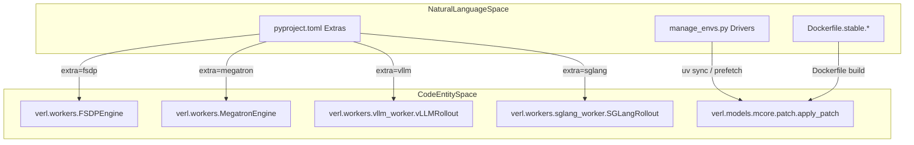
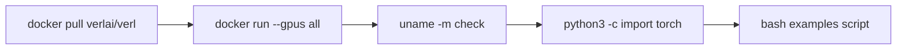
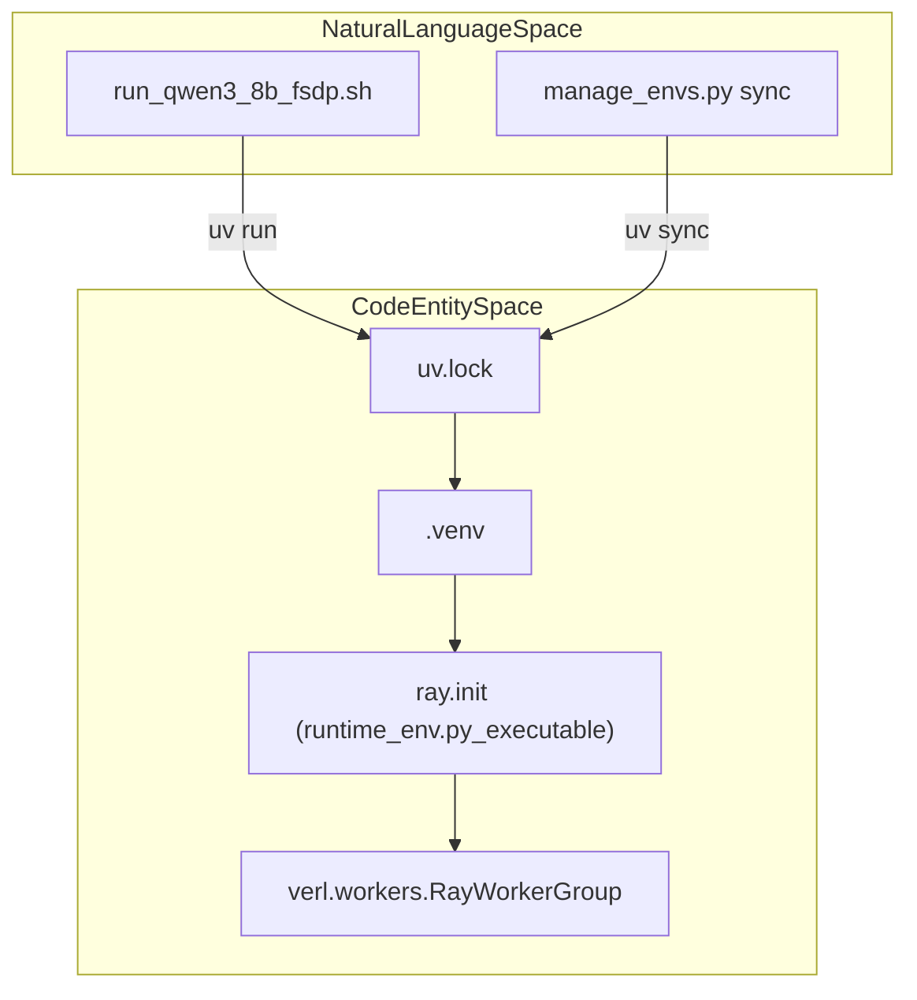

<!-- source: DeepWiki mcp.deepwiki.com · repo volcengine/verl · page 2.1 Installation and Environment Setup · fetched 2026-10-21 -->

# Installation and Environment Setup

<details>
<summary>Relevant source files</summary>

The following files were used as context for generating this wiki page:

- [docker/Dockerfile.stable.sglang](docker/Dockerfile.stable.sglang)
- [docker/Dockerfile.stable.vllm](docker/Dockerfile.stable.vllm)
- [docker/Dockerfile.uv.cu130](docker/Dockerfile.uv.cu130)
- [docker/README.md](docker/README.md)
- [docker/verl0.6.1-experimental/Dockerfile.sglang056exp](docker/verl0.6.1-experimental/Dockerfile.sglang056exp)
- [docker/verl0.6.1-experimental/Dockerfile.vllm012exp](docker/verl0.6.1-experimental/Dockerfile.vllm012exp)
- [docs/start/install.rst](docs/start/install.rst)
- [manage_envs.py](manage_envs.py)
- [pyproject.toml](pyproject.toml)
- [requirements.txt](requirements.txt)
- [setup.py](setup.py)
- [uv.lock](uv.lock)

</details>


## Purpose and Scope

This document guides users through environment setup, Docker configuration, and dependency installation for `verl` [docs/start/install.rst:1-15](). It covers multiple backend configurations—including training engines like PyTorch FSDP and Megatron-LM, and inference/rollout backends like vLLM, SGLang, and TensorRT-LLM [docs/start/install.rst:10-15](). Furthermore, it details both the modern `uv`-driven reproducible workflow powered by `manage_envs.py` and traditional containerized or pip-based installations [docs/start/install.rst:31-48](), [manage_envs.py:15-35]().

Sources: [docs/start/install.rst:1-15](), [docs/start/install.rst:31-48](), [manage_envs.py:15-35]()

---

## System Requirements and Backend Architecture

`verl` relies on modern Python and CUDA runtimes to execute high-throughput reinforcement learning loops. The baseline environment requirements are defined across packaging configuration files:

| Component | Version Requirement | Code Reference |
|-----------|--------------------|----------------|
| Python | `>= 3.10` (Target: `3.12` for `uv`) | [pyproject.toml:11](), [docs/start/install.rst:52]() |
| CUDA | `>= 12.8` (Target: `13.0.2` in stable images) | [docs/start/install.rst:8](), [docker/Dockerfile.stable.vllm:4]() |
| Ray | `>= 2.41.0` | [setup.py:38]() |
| TensorDict | `>= 0.8.0, <= 0.10.0, != 0.9.0` | [setup.py:40]() |
| Transformers | `>= 5.5.3, != 5.6.0, < 5.13` (Project Pin: `==5.12.1`) | [setup.py:43](), [pyproject.toml:31]() |

Sources: [pyproject.toml:11](), [docs/start/install.rst:8](), [docs/start/install.rst:52](), [docker/Dockerfile.stable.vllm:4](), [setup.py:38-43](), [pyproject.toml:31]()

### Diagram: Installation Target to Code Entity Mapping

This diagram bridges natural language configuration intent to specific code entities, build scripts, and backend workers within the codebase.


Sources: [pyproject.toml:24-171](), [setup.py:26-77](), [manage_envs.py:15-134](), [docker/Dockerfile.stable.vllm:1-161](), [verl/models/mcore/patch.py:1-160]()

---

## Installation Methods

### Method 1: Docker Installation (Production & Multi-Arch)

Starting from v0.6.0, `verl` uses official vLLM and SGLang release images as base layers [docker/README.md:5](). Pre-built images are published to DockerHub under `verlai/verl` (e.g., `verlai/verl:vllm024.latest`, `verlai/verl:sgl0512.latest`) [docker/README.md:27]().

The application image layers compile and bundle critical high-performance extensions:
- **`flash_attn`**: Optimized attention kernels [docker/Dockerfile.stable.vllm:17]()
- **Megatron-LM**: Trillion-parameter training support [docker/Dockerfile.stable.vllm:150]()
- **Apex**: Mixed precision utilities [docker/Dockerfile.stable.vllm:82]()
- **TransformerEngine**: NVIDIA hardware primitives [docker/Dockerfile.stable.vllm:85]()
- **DeepEP**: Efficient MoE communication primitives [docker/Dockerfile.stable.vllm:106]()
- **TransferQueue**: Asynchronous data streaming [docker/Dockerfile.stable.vllm:21]()

Building locally from the repository root is supported via stable Dockerfiles [docker/README.md:34-40]():
```bash
docker build -f docker/Dockerfile.stable.vllm -t verl:vllm-local .
```
For users behind network restrictions or regional mirrors, pass the `APT_MIRROR` build argument [docker/README.md:42-47]():
```bash
docker build -f docker/Dockerfile.stable.vllm \
    --build-arg APT_MIRROR=https://mirrors.tuna.tsinghua.edu.cn \
    -t verl:vllm-local .
```

Sources: [docker/README.md:5-47](), [docker/Dockerfile.stable.vllm:17-150]()

#### Diagram: Docker Container Execution and Runtime Flow


Sources: [docker/README.md:1-164](), [docker/Dockerfile.stable.vllm:1-161]()

---

### Method 2: UV-Managed Environment (`uv.lock` & `manage_envs.py`)

`verl` provides a reproducible Python environment workflow driven by `uv`, utilizing a committed `uv.lock` file that captures all backend dependencies [docs/start/install.rst:31-35](), [manage_envs.py:15-23](). The workflow targets Linux with Python 3.12 on both `x86_64` and `aarch64` architectures [docs/start/install.rst:50-52](), [manage_envs.py:126-134]().

The `manage_envs.py` driver script exposes administrative tasks for locking, syncing, running, and prefetching environments [manage_envs.py:42-53]():
- `python manage_envs.py lock`: Regenerates the universal `uv.lock` [manage_envs.py:44]()
- `python manage_envs.py sync <extras...>`: Materializes `.venv` up front for specific combinations (e.g., `fsdp vllm`) [manage_envs.py:45]()
- `python manage_envs.py prefetch`: Populates the local uv cache (`$UV_CACHE_DIR`) with prebuilt wheels and source builds during Docker image construction [manage_envs.py:50-52]()

To run jobs or tests without manual virtual environment creation, `uv run` materializes and caches the environment on first invocation [docs/start/install.rst:41-45]():
```bash
bash examples/grpo_trainer/run_qwen3_8b_fsdp.sh

# Select alternative inference backend
INFER_BACKEND=sglang bash examples/grpo_trainer/run_qwen3_8b_fsdp.sh
```

The underlying launcher configuration injects `uv run` arguments and propagates the execution environment to Ray workers via `ray_kwargs.ray_init.runtime_env.py_executable` [docs/start/install.rst:97-108](). Furthermore, `verl/__init__.py` sets `RAY_ENABLE_UV_RUN_RUNTIME_ENV=0` to avoid conflicts with Ray's internal runtime-env working directory hooks [docs/start/install.rst:130-135]().

Sources: [docs/start/install.rst:31-139](), [manage_envs.py:15-134](), [pyproject.toml:1-171]()

#### Diagram: UV Environment Synchronization and Ray Propagation Flow


Sources: [docs/start/install.rst:31-139](), [manage_envs.py:15-134](), [pyproject.toml:1-171]()

---

### Method 3: Traditional Pip and Manual Setup

When `uv` or Docker is not used, `verl` supports standard editable installations from source [setup.py:83-105]():
```bash
git clone https://github.com/volcengine/verl && cd verl
pip install -e .
```

For backend-specific extras defined in `setup.py`, install corresponding optional groups [setup.py:66-77]():
```bash
pip install -e ".[vllm]"    # vLLM rollout backend
pip install -e ".[sglang]"  # SGLang rollout backend
pip install -e ".[mcore]"   # Megatron-Core training backend
```

Alternatively, installation scripts automate the compilation of FlashAttention, TransformerEngine, and Megatron-LM.

Sources: [setup.py:66-105]()

---

## Backend-Specific Configurations and Dependency Mapping

Each backend configures specific packages and compatibility pins:

- **vLLM Rollout Backend**: Pins `vllm==0.29.0` in `pyproject.toml` [pyproject.toml:95]() (or `vllm>=0.18.0` in setup configurations [setup.py:55]()), paired with `torch==2.13.0` [pyproject.toml:90]().
- **SGLang Rollout Backend**: Integrates `sglang==0.5.20` and `sglang-kernel` [pyproject.toml:111-114]() along with custom CUDA extensions [docker/Dockerfile.stable.sglang:72-98]().
- **Megatron-LM Training Backend**: Relies on `megatron-core` (`core_v0.19.2` as per `uv.lock` [uv.lock:40]()), `megatron-bridge` (`0.6.2` as per `uv.lock` [uv.lock:36]()), `TransformerEngine`, and `Apex` [pyproject.toml:44](), [docker/Dockerfile.stable.vllm:82-150]().
- **FSDP Training Backend**: Combines PyTorch FSDP with `liger-kernel>=0.8.2` and `flash-attn` [pyproject.toml:141-146]().

Sources: [pyproject.toml:44](), [pyproject.toml:90-146](), [setup.py:55](), [docker/Dockerfile.stable.vllm:82-150](), [docker/Dockerfile.stable.sglang:72-98](), [uv.lock:36](), [uv.lock:40]()

---

## Hardware Platform Customization

- **NVIDIA GPUs**: Requires CUDA >= 12.8 [docs/start/install.rst:8](). Precompiled wheels target `cu130` with PyTorch 2.13 [pyproject.toml:19]().
- **AMD GPUs (ROCm)**: Supported via AMD ROCm platforms for MI300 accelerators, utilizing pure-torch shims where native CUDA extensions cannot be built.
- **Huawei Ascend NPU Support**: Ascend NPU support is outside the `uv` workflow and requires dedicated images [docs/start/install.rst:58](). It is supported via CANN and MindSpeed toolchains, integrating `TransferQueue` for asynchronous cross-device communication [requirements.txt:28]().

Sources: [docs/start/install.rst:8](), [docs/start/install.rst:58](), [pyproject.toml:19](), [requirements.txt:28]()

---

