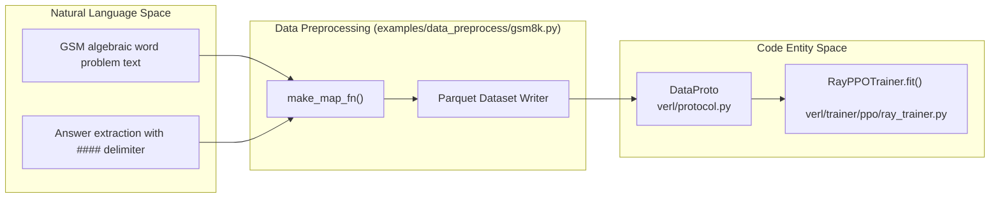

<!-- source: DeepWiki mcp.deepwiki.com · repo volcengine/verl · page 2.2 Quick Start: PPO Training · fetched 2026-10-21 -->

# Quick Start: PPO Training

<details>
<summary>Relevant source files</summary>

The following files were used as context for generating this wiki page:

- [docs/advance/dpo_extension.rst](docs/advance/dpo_extension.rst)
- [docs/algo/baseline.md](docs/algo/baseline.md)
- [docs/algo/dapo.md](docs/algo/dapo.md)
- [docs/api/data.rst](docs/api/data.rst)
- [docs/api/single_controller.rst](docs/api/single_controller.rst)
- [docs/examples/config.rst](docs/examples/config.rst)
- [docs/examples/gsm8k_example.rst](docs/examples/gsm8k_example.rst)
- [docs/examples/ppo_code_architecture.rst](docs/examples/ppo_code_architecture.rst)
- [docs/hybrid_flow.rst](docs/hybrid_flow.rst)
- [docs/perf/device_tuning.rst](docs/perf/device_tuning.rst)
- [docs/perf/perf_tuning.rst](docs/perf/perf_tuning.rst)
- [docs/preparation/reward_function.rst](docs/preparation/reward_function.rst)
- [docs/start/multinode.rst](docs/start/multinode.rst)
- [docs/start/quickstart.rst](docs/start/quickstart.rst)
- [docs/workers/model_engine.rst](docs/workers/model_engine.rst)
- [examples/tutorial/slurm/ray_on_slurm.slurm](examples/tutorial/slurm/ray_on_slurm.slurm)
- [verl/trainer/config/ppo_megatron_trainer.yaml](verl/trainer/config/ppo_megatron_trainer.yaml)
- [verl/trainer/config/ppo_trainer.yaml](verl/trainer/config/ppo_trainer.yaml)
- [verl/trainer/main_ppo.py](verl/trainer/main_ppo.py)
- [verl/trainer/ppo/core_algos.py](verl/trainer/ppo/core_algos.py)
- [verl/trainer/ppo/ray_trainer.py](verl/trainer/ppo/ray_trainer.py)

</details>


## Purpose and Scope
This page provides a technical walkthrough for launching a basic Proximal Policy Optimization (PPO) training job within the `verl` framework. It covers end-to-end dataset preparation on the GSM8K math reasoning benchmark [docs/start/quickstart.rst:4-5](), Hydra-based configuration management [docs/start/quickstart.rst:102-127](), distributed execution via Ray orchestration [verl/trainer/main_ppo.py:56-74](), and training execution using the FSDP backend [docs/examples/gsm8k_example.rst:135-178]().

Sources: [docs/start/quickstart.rst:4-5](), [docs/start/quickstart.rst:102-127](), [verl/trainer/main_ppo.py:56-74](), [docs/examples/gsm8k_example.rst:135-178]()

---

## Prerequisites and Environment Setup

Before launching a PPO training job, verify the following prerequisites:
1. **Framework Installation**: `verl` and its runtime dependencies installed in your Python environment or container, or managed via `uv` workflows [docs/start/quickstart.rst:16-18](), [docs/start/quickstart.rst:24-37]().
2. **Hardware Requirements**: At least one NVIDIA GPU with sufficient High Bandwidth Memory (e.g., 24 GB+ for smaller instruct models) [docs/start/quickstart.rst:20-20]().
3. **Model Checkpoints**: Base or instruction-tuned model weights (e.g., `Qwen/Qwen2.5-0.5B-Instruct`) available locally or accessible via HuggingFace/ModelScope [docs/start/quickstart.rst:71-71](), [docs/examples/gsm8k_example.rst:56-68]().
4. **Ray Runtime**: Ray initialized automatically via `ray.init` inside the runner orchestration [verl/trainer/main_ppo.py:56-74]().

Sources: [docs/start/quickstart.rst:16-37](), [docs/start/quickstart.rst:71-71](), [docs/examples/gsm8k_example.rst:56-68](), [verl/trainer/main_ppo.py:56-74]()

---

## Training Workflow Architecture and Initialization

The training pipeline begins at the entry point `verl/trainer/main_ppo.py` [verl/trainer/main_ppo.py:1-20](). When invoked, `run_ppo()` sets up environment configurations, initializes the Ray cluster via `ray.init()` [verl/trainer/main_ppo.py:56-74](), and spawns a remote instance of `TaskRunnerV1` [verl/trainer/main_ppo.py:106-116](). The runner loads the designated trainer class (e.g., `RayPPOTrainer`) [verl/trainer/ppo/ray_trainer.py:17-19]() and invokes `fit()` to coordinate worker roles across the cluster [verl/trainer/main_ppo.py:137-156]().

### Diagram: Entry Point and Initialization Flow

```mermaid
graph TB
    subgraph NaturalLanguageSpace["Natural Language Space"]
        ConfigDesc[""Hydra YAML Configuration & CLI Overrides""]
        ModelSpec[""Model Weights Path (Qwen/Qwen2.5-0.5B-Instruct)""]
    end

    subgraph CodeEntitySpace["Code Entity Space"]
        Main["main() <br/> verl/trainer/main_ppo.py"]
        RunPPO["run_ppo(config) <br/> verl/trainer/main_ppo.py:35"]
        TaskRunner["TaskRunnerV1 <br/> verl/trainer/main_ppo.py:106"]
        TrainerClass["RayPPOTrainer <br/> verl/trainer/ppo/ray_trainer.py"]
        FitMethod["RayPPOTrainer.fit() <br/> verl/trainer/ppo/ray_trainer.py"]
    end

    ConfigDesc --> Main
    ModelSpec --> Main
    Main --> RunPPO
    RunPPO --> TaskRunner
    TaskRunner --> TrainerClass
    TrainerClass --> FitMethod
```

Sources: [verl/trainer/main_ppo.py:34-156](), [verl/trainer/ppo/ray_trainer.py:1-20]()

---

## Step 1: Dataset Preparation and Data Flow

Reinforcement learning workflows in `verl` require training data formatted as Parquet files containing prompt strings and ground truth labels for reward verification [docs/start/quickstart.rst:59-62](). 

### GSM8K Preprocessing
Execute the provided preprocessing utility script to download and structure the GSM8K dataset [docs/start/quickstart.rst:66-67]():

```bash
python3 examples/data_preprocess/gsm8k.py --local_save_dir ~/data/gsm8k
```

This generates `train.parquet` and `test.parquet` containing tokenized or raw prompt fields along with target solution strings [docs/examples/gsm8k_example.rst:88-89]().

### Diagram: Dataset Ingestion and DataProto Flow



Sources: [docs/start/quickstart.rst:59-67](), [docs/examples/gsm8k_example.rst:30-49](), [verl/trainer/ppo/ray_trainer.py:1-20](), [verl/protocol.py:1-1]()

---

## Step 2: Launching a Basic PPO Training Job

To launch a single-node PPO training job utilizing vLLM for rollout generation and FSDP for model parameter sharding, run the following command [docs/start/quickstart.rst:102-127]():

```bash
PYTHONUNBUFFERED=1 python3 -m verl.trainer.main_ppo \
    data.train_files=$HOME/data/gsm8k/train.parquet \
    data.val_files=$HOME/data/gsm8k/test.parquet \
    data.train_batch_size=256 \
    data.max_prompt_length=512 \
    data.max_response_length=512 \
    actor_rollout_ref.model.path=Qwen/Qwen2.5-0.5B-Instruct \
    actor_rollout_ref.actor.optim.lr=1e-6 \
    actor_rollout_ref.actor.ppo_mini_batch_size=64 \
    actor_rollout_ref.actor.ppo_micro_batch_size_per_gpu=4 \
    actor_rollout_ref.rollout.name=vllm \
    actor_rollout_ref.rollout.gpu_memory_utilization=0.4 \
    critic.optim.lr=1e-5 \
    critic.model.path=Qwen/Qwen2.5-0.5B-Instruct \
    critic.ppo_micro_batch_size_per_gpu=4 \
    algorithm.kl_ctrl.kl_coef=0.001 \
    trainer.logger=console \
    trainer.val_before_train=False \
    trainer.n_gpus_per_node=1 \
    trainer.nnodes=1 \
    trainer.save_freq=10 \
    trainer.test_freq=10 \
    trainer.total_epochs=15 2>&1 | tee verl_demo.log
```

Sources: [docs/start/quickstart.rst:102-127]()

---

## Step 3: Core Configuration Parameters Reference

The Hydra configuration system defined in `verl/trainer/config/ppo_trainer.yaml` controls all training hyperparameters [docs/examples/gsm8k_example.rst:116-116](), [verl/trainer/config/ppo_trainer.yaml:1-51](). Key parameters are detailed below:

| Configuration Path | Type | Description |
| :--- | :--- | :--- |
| `data.train_batch_size` | `int` | Global batch size of prompt samples processed per training iteration [docs/examples/gsm8k_example.rst:144-144](). |
| `actor_rollout_ref.actor.ppo_mini_batch_size` | `int` | Mini-batch size used for gradient updates on the actor model across workers [docs/examples/gsm8k_example.rst:150-150](). |
| `actor_rollout_ref.rollout.name` | `str` | Rollout generation backend engine selection (e.g., `vllm`, `sglang`) [docs/start/quickstart.rst:112-112](). |
| `algorithm.adv_estimator` | `str` | Advantage estimation algorithm (`gae`, `grpo`, `reinforce_plus_plus`, `rloo`) [verl/trainer/config/ppo_trainer.yaml:77-78](). |
| `algorithm.kl_ctrl.kl_coef` | `float` | Initial scaling coefficient for the reward KL penalty term [verl/trainer/config/ppo_trainer.yaml:116-117](). |

Sources: [docs/start/quickstart.rst:112-120](), [docs/examples/gsm8k_example.rst:144-150](), [verl/trainer/config/ppo_trainer.yaml:1-206]()

---

## Step 4: Monitoring, Logging, and Checkpointing

During training, `RayPPOTrainer` computes metrics and outputs telemetry [verl/trainer/ppo/ray_trainer.py:44-50]():
- **KL Penalty**: Computed via `apply_kl_penalty()` using log probabilities from the reference policy and current policy [verl/trainer/ppo/ray_trainer.py:78-117]().
- **Validation**: Validation runs periodically according to `trainer.test_freq`, assessing score metrics [docs/start/quickstart.rst:126-129]().
- **Checkpointing**: Model states are serialized according to the interval specified by `trainer.save_freq` [docs/start/quickstart.rst:125-125](), utilizing checkpoint management utilities [verl/utils/checkpoint/checkpoint_manager.py:63-63]().

Sources: [verl/trainer/ppo/ray_trainer.py:44-117](), [docs/start/quickstart.rst:125-129](), [verl/utils/checkpoint/checkpoint_manager.py:63-63]()

---

## Advanced Configuration: Megatron-LM Backend

For large-scale models requiring hybrid parallelism strategies, `verl` supports the Megatron-LM backend through configuration overrides defined in `verl/trainer/config/ppo_megatron_trainer.yaml` [docs/examples/gsm8k_example.rst:128-128](), [verl/trainer/config/ppo_megatron_trainer.yaml:1-6](). Switch engines using configuration arguments:

```bash
python3 -m verl.trainer.main_ppo \
    model_engine=megatron \
    actor_rollout_ref.actor.strategy=megatron \
    actor_rollout_ref.actor.ppo_mini_batch_size=256 \
    trainer.n_gpus_per_node=8
```

Sources: [docs/examples/gsm8k_example.rst:128-128](), [verl/trainer/config/ppo_megatron_trainer.yaml:1-6]()

---

