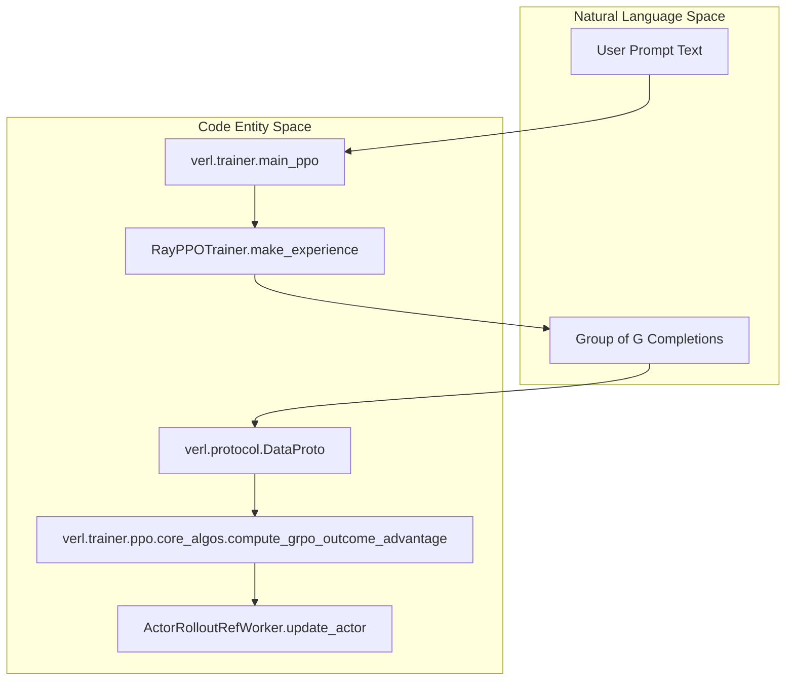
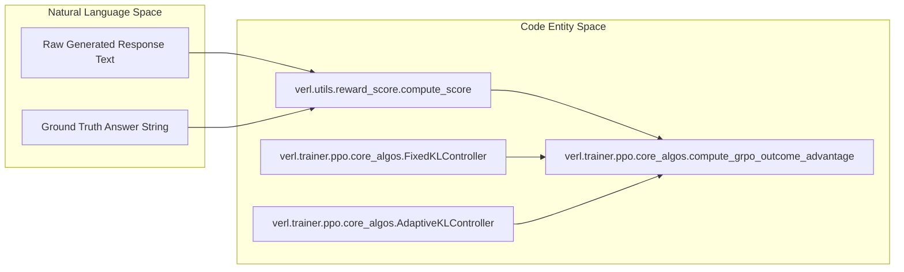

<!-- source: DeepWiki mcp.deepwiki.com · repo volcengine/verl · page 2.3 Quick Start: GRPO and Other Algorithms · fetched 2026-10-21 -->

# Quick Start: GRPO and Other Algorithms

<details>
<summary>Relevant source files</summary>

The following files were used as context for generating this wiki page:

- [docs/algo/grpo.md](docs/algo/grpo.md)
- [docs/algo/ppo.md](docs/algo/ppo.md)
- [examples/ascend_extras/grpo_trainer/run_qwen3_5_122b_a10b_32k_megatron.sh](examples/ascend_extras/grpo_trainer/run_qwen3_5_122b_a10b_32k_megatron.sh)
- [examples/ascend_extras/ppo_trainer/run_qwen3_8b_fsdp.sh](examples/ascend_extras/ppo_trainer/run_qwen3_8b_fsdp.sh)
- [examples/grpo_trainer/README.md](examples/grpo_trainer/README.md)
- [examples/grpo_trainer/run_deepseek_v3_671b_megatron.sh](examples/grpo_trainer/run_deepseek_v3_671b_megatron.sh)
- [examples/grpo_trainer/run_gpt_oss_20b_veomni.sh](examples/grpo_trainer/run_gpt_oss_20b_veomni.sh)
- [examples/grpo_trainer/run_hy_v3_megatron.sh](examples/grpo_trainer/run_hy_v3_megatron.sh)
- [examples/grpo_trainer/run_nemotron_nano_v3_30b_a3b_megatron.sh](examples/grpo_trainer/run_nemotron_nano_v3_30b_a3b_megatron.sh)
- [examples/grpo_trainer/run_qwen3_5_122b_a10b_megatron.sh](examples/grpo_trainer/run_qwen3_5_122b_a10b_megatron.sh)
- [examples/grpo_trainer/run_qwen3_5_35b_fsdp.sh](examples/grpo_trainer/run_qwen3_5_35b_fsdp.sh)
- [examples/grpo_trainer/run_qwen3_5_35b_megatron.sh](examples/grpo_trainer/run_qwen3_5_35b_megatron.sh)
- [examples/grpo_trainer/run_qwen3_5_397b_megatron.sh](examples/grpo_trainer/run_qwen3_5_397b_megatron.sh)
- [examples/grpo_trainer/run_qwen3_vl_30b_a3b_megatron.sh](examples/grpo_trainer/run_qwen3_vl_30b_a3b_megatron.sh)
- [examples/ppo_trainer/README.md](examples/ppo_trainer/README.md)
- [examples/ppo_trainer/run_qwen3_8b_fsdp.sh](examples/ppo_trainer/run_qwen3_8b_fsdp.sh)
- [examples/tuning/lora/run_qwen3_30b_a3b_megatron.sh](examples/tuning/lora/run_qwen3_30b_a3b_megatron.sh)
- [tests/utils/veomni/test_moe_param_export_on_cpu.py](tests/utils/veomni/test_moe_param_export_on_cpu.py)
- [verl/workers/engine/veomni/utils.py](verl/workers/engine/veomni/utils.py)

</details>


This page provides a comprehensive guide and runnable examples for executing Reinforcement Learning (RL) algorithms that eliminate the requirement for a separate value critic network, including **GRPO (Group Relative Policy Optimization)**, **RLOO (REINFORCE Leave-One-Out)**, **DAPO (Decoupled Clip and Dynamic Sampling Policy Optimization)**, and other advanced baselines. These algorithms share the same underlying `verl.trainer.main_ppo` entry point as standard PPO but substitute specialized advantage estimation functions.

By removing the `CriticWorker`, these algorithms drastically lower GPU memory overhead and streamline distributed compute allocation. The primary configuration adjustments involve specifying `algorithm.adv_estimator` and configuring the rollout count per prompt via `actor_rollout_ref.rollout.n` to facilitate group-based relative comparisons.

Sources: `[verl/trainer/ppo/core_algos.py:88-112]()`, `[examples/grpo_trainer/README.md:3-9]()`

---

## GRPO: Architecture and Data Flow

GRPO computes advantages by normalizing rewards over a group of $G$ sampled completions generated for the exact same prompt. This group normalization establishes a relative baseline without needing a learned value critic network.

### Component Logic
The orchestrator initializes workers based on the selected advantage estimator. For GRPO, the framework instantiates the `ActorRolloutRefWorker` to manage both rollout generation and actor optimization updates. Unlike standard PPO where rollout multiplicity `n` defaults to 1, GRPO requires multiple completions per prompt (e.g., `rollout.n=8` or `rollout.n=16`) to build the group evaluation vector.

| Component | Role in GRPO | Configuration Key |
| :--- | :--- | :--- |
| **Actor** | Policy network being optimized | `actor_rollout_ref.actor` `[examples/grpo_trainer/README.md:23-23]()` |
| **Reference** | KL divergence baseline model | `actor_rollout_ref.ref` `[examples/grpo_trainer/run_qwen3_5_122b_a10b_megatron.sh:105-107]()` |
| **Critic** | **Omitted / Disabled** | Implicitly disabled via `adv_estimator=grpo` `[examples/grpo_trainer/README.md:15-15]()` |
| **Rollout** | Generates $G$ samples per prompt | `actor_rollout_ref.rollout.n` `[examples/grpo_trainer/README.md:21-21]()` |

Sources: `[examples/grpo_trainer/README.md:15-38]()`, `[examples/grpo_trainer/run_qwen3_5_35b_megatron.sh:99-99]()`, `[verl/trainer/ppo/core_algos.py:98-98]()`

### Data Flow: From Generation to Advantage
The diagram below maps how GRPO processes multiple completions per prompt to derive advantages without a critic network, bridging natural language inputs to code execution paths.

Title: GRPO Data Flow and Code Entities

Sources: `[verl/trainer/ppo/core_algos.py:98-98]()`, `[examples/grpo_trainer/README.md:21-26]()`, `[examples/grpo_trainer/run_qwen3_5_35b_megatron.sh:99-99]()`

---

## DAPO: Decoupled Clip and Dynamic Sampling

DAPO (Decoupled Clip and Dynamic Sampling Policy Optimization) introduces decoupled clipping boundaries and a dynamic sampling mechanism that filters out uninformative response groups where all samples share identical correctness scores.

### Key Configurations
*   **Separated Clip Bounds**: Utilizes `clip_ratio_low` and `clip_ratio_high` to configure asymmetric bounds in the policy objective.
*   **Flexible Loss Aggregation**: Supports `loss_agg_mode: "token-mean"` for granular token-level loss aggregation.
*   **Dynamic Filtering**: Discards groups with uniform reward metrics and re-samples until the target batch size is achieved.

Sources: `[examples/grpo_trainer/README.md:30-38]()`, `[examples/grpo_trainer/run_hy_v3_megatron.sh:91-98]()`

---

## RLOO and Other Estimators

### RLOO: REINFORCE Leave-One-Out
RLOO reduces gradient variance without requiring a critic model by employing a "leave-one-out" baseline computed from multiple rollouts of the same prompt. In `verl`, this is exposed via the `rloo` or `rloo_vectorized` advantage estimators.

Sources: `[verl/trainer/ppo/core_algos.py:102-106]()`, `[examples/ppo_trainer/README.md:47-47]()`

### Additional Supported Estimators
*   **REINFORCE++**: Enhanced REINFORCE baseline implementation `[verl/trainer/ppo/core_algos.py:99-100]()`.
*   **GPG**: Logit-Gradient Norm proxy for optimal token baseline `[verl/trainer/ppo/core_algos.py:105-105]()`.
*   **GDPO**: Generalized DPO-style updates integrated inside the PPO loop `[verl/trainer/ppo/core_algos.py:107-107]()`.

Sources: `[verl/trainer/ppo/core_algos.py:99-107]()`

---

## Configuration Snippets

### GRPO Quick Start (FSDP)
To launch GRPO with FSDP backends, set `adv_estimator=grpo` and configure rollout sample multiplicity `n`:

```bash
# Example GRPO Launch Command (derived from Qwen3-8B FSDP template)
python3 -m verl.trainer.main_ppo \
    algorithm.adv_estimator=grpo \
    actor_rollout_ref.rollout.n=8 \
    data.train_batch_size=256 \
    actor_rollout_ref.actor.ppo_mini_batch_size=64 \
    actor_rollout_ref.actor.use_kl_loss=True \
    actor_rollout_ref.actor.kl_loss_coef=0.001
```
Sources: `[examples/grpo_trainer/README.md:60-65]()`, `[examples/grpo_trainer/README.md:21-28]()`

### Qwen3.5-35B GRPO (Megatron-LM)
This configuration demonstrates running GRPO on a Qwen3.5-35B MoE model using Megatron-LM across 8 GPUs. It highlights handling Qwen3.5's Gated Delta Net (GDN) linear attention which currently bypasses packed sequence support, requiring `use_remove_padding=False` and `use_dynamic_bsz=False`.

```bash
#!/usr/bin/env bash
# Qwen3.5-35B-A3B MoE GRPO RL with Megatron (single node, 8 GPUs, geo3k dataset)

export CUDA_DEVICE_MAX_CONNECTIONS=1
export VLLM_USE_V1=1
export VLLM_ALLREDUCE_USE_SYMM_MEM=0
set -xeuo pipefail

DEVICE=${DEVICE:-$(python3 -c 'import torch_npu' 2>/dev/null && echo npu || echo gpu)}
TP=2
PP=1
CP=1
EP=8
ETP=1
GEN_TP=8

ALL_OFFLOAD=${ALL_OFFLOAD:-True}
rollout_name="vllm"
project_name='verl_grpo_qwen3_5_35b_geo3k'
exp_name='qwen3_5_35b_megatron'
adv_estimator=grpo

HF_MODEL_PATH=${HF_MODEL_PATH:-"Qwen3.5-35B-A3B"}
train_path=${train_path:-$HOME/data/geo3k/train.parquet}
test_path=${test_path:-$HOME/data/geo3k/test.parquet}

DATA=(
    data.train_files=${train_path}
    data.val_files=${test_path}
    data.train_batch_size=32
    data.max_prompt_length=1024
    data.max_response_length=2048
    data.truncation='error'
    data.filter_overlong_prompts=True
)

MODEL=(
    actor_rollout_ref.model.path=${HF_MODEL_PATH}
    actor_rollout_ref.model.trust_remote_code=True
    actor_rollout_ref.model.use_remove_padding=False
)

ACTOR=(
    actor_rollout_ref.actor.optim.lr=1e-6
    actor_rollout_ref.actor.ppo_mini_batch_size=32
    actor_rollout_ref.actor.use_kl_loss=True
    actor_rollout_ref.actor.kl_loss_type=low_var_kl
    actor_rollout_ref.actor.megatron.tensor_model_parallel_size=${TP}
    actor_rollout_ref.actor.megatron.expert_model_parallel_size=${EP}
    actor_rollout_ref.actor.megatron.param_offload=${ALL_OFFLOAD}
)

python3 -m verl.trainer.main_ppo \
    algorithm.adv_estimator=${adv_estimator} \
    "${DATA[@]}" \
    "${MODEL[@]}" \
    "${ACTOR[@]}" \
    "$@"
```
Sources: `[examples/grpo_trainer/run_qwen3_5_35b_megatron.sh:1-155]()`

### Qwen3.5-122B GRPO (Megatron-LM, Multi-node)
This example demonstrates a multi-node GRPO training setup for the Qwen3.5-122B-A10B MoE model using Megatron-LM. It includes configurations for both GPU and NPU environments, showcasing how to adjust parallelism settings (`TP`, `PP`, `EP`, `GEN_TP`) and memory utilization for large-scale models.

```bash
#!/usr/bin/env bash
# Qwen3.5-122B-A10B MoE GRPO RL with Megatron (four nodes, 8 GPUs, H20, 96G, geo3k dataset)

export CUDA_DEVICE_MAX_CONNECTIONS=1
export VLLM_USE_V1=1
export VLLM_ALLREDUCE_USE_SYMM_MEM=0

set -xeuo pipefail
unset http_proxy
unset https_proxy

DEVICE=${DEVICE:-$(python3 -c 'import torch_npu' 2>/dev/null && echo npu || echo gpu)}

case "${DEVICE}" in
    gpu)
        export CUDA_VISIBLE_DEVICES=${CUDA_VISIBLE_DEVICES:-0,1,2,3,4,5,6,7}
        ;;
    npu)
        export CPU_AFFINITY_CONF=${CPU_AFFINITY_CONF:-1}
        export OMP_NUM_THREADS=${OMP_NUM_THREADS:-1}
        ;;
    *)
        echo "Unsupported DEVICE=${DEVICE}. Expected 'gpu' or 'npu'." >&2
        exit 1
        ;;
esac

test_files=${test_files:-$HOME/data/geo3k/test.parquet}
train_files=${train_files:-$HOME/data/geo3k/train.parquet}
HF_MODEL_PATH=${HF_MODEL_PATH:-"Qwen/Qwen3.5-122B-A10B"}

project_name=${project_name:-'verl_grpo_qwen3_5_122b_geo3k'}
exp_name=${exp_name:-'qwen3_5_122b_megatron'}
adv_estimator=${adv_estimator:-grpo}

TP=${TP:-2}
CP=${CP:-1}
ETP=${ETP:-1}
nnodes=${nnodes:-4}

python3 -m verl.trainer.main_ppo \
    algorithm.adv_estimator=${adv_estimator} \
    model_engine=megatron \
    "$@"
```
Sources: `[examples/grpo_trainer/run_qwen3_5_122b_a10b_megatron.sh:1-162]()`, `[examples/ascend_extras/grpo_trainer/run_qwen3_5_122b_a10b_32k_megatron.sh:1-156]()`

### GPT-OSS-20B GRPO (VeOmni)
This example demonstrates GRPO training for the GPT-OSS-20B model using the VeOmni backend, which supports expert-parallel (EP) synchronization. It highlights specific configurations for VeOmni, including `param_offload`, `optimizer_offload`, `enable_full_shard`, `ulysses_parallel_size`, and `expert_parallel_size`.

```bash
#!/usr/bin/env bash
# GRPO | GPT-OSS-20B BF16 | VeOmni actor EP | vLLM rollout EP

set -xeuo pipefail

DATA_ROOT=${DATA_ROOT:-/mnt/hdfs/mlsys/datasets}
MODEL_PATH=${MODEL_PATH:-hdfs://harunava/home/byte_arnold_va_ssd/mlsys/models/gpt-oss-20b-BF16}
NNODES=${NNODES:-1}
NGPUS_PER_NODE=${NGPUS_PER_NODE:-8}

ACTOR_EP_SIZE=${ACTOR_EP_SIZE:-8}
ACTOR_SP_SIZE=${ACTOR_SP_SIZE:-1}
ROLLOUT_TP_SIZE=${ROLLOUT_TP_SIZE:-8}
ROLLOUT_DP_SIZE=${ROLLOUT_DP_SIZE:-1}
ROLLOUT_EP_SIZE=${ROLLOUT_EP_SIZE:-8}

python3 -m verl.trainer.main_ppo \
    algorithm.adv_estimator=grpo \
    model_engine=veomni \
    "$@"
```
Sources: `[examples/grpo_trainer/run_gpt_oss_20b_veomni.sh:1-127]()`

---

## Reward Model and Dataset Preparation

Datasets must be preformatted into Parquet files containing the schema required for prompt and reward resolution.

### Dataset Preprocessing
Preprocessing scripts tokenize and format instructions. For math tasks, rule-based string parsers extract answers following delimiters.

```bash
# Preprocess GSM8K for rule-based reward verification
python3 examples/data_preprocess/gsm8k.py
```
Sources: `[examples/grpo_trainer/README.md:70-73]()`

### Architecture: Natural Language to Code Entity
This diagram maps conceptual evaluation parameters to actual codebase structures, illustrating reward computation and KL penalty controls.

Title: Reward and KL Control Orchestration

Sources: `[verl/trainer/ppo/core_algos.py:137-192]()`, `[examples/grpo_trainer/run_qwen3_5_2b_openr1_fsdp.sh:75-78]()`

---

## Performance Baselines

Summary of verification performance on benchmarks using various RL strategies in `verl`:

| Model | Method | Score | Detail |
| :--- | :--- | :--- | :--- |
| Qwen/Qwen2.5-0.5B-Instruct | PPO | 56.7 | `[examples/ppo_trainer/README.md:99-99]()` |
| Qwen/Qwen2.5-7B-Instruct | GRPO-LoRA | 93.4 | `[examples/grpo_trainer/README.md:78-83]()` |
| Qwen/Qwen3.5-35B-A3B | GRPO (Megatron) | — | `[examples/grpo_trainer/run_qwen3_5_35b_megatron.sh:2-2]()` |

Sources: `[examples/grpo_trainer/README.md:76-90]()`, `[examples/ppo_trainer/README.md:96-99]()`

---

