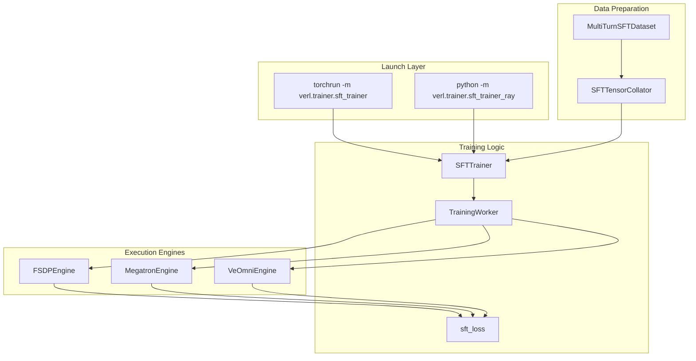
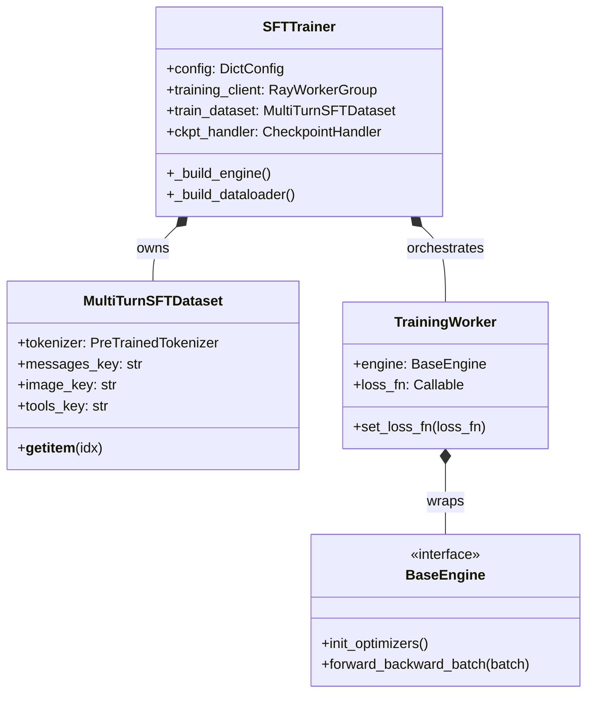

<!-- source: DeepWiki mcp.deepwiki.com · repo volcengine/verl · page 2.4 Quick Start: Supervised Fine-Tuning · fetched 2026-10-21 -->

# Quick Start: Supervised Fine-Tuning

<details>
<summary>Relevant source files</summary>

The following files were used as context for generating this wiki page:

- [.github/workflows/README.md](.github/workflows/README.md)
- [.github/workflows/e2e_ppo_trainer_veomni_vllm.yml](.github/workflows/e2e_ppo_trainer_veomni_vllm.yml)
- [.github/workflows/e2e_sft_llm.yml](.github/workflows/e2e_sft_llm.yml)
- [.github/workflows/e2e_sft_vlm.yml](.github/workflows/e2e_sft_vlm.yml)
- [examples/tpu/sft/README.md](examples/tpu/sft/README.md)
- [examples/tpu/sft/run_qwen3_0_6b_torchtitan.sh](examples/tpu/sft/run_qwen3_0_6b_torchtitan.sh)
- [tests/special_e2e/ppo_trainer/run_function_reward.sh](tests/special_e2e/ppo_trainer/run_function_reward.sh)
- [tests/special_e2e/run_ppo_trainer_veomni.sh](tests/special_e2e/run_ppo_trainer_veomni.sh)
- [tests/special_e2e/sft/run_sft_engine.sh](tests/special_e2e/sft/run_sft_engine.sh)
- [tests/special_e2e/sft/test_sft_engine_all.sh](tests/special_e2e/sft/test_sft_engine_all.sh)
- [tests/utils/dataset/test_multiturn_sft_dataset_on_cpu.py](tests/utils/dataset/test_multiturn_sft_dataset_on_cpu.py)
- [verl/trainer/config/sft_trainer_engine.yaml](verl/trainer/config/sft_trainer_engine.yaml)
- [verl/trainer/sft_trainer.py](verl/trainer/sft_trainer.py)
- [verl/trainer/sft_trainer_ray.py](verl/trainer/sft_trainer_ray.py)
- [verl/utils/checkpoint/__init__.py](verl/utils/checkpoint/__init__.py)
- [verl/utils/checkpoint/checkpoint_handler.py](verl/utils/checkpoint/checkpoint_handler.py)
- [verl/utils/dataset/multiturn_sft_dataset.py](verl/utils/dataset/multiturn_sft_dataset.py)

</details>


This page provides a comprehensive guide for running Supervised Fine-Tuning (SFT) within the `verl` framework. It covers entry points, multi-turn conversation dataset preparation, Hydra configuration options, launching distributed jobs with FSDP or Megatron backends, and parameter-efficient fine-tuning (PEFT/LoRA). SFT in `verl` leverages the same core `TrainingWorker` and execution engine abstractions used in RL training, configured for single-phase cross-entropy optimization.

---

## 1. Architecture Overview

SFT training in `verl` is supported through two primary orchestration entry points:
1.  **SPMD Mode:** Managed by `verl.trainer.sft_trainer.SFTTrainer` via `torchrun` for standard distributed training across local GPUs [verl/trainer/sft_trainer.py:50-51]().
2.  **Ray Mode:** Managed by `verl.trainer.sft_trainer_ray.SFTTrainer` for distributed scaling across a Ray cluster [verl/trainer/sft_trainer_ray.py:49-50]().

Both trainers instantiate a `MultiTurnSFTDataset`, coordinate a stateful data loader, and instantiate a `TrainingWorker` which wraps the underlying training engine [verl/trainer/sft_trainer.py:62-177](), [verl/trainer/sft_trainer_ray.py:108-145]().

**SFT Trainer Data Flow and Code Entity Mapping**


Sources: [verl/trainer/sft_trainer_ray.py:49-145](), [verl/trainer/sft_trainer.py:50-177](), [verl/workers/engine_workers.py:44-44]()

**Class and Component Relationships (Code Entity Space)**


Sources: [verl/trainer/sft_trainer_ray.py:49-145](), [verl/utils/dataset/multiturn_sft_dataset.py:73-126](), [verl/workers/engine_workers.py:44-44](), [verl/trainer/sft_trainer.py:50-98]()

---

## 2. Data Preparation

### Input Format
SFT datasets are typically stored in Parquet format. The core dataset class is `MultiTurnSFTDataset`, which handles complex conversation histories including text turns, multimodal payloads, and tool definitions [verl/utils/dataset/multiturn_sft_dataset.py:73-83]().

**Key Features:**
- **Multi-turn Training:** Iterates through message lists, applying chat templates to each turn separately and concatenating `input_ids` to ensure gradient computation is restricted to assistant responses [verl/utils/dataset/multiturn_sft_dataset.py:16-17](), [verl/trainer/config/sft_trainer_engine.yaml:42-43]().
- **Multimodal Support:** Exposes `image_key` and `video_key` to process vision-language inputs for models like Qwen2-VL [verl/utils/dataset/multiturn_sft_dataset.py:104-108]().
- **Agentic Training:** Supports `tools_key` for agentic tool-use fine-tuning [verl/utils/dataset/multiturn_sft_dataset.py:109-109]().
- **Thinking Tags:** Provides `enable_thinking_key` to manage reasoning tags for advanced models [verl/utils/dataset/multiturn_sft_dataset.py:110-111]().

### Preprocessing and Batching
Dataframes are loaded via `pd.read_parquet` using the `pyarrow` backend [verl/utils/dataset/multiturn_sft_dataset.py:147-147](). The trainer relies on `SFTTensorCollator` to package samples into `TensorDict` structures [verl/trainer/sft_trainer.py:36-37]().

Sources: [verl/utils/dataset/multiturn_sft_dataset.py:73-111](), [verl/utils/dataset/multiturn_sft_dataset.py:147-147](), [verl/trainer/config/sft_trainer_engine.yaml:42-43](), [verl/trainer/sft_trainer.py:36-37]()

---

## 3. Configuration Reference

`verl` uses Hydra for hierarchical configuration management (`verl/trainer/config/sft_trainer_engine.yaml`). SFT jobs require configuration profiles for models, engines, and optimizers.

### Trainer and Data Config Fields

| Field | Default | Description |
| :--- | :--- | :--- |
| `data.train_batch_size` | 256 | Global training batch size [verl/trainer/config/sft_trainer_engine.yaml:17-17]() |
| `data.micro_batch_size_per_gpu` | 4 | Micro-batch size per device [verl/trainer/config/sft_trainer_engine.yaml:18-18]() |
| `data.messages_key` | `"messages"` | Column name for conversation turns [verl/trainer/config/sft_trainer_engine.yaml:26-26]() |
| `data.pad_mode` | `"no_padding"` | Padding mode (`no_padding` recommended with sequence packing) [verl/trainer/config/sft_trainer_engine.yaml:30-30]() |
| `trainer.total_epochs` | 4 | Total number of training epochs [verl/trainer/config/sft_trainer_engine.yaml:64-64]() |
| `trainer.resume_mode` | `"auto"` | Checkpoint resume policy (`auto`, `disable`, `resume_path`) [verl/trainer/config/sft_trainer_engine.yaml:73-77]() |

### Performance Tuning
Users can select execution engines such as `fsdp`, `megatron`, `torchtitan`, `automodel`, or `veomni` [verl/trainer/config/sft_trainer_engine.yaml:10-12](), [tests/special_e2e/sft/test_sft_engine_all.sh:12-34](). Sequence parallelism (`SP_SIZE`) can be enabled for long-context training on supported hardware [tests/special_e2e/sft/test_sft_engine_all.sh:12-12]().

Sources: [verl/trainer/config/sft_trainer_engine.yaml:10-30](), [verl/trainer/config/sft_trainer_engine.yaml:64-77](), [tests/special_e2e/sft/test_sft_engine_all.sh:12-34](), [verl/trainer/sft_trainer_ray.py:122-125]()

---

## 4. Launching SFT Training

### Standard Fine-Tuning (FSDP)
Use `torchrun` to launch distributed SFT jobs with the FSDP engine [verl/trainer/sft_trainer.py:50-51](), [verl/trainer/config/sft_trainer_engine.yaml:11-11]():

```bash
torchrun --standalone --nnodes=1 --nproc-per-node=8 \
    -m verl.trainer.sft_trainer \
    data.train_files=$HOME/data/gsm8k/train.parquet \
    model.path=Qwen/Qwen2.5-0.5B-Instruct \
    engine=fsdp
```
Sources: [verl/trainer/sft_trainer.py:50-51](), [verl/trainer/config/sft_trainer_engine.yaml:11-11]()

### LoRA / PEFT Training
LoRA is enabled by setting `lora_rank` and `lora_alpha`. The `SFTTrainer` automatically tracks LoRA metadata during checkpointing [verl/trainer/sft_trainer.py:87-136]().

**Required LoRA Configurations:**
- `model.lora_rank`: Set to an integer greater than 0 (e.g., `16`, `32`) [verl/trainer/sft_trainer.py:102-102]().
- `model.lora_alpha`: Scaling parameter for low-rank updates [verl/trainer/sft_trainer.py:107-107]().
- `model.task_type`: PEFT task type, defaulting to `"CAUSAL_LM"` [verl/trainer/sft_trainer.py:128-131]().

For FSDP backends, wrapping policies automatically handle LoRA modules. An example of running SFT with LoRA is shown in the CI workflow [.github/workflows/e2e_sft_llm.yml:140-142]():
```bash
LORA_RANK=32 $UV_RUN bash tests/special_e2e/sft/run_sft.sh
```
Sources: [verl/trainer/sft_trainer.py:87-136](), [.github/workflows/e2e_sft_llm.yml:140-142]()

---

## 5. Advanced Features and Checkpoint Management

### Memory Efficiency and Specialized Kernels
- **Efficient Logprobs:** `logprobs_from_logits` leverages Flash-Attention cross-entropy kernels or row-wise processing to minimize memory overhead [verl/utils/torch_functional.py:72-100]().
- **NPU Support:** Ascend NPU acceleration uses `logprobs_from_logits_torch_npu` [verl/utils/torch_functional.py:136-152](). This is demonstrated in the NPU SFT CI workflow [.github/workflows/e2e_sft_vlm.yml:123-126]().
- **Dynamic Batching:** Enabled via `use_dynamic_bsz` to optimize memory across varying token lengths [verl/trainer/config/sft_trainer_engine.yaml:20-20]().

### Checkpoint Management
The `CheckpointHandler` manages persistence of model weights, optimizer states, and dataloader iterators [verl/utils/checkpoint/checkpoint_handler.py:49-78]().
- **Max Checkpoints:** Controlled by `trainer.max_ckpt_to_keep` [verl/trainer/sft_trainer.py:85-85]().
- **Resume Mode:** Configured via `trainer.resume_mode` [verl/trainer/config/sft_trainer_engine.yaml:73-77](). An example of resuming training with LoRA is available in the CI workflow [.github/workflows/e2e_sft_llm.yml:143-146]():
```bash
LORA_RANK=32 RESUME_MODE=auto TOTAL_TRAIN_STEP=2 $UV_RUN bash tests/special_e2e/sft/run_sft.sh
```
- **Stateful Dataloader:** Uses `StatefulDataLoader` to preserve iterator states across interruptions [verl/trainer/sft_trainer.py:31-32]().

### Chat Templates and Special Tags
`MultiTurnSFTDataset` applies chat templates per turn. If tokenization mismatches occur due to model-specific special tokens (e.g., `<think>` tags in Qwen models), set `data.ignore_input_ids_mismatch=True` [verl/trainer/config/sft_trainer_engine.yaml:44-47](), [verl/utils/dataset/multiturn_sft_dataset.py:116-116]().

Sources: [verl/trainer/sft_trainer.py:82-136](), [verl/utils/dataset/multiturn_sft_dataset.py:16-17](), [verl/trainer/config/sft_trainer_engine.yaml:42-47](), [verl/utils/dataset/multiturn_sft_dataset.py:116-116](), [verl/utils/checkpoint/checkpoint_handler.py:49-78](), [.github/workflows/e2e_sft_vlm.yml:123-126](), [.github/workflows/e2e_sft_llm.yml:143-146]()

---

