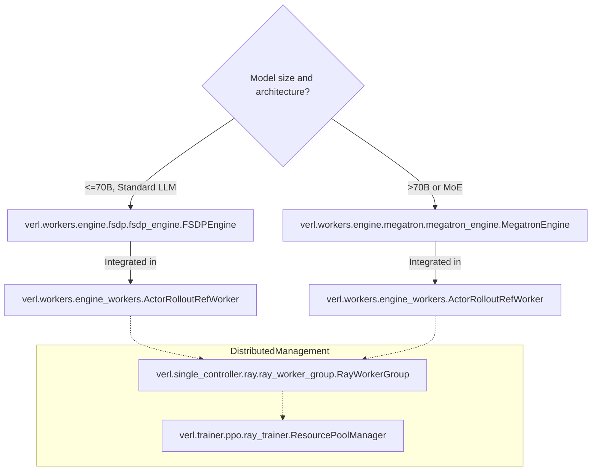

<!-- source: DeepWiki mcp.deepwiki.com · repo volcengine/verl · page 2.5 Multinode Deployment and Hardware Selection · fetched 2026-10-21 -->

# Multinode Deployment and Hardware Selection

<details>
<summary>Relevant source files</summary>

The following files were used as context for generating this wiki page:

- [docs/advance/dpo_extension.rst](docs/advance/dpo_extension.rst)
- [docs/algo/baseline.md](docs/algo/baseline.md)
- [docs/algo/dapo.md](docs/algo/dapo.md)
- [docs/api/data.rst](docs/api/data.rst)
- [docs/api/single_controller.rst](docs/api/single_controller.rst)
- [docs/examples/gsm8k_example.rst](docs/examples/gsm8k_example.rst)
- [docs/examples/ppo_code_architecture.rst](docs/examples/ppo_code_architecture.rst)
- [docs/hardware/multi_chip_support.rst](docs/hardware/multi_chip_support.rst)
- [docs/hybrid_flow.rst](docs/hybrid_flow.rst)
- [docs/perf/device_tuning.rst](docs/perf/device_tuning.rst)
- [docs/preparation/reward_function.rst](docs/preparation/reward_function.rst)
- [docs/start/multinode.rst](docs/start/multinode.rst)
- [docs/start/quickstart.rst](docs/start/quickstart.rst)
- [docs/workers/model_engine.rst](docs/workers/model_engine.rst)
- [examples/README.md](examples/README.md)
- [examples/tpu/grpo/Dockerfile](examples/tpu/grpo/Dockerfile)
- [examples/tpu/grpo/README.md](examples/tpu/grpo/README.md)
- [examples/tpu/grpo/ray-tpu-v6e4-2slice.yaml](examples/tpu/grpo/ray-tpu-v6e4-2slice.yaml)
- [examples/tpu/grpo/run_qwen3_0_6b_torchtitan.sh](examples/tpu/grpo/run_qwen3_0_6b_torchtitan.sh)
- [examples/tpu/grpo/run_qwen3_4b_torchtitan.sh](examples/tpu/grpo/run_qwen3_4b_torchtitan.sh)
- [examples/tutorial/slurm/ray_on_slurm.slurm](examples/tutorial/slurm/ray_on_slurm.slurm)
- [tests/special_sanity/check_example_naming.py](tests/special_sanity/check_example_naming.py)
- [verl/experimental/separation/engine_workers.py](verl/experimental/separation/engine_workers.py)
- [verl/plugin/platform/platform_base.py](verl/plugin/platform/platform_base.py)

</details>


## Purpose and Scope

This page covers how to deploy `verl` across multiple nodes, including manual Ray cluster setup, provisioned-cluster deployment via SkyPilot, Slurm-managed clusters, and how to select training and inference backends based on cluster topology and available hardware resources.

For details on configuration fields, see [docs/start/multinode.rst:1-171](). For details on how workers are scheduled onto Ray placement groups, see [docs/examples/ppo_code_architecture.rst:114-127](). For Ascend NPU-specific deployment, see [examples/tpu/grpo/run_qwen3_4b_torchtitan.sh:11-17]().

Sources: `[docs/start/multinode.rst:1-10]`, `[docs/workers/model_engine.rst:31-48]`, `[examples/tpu/grpo/run_qwen3_4b_torchtitan.sh:11-17]()`

---

## How verl Uses Ray for Multi-node Training

`verl` distributes all model roles (`ActorRolloutRefWorker`, `TrainingWorker`) as Ray remote actors managed by `RayWorkerGroup` `[docs/examples/ppo_code_architecture.rst:49-51]`. A single controller process running `main_ppo` (`verl.trainer.main_ppo`) coordinates these actors from a CPU node, while GPU workers are managed via `RayWorkerGroup` (`verl.single_controller.ray.ray_worker_group.RayWorkerGroup`) and `ResourcePoolManager` (`verl.trainer.ppo.ray_trainer.ResourcePoolManager`) `[docs/start/multinode.rst:15-28]`. In a multi-node setup, Ray schedules workers across nodes and establishes NCCL process groups for inter-node communication.

Title: "Distributed Orchestration Architecture"
```mermaid
graph TD
    subgraph HeadNodeCPU ["HeadNodeCPU"]
        C["verl.trainer.main_ppo"]
        RM["verl.trainer.ppo.ray_trainer.ResourcePoolManager"]
        T["RayPPOTrainer"]
    end

    subgraph GPUNode1 ["GPUNode1"]
        W1["verl.single_controller.ray.ray_worker_group.RayWorkerGroup"]
        A1["verl.workers.engine_workers.ActorRolloutRefWorker"]
    end

    subgraph GPUNode2 ["GPUNode2"]
        W2["verl.single_controller.ray.ray_worker_group.RayWorkerGroup"]
        A2["verl.workers.engine_workers.ActorRolloutRefWorker"]
    end

    C --> T
    T -->|"manages"| RM
    RM -->|"schedules via RayResourcePool"| W1
    RM -->|"schedules via RayResourcePool"| W2
    W1 --> A1
    W2 --> A2
    A1 <---|"NCCL torch.distributed"|---> A2
```

Sources: `[docs/start/multinode.rst:15-28]`, `[docs/examples/ppo_code_architecture.rst:49-51]`

---

## Cluster Configuration Parameters

These fields in the `trainer` configuration control node counts and GPU allocations:

| Config Field | Default | Purpose |
|---|---|---|
| `trainer.nnodes` | `1` | Total number of nodes in the cluster `[docs/start/multinode.rst:48-48]` |
| `trainer.n_gpus_per_node` | `8` | Number of GPUs available per node `[docs/start/multinode.rst:47-47]` |

Sources: `[docs/start/multinode.rst:47-48]`

---

## Deployment Options

### Option 1: Manual Ray Cluster

1.  **Start the head node:**
    ```bash
    ray start --head --dashboard-host=0.0.0.0
    ```
    Outputs the GCS address (for worker connection) and the Dashboard address (for job submission) `[docs/start/multinode.rst:15-18]`.

2.  **Start each worker node:**
    ```bash
    ray start --address=<gcs_address>
    ```
    `[docs/start/multinode.rst:22-24]`

3.  **Submit a training job:**
    Jobs are submitted via the Ray Job CLI to the dashboard address `[docs/start/multinode.rst:42-51]`:
    ```bash
    ray job submit --address="http://<head_ip>:8265" \
        --runtime-env=verl/trainer/runtime_env.yaml \
        --no-wait \
        -- \
        python3 -m verl.trainer.main_ppo \
        trainer.n_gpus_per_node=8 \
        trainer.nnodes=2 \
        ...
    ```

Sources: `[docs/start/multinode.rst:15-51]`

### Option 2: SkyPilot (Cloud/K8s)

SkyPilot automates node provisioning on cloud platforms (AWS, GCP, Azure) and Kubernetes. `verl` provides ready-to-use configurations in `examples/tutorial/skypilot/` `[docs/start/multinode.rst:72-82]`.

-   **Automated Setup:** SkyPilot executes `ray start` on head and worker nodes using environment variables like `$SKYPILOT_NODE_RANK` and `$SKYPILOT_NODE_IPS` `[docs/start/multinode.rst:162-171]`.
-   **Resource Orchestration:** Defines GPU specs (e.g., `L4:1`), memory requirements, and Docker images in a single YAML `[docs/start/multinode.rst:124-130]`.
-   **Secrets Management:** Securely passes secrets like `WANDB_API_KEY` or `HF_TOKEN` `[docs/start/multinode.rst:137-140]`.

Sources: `[docs/start/multinode.rst:69-171]`

### Option 3: Slurm Cluster

`verl` executes on Slurm-managed HPC clusters by spawning a Ray cluster via `examples/tutorial/slurm/ray_on_slurm.slurm` `[examples/tutorial/slurm/ray_on_slurm.slurm:1-135]`.
-   Supports Apptainer/Singularity container images for HPC isolation `[examples/tutorial/slurm/ray_on_slurm.slurm:82-84]`.
-   Automatically detects node IP allocations and bootstraps Ray head and worker processes across nodes `[examples/tutorial/slurm/ray_on_slurm.slurm:45-106]`.

Sources: `[examples/tutorial/slurm/ray_on_slurm.slurm:1-135]()`

---

## Training Backend Selection: FSDP vs Megatron

Choosing the appropriate distributed backend is critical for multi-node throughput and memory efficiency. `verl` abstracts backends into engine implementations.

Title: "Training Engine Selection and Worker Integration"


Sources: `[docs/workers/model_engine.rst:13-25]`, `[docs/examples/ppo_code_architecture.rst:107-112]`

### FSDP Backend
-   **Use Case:** Recommended for standard dense architectures up to 70B parameters `[docs/workers/model_engine.rst:18-20]`.
-   **Implementation:** `FSDPEngine` handles Hugging Face auto-model wrapping and sharded checkpoint persistence `[docs/workers/model_engine.rst:18-20]`.
-   **Extensions:** Supports `trust_remote_code` and custom model architectures via monkey-patching and wrapper utilities `[docs/workers/model_engine.rst:18-20]`.

Sources: `[docs/workers/model_engine.rst:13-25]`

### Megatron-LM Backend
-   **Use Case:** Recommended for very large models or complex Mixture-of-Experts (MoE) topologies `[examples/tpu/grpo/run_qwen3_4b_torchtitan.sh:101-110]()`.
-   **MoE Support:** Enables large MoE scaling with Context Parallelism (CP) and Expert Parallelism (EP) `[examples/tpu/grpo/run_qwen3_4b_torchtitan.sh:129-135]()`.
-   **Hardware Tuning:** Large-scale training jobs require configuring parallelism dimensions (`TP`, `EP`, `PP`, `CP`) as demonstrated in production run scripts `[examples/tpu/grpo/run_qwen3_4b_torchtitan.sh:129-135]()`.

Sources: `[examples/tpu/grpo/run_qwen3_4b_torchtitan.sh:1-146]()`

---

## Hardware Selection and Recommended Configurations

The following table summarizes reference resource requirements for GRPO and PPO training workloads.

| Model Size | Task | Resource | Train Backend | Infer Backend | Link to Example | Contributor |
|---|---|---|---|---|---|---|
| **0.5B** | GRPO-LoRA | 1\*H100 | fsdp | vllm0.8.3 | `qwen2-0.5b_grpo-lora_1_h100_fsdp_vllm.sh` `[docs/perf/device_tuning.rst:55-55]` | SimonHuang |
| **1.5B** | GRPO-LoRA | 1\*H100 | fsdp | vllm0.8.3 | `qwen2-1.5b_grpo-lora_1_h100_fsdp_vllm.sh` `[docs/perf/device_tuning.rst:79-79]` | SimonHuang |
| **3B** | GRPO-LoRA | 1\*H100 | fsdp | vllm0.8.3 | `qwen2-3b_grpo-lora_1_h100_fsdp_vllm.sh` `[docs/perf/device_tuning.rst:107-107]` | SimonHuang |
| **7B** | GRPO | 2\*H800 | fsdp | vllm0.8.2 | `qwen2-7b_grpo_2_h800_fsdp_vllm` `[docs/perf/device_tuning.rst:133-133]` | Xiangyongan |
| **7B** | GRPO-LoRA | 1\*H100 | fsdp | vllm0.8.3 | `qwen2-7b_grpo-lora_1_h100_fsdp_vllm.sh` `[docs/perf/device_tuning.rst:142-142]` | SimonHuang |
| **14B** | GRPO | 4\*H800 | fsdp | vllm0.8.2 | `qwen2-14b_grpo_4_h800_fsdp_vllm` `[docs/perf/device_tuning.rst:168-168]` | Xiangyongan |
| **14B** | GRPO-LoRA | 2\*H100 | fsdp | vllm0.8.3 | `qwen2-14b_grpo-lora_2_h100_fsdp_vllm.sh` `[docs/perf/device_tuning.rst:177-177]` | SimonHuang |
| **32B** | GRPO | 8\*H20 | megatron | vllm0.8.2 | `qwen2-32b_grpo_8_h20_megatron_vllm` `[docs/perf/device_tuning.rst:203-203]` | Xiangyongan |
| **32B** | GRPO-LoRA | 4\*H100 | fsdp | vllm0.8.3 | `qwen2-32b_grpo-lora_4_h100_fsdp_vllm.sh` `[docs/perf/device_tuning.rst:212-212]` | SimonHuang |

### Optimization Strategies for Large Models
-   **Optimizer Offloading:** Enable `param_offload` and `optimizer_offload` in FSDP or Megatron configs to reduce peak device memory `[examples/tpu/grpo/run_qwen3_4b_torchtitan.sh:101-110]()`.
-   **Weight Resharding:** Utilize `ActorRolloutRefWorker` as a hybrid engine to manage dynamic weight resharding between inference engines and training backends `[docs/examples/ppo_code_architecture.rst:49-50]`.
-   **Dynamic Sampling:** Configure `filter_groups` for algorithms like DAPO to filter uninformative rollouts and control retry attempts via `max_num_gen_batches` `[docs/algo/dapo.md:74-86]`.
-   **TransferQueue Integration:** For high-scale multimodal post-training, adopt `TransferQueue` for asynchronous streaming data management and reduced host memory overhead `[examples/tpu/grpo/run_qwen3_4b_torchtitan.sh:75-76]()`.

Sources: `[docs/perf/device_tuning.rst:32-234]`, `[docs/examples/ppo_code_architecture.rst:49-50]`, `[examples/tpu/grpo/run_qwen3_4b_torchtitan.sh:75-76]()`, `[docs/algo/dapo.md:74-86]`

---

