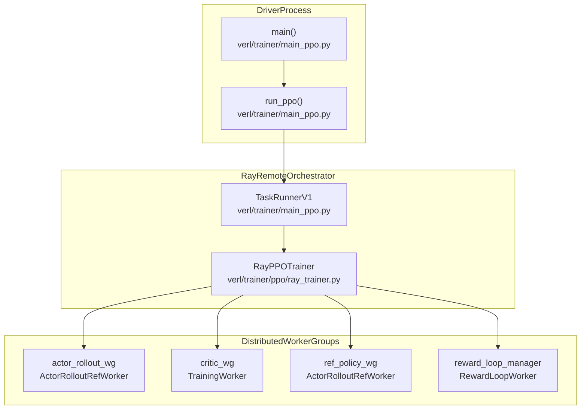

<!-- source: DeepWiki mcp.deepwiki.com · repo volcengine/verl · page 3 PPO Training System · fetched 2026-10-21 -->

# PPO Training System

<details>
<summary>Relevant source files</summary>

The following files were used as context for generating this wiki page:

- [docs/examples/config.rst](docs/examples/config.rst)
- [docs/perf/perf_tuning.rst](docs/perf/perf_tuning.rst)
- [verl/trainer/config/ppo_megatron_trainer.yaml](verl/trainer/config/ppo_megatron_trainer.yaml)
- [verl/trainer/config/ppo_trainer.yaml](verl/trainer/config/ppo_trainer.yaml)
- [verl/trainer/main_ppo.py](verl/trainer/main_ppo.py)
- [verl/trainer/ppo/core_algos.py](verl/trainer/ppo/core_algos.py)
- [verl/trainer/ppo/ray_trainer.py](verl/trainer/ppo/ray_trainer.py)

</details>


This page serves as a high-level parent guide to the Proximal Policy Optimization (PPO) training architecture in `verl`. It outlines how distributed orchestration, worker roles, advantage estimation, policy losses, reward processing, and asynchronous execution come together to form an end-to-end RLHF training system.

For deep dives into specific subsystems, refer to the following child pages:
- **[RayPPOTrainer Architecture and Orchestration](#3.1)** — Explain `RayPPOTrainer`'s role in orchestrating distributed training, resource management, and worker coordination.
- **[Training Loop and Data Flow](#3.2)** — Document the complete PPO training loop: rollout, reward computation, advantage estimation, and policy updates with `DataProto` flow.
- **[Advantage Estimation Methods](#3.3)** — Detail various advantage estimators (`GAE`, `GRPO`, `GRPO_VECTORIZED`, `REINFORCE++`, `RLOO`, `OPTIMAL_TOKEN_BASELINE`, `GDPO`) and their implementations.
- **[Policy Loss Functions and Clipping](#3.4)** — Explain policy loss modes (`vanilla`, `clip-cov`, `kl-cov`, `GPG`, `flow_grpo`, DPPO variants), clipping strategies, and SAPO/GMPO smoothing.
- **[Reward Systems and KL Control](#3.5)** — Cover reward model integration, custom reward functions, KL penalty application, and KL controllers (`FixedKLController`, `AdaptiveKLController`).
- **[Alternative RL Algorithms](#3.6)** — Document implementation details of `GRPO`, `DAPO`, `RLOO`, `PRIME`, `ReMax`, `GMPO`, `SAPO`, `DPPO`, `GSPO`, `GPG`, `OTB`, `GDPO`, `REINFORCE++`, `CISPO`, and other algorithms beyond standard PPO.
- **[Rollout Correction and Off-Policy Handling](#3.7)** — Document the `RolloutCorrectionConfig` system for off-policy issues: IS weighting modes, rejection sampling, and preset factory methods.
- **[V1 PPO Trainer: Async and Streaming Architecture](#3.8)** — Document the V1 PPO trainer system (`PPOTrainer`, async variants, `ReplayBuffer`, `MetricsAggregator`, `SkipManager`) and its `transfer_queue`-based streaming.

---

## Top-Level Architecture and Component Mapping

The PPO training system utilizes a single-controller architecture via Ray where the driver runs a controller task (such as `TaskRunnerV1` in `verl/trainer/main_ppo.py` or `RayPPOTrainer` in `verl/trainer/ppo/ray_trainer.py`) that coordinates multiple distributed worker groups (`ActorRolloutRefWorker`, `TrainingWorker`, etc.). Configuration is centrally managed via Hydra-based YAML definitions (`verl/trainer/config/ppo_trainer.yaml`).

Title: "System Component Map to Code Entities"


Sources: [verl/trainer/main_ppo.py:34-94](), [verl/trainer/main_ppo.py:103-132](), [verl/trainer/ppo/ray_trainer.py:17-19](), [verl/trainer/config/ppo_trainer.yaml:8-51]()

---

## Training Loop and Data Flow Overview

The training loop coordinates batch sampling, rollout generation, reward scoring, advantage estimation, and gradient updates across distributed engines. Data flows throughout the pipeline encapsulated inside `DataProto` containers managed by the core trainer (`RayPPOTrainer`) and helper utility functions in `verl/trainer/ppo/core_algos.py`.

Title: "PPO Training Loop Data Flow"
```mermaid
sequenceDiagram
    participant Trainer as "RayPPOTrainer\nverl/trainer/ppo/ray_trainer.py"
    participant Rollout as "ActorRolloutRefWorker"
    participant Reward as "RewardLoopWorker"
    participant Adv as "core_algos.get_adv_estimator_fn()"
    participant Actor as "update_actor()"
    participant Critic as "update_critic()"

    Trainer->>Rollout: "rollout()"
    Rollout-->>Trainer: "DataProto (responses, old_log_probs)"
    Trainer->>Reward: "compute_score_batch()"
    Reward-->>Trainer: "DataProto (rm_scores)"
    Trainer->>Trainer: "apply_kl_penalty()"
    Trainer->>Adv: "compute_advantage()"
    Adv-->>Trainer: "DataProto (advantages, returns)"
    Trainer->>Actor: "update_actor()"
    Trainer->>Critic: "update_critic()"
```

For detailed breakdown of data tensors, sequence balancing, and asynchronous steps, see [Training Loop and Data Flow](#3.2) and [V1 PPO Trainer: Async and Streaming Architecture](#3.8).

Sources: [verl/trainer/ppo/ray_trainer.py:433-870](), [verl/trainer/ppo/core_algos.py:137-150]()

---

## Core Algorithmic Subsystems

The PPO system accommodates standard PPO as well as a wide array of alternative reinforcement learning algorithms and loss formulations. 

- **Advantage Estimators**: Functions registered in `verl/trainer/ppo/core_algos.py` via `register_adv_est` handle advantage computations like GAE, GRPO, and REINFORCE++ [verl/trainer/ppo/core_algos.py:88-116](). For details, see [Advantage Estimation Methods](#3.3).
- **Policy Losses & Clipping**: Custom loss functions handle ratio clipping, KL divergence penalties, and sequence-level smoothing. For details, see [Policy Loss Functions and Clipping](#3.4).
- **Reward Systems & KL Control**: KL divergence is dynamically adjusted using `AdaptiveKLController` or `FixedKLController` [verl/trainer/ppo/core_algos.py:153-191]() and combined with token-level rewards via `apply_kl_penalty` [verl/trainer/ppo/ray_trainer.py:78-117](). For details, see [Reward Systems and KL Control](#3.5).
- **Alternative Algorithms**: Beyond standard PPO, `verl` natively supports GRPO, DAPO, RLOO, ReMax, and other group/reward variants configured via `AlgoConfig` [verl/trainer/config/ppo_trainer.yaml:65-136](). For details, see [Alternative RL Algorithms](#3.6).

Sources: [verl/trainer/ppo/core_algos.py:88-191](), [verl/trainer/ppo/ray_trainer.py:78-117](), [verl/trainer/config/ppo_trainer.yaml:65-136]()

---

## Off-Policy Handling and V1 Async Architecture

To address distribution mismatches between rollout engines (e.g., vLLM inference) and trainers (e.g., FSDP training), `verl` provides robust rollout correction mechanisms and asynchronous execution pipelines.

- **Rollout Correction**: The `RolloutCorrectionConfig` system manages importance sampling (IS) weights and rejection sampling (Geo-RS, K3-RS) to stabilize updates [verl/trainer/config/ppo_trainer.yaml:39-40](). For details, see [Rollout Correction and Off-Policy Handling](#3.7).
- **V1 Async Trainers**: The V1 architecture introduces fully asynchronous colocated and separate trainer variants leveraging `transfer_queue` streaming and `TaskRunnerV1` [verl/trainer/main_ppo.py:106-156](). For details, see [V1 PPO Trainer: Async and Streaming Architecture](#3.8).

Sources: [verl/trainer/config/ppo_trainer.yaml:39-40](), [verl/trainer/main_ppo.py:106-156]()

---

