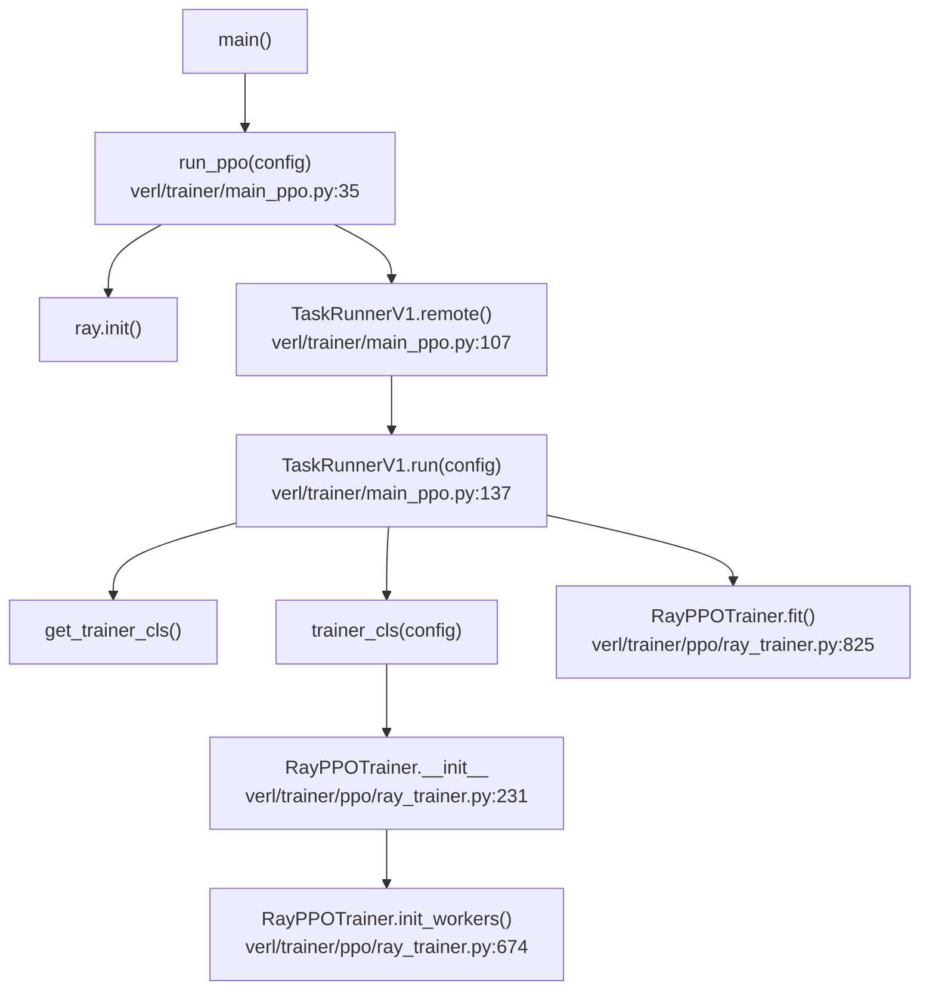
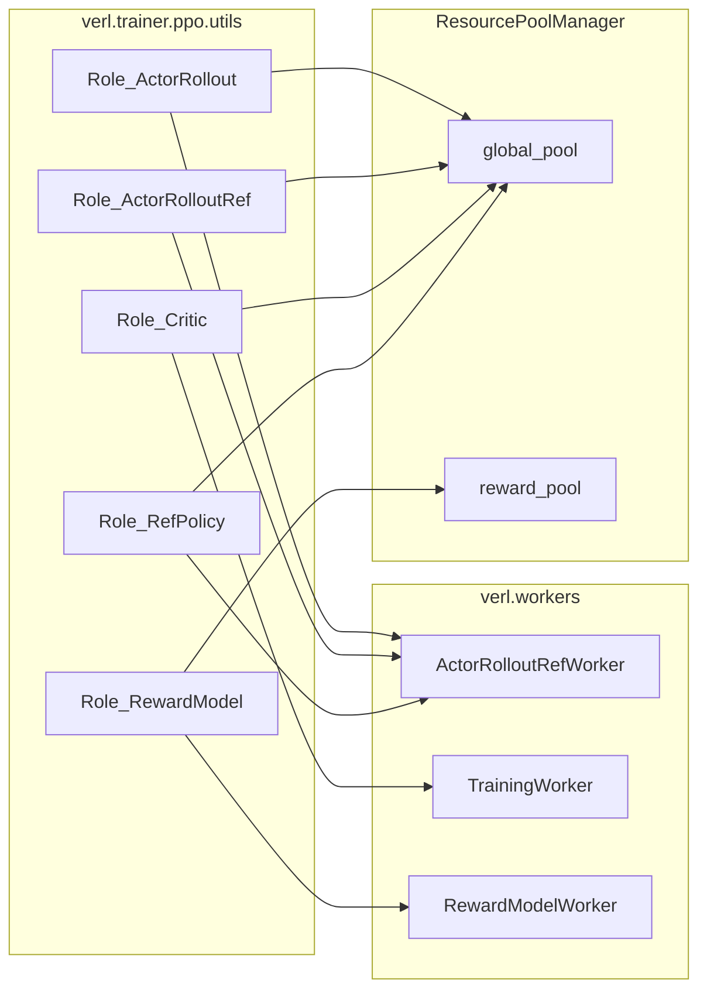
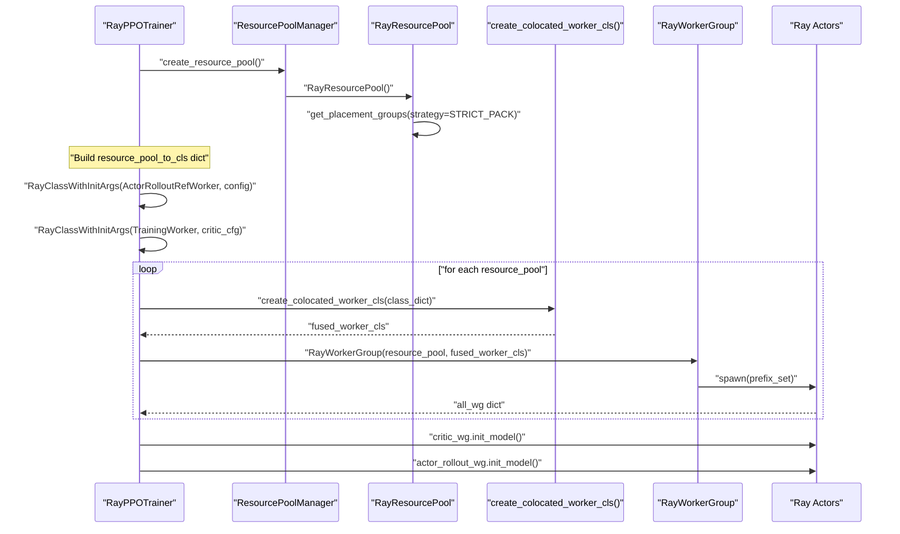
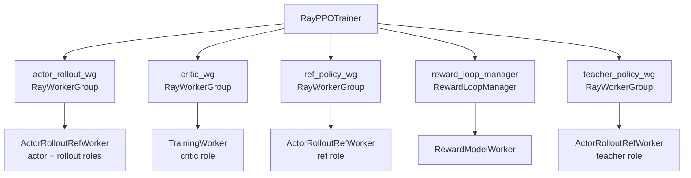

<!-- source: DeepWiki mcp.deepwiki.com · repo volcengine/verl · page 3.1 RayPPOTrainer Architecture and Orchestration · fetched 2026-10-21 -->

# RayPPOTrainer Architecture and Orchestration

<details>
<summary>Relevant source files</summary>

The following files were used as context for generating this wiki page:

- [docs/examples/config.rst](docs/examples/config.rst)
- [docs/perf/perf_tuning.rst](docs/perf/perf_tuning.rst)
- [tests/single_controller/test_data_transfer.py](tests/single_controller/test_data_transfer.py)
- [tests/single_controller/test_device_mesh_register.py](tests/single_controller/test_device_mesh_register.py)
- [tests/single_controller/test_high_level_scheduling_api.py](tests/single_controller/test_high_level_scheduling_api.py)
- [tests/single_controller/test_ray_collectives.py](tests/single_controller/test_ray_collectives.py)
- [tests/single_controller/test_split_resource_pool.py](tests/single_controller/test_split_resource_pool.py)
- [tests/single_controller/test_worker_group_basics.py](tests/single_controller/test_worker_group_basics.py)
- [verl/single_controller/base/worker.py](verl/single_controller/base/worker.py)
- [verl/single_controller/base/worker_group.py](verl/single_controller/base/worker_group.py)
- [verl/single_controller/ray/__init__.py](verl/single_controller/ray/__init__.py)
- [verl/single_controller/ray/base.py](verl/single_controller/ray/base.py)
- [verl/trainer/config/ppo_megatron_trainer.yaml](verl/trainer/config/ppo_megatron_trainer.yaml)
- [verl/trainer/config/ppo_trainer.yaml](verl/trainer/config/ppo_trainer.yaml)
- [verl/trainer/main_ppo.py](verl/trainer/main_ppo.py)
- [verl/trainer/ppo/core_algos.py](verl/trainer/ppo/core_algos.py)
- [verl/trainer/ppo/ray_trainer.py](verl/trainer/ppo/ray_trainer.py)

</details>


## Purpose and Scope

This page documents the `RayPPOTrainer` class (`verl/trainer/ppo/ray_trainer.py`) — the single-controller orchestrator that sets up, manages resources for, and coordinates all distributed PPO workers. It covers `__init__`, `init_workers`, role-to-worker mapping, `ResourcePoolManager` configuration, and the relationship between worker groups across model roles [verl/trainer/ppo/ray_trainer.py:17-304]().

For the subsequent training loop, see [Training Loop and Data Flow](3.2). For the underlying `RayWorkerGroup` abstractions, see [RayWorkerGroup and Resource Management](5.1). For hybrid engine mechanics, see [ActorRolloutRefWorker: Hybrid Engine Design](6.1).

Sources: [verl/trainer/ppo/ray_trainer.py:17-304]()

---

## System Overview and Orchestration Flow

`RayPPOTrainer` executes on the driver process (typically wrapped inside a Ray remote task runner like `TaskRunnerV1`), issuing asynchronous remote coordination calls across distributed worker pools. The driver process holds no model weights directly; all sharded tensor computations run on remote Ray actor groups.

Title: "End-to-end launch flow from main() to training initialization"

Sources: [verl/trainer/main_ppo.py:33-143](), [verl/trainer/ppo/ray_trainer.py:674-825]()

---

## Entry Point: `TaskRunner` and Worker Mapping

The `TaskRunnerV1` [verl/trainer/main_ppo.py:103-164]() initializes the trainer class and manages the asynchronous `TransferQueue` runtime environment.

### Worker Class Selection

Depending on the engine configuration and model roles, `RayPPOTrainer` maps roles to specific worker implementations defined under `verl.workers`:

| Role | Worker Class | Source File / Module |
|-----------------|------------------------|----------------------|
| `Role.ActorRollout` / `Role.ActorRolloutRef` | `ActorRolloutRefWorker` | [verl/trainer/ppo/utils.py:22-29]() |
| `Role.Critic` | `TrainingWorker` | [verl/trainer/ppo/utils.py:22-29]() |
| `Role.RewardModel` | `RewardModelWorker` | [verl/trainer/ppo/utils.py:22-29]() |

Sources: [verl/trainer/main_ppo.py:103-164](), [verl/trainer/ppo/utils.py:22-29]()

---

## `RayPPOTrainer.__init__` Implementation

The constructor `RayPPOTrainer.__init__` [verl/trainer/ppo/ray_trainer.py:231-304]() performs lightweight configuration parsing on the driver node. No heavy GPU allocations occur during `__init__`.

### Key Parameters and Feature Flags

The trainer inspects the configuration to configure component flags:

```python
self.hybrid_engine = config.actor_rollout_ref.hybrid_engine  # [verl/trainer/ppo/ray_trainer.py:277]()
self.use_reference_policy = need_reference_policy(config)  # [verl/trainer/ppo/ray_trainer.py:279]()
self.use_rm = need_reward_model(config)  # [verl/trainer/ppo/ray_trainer.py:280]()
self.use_critic = need_critic(config)  # [verl/trainer/ppo/ray_trainer.py:281]()
self.use_teacher_policy = need_teacher_policy(config)  # [verl/trainer/ppo/ray_trainer.py:282]()
```

If KL penalty in reward computation is enabled via `config.algorithm.use_kl_in_reward`, an appropriate KL controller is instantiated [verl/trainer/ppo/ray_trainer.py:283-284]() using either `AdaptiveKLController` [verl/trainer/ppo/core_algos.py:153-159]() or `FixedKLController` [verl/trainer/ppo/core_algos.py:177-180]().

Sources: [verl/trainer/ppo/ray_trainer.py:231-304](), [verl/trainer/ppo/core_algos.py:153-191]()

---

## Role and Resource Pool Mapping

Title: "Mapping between Role enums, worker classes, and resource pools"

Sources: [verl/trainer/ppo/utils.py:22-29](), [verl/single_controller/ray/base.py:113-213]()

---

## `init_workers`: Worker Group Coordination

`init_workers` [verl/trainer/ppo/ray_trainer.py:674-824]() sets up placement groups and instantiates Ray worker groups.

Title: "init_workers sequence diagram showing worker group instantiation"

Sources: [verl/trainer/ppo/ray_trainer.py:674-824](), [verl/single_controller/ray/base.py:113-213]()

### Spawning Mechanism
1. **Resource Pool Creation**: `self.resource_pool_manager.create_resource_pool()` [verl/trainer/ppo/ray_trainer.py:683]() requests Ray placement groups with `STRICT_PACK` guarantees.
2. **Worker Class Fusing**: `create_colocated_worker_cls` [verl/single_controller/ray/base.py:39]() combines multiple roles (e.g. Actor, Rollout, Reference) into a single Ray actor when hybrid engines are enabled.
3. **RayWorkerGroup Initialization**: `wg_dict.spawn(prefix_set)` partitions the fused Ray workers into distinct `RayWorkerGroup` objects [verl/trainer/ppo/ray_trainer.py:754]().

Sources: [verl/trainer/ppo/ray_trainer.py:674-824](), [verl/single_controller/ray/base.py:39-163]()

---

## Worker Group Summary

The trainer maintains references to several `RayWorkerGroup` instances and managers:

| Attribute | Type | Required | Created When |
|-----------|------|----------|--------------|
| `actor_rollout_wg` | `RayWorkerGroup` | Always | `hybrid_engine=True` [verl/trainer/config/ppo_trainer.yaml:56]() |
| `critic_wg` | `RayWorkerGroup` | Conditional | `use_critic=True` (e.g. GAE estimator) [verl/trainer/ppo/ray_trainer.py:281]() |
| `ref_policy_wg` | `RayWorkerGroup` | Conditional | `use_kl_in_reward=True` or `actor.use_kl_loss=True` [verl/trainer/ppo/utils.py:58]() |
| `reward_loop_manager` | `RewardLoopManager` | Conditional | `reward.reward_model.enable=True` [verl/trainer/ppo/utils.py:59]() |
| `teacher_policy_wg` | `RayWorkerGroup` | Conditional | Distillation enabled [verl/trainer/ppo/utils.py:60]() |

Title: "Trainer attributes and their mapping to underlying worker entities"

Sources: [verl/trainer/ppo/ray_trainer.py:771-824](), [verl/trainer/ppo/utils.py:53-61]()

---

## Asynchronous Orchestration and TransferQueue

When `config.transfer_queue.enable` is active, `TaskRunnerV1` initializes `transfer_queue` [verl/trainer/main_ppo.py:149]() and instantiates an `AgentLoopManager` [verl/trainer/main_ppo.py:118-132]() to stream generated rollout sequences asynchronously, bypassing synchronous batch barriers between generation and training steps.

Sources: [verl/trainer/main_ppo.py:103-164](), [verl/trainer/ppo/ray_trainer.py:1-76]()

---

## Configuration Reference

Key configuration options affecting `RayPPOTrainer` orchestration (from `ppo_trainer.yaml` [verl/trainer/config/ppo_trainer.yaml]()):

| Configuration Path | Default | Description |
|--------------------|---------|-------------|
| `actor_rollout_ref.hybrid_engine` | `true` | Co-locates actor and rollout on the same GPUs |
| `trainer.nnodes` | `1` | Number of nodes in the Ray cluster |
| `trainer.n_gpus_per_node` | `8` | Number of GPUs allocated per node |
| `algorithm.adv_estimator` | `"gae"` | Determines whether a critic worker is spawned |
| `transfer_queue.enable` | `false` | Enables async streaming via TransferQueue |

Sources: [verl/trainer/config/ppo_trainer.yaml:50-200](), [verl/trainer/main_ppo.py:61-75]()

---

