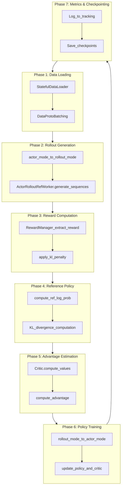
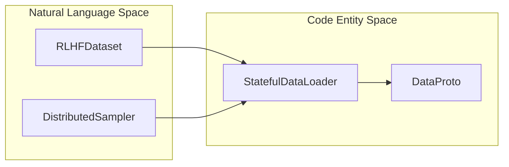
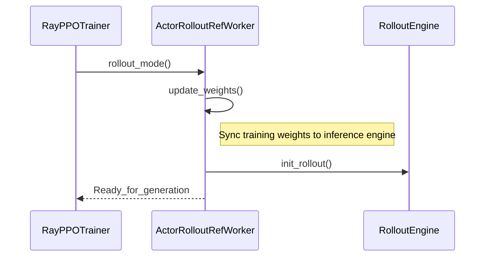
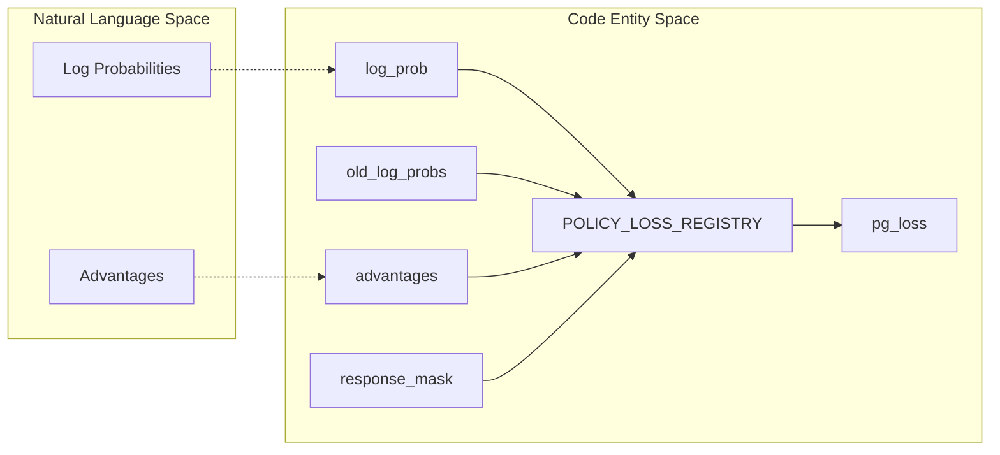

<!-- source: DeepWiki mcp.deepwiki.com · repo volcengine/verl · page 3.2 Training Loop and Data Flow · fetched 2026-10-21 -->

# Training Loop and Data Flow

Relevant source files

The following files were used as context for generating this wiki page:

- [docs/examples/config.rst](docs/examples/config.rst)
- [docs/perf/perf_tuning.rst](docs/perf/perf_tuning.rst)
- [tests/single_controller/test_decorator_on_cpu.py](tests/single_controller/test_decorator_on_cpu.py)
- [tests/special_e2e/sft/compare_sft_engine_results.py](tests/special_e2e/sft/compare_sft_engine_results.py)
- [tests/special_sanity/validate_structure.py](tests/special_sanity/validate_structure.py)
- [tests/test_protocol_on_cpu.py](tests/test_protocol_on_cpu.py)
- [tests/test_protocol_v2_on_cpu.py](tests/test_protocol_v2_on_cpu.py)
- [verl/protocol.py](verl/protocol.py)
- [verl/single_controller/base/decorator.py](verl/single_controller/base/decorator.py)
- [verl/trainer/config/ppo_megatron_trainer.yaml](verl/trainer/config/ppo_megatron_trainer.yaml)
- [verl/trainer/config/ppo_trainer.yaml](verl/trainer/config/ppo_trainer.yaml)
- [verl/trainer/main_ppo.py](verl/trainer/main_ppo.py)
- [verl/trainer/ppo/core_algos.py](verl/trainer/ppo/core_algos.py)
- [verl/trainer/ppo/ray_trainer.py](verl/trainer/ppo/ray_trainer.py)
- [verl/utils/dataset/dataset_utils.py](verl/utils/dataset/dataset_utils.py)
- [verl/utils/tensordict_utils.py](verl/utils/tensordict_utils.py)

This document details the complete training iteration in verl's PPO implementation, covering sequential phases from data loading through rollout generation, reward computation, advantage estimation, and policy updates using the `DataProto` communication flow.

---

## Training Iteration Overview

Each training iteration in `RayPPOTrainer.fit()` consists of sequential phases that transform input prompts into trained policy updates. The orchestration is handled by the single-controller `RayPPOTrainer` [verl/trainer/ppo/ray_trainer.py:822-1344](). In the V1 architecture, this flow is managed by `PPOTrainer` and its variants like `PPOTrainerSeparateAsync` [verl/trainer/main_ppo.py:139-142]().

**Diagram: PPO Training Iteration Flow**

Sources: [verl/trainer/ppo/ray_trainer.py:822-1344](), [verl/trainer/main_ppo.py:139-142]()

---

## Phase 1: Data Loading and Batch Preparation

### StatefulDataLoader and Dataset

The training loop begins by fetching a batch from `StatefulDataLoader`, which wraps the training dataset and maintains iterator state for checkpointing [verl/trainer/ppo/ray_trainer.py:734-750](). The dataset is typically created via `create_rl_dataset` which handles parquet or JSON files [verl/trainer/ppo/utils.py:52-55]().

**Diagram: Data Loading Abstraction Mapping**

Sources: [verl/trainer/ppo/ray_trainer.py:734-750](), [verl/trainer/ppo/utils.py:52-55](), [verl/protocol.py:30-43]()

### DataProto Conversion and Padding

The batch dictionary is converted to `DataProto` and padded to be divisible by the number of workers using `pad_dataproto_to_divisor` [verl/protocol.py:74-99](). `DataProto` acts as the primary data carrier, wrapping a `TensorDict` to handle distributed communication [verl/protocol.py:30-43](). It supports operations like `concat`, `split`, and `reorder`.

`DataProto` internally uses `tensordict.TensorDict` for efficient tensor management. Non-tensor data (e.g., strings, lists of dictionaries) can be stored within `TensorDict` using `NonTensorData` for single values or `NonTensorStack` for lists of potentially nested structures [verl/utils/tensordict_utils.py:26-74](). The utility functions automatically handle this wrapping [verl/utils/tensordict_utils.py:76-107]().

### Sequence Balancing

If `config.trainer.balance_batch=True` [verl/trainer/config/ppo_trainer.yaml:141-142](), the Karmarkar-Karp algorithm (`karmarkar_karp`) reorders samples to minimize workload imbalance across workers [verl/utils/seqlen_balancing.py:49-70](). This reduces stragglers in distributed generation by ensuring each worker processes roughly equal total sequence lengths [verl/trainer/ppo/ray_trainer.py:962-996](). The workload is estimated based on transformer attention complexity using a calibrated formula: $\text{Workload} \propto 24576 \times \text{seqlen} + \text{seqlen}^2$ [verl/utils/seqlen_balancing.py:27-46]().

Sources: [verl/trainer/ppo/ray_trainer.py:962-996](), [verl/protocol.py:30-43](), [verl/protocol.py:74-99](), [verl/utils/seqlen_balancing.py:27-46](), [verl/utils/seqlen_balancing.py:49-70](), [verl/utils/tensordict_utils.py:26-74](), [verl/utils/tensordict_utils.py:76-107](), [verl/trainer/config/ppo_trainer.yaml:141-142]()

---

## Phase 2: Rollout Generation

### Mode Transition: actor_mode → rollout_mode

Before generation, the hybrid engine transitions from training mode to inference mode. In `ActorRolloutRefWorker`, this involves weight synchronization and memory management [verl/trainer/ppo/ray_trainer.py:1010-1014](). In the V1 architecture, the flow can involve a `TransferQueue` for asynchronous interaction managed by `AgentLoopManagerTQ` [verl/trainer/main_ppo.py:119-132]().

**Diagram: Hybrid Engine Mode Switching**

Sources: [verl/trainer/ppo/ray_trainer.py:1010-1014](), [verl/trainer/ppo/ray_trainer.py:1051-1055](), [verl/trainer/main_ppo.py:119-150]()

---

## Phase 3: Reward Computation and KL Penalty

### Reward Extraction
The `extract_reward()` function computes token-level rewards from the batch [verl/trainer/ppo/reward.py:51-51](). If `config.algorithm.use_kl_in_reward=True` [verl/trainer/config/ppo_trainer.yaml:102-102](), the KL divergence between reference and current policy is penalized via `apply_kl_penalty()` [verl/trainer/ppo/ray_trainer.py:78-117]().

### KL Penalty Logic
1. **Compute KL**: Uses `core_algos.kl_penalty` to find divergence between `old_log_probs` and `ref_log_prob` [verl/trainer/ppo/ray_trainer.py:100-102]().
2. **Apply Penalty**: `token_level_rewards = token_level_scores - beta * kld` [verl/trainer/ppo/ray_trainer.py:106-106]().
3. **Update Controller**: The `AdaptiveKLController` updates `beta` based on `current_kl` [verl/trainer/ppo/ray_trainer.py:112-112](). Verl supports both `FixedKLController` and `AdaptiveKLController` [verl/trainer/ppo/core_algos.py:153-192]().

Sources: [verl/trainer/ppo/ray_trainer.py:78-117](), [verl/trainer/ppo/core_algos.py:153-192](), [verl/trainer/config/ppo_trainer.yaml:102-102](), [verl/trainer/ppo/reward.py:51-51]()

---

## Phase 4: Advantage Estimation

The `compute_advantage()` function dispatches to estimators registered in the `ADV_ESTIMATOR_REGISTRY` [verl/trainer/ppo/core_algos.py:136-150](). The specific estimator is chosen based on the `adv_estimator` field in the `AlgoConfig` [verl/trainer/config/ppo_trainer.yaml:77-78]().

| Estimator | Code Entity | Purpose |
| :--- | :--- | :--- |
| **GAE** | `AdvantageEstimator.GAE` | Standard PPO advantage with value function [verl/trainer/ppo/core_algos.py:97-97]() |
| **GRPO** | `AdvantageEstimator.GRPO` | Group-relative advantage using mean/std of rewards [verl/trainer/ppo/core_algos.py:98-98]() |
| **RLOO** | `AdvantageEstimator.RLOO` | Leave-one-out advantage estimation [verl/trainer/ppo/core_algos.py:102-102]() |
| **REINFORCE++** | `AdvantageEstimator.REINFORCE_PLUS_PLUS` | Variance-reduced REINFORCE variant [verl/trainer/ppo/core_algos.py:99-99]() |
| **GDPO** | `AdvantageEstimator.GDPO` | Generalized Difference Policy Optimization [verl/trainer/ppo/core_algos.py:110-110]() |
| **OPTIMAL_TOKEN_BASELINE** | `AdvantageEstimator.OPTIMAL_TOKEN_BASELINE` | Advantage using optimal token-level baselines [verl/trainer/ppo/core_algos.py:108-108]() |

Sources: [verl/trainer/ppo/core_algos.py:88-112](), [verl/trainer/ppo/core_algos.py:136-150](), [verl/trainer/config/ppo_trainer.yaml:77-78]()

---

## Phase 5: Policy and Critic Training

### Loss Functions
Training occurs over multiple PPO epochs [verl/trainer/config/ppo_trainer.yaml:143-144](). The trainer prepares micro-batches to fit within GPU memory [verl/trainer/ppo/ray_trainer.py:1133-1135]().

*   **Policy Loss**: Uses `get_policy_loss_fn` to select modes like `vanilla`, `clip-cov`, or `kl-cov` [verl/trainer/ppo/core_algos.py:70-85](). The `POLICY_LOSS_REGISTRY` maps names to policy loss functions [verl/trainer/ppo/core_algos.py:50-50]().
*   **Value Loss**: Loss for the critic/value network, often incorporating clipping.

**Diagram: Policy Loss Data Flow Mapping**

Sources: [verl/trainer/ppo/core_algos.py:37-85](), [verl/protocol.py:30-43](), [verl/trainer/ppo/ray_trainer.py:1133-1135](), [verl/trainer/config/ppo_trainer.yaml:143-144]()

---

## Phase 6: Metrics and Logging

Metrics are aggregated across distributed workers and logged to tracking backends.

*   **Data Metrics**: `compute_data_metrics` calculates statistics for scores, rewards, and advantages [verl/trainer/ppo/metric_utils.py:44-45]().
*   **Aggregation**: `reduce_metrics` averages values across workers [verl/utils/metric.py:67-67]().
*   **Timing**: `compute_timing_metrics` tracks the duration of each phase [verl/trainer/ppo/metric_utils.py:46-47]().
*   **Validation**: `process_validation_metrics` handles processing of metrics during validation [verl/trainer/ppo/metric_utils.py:49-49]().

Sources: [verl/utils/metric.py:67-67](), [verl/trainer/ppo/metric_utils.py:44-50]()

---

