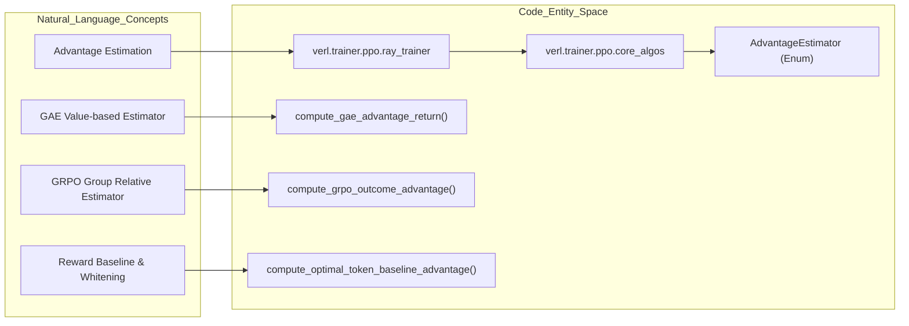

<!-- source: DeepWiki mcp.deepwiki.com · repo volcengine/verl · page 3.3 Advantage Estimation Methods · fetched 2026-10-21 -->

# Advantage Estimation Methods

Relevant source files

The following files were used as context for generating this wiki page:

- [docs/examples/config.rst](docs/examples/config.rst)
- [docs/perf/perf_tuning.rst](docs/perf/perf_tuning.rst)
- [tests/plugin/__init__.py](tests/plugin/__init__.py)
- [tests/trainer/ppo/test_core_algos_on_cpu.py](tests/trainer/ppo/test_core_algos_on_cpu.py)
- [tests/utils/test_groupwise.py](tests/utils/test_groupwise.py)
- [verl/plugin/__init__.py](verl/plugin/__init__.py)
- [verl/plugin/platform/README.md](verl/plugin/platform/README.md)
- [verl/trainer/config/ppo_megatron_trainer.yaml](verl/trainer/config/ppo_megatron_trainer.yaml)
- [verl/trainer/config/ppo_trainer.yaml](verl/trainer/config/ppo_trainer.yaml)
- [verl/trainer/main_ppo.py](verl/trainer/main_ppo.py)
- [verl/trainer/ppo/core_algos.py](verl/trainer/ppo/core_algos.py)
- [verl/trainer/ppo/ray_trainer.py](verl/trainer/ppo/ray_trainer.py)
- [verl/utils/__init__.py](verl/utils/__init__.py)
- [verl/utils/groupwise.py](verl/utils/groupwise.py)

## Purpose and Scope

This document details the advantage estimation system in `verl`'s PPO training pipeline. Advantage estimation computes the relative quality of actions taken during trajectory generation, providing the learning signal for policy updates. The system implements a pluggable registry of estimators including GAE, GRPO, GRPO_VECTORIZED, REINFORCE++, RLOO, OPTIMAL_TOKEN_BASELINE, and GDPO, each suited to different training scenarios.

For policy loss computation using advantages, see [verl/trainer/ppo/core_algos.py:37-48](). For reward computation preceding advantage estimation, see [verl/trainer/ppo/ray_trainer.py:78-117](). For the complete training loop flow, see [verl/trainer/ppo/ray_trainer.py:16-19]().

Sources: [verl/trainer/ppo/ray_trainer.py:16-43](), [verl/trainer/ppo/core_algos.py:37-48]()

---

## Advantage Estimation in RL Training

Advantage estimation quantifies how much better (or worse) an action is compared to the average action at a given state. In PPO training for LLMs, advantages are computed per token over response sequences:

- **Input**: Token-level rewards, values (for critic-based methods), response masks, and grouping indices. [verl/trainer/ppo/core_algos.py:215-220]()
- **Output**: Per-token advantage estimates with shape `(batch_size, response_length)`. [verl/trainer/ppo/core_algos.py:261-262]()
- **Purpose**: Provide variance-reduced learning signals for policy gradient updates. [verl/trainer/ppo/core_algos.py:16-19]()

The advantage function $A(s,a)$ estimates $Q(s,a) - V(s)$, where $Q(s,a)$ is the action-value and $V(s)$ is the state value. Different estimators make different trade-offs between bias and variance.

Sources: [verl/trainer/ppo/core_algos.py:16-262]()

---

## Registry Architecture

The advantage estimator system uses a registry pattern for extensibility, allowing users to select algorithms via configuration strings or enums.

### Advantage Estimator Registry Architecture

Title: "Advantage Estimator Registry Architecture"

```mermaid
graph TB
    subgraph Advantage_Estimator_Registry_System
        Registry["ADV_ESTIMATOR_REGISTRY"]
        Decorator["register_adv_est"]
        Getter["get_adv_estimator_fn"]
        Enum["AdvantageEstimator"]
    end
    
    subgraph Estimator_Implementations
        GAE["compute_gae_advantage_return"]
        GRPO["compute_grpo_outcome_advantage"]
        GRPO_V["compute_grpo_vectorized_outcome_advantage"]
        RLOO["compute_rloo_outcome_advantage"]
        OTB["compute_optimal_token_baseline_advantage"]
        GDPO["compute_gdpo_outcome_advantage"]
        R_PP["compute_reinforce_plus_plus_outcome_advantage"]
    end
    
    subgraph Usage_in_Training
        Config["AlgoConfig"]
        Trainer["ppo_loss"]
    end
    
    GAE -- "@register_adv_est('gae')" --> Decorator
    GRPO -- "@register_adv_est('grpo')" --> Decorator
    GRPO_V -- "@register_adv_est('grpo_vectorized')" --> Decorator
    RLOO -- "@register_adv_est('rloo')" --> Decorator
    OTB -- "@register_adv_est('optimal_token_baseline')" --> Decorator
    GDPO -- "@register_adv_est('gdpo')" --> Decorator
    R_PP -- "@register_adv_est('reinforce_plus_plus')" --> Decorator
    
    Decorator -. "populates" .-> Registry
    Enum -. "defines keys" .-> Decorator
    Config -- "adv_estimator field" --> Getter
    Trainer -- "calls via DataProto flow" --> Getter
    Getter -. "looks up" .-> Registry
```

**Key Components:**

- `ADV_ESTIMATOR_REGISTRY`: Global dictionary mapping strings to estimator functions. [verl/trainer/ppo/core_algos.py:113-113]()
- `register_adv_est()`: Decorator used to register new estimation logic. [verl/trainer/ppo/core_algos.py:116-134]()
- `get_adv_estimator_fn()`: Retrieves the implementation based on the `AdvantageEstimator` enum or string name. [verl/trainer/ppo/core_algos.py:137-151]()
- `AdvantageEstimator`: An `Enum` defining supported methods like `GAE`, `GRPO`, `GRPO_VECTORIZED`, `RLOO`, `RLOO_VECTORIZED`, `GDPO`, `REINFORCE_PLUS_PLUS`, and `OPTIMAL_TOKEN_BASELINE`. [verl/trainer/ppo/core_algos.py:88-111]()

Sources: [verl/trainer/ppo/core_algos.py:88-151]()

---

## Built-in Advantage Estimators and Implementations

### GAE (Generalized Advantage Estimation)
- **Function:** `compute_gae_advantage_return`
- **Registration:** `@register_adv_est(AdvantageEstimator.GAE)` [verl/trainer/ppo/core_algos.py:97]()
- **Implementation:** Computes TD($\lambda$) returns with a learned value function baseline. It calculates TD errors $\delta_t = r_t + \gamma V(s_{t+1}) - V(s_t)$, masks out padding tokens using `response_mask`, and whitens advantages using `verl_F.masked_whiten` for training stability. [verl/trainer/ppo/core_algos.py:215-262]()

### GRPO and GRPO_VECTORIZED (Group Relative Policy Optimization)
- **Functions:** `compute_grpo_outcome_advantage` / `compute_grpo_vectorized_outcome_advantage`
- **Registration:** `@register_adv_est(AdvantageEstimator.GRPO)` / `@register_adv_est(AdvantageEstimator.GRPO_VECTORIZED)` [verl/trainer/ppo/core_algos.py:98, 107]()
- **Implementation:** Groups trajectories by prompt index using `as_torch_index` and computes per-group mean and standard deviation using `group_mean_std`. The vectorized version optimizes memory and throughput by avoiding Python loops over groups and leveraging batch tensor operations. [verl/trainer/ppo/core_algos.py:266-358](), [verl/utils/groupwise.py:91-188]()

### RLOO and RLOO_VECTORIZED (Reinforcement Learning with Likelihood Ratio Optimization)
- **Functions:** `compute_rloo_outcome_advantage` / `compute_rloo_vectorized_outcome_advantage`
- **Registration:** `@register_adv_est(AdvantageEstimator.RLOO)` / `@register_adv_est(AdvantageEstimator.RLOO_VECTORIZED)` [verl/trainer/ppo/core_algos.py:102, 106]()
- **Implementation:** Uses a leave-one-out baseline where each trajectory's advantage is its reward minus the mean of all other trajectories in the group. Vectorized variants compute group sums and counts efficiently via tensor indexing. [verl/trainer/ppo/core_algos.py:476-525, 720-755]()

### REINFORCE++
- **Function:** `compute_reinforce_plus_plus_outcome_advantage`
- **Registration:** `@register_adv_est(AdvantageEstimator.REINFORCE_PLUS_PLUS)` [verl/trainer/ppo/core_algos.py:99]()
- **Implementation:** A policy gradient baseline that applies whitening directly to outcome rewards without requiring a critic model. [verl/trainer/ppo/core_algos.py:99]()

### OPTIMAL_TOKEN_BASELINE
- **Function:** `compute_optimal_token_baseline_advantage`
- **Registration:** `@register_adv_est(AdvantageEstimator.OPTIMAL_TOKEN_BASELINE)` [verl/trainer/ppo/core_algos.py:108]()
- **Implementation:** Computes per-timestep optimal baselines using cumulative path variance proxy ($\sum \pi^2$ and logits), performing weight-based aggregation across prompt groups for fine-grained credit assignment. [verl/trainer/config/ppo_trainer.yaml:73-74](), [verl/trainer/ppo/core_algos.py:758-873]()

### GDPO (Group-based Differential Policy Optimization)
- **Function:** `compute_gdpo_outcome_advantage`
- **Registration:** `@register_adv_est(AdvantageEstimator.GDPO)` [verl/trainer/ppo/core_algos.py:110]()
- **Implementation:** A group-based estimator tailored for differential optimization patterns across trajectory groups. [verl/trainer/ppo/core_algos.py:110]()

Sources: [verl/trainer/ppo/core_algos.py:88-111, 215-358, 476-525, 720-873](), [verl/trainer/config/ppo_trainer.yaml:73-74](), [verl/utils/groupwise.py:91-188]()

---

## Integration and Data Flow

The training workers orchestrate advantage estimation by passing the `DataProto` tensor dictionary to the registered estimator functions.

### Advantage Estimation Logic Mapping

Title: "Advantage Estimation Logic Mapping"

Sources: [verl/trainer/ppo/ray_trainer.py:42-43](), [verl/trainer/ppo/core_algos.py:21-111]()

---

## Configuration Reference

The choice of estimator is configured via the algorithm section in `ppo_trainer.yaml`.

| Estimator String | Class/Function Reference | Use Case |
|:---|:---|:---|
| `gae` | `compute_gae_advantage_return` | Standard PPO with Critic. [verl/trainer/ppo/core_algos.py:97]() |
| `grpo` | `compute_grpo_outcome_advantage` | LLM reasoning with group rewards (e.g., DeepSeek-R1). [verl/trainer/ppo/core_algos.py:98]() |
| `grpo_vectorized` | `compute_grpo_vectorized_outcome_advantage` | High-throughput vectorized GRPO. [verl/trainer/ppo/core_algos.py:107]() |
| `rloo` | `compute_rloo_outcome_advantage` | Variance reduction without a Critic using leave-one-out. [verl/trainer/ppo/core_algos.py:102]() |
| `rloo_vectorized` | `compute_rloo_vectorized_outcome_advantage` | Vectorized RLOO implementation. [verl/trainer/ppo/core_algos.py:106]() |
| `optimal_token_baseline` | `compute_optimal_token_baseline_advantage` | Token-level credit assignment via variance proxy. [verl/trainer/ppo/core_algos.py:108]() |
| `reinforce_plus_plus` | `compute_reinforce_plus_plus_outcome_advantage` | Simple policy gradient with whitening. [verl/trainer/ppo/core_algos.py:99]() |
| `gdpo` | `compute_gdpo_outcome_advantage` | Specialized group-based differential optimization. [verl/trainer/ppo/core_algos.py:110]() |

Sources: [verl/trainer/ppo/core_algos.py:88-111](), [verl/trainer/config/ppo_trainer.yaml:73-74]()

---

## Computational Considerations

- **Memory Complexity:** Token-level estimators like `GAE` and `OPTIMAL_TOKEN_BASELINE` require $O(\text{Batch} \times \text{SeqLen})$ memory for advantage tensors. `GRPO` and `RLOO` operate primarily at the outcome level and broadcast results back to response tokens. [verl/trainer/ppo/core_algos.py:215-262, 758-873]()
- **Vectorization:** Vectorized estimators (`GRPO_VECTORIZED`, `RLOO_VECTORIZED`) avoid Python loops over groups and utilize optimized tensor routines (`group_mean_std`), significantly enhancing scaling efficiency in multi-node training clusters. [verl/trainer/ppo/core_algos.py:333-358, 720-755](), [verl/utils/groupwise.py:164-188]()

Sources: [verl/trainer/ppo/core_algos.py:333-358, 720-755](), [verl/utils/groupwise.py:164-188]()

---

