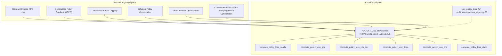
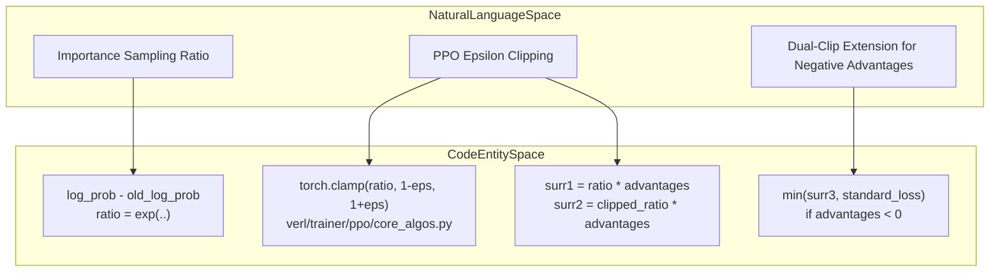
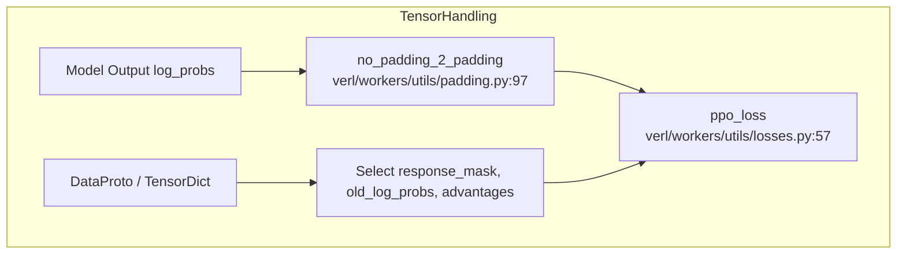

<!-- source: DeepWiki mcp.deepwiki.com · repo volcengine/verl · page 3.4 Policy Loss Functions and Clipping · fetched 2026-10-21 -->

# Policy Loss Functions and Clipping

Relevant source files

The following files were used as context for generating this wiki page:

- [docs/examples/config.rst](docs/examples/config.rst)
- [docs/perf/perf_tuning.rst](docs/perf/perf_tuning.rst)
- [tests/models/test_fsdp_no_padding_on_gpu.py](tests/models/test_fsdp_no_padding_on_gpu.py)
- [tests/special_distributed/test_qwen35_linear_attention_ulysses_sp.py](tests/special_distributed/test_qwen35_linear_attention_ulysses_sp.py)
- [tests/utils/test_padding_on_cpu.py](tests/utils/test_padding_on_cpu.py)
- [verl/trainer/config/ppo_megatron_trainer.yaml](verl/trainer/config/ppo_megatron_trainer.yaml)
- [verl/trainer/config/ppo_trainer.yaml](verl/trainer/config/ppo_trainer.yaml)
- [verl/trainer/main_ppo.py](verl/trainer/main_ppo.py)
- [verl/trainer/ppo/core_algos.py](verl/trainer/ppo/core_algos.py)
- [verl/trainer/ppo/ray_trainer.py](verl/trainer/ppo/ray_trainer.py)
- [verl/workers/utils/losses.py](verl/workers/utils/losses.py)
- [verl/workers/utils/padding.py](verl/workers/utils/padding.py)

This page documents the policy loss function system in `verl`, which provides pluggable implementations of various policy gradient loss formulations for RL training (PPO, GRPO, DAPO, GMPO, SAPO, DPPO, etc.). Policy loss functions compute the objective that drives policy updates, incorporating importance sampling ratios, clipping strategies, smoothing mechanisms, and regularization terms.

For information about advantage estimation methods that compute the input values for these loss functions, see [Advantage Estimation Methods]().

---

## 1. Policy Loss Registry and Architecture

All policy loss functions share a common call signature defined by the `PolicyLossFn` type definition `[verl/trainer/ppo/core_algos.py:37-48]()`. They operate on old log probabilities, current log probabilities, advantages, and response masks, returning a scalar loss tensor and a dictionary of training metrics.

The framework manages loss functions through a global registry structure `[verl/trainer/ppo/core_algos.py:50-50]()` and a factory getter `[verl/trainer/ppo/core_algos.py:70-85]()`.

### Diagram: Natural Language Space to Code Entity Space (Loss Registry)

Sources: `[verl/trainer/ppo/core_algos.py:37-86]`, `[verl/workers/utils/losses.py:57-145]()`

---

## 2. Vanilla PPO Loss and Clipping Strategies

The vanilla PPO loss implements the standard clipped surrogate objective. It computes the importance sampling ratio between the current policy log probability and the old rollout log probability.

### Diagram: Natural Language Space to Code Entity Space (PPO Clipping)

Sources: `[verl/trainer/ppo/core_algos.py:906-998]`, `[verl/trainer/config/ppo_trainer.yaml:128]()`

**Key Parameters:**
- `clip_ratio`: The $\epsilon$ parameter for standard PPO clipping (default 0.2) `[verl/trainer/config/ppo_trainer.yaml:128]()`.
- `clip_ratio_low`: Lower bound for asymmetric clipping.
- `clip_ratio_high`: Upper bound for asymmetric clipping.
- `clip_ratio_c`: The dual-clip coefficient for handling large negative advantages, preventing destructive policy updates.

Sources: `[verl/trainer/ppo/core_algos.py:906-998]`, `[verl/trainer/config/ppo_trainer.yaml:128]()`

---

## 3. Alternative Policy Loss Formulations

Beyond standard PPO, `verl` supports specialized loss formulations for different RL algorithms. These are configured via the `policy_loss.loss_mode` parameter in the actor configuration.

- **Generalized Policy Gradient (GPG)**: Used primarily with GRPO (`adv_estimator: grpo`). It omits importance sampling clipping, computing the loss directly as `pg_losses = -log_prob * advantages` `[verl/trainer/ppo/core_algos.py:1099-1099]()`.
- **Covariance-Based Clipping (`clip_cov` & `kl_cov`)**: Alternative clipping objectives incorporating covariance constraints between policy updates and reference distributions `[verl/trainer/ppo/core_algos.py:1112-1295]()`.
    - `clip_cov_ratio`: Ratio of tokens to be clipped for `clip_cov` loss.
    - `clip_cov_lb`, `clip_cov_ub`: Lower and upper bounds for `clip_cov` loss.
    - `kl_cov_ratio`: Ratio of tokens to apply KL penalty for `kl_cov` loss.
- **Diffusion Policy Optimization (`dppo_tv`, `dppo_kl`)**: Variants designed for diffusion model RL pipelines supporting Total Variation and KL divergences `[verl/trainer/ppo/core_algos.py:1383-1530]()`.
- **Flow GRPO (`flow_grpo`)**: Experimental loss function tailored for multi-step flow matching and diffusion rollout backends `[verl/trainer/ppo/core_algos.py:1532-1582]()`.
- **Direct Reward Optimization (`dro`)**: Uses a quadratic log-ratio penalty. Requires `dro_beta` to be set.
- **Conservative Importance Sampling Policy Optimization (`cispo`)**: Aims to prevent policy collapse by adding a conservative term.

Sources: `[verl/trainer/ppo/core_algos.py:1076-1582]()`

---

## 4. Log Probability and Padding Handling

Tensor shapes must be carefully managed between unpadded (jagged/nested) rollout representations and padded tensor batches used during loss computation.

Sources: `[verl/workers/utils/padding.py:97-141]()`, `[verl/workers/utils/losses.py:57-144]()`

- `no_padding_2_padding()`: Slices response tokens from unpadded model outputs back into padded format `[verl/workers/utils/padding.py:97-141]()`.
- `ppo_loss()`: Coordinates data extraction, policy loss calculation via `POLICY_LOSS_REGISTRY`, entropy addition, and KL penalties `[verl/workers/utils/losses.py:57-144]()`.

Sources: `[verl/workers/utils/padding.py:97-141]()`, `[verl/workers/utils/losses.py:57-144]()`

---

## 5. SAPO/GMPO Smoothing, Entropy, and KL Regularization

To stabilize training and control exploration, `verl` integrates several penalty and smoothing mechanisms:

1. **Entropy Regularization**: Computed from logits and subtracted from policy loss using `entropy_coeff` `[verl/workers/utils/losses.py:123-130]()`.
2. **SAPO / GMPO Smoothing**: Asymmetric smoothing parameters (`tau_pos`, `tau_neg`) stabilize updates for group-based policy optimization.
    - `tau_pos`: Positive tau for SAPO smoothing (>= 1.0 keeps rewards stable).
    - `tau_neg`: Negative tau for SAPO smoothing (> `tau_pos` for asymmetry).
3. **KL Penalty Application**: The `apply_kl_penalty` function computes token-level KL divergence against reference policies and adjusts rewards using an adaptive or fixed controller `[verl/trainer/ppo/ray_trainer.py:78-117]()`.
4. **Adaptive vs. Fixed KL Controllers**: `AdaptiveKLController` dynamically updates the penalty coefficient based on target divergence and horizon steps `[verl/trainer/ppo/core_algos.py:153-191]()`.

Sources: `[verl/trainer/ppo/ray_trainer.py:78-117]()`, `[verl/trainer/ppo/core_algos.py:153-191]()`, `[verl/workers/utils/losses.py:123-144]()`

---

## 6. Loss Aggregation and Normalization

The `agg_loss` utility normalizes token-level losses across distributed data-parallel (DP) ranks `[verl/trainer/ppo/core_algos.py:772-828]()`.

| Aggregation Mode | Code Identifier | Description |
| :--- | :--- | :--- |
| **Token Mean** | `token-mean` | Sum of token losses divided by total valid tokens across the DP group `[verl/trainer/ppo/core_algos.py:794-796]()`. |
| **Sequence Mean** | `seq-mean-token-sum` | Sum of token losses per sequence, averaged over the batch `[verl/trainer/ppo/core_algos.py:798-800]()`. |
| **Normalized Sum** | `seq-mean-token-sum-norm` | Scales loss by `loss_scale_factor` for cross-GPU gradient consistency. |

Sources: `[verl/trainer/ppo/core_algos.py:772-828]()`

---

## 7. Value Loss Clipping

For the value network (critic), `verl` implements value clipping analogous to policy clipping to prevent destabilizing value estimation updates.

- `compute_value_loss()`: Computes clipped MSE loss between predicted values and returns `[verl/trainer/ppo/core_algos.py:831-903]()`.
- `value_loss()`: High-level wrapper handling padding conversion and global batch scaling `[verl/workers/utils/losses.py:147-185]()`.
- `cliprange_value`: PPO value function clipping range.

Sources: `[verl/trainer/ppo/core_algos.py:831-903]()`, `[verl/workers/utils/losses.py:147-185]()`

---

