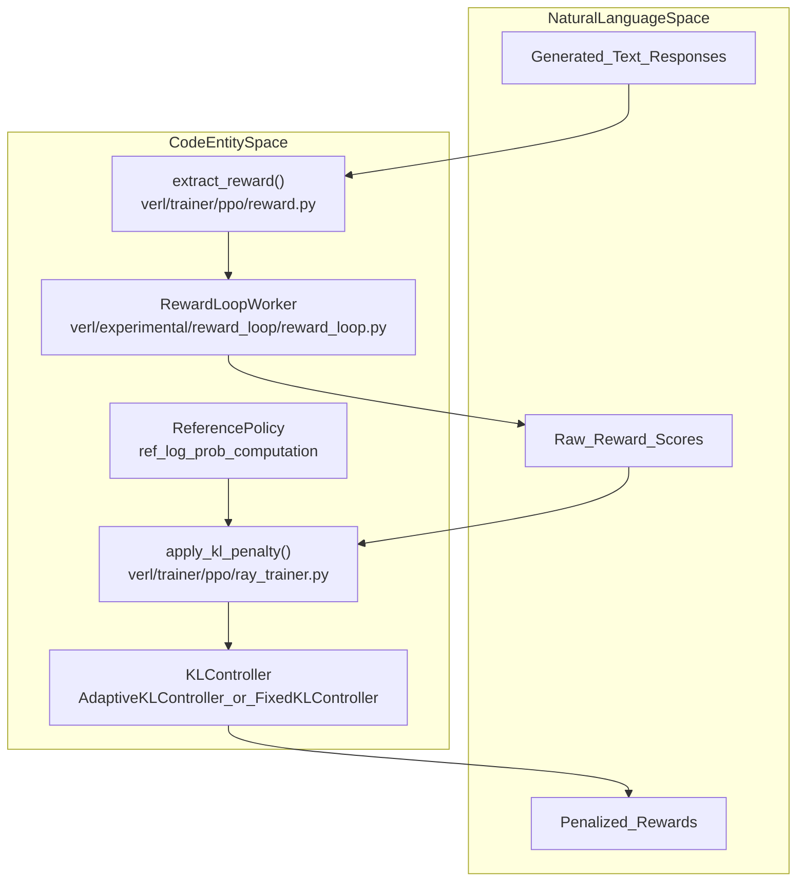
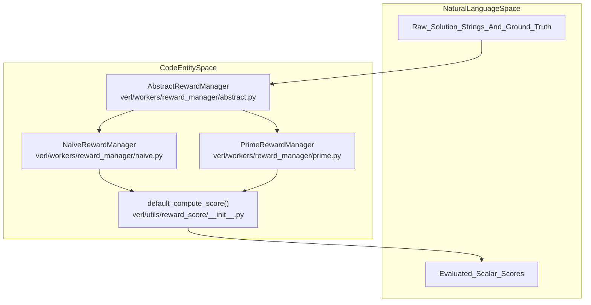
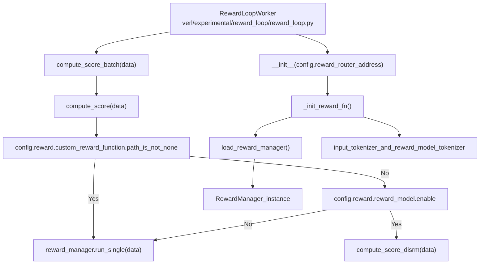
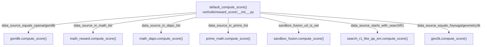
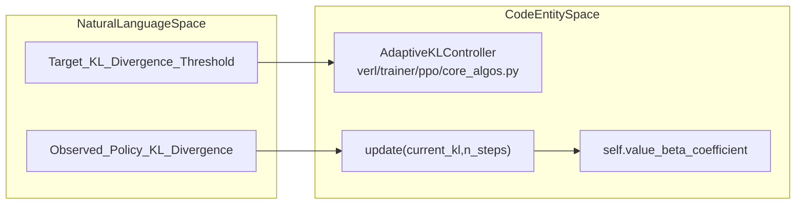

<!-- source: DeepWiki mcp.deepwiki.com · repo volcengine/verl · page 3.5 Reward Systems and KL Control · fetched 2026-10-21 -->

# Reward Systems and KL Control

<details>
<summary>Relevant source files</summary>

The following files were used as context for generating this wiki page:

- [docs/advance/reward_loop.rst](docs/advance/reward_loop.rst)
- [docs/examples/sandbox_fusion_example.rst](docs/examples/sandbox_fusion_example.rst)
- [tests/experimental/reward_loop/test_rate_limited_reward_manager_on_cpu.py](tests/experimental/reward_loop/test_rate_limited_reward_manager_on_cpu.py)
- [tests/utils/reward_score/reward_score/test_sandbox_fusion_on_cpu.py](tests/utils/reward_score/reward_score/test_sandbox_fusion_on_cpu.py)
- [tests/workers/reward_manager/test_dapo_on_cpu.py](tests/workers/reward_manager/test_dapo_on_cpu.py)
- [tests/workers/reward_manager/test_naive_on_cpu.py](tests/workers/reward_manager/test_naive_on_cpu.py)
- [verl/experimental/reward_loop/reward_loop.py](verl/experimental/reward_loop/reward_loop.py)
- [verl/experimental/reward_loop/reward_manager/base.py](verl/experimental/reward_loop/reward_manager/base.py)
- [verl/experimental/reward_loop/reward_manager/dapo.py](verl/experimental/reward_loop/reward_manager/dapo.py)
- [verl/experimental/reward_loop/reward_manager/gdpo.py](verl/experimental/reward_loop/reward_manager/gdpo.py)
- [verl/experimental/reward_loop/reward_manager/limited.py](verl/experimental/reward_loop/reward_manager/limited.py)
- [verl/experimental/reward_loop/reward_manager/naive.py](verl/experimental/reward_loop/reward_manager/naive.py)
- [verl/experimental/reward_loop/reward_manager/registry.py](verl/experimental/reward_loop/reward_manager/registry.py)
- [verl/trainer/ppo/__init__.py](verl/trainer/ppo/__init__.py)
- [verl/trainer/ppo/reward.py](verl/trainer/ppo/reward.py)
- [verl/utils/ray_utils.py](verl/utils/ray_utils.py)
- [verl/utils/reward_score/__init__.py](verl/utils/reward_score/__init__.py)
- [verl/utils/reward_score/prime_code/__init__.py](verl/utils/reward_score/prime_code/__init__.py)
- [verl/utils/reward_score/prime_code/testing_util.py](verl/utils/reward_score/prime_code/testing_util.py)
- [verl/utils/reward_score/prime_math/__init__.py](verl/utils/reward_score/prime_math/__init__.py)
- [verl/utils/reward_score/prime_math/grader.py](verl/utils/reward_score/prime_math/grader.py)
- [verl/utils/reward_score/prime_math/math_normalize.py](verl/utils/reward_score/prime_math/math_normalize.py)
- [verl/utils/reward_score/sandbox_fusion/__init__.py](verl/utils/reward_score/sandbox_fusion/__init__.py)
- [verl/utils/reward_score/sandbox_fusion/utils.py](verl/utils/reward_score/sandbox_fusion/utils.py)
- [verl/workers/reward_manager/__init__.py](verl/workers/reward_manager/__init__.py)
- [verl/workers/reward_manager/abstract.py](verl/workers/reward_manager/abstract.py)
- [verl/workers/reward_manager/batch.py](verl/workers/reward_manager/batch.py)
- [verl/workers/reward_manager/dapo.py](verl/workers/reward_manager/dapo.py)
- [verl/workers/reward_manager/naive.py](verl/workers/reward_manager/naive.py)
- [verl/workers/reward_manager/prime.py](verl/workers/reward_manager/prime.py)
- [verl/workers/reward_manager/registry.py](verl/workers/reward_manager/registry.py)

</details>


## Purpose and Scope

This page documents verl's reward computation and Kullback-Leibler (KL) divergence control systems. These subsystems are essential for Reinforcement Learning from Human Feedback (RLHF) and post-training alignment, governing how generated sequences are scored via rule-based evaluators, reward models, or custom functions, and how KL penalties are injected to regularize policy updates against a reference model.

Sources: [verl/trainer/ppo/reward.py:14-30](), [docs/advance/reward_loop.rst:10-23]()

---

## System Overview

The reward and KL control pipeline operates sequentially during each training optimization cycle:
1. **Reward Computation Phase**: Decodes generated responses and computes raw reward scores using rule-based evaluators, discriminative reward models (DisRM), generative reward models (GenRM), or custom functions [verl/experimental/reward_loop/reward_loop.py:93-107]().
2. **KL Penalty Phase**: Computes token-level KL divergence between the policy and reference model outputs, dynamically updating penalty coefficients via KL controllers [verl/trainer/ppo/reward.py:160-167]().

Title: "Reward and KL Penalty Pipeline"


Sources: [verl/trainer/ppo/reward.py:160-167](), [verl/experimental/reward_loop/reward_loop.py:93-107]()

---

## Reward Computation

### Reward Managers

verl uses an `AbstractRewardManager` base class to encapsulate scoring execution logic [verl/workers/reward_manager/abstract.py](). The `load_reward_manager` function dynamically initializes reward managers based on Hydra configuration, supporting both core registries and dynamic module loading via `importlib` [verl/trainer/ppo/reward.py:89-110]().

| Manager Class | Code Entity | Implementation Role |
|---------------|-------------|---------------------|
| **Naive** | `NaiveRewardManager` | Serial iteration over batch items, decoding responses and invoking `compute_score` with a `SIGALRM` timeout guard [verl/workers/reward_manager/naive.py:65-89](). |
| **Batch** | `BatchRewardManager` | Batched decoding and tensor-level scoring to minimize Python overhead across responses [verl/workers/reward_manager/batch.py:26-46](). |
| **Prime** | `PrimeRewardManager` | Asynchronous parallel scoring using a `ProcessPoolExecutor` combined with `asyncio.gather` and process supervision [verl/workers/reward_manager/prime.py:45-119](). |
| **DAPO** | `DAPORewardManager` | Integrates overlong length penalties via `overlong_buffer_cfg` alongside core scoring [verl/workers/reward_manager/dapo.py:25-57](). |

Sources: [verl/trainer/ppo/reward.py:89-157](), [verl/workers/reward_manager/naive.py:65-89](), [verl/workers/reward_manager/batch.py:26-46](), [verl/workers/reward_manager/prime.py:45-119](), [verl/workers/reward_manager/dapo.py:25-57]()

### RewardLoopWorker Architecture

The `RewardLoopWorker` class coordinates distributed reward calculations across worker nodes [verl/experimental/reward_loop/reward_loop.py:93-107](). It handles custom reward scripts, discriminative models, and default rule engines.

Title: "Reward Loop and Evaluation Mapping"


Sources: [verl/workers/reward_manager/naive.py:65-89](), [verl/workers/reward_manager/prime.py:102-119](), [verl/utils/reward_score/__init__.py:19-43]()

Title: "RewardLoopWorker Execution Flow"


Sources: [verl/experimental/reward_loop/reward_loop.py:109-155]()

### Rule-Based Scoring Logic

The `default_compute_score` function acts as the central router for evaluation datasets, mapping dataset names to specialized modules like `gsm8k`, `math_reward`, `math_dapo`, and `prime_math` [verl/utils/reward_score/__init__.py:19-107]().

Title: "Rule-Based Score Router"


Sources: [verl/utils/reward_score/__init__.py:44-107]()

### Custom Reward Functions and Sandbox Integration

Custom external reward functions are dynamically imported using `get_custom_reward_fn`, wrapping synchronous and asynchronous callables via `_call_with_kwargs` and `_call_with_kwargs_async` [verl/trainer/ppo/reward.py:50-87](). 

For code evaluation tasks (`codecontests`, `apps`), **Sandbox Fusion** establishes connection parameters and utilizes `multiprocessing.Manager().Semaphore()` to regulate concurrent requests to remote execution endpoints [verl/trainer/ppo/reward.py:135-147]().

Sources: [verl/trainer/ppo/reward.py:32-87](), [verl/trainer/ppo/reward.py:135-147](), [verl/utils/reward_score/__init__.py:76-88]()

### Timeout Protection

To prevent hanging execution threads caused by pathological generations (e.g., infinite loops or catastrophic backtracking):
* **Naive Manager Timeout**: `NaiveRewardManager` implements a `_score_timeout` context manager using `signal.SIGALRM` [verl/workers/reward_manager/naive.py:28-62]().
* **Prime Manager Timeout**: `PrimeRewardManager` enforces asynchronous timeouts via `asyncio.wait_for` across process execution boundaries [verl/workers/reward_manager/prime.py:31-42]().

Sources: [verl/workers/reward_manager/naive.py:28-62](), [verl/workers/reward_manager/prime.py:31-42]()

---

## KL Control and Penalties

### KL Controllers

verl regulates divergence from the reference policy using KL controllers implemented in core algorithms.

* **FixedKLController**: Applies a constant penalty weight throughout training.
* **AdaptiveKLController**: Dynamically scales the penalty coefficient based on measured KL divergence relative to a target configuration threshold.

Title: "KL Controller Parameter Mapping"


Sources: [verl/experimental/reward_loop/reward_manager/gdpo.py:23-45]()

---

## Configuration Reference

The reward system and KL control parameters are managed via Hydra configuration files. The `migrate_legacy_reward_impl` function handles backward compatibility for older configurations [verl/experimental/reward_loop/reward_loop.py:39-90]().

```yaml
reward:
  reward_manager:
    source: "register" # or "importlib"
    name: "naive" # e.g., "naive", "dapo", "prime", "batch", or custom registered name
    module: # Required if source is "importlib"
      path: null
      name: null
  custom_reward_function:
    path: null # Path to a custom Python file defining the reward function
    name: null # Name of the reward function within the file
    reward_kwargs: {} # Additional keyword arguments for the custom reward function
  sandbox_fusion:
    url: null # URL for the sandbox fusion service
    max_concurrent: 64 # Maximum concurrent requests to the sandbox
    memory_limit_mb: 1024 # Memory limit for sandbox processes
  reward_model: # Configuration for a discriminative reward model
    enable: false
    enable_resource_pool: false
    n_gpus_per_node: 1
    nnodes: 1
    model_path: null
    rollout: # Rollout configuration for the reward model
      name: "vllm"
      tensor_model_parallel_size: 1
      data_parallel_size: 1
      pipeline_model_parallel_size: 1
      free_cache_engine: false
      skip_tokenizer_init: false
  num_workers: 1 # Number of reward loop workers
  reward_kwargs: {} # General reward-related keyword arguments, e.g., for DAPO overlong penalty
```

Sources: [verl/trainer/ppo/reward.py:70-87](), [verl/trainer/ppo/reward.py:129-157](), [verl/experimental/reward_loop/reward_loop.py:39-90]()

---

