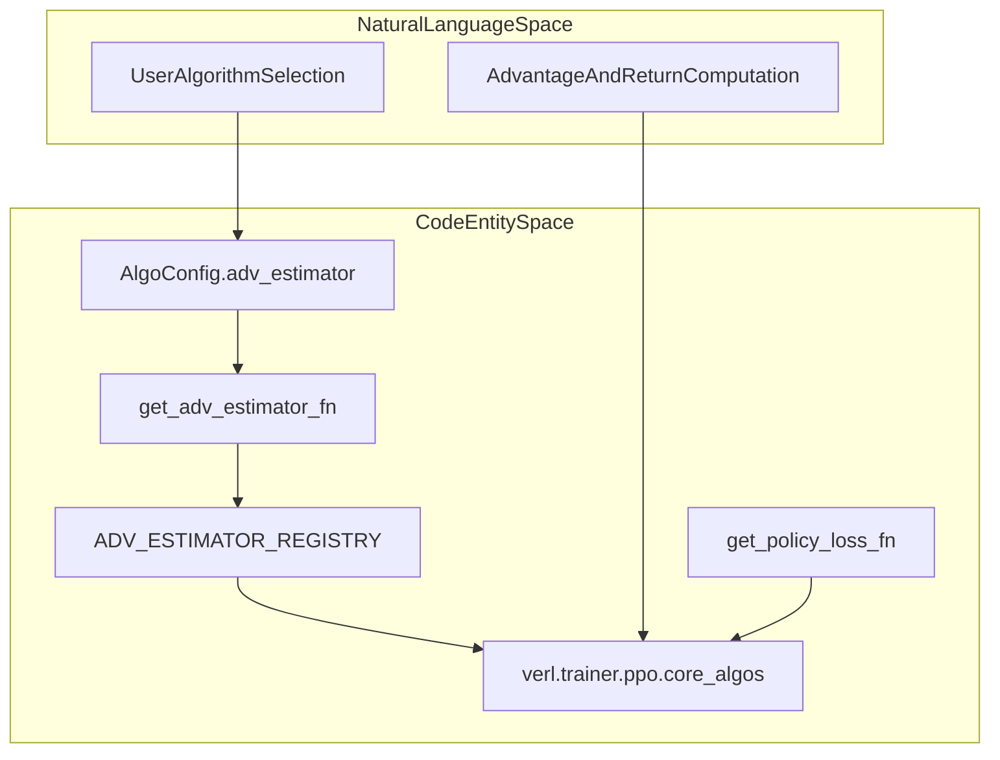
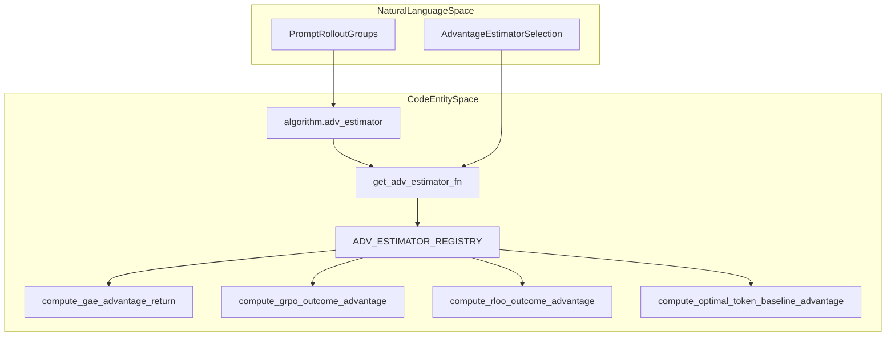
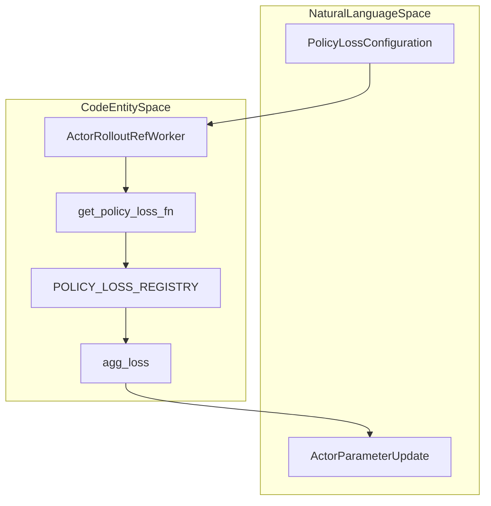

<!-- source: DeepWiki mcp.deepwiki.com · repo volcengine/verl · page 3.6 Alternative RL Algorithms · fetched 2026-10-21 -->

# Alternative RL Algorithms

Relevant source files

The following files were used as context for generating this wiki page:

- [examples/ascend_extras/grpo_trainer/run_qwen3_235b_256k_megatron.sh](examples/ascend_extras/grpo_trainer/run_qwen3_235b_256k_megatron.sh)
- [examples/ascend_extras/grpo_trainer/run_qwen3_30b_a3b_megatron.sh](examples/ascend_extras/grpo_trainer/run_qwen3_30b_a3b_megatron.sh)
- [examples/ascend_extras/grpo_trainer/run_qwen3_32b_fsdp.sh](examples/ascend_extras/grpo_trainer/run_qwen3_32b_fsdp.sh)
- [examples/ascend_extras/grpo_trainer/run_qwen3_next_80b_fsdp.sh](examples/ascend_extras/grpo_trainer/run_qwen3_next_80b_fsdp.sh)
- [examples/dppo_trainer/run_qwen3_30b_a3b_megatron.sh](examples/dppo_trainer/run_qwen3_30b_a3b_megatron.sh)
- [examples/grpo_trainer/run_qwen2_5_32b_fsdp.sh](examples/grpo_trainer/run_qwen2_5_32b_fsdp.sh)
- [examples/grpo_trainer/run_qwen2_5_vl_7b_fsdp.sh](examples/grpo_trainer/run_qwen2_5_vl_7b_fsdp.sh)
- [examples/grpo_trainer/run_qwen3_235b_a22b_megatron.sh](examples/grpo_trainer/run_qwen3_235b_a22b_megatron.sh)
- [examples/grpo_trainer/run_qwen3_30b_a3b_megatron.sh](examples/grpo_trainer/run_qwen3_30b_a3b_megatron.sh)
- [examples/grpo_trainer/run_qwen3_4b_fsdp.sh](examples/grpo_trainer/run_qwen3_4b_fsdp.sh)
- [examples/grpo_trainer/run_qwen3_5_27b_fsdp.sh](examples/grpo_trainer/run_qwen3_5_27b_fsdp.sh)
- [examples/grpo_trainer/run_qwen3_vl_8b_fsdp.sh](examples/grpo_trainer/run_qwen3_vl_8b_fsdp.sh)
- [tests/plugin/__init__.py](tests/plugin/__init__.py)
- [tests/trainer/ppo/test_core_algos_on_cpu.py](tests/trainer/ppo/test_core_algos_on_cpu.py)
- [tests/utils/test_groupwise.py](tests/utils/test_groupwise.py)
- [verl/plugin/__init__.py](verl/plugin/__init__.py)
- [verl/plugin/platform/README.md](verl/plugin/platform/README.md)
- [verl/utils/__init__.py](verl/utils/__init__.py)
- [verl/utils/groupwise.py](verl/utils/groupwise.py)

This page documents the implementation details of reinforcement learning algorithms supported by `verl` beyond standard PPO [docs/algo/ppo.md:1-6](). While the framework is orchestrated via a unified trainer structure [examples/ppo_trainer/README.md:1-16](), its modular design supports diverse advantage estimators and policy loss functions, including GRPO, DAPO, RLOO, PRIME, ReMax, GMPO, SAPO, DPPO, GSPO, GPG, OTB, GDPO, REINFORCE++, and CISPO.

---

## Overview and Extension Architecture

`verl` implements a unified training abstraction where alternative RL algorithms are plugged in through two primary extension points defined in `verl.trainer.ppo.core_algos`:
1. **Advantage Estimators** managed by the `AdvantageEstimator` enum and `ADV_ESTIMATOR_REGISTRY` [tests/trainer/ppo/test_core_algos_on_cpu.py:22-32]().
2. **Policy Loss Functions** registered via `POLICY_LOSS_REGISTRY` and invoked during the actor update loop [verl/trainer/ppo/core_algos.py:37-51]().

**Diagram: Algorithmic Extension Architecture**

Sources: [tests/trainer/ppo/test_core_algos_on_cpu.py:22-32](), [verl/trainer/ppo/core_algos.py:37-51]()

---

## Advantage Estimator Registry & Implementation

The advantage estimator registry maps string identifiers and enum values to mathematical functions transforming rewards into advantage tensors.

### Advantage Estimation System Architecture

**Diagram: Advantage Estimator Registry Mapping**

Sources: [tests/trainer/ppo/test_core_algos_on_cpu.py:22-32](), [docs/algo/otb.md:32-33]()

### Supported Advantage Estimators

The framework defines built-in estimators available via `algorithm.adv_estimator`:

| Algorithm | Registry Key | Supervision Style | Description / Implementation |
| :--- | :--- | :--- | :--- |
| **GAE** | `gae` | Token-level | Generalized Advantage Estimation using a learned value network [examples/ppo_trainer/README.md:46](). Implemented in `compute_gae_advantage_return` [tests/trainer/ppo/test_core_algos_on_cpu.py:24](). |
| **GRPO** | `grpo` | Outcome-only | Group-wise outcome normalization across $N$ rollouts per prompt [examples/ppo_trainer/README.md:46](). Implemented in `compute_grpo_outcome_advantage` [tests/trainer/ppo/test_core_algos_on_cpu.py:25](). |
| **GRPO Vectorized** | `grpo_vectorized` | Outcome-only | Vectorized variant of group relative policy optimization [tests/trainer/ppo/test_core_algos_on_cpu.py:26](). |
| **REINFORCE++** | `reinforce_plus_plus` | Outcome-only | Enhanced REINFORCE with global or moving-average baseline [verl/trainer/ppo/core_algos.py:99](). |
| **REINFORCE++ Baseline** | `reinforce_plus_plus_baseline` | Outcome-only | Variant with explicit baseline subtraction [verl/trainer/ppo/core_algos.py:100](). |
| **RLOO** | `rloo` | Outcome-only | REINFORCE Leave-One-Out baseline estimator [tests/trainer/ppo/test_core_algos_on_cpu.py:27](). |
| **RLOO Vectorized** | `rloo_vectorized` | Outcome-only | Vectorized REINFORCE Leave-One-Out implementation [tests/trainer/ppo/test_core_algos_on_cpu.py:28](). |
| **ReMax** | `remax` | Outcome-only | Uses greedy rollout reward as baseline to reduce variance without critic [verl/trainer/ppo/core_algos.py:101](). |
| **Optimal Token Baseline** | `optimal_token_baseline` | Token-level | Step-dependent optimal baseline for token-level updates [docs/algo/otb.md:7-8](). |
| **TIR OTB** | `tir_optimal_token_baseline` | Token-level | Multi-turn extension of Optimal Token Baseline [docs/algo/otb.md:40](). |
| **GDPO** | `gdpo` | Guided | Guided Discovery Policy Optimization advantage formulation [verl/trainer/ppo/core_algos.py:110](). |

Sources: [tests/trainer/ppo/test_core_algos_on_cpu.py:22-32](), [docs/algo/otb.md:7-40]()

---

## Group-Based & Baseline Algorithms (GRPO, RLOO, ReMax, OTB)

Algorithms that dispense with a separate critic network rely entirely on outcome rewards normalized across response groups or compared against specific baselines [examples/ppo_trainer/README.md:16-18]().

### Group Relative Policy Optimization (GRPO)
GRPO eliminates the critic model by sampling a group of $N$ outputs (`actor_rollout_ref.rollout.n > 1`) for each prompt [examples/grpo_trainer/README.md:21](). Advantages are calculated by normalizing rewards within each prompt group via group-wise statistics [verl/utils/groupwise.py:163-188]():
$$\hat{A}_{i,j} = \frac{R_{i,j} - \text{mean}(\mathbf{R}_i)}{\text{std}(\mathbf{R}_i) + \epsilon}$$
Group mean and standard deviation calculations are accelerated using pure PyTorch group-wise reduction helpers (`group_mean_std` and `as_torch_index`) [verl/utils/groupwise.py:21-22](). Dr. GRPO is an extension that addresses optimization bias by aggregating token-level losses and normalizing with a global constant to eliminate length bias, configured via `actor_rollout_ref.actor.loss_agg_mode=seq-mean-token-sum-norm` [examples/grpo_trainer/README.md:32-38]().

Sources: [verl/utils/groupwise.py:21-188](), [examples/grpo_trainer/README.md:21-38]()

### REINFORCE Leave-One-Out (RLOO)
RLOO computes the baseline for each sample in a group of size $N$ as the average reward of all *other* samples in the same group:
$$b_i = \frac{1}{N-1} \sum_{j \neq i} R_j$$
This removes self-comparison bias present in standard group mean normalization. Implemented via `compute_rloo_outcome_advantage` and `compute_rloo_vectorized_outcome_advantage` [tests/trainer/ppo/test_core_algos_on_cpu.py:27-28]().

Sources: [tests/trainer/ppo/test_core_algos_on_cpu.py:27-28]()

### ReMax
ReMax substitutes the learned value network of PPO with a greedy decoding rollout generated for each prompt. The reward of the greedy rollout serves as a fixed baseline for all sampled rollouts of that prompt, drastically reducing memory overhead while maintaining low variance.

### Optimal Token Baseline (OTB)
Optimal Token Baseline (OTB) is a dynamic token-level baseline for gradient variance reduction that weights updates using the Realized Energy statistic [docs/algo/otb.md:7-8](). It tracks uncertainty up to each token using the **Logit-Gradient Proxy**, avoiding extra backward passes [docs/algo/otb.md:13-16](). 

The optimal baseline per token is defined as:
$$B^*_t = \frac{\sum_i G_t^{(i)} \cdot W_t^{(i)}}{\sum_i W_t^{(i)} + \epsilon}, \quad W_t = \sum_{j=1}^t (1 - 2\pi_j + \sum \pi_j^2)$$
where $\sum \pi_j^2 = \exp(\text{logsumexp}(2 \cdot \text{logits}_j) - 2 \cdot \text{logsumexp}(\text{logits}_j))$ [docs/algo/otb.md:23-25](). OTB requires `actor_rollout_ref.actor.calculate_sum_pi_squared=true` and `actor_rollout_ref.model.use_fused_kernels: false` [docs/algo/otb.md:38-39](). The `sum_pi_squared` tensor is emitted by `ActorRolloutRefWorker.compute_log_prob` [docs/algo/otb.md:33-34]().

Sources: [docs/algo/otb.md:7-41]()

---

## Alternative Policy Losses and Smoothing (GPG, GSPO, CISPO, DPPO, GMPO, SAPO)

Beyond standard clipped surrogate objectives, `verl` supports specialized policy loss formulations to stabilize updates and handle diverse data distributions via policy loss registry functions [verl/trainer/ppo/core_algos.py:37-85]().

### Policy Loss Mapping

**Diagram: Policy Loss Execution Flow**

Sources: [verl/trainer/ppo/core_algos.py:37-85](), [examples/ppo_trainer/README.md:1-21]()

### Loss Types & Variants
- **GPG (Generalized Policy Gradient)**: Supports generalized advantage-weighted gradient updates.
- **GSPO & CISPO**: Specialized sequence and token-level clipped importance sampling objectives designed to prevent policy collapse under large distribution shifts.
- **DPPO (Decoupled PPO / Dual-Clip PPO)**: Implements dual-clip mechanisms using `actor_rollout_ref.actor.clip_ratio_c` to bound negative advantage updates [examples/grpo_trainer/run_qwen3_next_80b_fsdp.sh:95]().
- **GMPO & SAPO**: Group-wise and sentiment/advantage-smoothed policy optimization techniques that incorporate variance penalties or smoothing factors into the surrogate objective.

Sources: [verl/trainer/ppo/core_algos.py:37-85](), [examples/grpo_trainer/run_qwen3_next_80b_fsdp.sh:95]()

---

## Iterative Self-Improvement & Off-Policy Methods (PRIME, DAPO, SPIN, OPD)

Advanced recipes combine alternative loss functions with dynamic sampling and off-policy corrections.

### DAPO (Decoupled Clip & Dynamic Sampling)
DAPO decouples positive and negative trust regions using separate clipping ratios and introduces group filtering (`filter_groups.enable: True`) to discard homogeneous groups where all sampled outputs achieve identical rewards [examples/ascend_extras/grpo_trainer/run_qwen3_next_80b_fsdp.sh:44]().

### PRIME & SPIN
PRIME integrates preference-based optimization into the rollout-training loop. SPIN frames self-alignment as an iterative game where the model generates its own training data and optimizes an online DPO loss against a periodically updated reference policy.

Sources: [examples/ascend_extras/grpo_trainer/run_qwen3_next_80b_fsdp.sh:44]()

---

## Algorithm Feature Comparison Matrix

| Algorithm | Critic Model | Advantage Estimator | Loss Function Type | Key Use Case |
| :--- | :--- | :--- | :--- | :--- |
| **PPO** | Required [examples/ppo_trainer/README.md:16]() | GAE [examples/ppo_trainer/README.md:46]() | Clipped Surrogate | General RLHF |
| **GRPO** | None [examples/grpo_trainer/run_qwen3_4b_fsdp.sh:2] | Group Norm [examples/ppo_trainer/README.md:46]() | Clipped Surrogate | LLM Reasoning (GSM8K/MATH) [examples/grpo_trainer/run_qwen3_4b_fsdp.sh:2] |
| **RLOO** | None | Leave-One-Out [examples/ppo_trainer/README.md:46]() | Clipped Surrogate | Multi-sample group alignment |
| **ReMax** | None | Greedy Baseline | Clipped Surrogate | Low-memory high-efficiency RL |
| **OTB** | None | Realized Energy [docs/algo/otb.md:7-8]() | Clipped Surrogate / Token-Level | Low-variance token-level RL [docs/algo/otb.md:7-8]() |
| **SPIN** | None | N/A (Online DPO) | Online DPO Loss | Self-play alignment |
| **GPG** | Optional | Token-level | Generalized PG | Stable policy gradients |

Sources: [examples/ppo_trainer/README.md:16](), [examples/ppo_trainer/README.md:46](), [examples/grpo_trainer/run_qwen3_4b_fsdp.sh:2](), [docs/algo/otb.md:7-8]()

---

