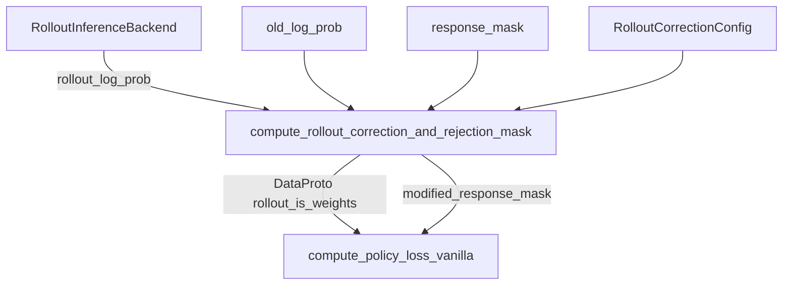
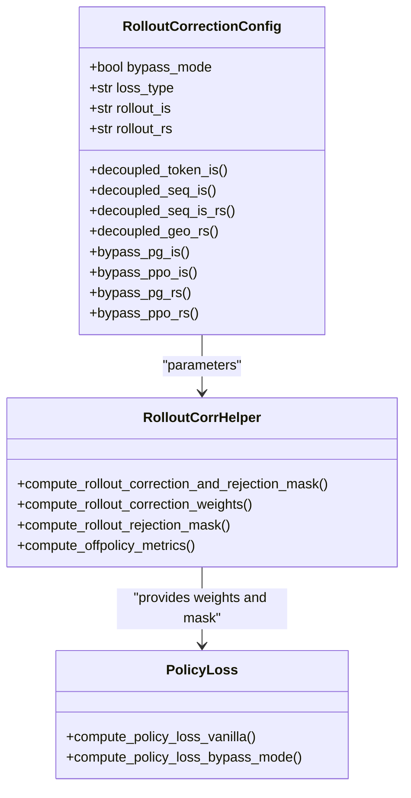

<!-- source: DeepWiki mcp.deepwiki.com · repo volcengine/verl · page 3.7 Rollout Correction and Off-Policy Handling · fetched 2026-10-21 -->

# Rollout Correction and Off-Policy Handling

Relevant source files

The following files were used as context for generating this wiki page:

- [docs/algo/rollout_corr.md](docs/algo/rollout_corr.md)
- [docs/algo/rollout_corr_math.md](docs/algo/rollout_corr_math.md)
- [tests/trainer/ppo/test_rollout_corr.py](tests/trainer/ppo/test_rollout_corr.py)
- [tests/trainer/ppo/test_rollout_corr_integration.py](tests/trainer/ppo/test_rollout_corr_integration.py)
- [verl/trainer/config/algorithm.py](verl/trainer/config/algorithm.py)
- [verl/trainer/config/algorithm/rollout_correction.yaml](verl/trainer/config/algorithm/rollout_correction.yaml)
- [verl/trainer/ppo/rollout_corr_helper.py](verl/trainer/ppo/rollout_corr_helper.py)

## Purpose and Scope
This page documents the Rollout Correction system in `verl`, which provides a unified framework to address **off-policy issues** arising when the data collection distribution (`Rollout` policy) differs from the training distribution. This includes policy implementation mismatches (e.g., vLLM BF16 vs FSDP FP32), temporal model staleness, asynchronous pipelines, and replay buffers. We cover the `RolloutCorrectionConfig` dataclass [verl/trainer/config/algorithm.py:64-138](), importance sampling (IS) weighting modes, rejection sampling (RS) filters, bypass versus decoupled execution modes, and verified configuration presets.

Sources: [verl/trainer/ppo/rollout_corr_helper.py:14-26](), [verl/trainer/config/algorithm.py:64-73]()

---

## 1. System Architecture and Data Flow

The Rollout Correction pipeline integrates directly into the training loop prior to loss computation. It consumes rollout log probabilities (`rollout_log_prob`), old policy log probabilities (`old_log_prob`), and sequence masks (`response_mask`) via helper functions defined in `verl.trainer.ppo.rollout_corr_helper` to compute continuous Importance Sampling weights and discrete Rejection Sampling masks.

**Title: Rollout Correction Data Flow**

Sources: [verl/trainer/ppo/rollout_corr_helper.py:53-55](), [tests/trainer/ppo/test_rollout_corr_integration.py:67-88]()

---

## 2. Configuration System (`RolloutCorrectionConfig`)

The off-policy handling mechanisms are configured via the `RolloutCorrectionConfig` dataclass. This structure defines options for IS weighting, truncation thresholds, rejection sampling filters, and bypass controls.

### Key Configuration Fields

* `rollout_is` (`Optional[str]`): Aggregation granularity for IS weights. Supports `"token"` (per-token IS, low variance, biased) or `"sequence"` (per-sequence IS, unbiased, high variance). Default is `"sequence"` [verl/trainer/config/algorithm.py:84-89]().
* `rollout_is_threshold` (`str | float`): Threshold specification for IS weighting. A single float enforces Truncated Importance Sampling (TIS) upper bounds; a `"lower_upper"` string enforces IcePop bounds (zeroing weights outside the interval) [verl/trainer/config/algorithm.py:91-95]().
* `rollout_is_batch_normalize` (`bool`): When `True`, normalizes IS weights to have a mean of `1.0` within each batch to reduce variance [verl/trainer/config/algorithm.py:97-102]().
* `rollout_rs` (`Optional[str]`): Comma-delimited list of rejection sampling options (e.g., `"token_k1"`, `"seq_mean_k3"`). Default is `None` [verl/trainer/config/algorithm.py:104-119]().
* `rollout_rs_threshold` (`Optional[str | float]`): Threshold values corresponding to `rollout_rs` options [verl/trainer/config/algorithm.py:121-125]().
* `bypass_mode` (`bool`): Operating mode toggle. `False` runs Decoupled mode (3 policies); `True` runs Bypass mode (2 policies) [verl/trainer/config/algorithm.py:127-132]().
* `loss_type` (`str`): Loss function variant in bypass mode (`"ppo_clip"` or `"reinforce"`) [verl/trainer/config/algorithm.py:134-138]().

Sources: [verl/trainer/config/algorithm.py:64-138](), [verl/trainer/config/algorithm/rollout_correction.yaml:1-28]()

---

## 3. Importance Sampling (IS) Weighting Modes

The helper module computes log-probability ratios between policies, protected by a fixed safety boundary to prevent numerical overflow or underflow [verl/trainer/ppo/rollout_corr_helper.py:34-36]().

* **`SAFETY_BOUND`**: Clamped to `20.0` ($\exp(20) \approx 4.85 \times 10^8$, $\exp(-20) \approx 2 \times 10^{-9}$) [verl/trainer/ppo/rollout_corr_helper.py:75]()
* **Token-Level IS**: Computes weights token by token based on ratio $\pi / \mu$. Provides tighter variance control at the cost of slight policy bias.
* **Sequence-Level IS**: Aggregates ratios across the response tokens per sequence, ensuring unbiased gradient corrections for complete trajectories.

Helper parsing functions validate user specifications before evaluation:
* `_parse_rollout_is_threshold()` [verl/trainer/ppo/rollout_corr_helper.py:93-130]()
* `_parse_rollout_rs_thresholds()` [verl/trainer/ppo/rollout_corr_helper.py:132-164]()

Sources: [verl/trainer/ppo/rollout_corr_helper.py:34-37](), [verl/trainer/config/algorithm.py:84-102]()

---

## 4. Rejection Sampling (RS) Implementations

Rejection sampling filters out outlier sequences or tokens whose divergence exceeds predefined limits. The system supports token-level and sequence-level divergence options stored in `SUPPORTED_ROLLOUT_RS_OPTIONS` [verl/trainer/ppo/rollout_corr_helper.py:77-89]().

### Supported RS Categories
1. **Ratio-Based (`*k1`)**: Evaluates bounded log ratios (`-log r`), supporting `"token_k1"`, `"seq_sum_k1"`, and `"seq_mean_k1"`. Configured via `lower_upper` thresholds [verl/trainer/ppo/rollout_corr_helper.py:107-116]().
2. **Quadratic Divergence (`*k2`)**: Evaluates $0.5 \cdot (\log r)^2$ upper-bound divergence criteria (e.g., `"token_k2"`, `"seq_mean_k2"`, `"seq_max_k2"`) [verl/trainer/ppo/rollout_corr_helper.py:109-118]().
3. **Exponential Divergence (`*k3`)**: Evaluates $\exp(\log r) - 1 - \log r$ upper-bound divergence for long-horizon stability (e.g., `"token_k3"`, `"seq_sum_k3"`, `"seq_mean_k3"`, `"seq_max_k3"`) [verl/trainer/ppo/rollout_corr_helper.py:110-118]().

Sources: [verl/trainer/ppo/rollout_corr_helper.py:77-118](), [tests/trainer/ppo/test_rollout_corr.py:128-167]()

---

## 5. Bypass vs Decoupled Execution Modes

The codebase implements two distinct architectural patterns for handling the behavior policy versus the training policy:

**Title: Rollout Correction System Overview**

Sources: [verl/trainer/config/algorithm.py:64-138](), [verl/trainer/ppo/rollout_corr_helper.py:44-50]()

*   **Decoupled Mode (`bypass_mode = False`)**: Implements a three-policy configuration ($\pi_{\text{rollout}}$, $\pi_{\text{old}}$, $\pi_{\theta}$). IS weights correct the distribution gap between $\pi_{\text{old}}$ and $\pi_{\text{rollout}}$, allowing PPO clipping to function independently [docs/algo/rollout_corr_math.md:126-140]().
*   **Bypass Mode (`bypass_mode = True`)**: Implements a two-policy configuration ($\pi_{\text{rollout}} = \pi_{\text{old}}$, $\pi_{\theta}$). Reuses `rollout_log_prob` directly as the old policy log probabilities, avoiding a redundant reference model forward pass [verl/trainer/config/algorithm.py:127-132]().
    *   `loss_type = "ppo_clip"`: Standard PPO clipped objective using direct ratio tracking [verl/trainer/config/algorithm.py:25]().
    *   `loss_type = "reinforce"`: REINFORCE-style policy gradient with explicit IS weight scaling and no clipping [verl/trainer/config/algorithm.py:135-138]().

The `RolloutCorrectionConfig` also provides factory methods for common presets, simplifying configuration for verified scenarios [docs/algo/rollout_corr.md:134-142](). These presets include:
*   `decoupled_token_is()`: Token-level Truncated Importance Sampling (TIS) in decoupled mode.
*   `decoupled_seq_is()`: Sequence-level TIS in decoupled mode.
*   `decoupled_seq_is_rs()`: Sequence-level Modified Importance Sampling (MIS) with rejection sampling in decoupled mode.
*   `decoupled_geo_rs()`: Geometric rejection sampling in decoupled mode.
*   `bypass_pg_is()`: Bypass mode with REINFORCE policy gradient and IS.
*   `bypass_ppo_is()`: Bypass mode with PPO clipping and IS.
*   `bypass_pg_rs()`: Bypass mode with REINFORCE policy gradient and RS.
*   `bypass_ppo_rs()`: Bypass mode with PPO clipping and RS.

Sources: [verl/trainer/config/algorithm.py:127-138](), [docs/algo/rollout_corr.md:94-100](), [docs/algo/rollout_corr.md:134-142]()

---

## 6. Diagnostic Metrics and Verification

The module automatically tracks off-policy diagnostic metrics via `compute_offpolicy_metrics()` to monitor divergence during distributed training:
*   `rollout_corr/rollout_is_mean`: Mean importance sampling weight across valid tokens.
*   `rollout_corr/rollout_is_eff_sample_size`: Effective Sample Size (ESS), indicating sample variance stability [tests/trainer/ppo/test_rollout_corr.py:88]().
*   `rollout_corr/rollout_rs_masked_fraction`: Fraction of samples discarded by rejection sampling filters [tests/trainer/ppo/test_rollout_corr.py:106]().
*   `rollout_corr/kl`: Token-level KL divergence between current and rollout log probabilities [tests/trainer/ppo/test_rollout_corr.py:122]().

Sources: [verl/trainer/ppo/rollout_corr_helper.py:38-42](), [tests/trainer/ppo/test_rollout_corr.py:68-123]()

---

