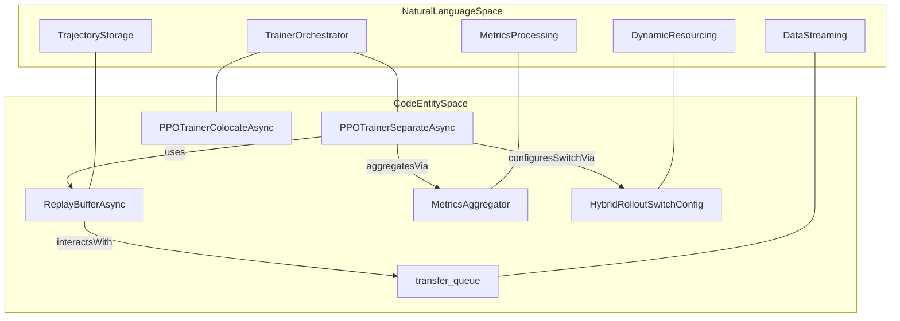
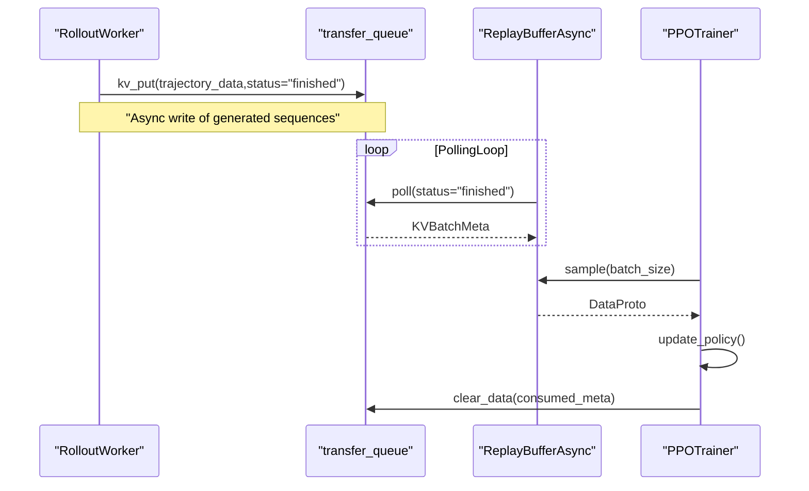
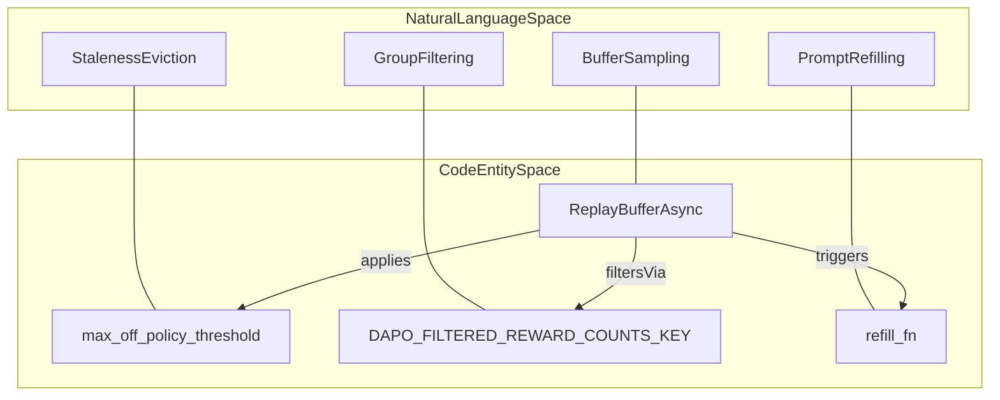

<!-- source: DeepWiki mcp.deepwiki.com · repo volcengine/verl · page 3.8 V1 PPO Trainer: Async and Streaming Architecture · fetched 2026-10-21 -->

# V1 PPO Trainer: Async and Streaming Architecture

Relevant source files

The following files were used as context for generating this wiki page:

- [.github/workflows/e2e_ppo_trainer_megatron_vllm_rocm.yml](.github/workflows/e2e_ppo_trainer_megatron_vllm_rocm.yml)
- [docker/rocm/Dockerfile.rocm](docker/rocm/Dockerfile.rocm)
- [docker/rocm/Dockerfile.rocm.deepseek-v4](docker/rocm/Dockerfile.rocm.deepseek-v4)
- [docs/advance/v1_async_trainer.md](docs/advance/v1_async_trainer.md)
- [docs/data/transfer_queue.md](docs/data/transfer_queue.md)
- [tests/trainer/ppo/v1/test_replay_buffer_on_cpu.py](tests/trainer/ppo/v1/test_replay_buffer_on_cpu.py)
- [tests/trainer/ppo/v1/test_rollout_profiling_on_cpu.py](tests/trainer/ppo/v1/test_rollout_profiling_on_cpu.py)
- [tests/trainer/ppo/v1/test_separate_async_step_switch_on_cpu.py](tests/trainer/ppo/v1/test_separate_async_step_switch_on_cpu.py)
- [tests/utils/test_check_profiler_output.py](tests/utils/test_check_profiler_output.py)
- [verl/trainer/config/transfer_queue/transfer_queue.yaml](verl/trainer/config/transfer_queue/transfer_queue.yaml)
- [verl/trainer/ppo/v1/replay_buffer.py](verl/trainer/ppo/v1/replay_buffer.py)
- [verl/trainer/ppo/v1/trainer_base.py](verl/trainer/ppo/v1/trainer_base.py)
- [verl/trainer/ppo/v1/trainer_colocate_async.py](verl/trainer/ppo/v1/trainer_colocate_async.py)
- [verl/trainer/ppo/v1/trainer_separate_async.py](verl/trainer/ppo/v1/trainer_separate_async.py)
- [verl/trainer/ppo/v1/trainer_sync.py](verl/trainer/ppo/v1/trainer_sync.py)
- [verl/utils/transferqueue_utils.py](verl/utils/transferqueue_utils.py)

## Purpose and Scope
This page documents the V1 PPO trainer system (`verl/trainer/ppo/v1/`), which implements an asynchronous, streaming-based architecture for reinforcement learning training of LLMs. By leveraging the **TransferQueue** (`transfer_queue`) data system, it decouples rollout generation from trainer optimization, enabling partial rollouts, configurable off-policy training, and dynamic resource scheduling across colocated and separate hardware pools.

Sources: [verl/trainer/ppo/v1/trainer_base.py:113-164](), [docs/advance/v1_async_trainer.md:1-11]()

---

## 1. System Overview and Trainer Modes

The V1 architecture provides an abstract base trainer class along with colocated and separate asynchronous execution variants. These classes manage distributed worker coordination, replay buffer polling, and parameter synchronization.

### Implementation Classes
*   **`PPOTrainer`**: The abstract base trainer defining core lifecycle hooks, configuration resolution, metrics tracking, and replay buffer initialization [verl/trainer/ppo/v1/trainer_base.py:113-164]().
*   **`PPOTrainerColocateAsync`**: An asynchronous trainer variant where the training engine and rollout replicas share the same resource pool, alternating execution states via checkpoint manager sleep/wake cycles [verl/trainer/ppo/v1/trainer_colocate_async.py:19-50]().
*   **`PPOTrainerSeparateAsync`**: A fully disaggregated asynchronous trainer where rollout workers and trainer workers reside on dedicated hardware pools, supporting partial rollouts and a hybrid engine switch mode [verl/trainer/ppo/v1/trainer_separate_async.py:46-95]().

### Key Differences from V0 Trainer
| Feature | Legacy RayPPOTrainer (V0) | V1 Async Trainer |
| :--- | :--- | :--- |
| **Data Flow** | Synchronous RPC calls | `transfer_queue`-based streaming |
| **Rollout Type** | Full batch only | Supports partial/streaming rollouts |
| **Data Locality** | Centralized in controller | Distributed KV store (`transfer_queue`) |
| **Policy Update** | On-policy only | Configurable off-policy thresholding |
| **Worker Type** | `ActorRolloutRefWorker` | `DetachActorWorker` (for Separate Async) [verl/trainer/ppo/v1/trainer_separate_async.py:120-128]() |

### Code Mapping: System Architecture to Entities

Title: V1 Trainer Code Entity Mapping

Sources: [verl/trainer/ppo/v1/trainer_base.py:113-164](), [verl/trainer/ppo/v1/trainer_separate_async.py:46-95](), [verl/trainer/ppo/v1/replay_buffer.py:64-130](), [verl/trainer/ppo/v1/utils.py:26-37](), [verl/trainer/config/config.py:74-90]()

---

## 2. TransferQueue and Streaming Architecture

`TransferQueue` (`tq`) serves as the distributed backend store for prompt groups and generated trajectories [verl/trainer/ppo/v1/replay_buffer.py:64-68](). It allows rollout workers to push completed sessions asynchronously while the trainer polls for sampleable batches using `KVBatchMeta` [verl/trainer/ppo/v1/trainer_base.py:30-37](), supported by utility bridges like `_async_meta_to_realdata` and `_update_meta_with_output` [verl/utils/transferqueue_utils.py:160-207]().

### Data Flow Implementation

Title: V1 Data Flow with TransferQueue

Sources: [verl/trainer/ppo/v1/replay_buffer.py:64-91](), [verl/trainer/ppo/v1/trainer_base.py:30-37](), [verl/utils/transferqueue_utils.py:160-207]()

---

## 3. ReplayBuffer and Off-Policy Management

The `ReplayBuffer` and `ReplayBufferAsync` classes manage sampling, GRPO group status tracking, and off-policy data filtering [verl/trainer/ppo/v1/replay_buffer.py:64-130]().

### Key Features
1.  **GRPO Group Control**: Tracks prompt statuses (`pending`, `running`, `finished`, `failure`) under keys like `{uid}` to ensure complete session groups are collected prior to training [verl/trainer/ppo/v1/replay_buffer.py:84-91]().
2.  **Off-Policy Thresholding**: Measures staleness in model versions (`global_steps - prompt_global_steps + 1`) and applies eviction strategies such as `drop` or `wait` [verl/trainer/ppo/v1/replay_buffer.py:118-122]().
3.  **DAPO Filtering**: Automatically filters out groups where reward metrics show zero variance across trajectories [verl/trainer/ppo/v1/replay_buffer.py:97-101]().

### Code Mapping: Replay Buffer Concepts to Code Entities

Title: Replay Buffer Code Entity Mapping

Sources: [verl/trainer/ppo/v1/replay_buffer.py:64-130](), [docs/advance/v1_async_trainer.md:63-95]()

---

## 4. Metrics Aggregator & Parameter Sync

Because asynchronous trainers can execute multiple local gradient updates per synchronization step (`parameter_sync_step > 1`), `MetricsAggregator` accumulates iteration-level performance and loss metrics into global steps [verl/trainer/ppo/v1/utils.py:26-37]().

### Aggregation Rules
*   **Sum**: Applied to event counts like evicted samples [verl/trainer/ppo/v1/utils.py:41-50]().
*   **Weighted Average**: Applied to loss values and KL divergence, weighted by sample size [verl/trainer/ppo/v1/utils.py:111-116]().
*   **Last Value**: Retained for learning rates and current global steps [verl/trainer/ppo/v1/utils.py:51-54]().

Sources: [verl/trainer/ppo/v1/utils.py:26-140]()

---

## 5. SkipManager Integration

The V1 training pipeline integrates with `SkipManager` to bypass expensive rollout generation steps during testing and development [verl/trainer/ppo/v1/trainer_base.py:86](). The mechanism hooks into both the rollout submission phase and the `ReplayBuffer` sampling phase to cache or replay pre-generated trajectory datasets [verl/utils/skip/skip_manager.py:128-147]().

Sources: [verl/trainer/ppo/v1/trainer_base.py:86](), [verl/utils/skip/skip_manager.py:128-152]()

---

## 6. Trainer Sync Variant

For debugging and validation against legacy setups, a synchronous trainer variant (`trainer_sync`) is supported [verl/trainer/ppo/v1/trainer_base.py:153](). It shares the `ReplayBuffer` interface but operates in a blocking, strictly on-policy fashion where off-policy thresholding is treated as a no-op [verl/trainer/ppo/v1/replay_buffer.py:94-96]().

Sources: [verl/trainer/ppo/v1/trainer_base.py:150-166](), [verl/trainer/ppo/v1/replay_buffer.py:94-112]()

---

