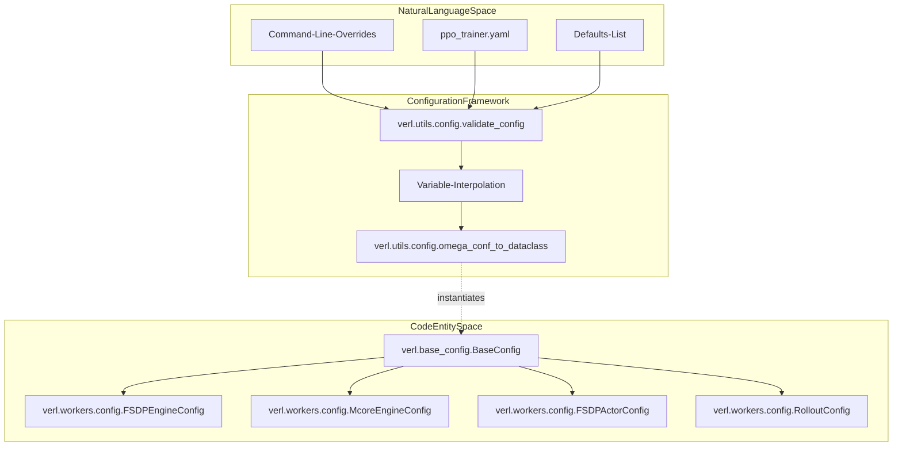
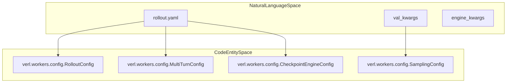

<!-- source: DeepWiki mcp.deepwiki.com · repo volcengine/verl · page 4 Configuration System · fetched 2026-10-21 -->

# Configuration System

Relevant source files

The following files were used as context for generating this wiki page:

- [verl/trainer/config/_generated_ppo_megatron_trainer.yaml](verl/trainer/config/_generated_ppo_megatron_trainer.yaml)
- [verl/trainer/config/_generated_ppo_torchtitan_trainer.yaml](verl/trainer/config/_generated_ppo_torchtitan_trainer.yaml)
- [verl/trainer/config/_generated_ppo_trainer.yaml](verl/trainer/config/_generated_ppo_trainer.yaml)
- [verl/trainer/config/_generated_ppo_veomni_trainer.yaml](verl/trainer/config/_generated_ppo_veomni_trainer.yaml)
- [verl/trainer/config/rollout/rollout.yaml](verl/trainer/config/rollout/rollout.yaml)
- [verl/workers/config/rollout.py](verl/workers/config/rollout.py)

The Configuration System in `verl` provides a declarative, hierarchical approach to configuring all aspects of the training pipeline. Built on the Hydra framework and OmegaConf, it enables composable configuration management with strong typing, validation, and automatic instantiation of Python dataclasses via `verl.utils.config.omega_conf_to_dataclass` [verl/utils/config.py:23-65](). The system supports multiple training backends including FSDP, Megatron, TorchTitan, and VeOmni through modular configuration files [verl/trainer/config/_generated_ppo_trainer.yaml:28-50](), [verl/trainer/config/_generated_ppo_megatron_trainer.yaml:45-84](), [verl/trainer/config/_generated_ppo_veomni_trainer.yaml:25-41](), [verl/trainer/config/_generated_ppo_torchtitan_trainer.yaml:23-52]().

As a parent page, this guide provides a high-level overview of the configuration sections. For detailed information, refer to the child pages:
- [Configuration Structure and Hydra Framework](#4.1) — Explain the hierarchical config structure, OmegaConf usage, interpolation syntax, and config composition patterns
- [Actor, Critic, and Reference Model Configuration](#4.2) — Detail configuration options for actor, critic, and reference models including engine settings, optimization, and PEFT
- [Rollout and Inference Configuration](#4.3) — Document rollout engine configuration (vLLM, SGLang, TRTLLM), sampling parameters, multi-turn settings, and checkpoint engine options
- [Data and Dataset Configuration](#4.4) — Cover dataset configuration including data files, tokenizer settings, multimodal parameters, and custom dataset classes
- [Algorithm and Training Configuration](#4.5) — Explain algorithm-specific settings, training parameters (batch size, steps, checkpointing), and resource allocation

---

## Configuration Architecture and Hydra Framework

The `verl` configuration system bridges high-level YAML definitions with strongly-typed Python dataclasses using Hydra and OmegaConf. Configuration objects inherit from `BaseConfig` [verl/base_config.py:22-38](), providing dictionary-like interfaces and validation via functions like `verl.utils.config.validate_config` [verl/utils/config.py:74-151]().

Title: "Configuration System Mapping"

Sources: [verl/trainer/config/_generated_ppo_trainer.yaml:28-60](), [verl/trainer/config/_generated_ppo_megatron_trainer.yaml:45-99](), [verl/workers/config/rollout.py:145-217](), [verl/base_config.py:20-32](), [verl/utils/config.py:23-65]()

For a comprehensive guide on hierarchical config structures, OmegaConf interpolation, and composition patterns, see [Configuration Structure and Hydra Framework](#4.1).

Sources: [verl/trainer/config/_generated_ppo_trainer.yaml:28-60](), [verl/trainer/config/_generated_ppo_megatron_trainer.yaml:45-99](), [verl/workers/config/rollout.py:145-217](), [verl/base_config.py:20-32](), [verl/utils/config.py:23-65]()

---

## Actor, Critic, and Reference Model Configuration

Actor, critic, and reference model configurations control model sharding, optimization hyperparameters, PEFT/LoRA settings, and engine strategies. `verl` supports backends such as FSDP, Megatron-Core, TorchTitan, and VeOmni [verl/trainer/config/_generated_ppo_trainer.yaml:28-50](), [verl/trainer/config/_generated_ppo_megatron_trainer.yaml:45-84](), [verl/trainer/config/_generated_ppo_veomni_trainer.yaml:25-41](), [verl/trainer/config/_generated_ppo_torchtitan_trainer.yaml:23-52]().

For detailed configuration options covering model sharding, optimizer settings, quantization (QAT), and PEFT integration, see [Actor, Critic, and Reference Model Configuration](#4.2).

Sources: [verl/trainer/config/_generated_ppo_trainer.yaml:28-50](), [verl/trainer/config/_generated_ppo_megatron_trainer.yaml:45-84](), [verl/trainer/config/_generated_ppo_veomni_trainer.yaml:25-41](), [verl/trainer/config/_generated_ppo_torchtitan_trainer.yaml:23-52]()

---

## Rollout and Inference Configuration

Rollout configuration manages inference generation parameters, backend selection (`vllm`, `sglang`, `trtllm`), sampling behavior (`SamplingConfig`), multi-turn tool interactions (`MultiTurnConfig`), and weight synchronization (`CheckpointEngineConfig`) [verl/workers/config/rollout.py:25-143]().

Title: "Rollout Configuration Bridge"

Sources: [verl/workers/config/rollout.py:25-143](), [verl/trainer/config/rollout/rollout.yaml:1-196]()

For deep dives into rollout engines, sampling parameters, multi-turn tool configurations, and checkpoint engines, see [Rollout and Inference Configuration](#4.3).

Sources: [verl/workers/config/rollout.py:25-143](), [verl/trainer/config/rollout/rollout.yaml:1-196]()

---

## Data and Dataset Configuration

Dataset parameters govern data loading, tokenization, sequence length limits (`max_prompt_length`, `max_response_length`), multimodal processing pipelines, and custom dataset extensions [verl/trainer/config/rollout/rollout.yaml:33-39]().

For detailed documentation on data files, tokenizer settings, multimodal inputs, and custom dataset classes, see [Data and Dataset Configuration](#4.4).

Sources: [verl/trainer/config/rollout/rollout.yaml:33-39]()

---

## Algorithm and Training Configuration

Algorithm and training settings manage reinforcement learning hyperparameters (e.g., clipping ratios, KL coefficients, advantage estimators), training batch sizes, checkpoint intervals, and Ray-based resource allocation [verl/trainer/config/_generated_ppo_trainer.yaml:80-135]().

For complete coverage of training algorithms, batching strategies, learning rate schedules, and resource provisioning, see [Algorithm and Training Configuration](#4.5).

Sources: [verl/trainer/config/_generated_ppo_trainer.yaml:80-135]()

---

