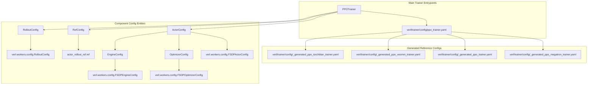
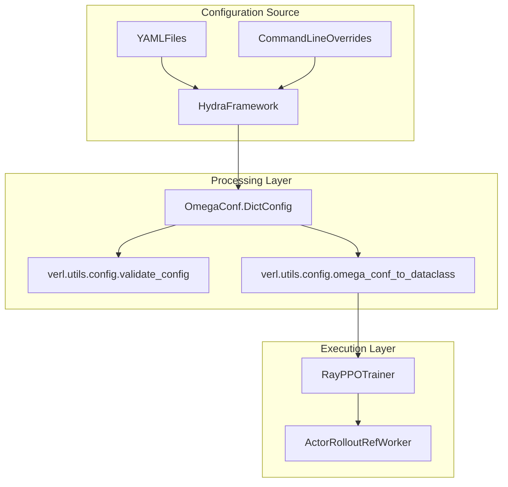

<!-- source: DeepWiki mcp.deepwiki.com · repo volcengine/verl · page 4.1 Configuration Structure and Hydra Framework · fetched 2026-10-21 -->

# Configuration Structure and Hydra Framework

<details>
<summary>Relevant source files</summary>

The following files were used as context for generating this wiki page:

- [tests/utils/test_config_on_cpu.py](tests/utils/test_config_on_cpu.py)
- [tests/utils/test_nvtx_profile.py](tests/utils/test_nvtx_profile.py)
- [verl/base_config.py](verl/base_config.py)
- [verl/trainer/config/_generated_ppo_megatron_trainer.yaml](verl/trainer/config/_generated_ppo_megatron_trainer.yaml)
- [verl/trainer/config/_generated_ppo_torchtitan_trainer.yaml](verl/trainer/config/_generated_ppo_torchtitan_trainer.yaml)
- [verl/trainer/config/_generated_ppo_trainer.yaml](verl/trainer/config/_generated_ppo_trainer.yaml)
- [verl/trainer/config/_generated_ppo_veomni_trainer.yaml](verl/trainer/config/_generated_ppo_veomni_trainer.yaml)
- [verl/trainer/config/rollout/rollout.yaml](verl/trainer/config/rollout/rollout.yaml)
- [verl/utils/config.py](verl/utils/config.py)
- [verl/workers/config/rollout.py](verl/workers/config/rollout.py)

</details>


## Purpose and Scope

This page documents the configuration system architecture in `verl`, which uses the **Hydra** framework and **OmegaConf** library to manage hierarchical YAML configurations. It covers the structural patterns, composition mechanisms, interpolation syntax, and dataclass integration that enable flexible, composable training configurations across different backends like FSDP, Megatron-Core, VeOmni, and TorchTitan.

For specific configuration options for actors, critics, and reference models, see [Actor, Critic, and Reference Model Configuration](4.2). For rollout and inference settings, see [Rollout and Inference Configuration](4.3). For data configuration, see [Data and Dataset Configuration](4.4). For algorithm-specific settings, see [Algorithm and Training Configuration](4.5).

Sources: `[verl/utils/config.py:23-65]`, `[verl/workers/config/rollout.py:145-205]`, `[verl/base_config.py:21-38]`

---

## Hydra and OmegaConf Framework

`verl` uses **Hydra** as its configuration management framework, with **OmegaConf** providing the underlying configuration objects. This combination enables powerful features like hierarchical composition, value interpolation, and dynamic instantiation.

### Core Components

| Component | Purpose | Key Features |
|-----------|---------|--------------|
| **Hydra** | Configuration composition framework | Multi-file composition, command-line overrides, config groups |
| **OmegaConf** | Configuration object library | `DictConfig`/`ListConfig`, interpolation, structured configs |
| **`_target_`** | Class instantiation pattern | Maps config to Python classes via fully qualified names |

### The `_target_` Pattern

Throughout `verl`'s configuration files, the `_target_` field specifies the fully qualified Python class name to instantiate. This enables Hydra to automatically create objects from configuration:

```yaml
# Example from verl/trainer/config/rollout/rollout.yaml
_target_: verl.workers.config.RolloutConfig
name: ???
mode: async
```
`[verl/trainer/config/rollout/rollout.yaml:1-3]`

This pattern allows `verl.utils.config.omega_conf_to_dataclass` to instantiate the specified dataclass with parameters from the config `[verl/utils/config.py:23-50]`. If a `dataclass_type` is not provided to the function, it uses `hydra.utils.instantiate` to create the object based on the `_target_` field `[verl/utils/config.py:42-50]`.

Sources: `[verl/utils/config.py:23-65]`, `[verl/trainer/config/rollout/rollout.yaml:1-3]`

---

## Hierarchical Configuration Structure

`verl` organizes configurations in a hierarchical structure where component configs compose into trainer-level configs. While the entry point is typically `ppo_trainer.yaml`, the framework generates flattened reference configurations for different engines using generation scripts `[verl/trainer/config/_generated_ppo_trainer.yaml:1-5]`.

### Component Relationships

**Natural Language to Code Entity Mapping: Configuration Components**


Sources: `[verl/trainer/config/_generated_ppo_trainer.yaml:1-50]`, `[verl/utils/config.py:150-151]`

**Configuration Hierarchy Sections:**

| Level | Configuration Section | Description |
|-------|----------------------|-------------|
| **Top Level** | `trainer` | Global training settings: nodes, GPUs per node, logging, and hardware device. |
| **Component Level** | `actor_rollout_ref` | Container for the Actor, Rollout, and Reference model configurations. |
| | `critic` | Critic model configuration, often matching Actor strategy. |
| | `data` | Dataset settings: file paths, batch sizes, and sequence lengths. |
| **Nested Level** | `actor_rollout_ref.actor` | Training settings including optimizer (`optim`) and distributed engine (`fsdp_config`/`megatron`/`veomni`/`torchtitan`). |
| | `actor_rollout_ref.rollout` | Inference engine settings (vLLM, SGLang, etc.) and sampling parameters. |

Sources: `[verl/trainer/config/_generated_ppo_trainer.yaml:6-185]`, `[verl/utils/config.py:86-107]`

---

## Configuration Composition and Defaults

### Composition Patterns

`verl` uses three primary composition patterns to maintain consistency:

1. **Direct Instantiation**: Using `_target_` to map YAML blocks to specific configuration dataclasses.
2. **Conditional Fallbacks**: Using `${oc.select:...}` to provide default values if a specific key is missing `[verl/trainer/config/_generated_ppo_trainer.yaml:42-47]`.
3. **Cross-Component Synchronization**: Fields in one component reference values in another to ensure they stay in sync (e.g., rollout parameter values referencing data lengths) `[verl/trainer/config/rollout/rollout.yaml:35-39]`.

### Backend-Specific Configuration Classes

The configuration structure adapts based on the chosen model engine. Each engine defines its own configuration classes for optimizers and distributed execution:

| Engine | Actor Config Class | Optimizer Config Class | Engine Config Class |
|--------|-------------------|------------------------|---------------------|
| **FSDP** | `FSDPActorConfig` `[verl/trainer/config/_generated_ppo_trainer.yaml:77]` | `FSDPOptimizerConfig` `[verl/trainer/config/_generated_ppo_trainer.yaml:9]` | `FSDPEngineConfig` `[verl/trainer/config/_generated_ppo_trainer.yaml:28]` |
| **Megatron** | `McoreActorConfig` `[verl/trainer/config/_generated_ppo_megatron_trainer.yaml:100]` | `McoreOptimizerConfig` `[verl/trainer/config/_generated_ppo_megatron_trainer.yaml:9]` | `McoreEngineConfig` `[verl/trainer/config/_generated_ppo_megatron_trainer.yaml:46]` |
| **VeOmni** | `VeOmniActorConfig` `[verl/trainer/config/_generated_ppo_veomni_trainer.yaml:71]` | `VeOmniOptimizerConfig` `[verl/trainer/config/_generated_ppo_veomni_trainer.yaml:9]` | `VeOmniEngineConfig` `[verl/trainer/config/_generated_ppo_veomni_trainer.yaml:26]` |
| **TorchTitan** | `TorchTitanActorConfig` `[verl/trainer/config/_generated_ppo_torchtitan_trainer.yaml:53]` | `TorchtitanOptimizerConfig` `[verl/trainer/config/_generated_ppo_torchtitan_trainer.yaml:9]` | `TorchtitanEngineConfig` `[verl/trainer/config/_generated_ppo_torchtitan_trainer.yaml:24]` |

Sources: `[verl/trainer/config/_generated_ppo_trainer.yaml:9-77]`, `[verl/trainer/config/_generated_ppo_megatron_trainer.yaml:9-100]`, `[verl/trainer/config/_generated_ppo_veomni_trainer.yaml:9-71]`, `[verl/trainer/config/_generated_ppo_torchtitan_trainer.yaml:9-53]`

---

## Value Interpolation and References

`verl` uses OmegaConf interpolation to create a single source of truth for critical parameters across distributed workers.

### Common Interpolation Patterns

| Pattern | Example | Purpose |
|---------|---------|---------|
| **Global to Local** | `n_gpus_per_node: ${oc.select:trainer.n_gpus_per_node,8}` | Ensures rollout servers use the same GPU count as the trainer `[verl/trainer/config/rollout/rollout.yaml:14]`. |
| **Data to Rollout** | `prompt_length: ${oc.select:data.max_prompt_length,512}` | Syncs the inference engine's prompt limit with the dataset's max length `[verl/trainer/config/rollout/rollout.yaml:35]`. |
| **Actor to Reference/Rollout** | `log_prob_use_dynamic_bsz: ${oc.select:actor_rollout_ref.actor.use_dynamic_bsz,false}` | Ensures log probability computations match actor configurations `[verl/trainer/config/rollout/rollout.yaml:113]`. |
| **Self-Reference** | `load_contents: ${.save_contents}` | Ensures checkpoint loading matches what was saved `[verl/trainer/config/_generated_ppo_trainer.yaml:120]`. |

Sources: `[verl/trainer/config/rollout/rollout.yaml:14-113]`, `[verl/trainer/config/_generated_ppo_trainer.yaml:120]`

---

## Dataclass Configuration Pattern

`verl` uses Python dataclasses inheriting from `BaseConfig` to provide type safety and default values. These are instantiated via helper functions `[verl/utils/config.py:23-65]`, `[verl/base_config.py:21-38]`.

### Key Dataclass: `RolloutConfig` and Related Configs

The rollout worker configuration uses structured dataclasses defined in `verl/workers/config/rollout.py`:

```python
# verl/workers/config/rollout.py
@dataclass
class SamplingConfig(BaseConfig):
    temperature: float = 1.0
    top_k: int = -1
    top_p: float = 1.0
    do_sample: bool = True
    n: int = 1
```
`[verl/workers/config/rollout.py:38-45]`

### Mutability Control

The `BaseConfig` class implements checks that prevent modifying fields unless they are explicitly listed in `_mutable_fields`. This ensures configuration integrity during runtime. For example, `MultiTurnConfig` and `RolloutConfig` declare mutable fields explicitly `[verl/workers/config/rollout.py:49-50]`, `[verl/workers/config/rollout.py:146-156]`, `[verl/base_config.py:33-38]`.

Sources: `[verl/workers/config/rollout.py:38-205]`, `[verl/utils/config.py:23-65]`, `[verl/base_config.py:21-38]`

---

## Configuration Loading and Data Flow

The configuration flows from YAML files through Hydra into the trainer, where it is validated and converted into structured dataclasses `[verl/utils/config.py:23-163]`.

### Data Flow Diagram

**Natural Language to Code Entity Mapping: Config Data Flow**


Sources: `[verl/utils/config.py:23-78]`, `[verl/utils/config.py:88-162]`

### Validation Logic

The `validate_config` function in `verl/utils/config.py` performs critical checks before execution starts `[verl/utils/config.py:88-102]`:
- **Router Replay Mode**: Validates that `router_replay.mode='R2'` is not used with `rollout_correction.bypass_mode=True` because R2 records routes during old_log_probs recomputation, which bypass mode skips `[verl/utils/config.py:74-85]`.
- **Score Centering**: Ensures score centering is consistently enabled across `algorithm.rollout_correction` and `actor_rollout_ref.actor.policy_loss.rollout_correction`, and that it's used with the v1 trainer, FSDP/FSDP2 strategy, vLLM rollout, and `topk_log_probs > 0`. It also checks for incompatibility with distillation `[verl/utils/config.py:88-118]`.
- **Batch Size Divisibility**: Ensures `real_train_batch_size` (accounting for rollout `n`) is divisible by the minimal possible batch size calculated from DP/TP/PP ranks `[verl/utils/config.py:133-153]`.
- **Mutual Exclusivity**: Prevents setting both deprecated `micro_batch_size` and the new `micro_batch_size_per_gpu` parameters `[verl/utils/config.py:131-162]`.

Sources: `[verl/utils/config.py:74-162]`

---

