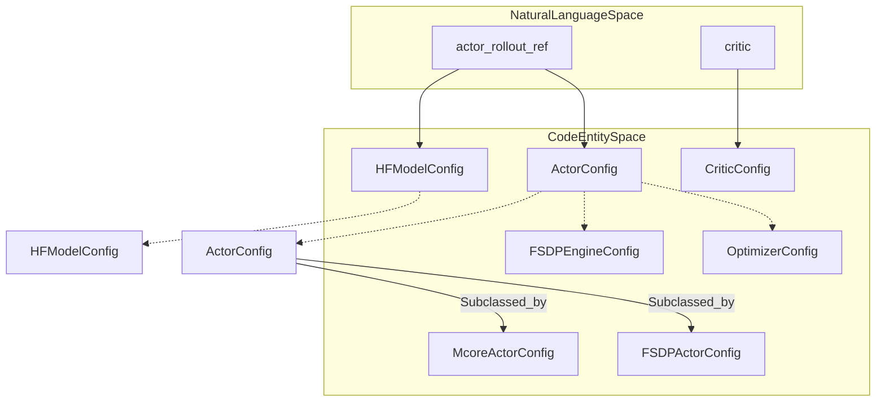
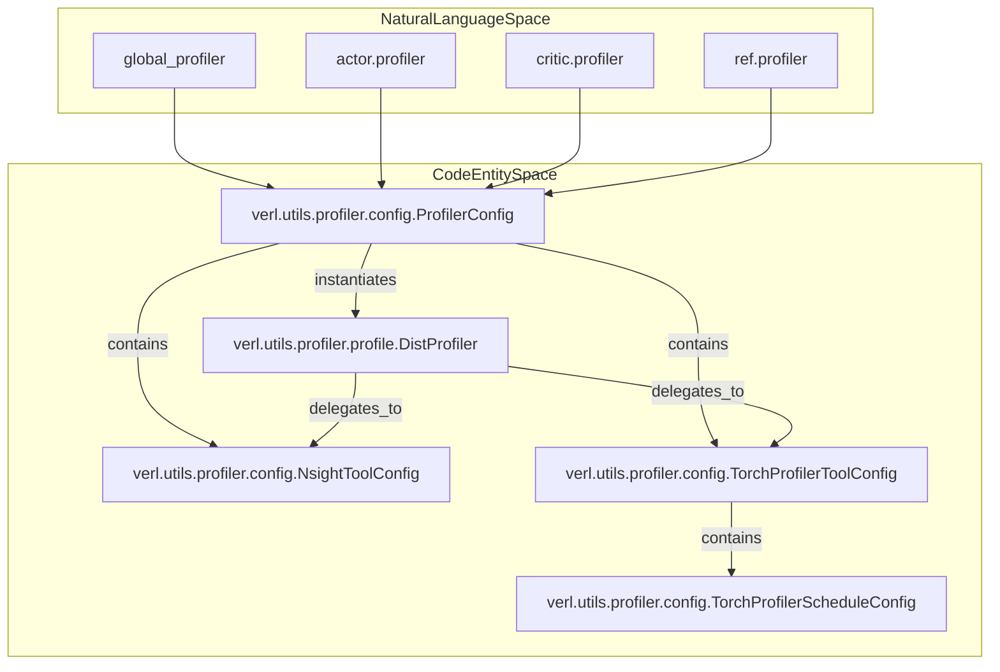
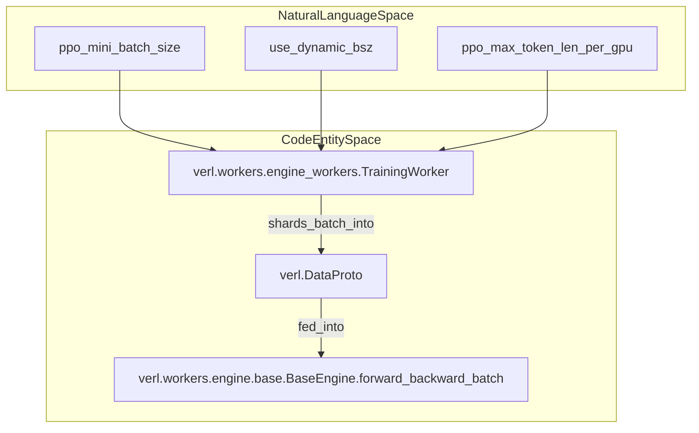

<!-- source: DeepWiki mcp.deepwiki.com · repo volcengine/verl · page 4.2 Actor, Critic, and Reference Model Configuration · fetched 2026-10-21 -->

# Actor, Critic, and Reference Model Configuration

Relevant source files

The following files were used as context for generating this wiki page:

- [docs/perf/torch_profiling.md](docs/perf/torch_profiling.md)
- [examples/muon/README.md](examples/muon/README.md)
- [tests/utils/megatron/muon_optim_gpu_smoke.py](tests/utils/megatron/muon_optim_gpu_smoke.py)
- [tests/utils/megatron/test_muon_optim_realcfg_on_cpu.py](tests/utils/megatron/test_muon_optim_realcfg_on_cpu.py)
- [tests/utils/megatron/test_muon_optim_wiring_on_cpu.py](tests/utils/megatron/test_muon_optim_wiring_on_cpu.py)
- [tests/utils/test_server_profiler.py](tests/utils/test_server_profiler.py)
- [tests/utils/test_torch_profile.py](tests/utils/test_torch_profile.py)
- [tests/workers/config/test_optim_config_on_cpu.py](tests/workers/config/test_optim_config_on_cpu.py)
- [verl/trainer/config/actor/actor.yaml](verl/trainer/config/actor/actor.yaml)
- [verl/trainer/config/actor/dp_actor.yaml](verl/trainer/config/actor/dp_actor.yaml)
- [verl/trainer/config/actor/megatron_actor.yaml](verl/trainer/config/actor/megatron_actor.yaml)
- [verl/trainer/config/critic/critic.yaml](verl/trainer/config/critic/critic.yaml)
- [verl/trainer/config/critic/dp_critic.yaml](verl/trainer/config/critic/dp_critic.yaml)
- [verl/trainer/config/critic/megatron_critic.yaml](verl/trainer/config/critic/megatron_critic.yaml)
- [verl/trainer/config/optim/fsdp.yaml](verl/trainer/config/optim/fsdp.yaml)
- [verl/trainer/config/optim/megatron.yaml](verl/trainer/config/optim/megatron.yaml)
- [verl/trainer/config/profiler/profiler.yaml](verl/trainer/config/profiler/profiler.yaml)
- [verl/trainer/config/ref/dp_ref.yaml](verl/trainer/config/ref/dp_ref.yaml)
- [verl/trainer/config/ref/megatron_ref.yaml](verl/trainer/config/ref/megatron_ref.yaml)
- [verl/trainer/config/ref/ref.yaml](verl/trainer/config/ref/ref.yaml)
- [verl/utils/megatron/optimizer.py](verl/utils/megatron/optimizer.py)
- [verl/utils/profiler/config.py](verl/utils/profiler/config.py)
- [verl/utils/profiler/profile.py](verl/utils/profiler/profile.py)
- [verl/utils/profiler/torch_profile.py](verl/utils/profiler/torch_profile.py)
- [verl/workers/config/actor.py](verl/workers/config/actor.py)
- [verl/workers/config/critic.py](verl/workers/config/critic.py)
- [verl/workers/config/optimizer.py](verl/workers/config/optimizer.py)

## Purpose and Scope

This page documents the configuration parameters for the three core neural model components in reinforcement learning (PPO, GRPO) and supervised training: the **Actor** (policy network), **Critic** (value network), and **Reference** model (frozen policy for KL divergence calculation). These configurations control model initialization, optimizer hyperparameters, PPO-specific loss computation modes, multi-token prediction (MTP) modules, and distributed execution engines including FSDP, Megatron-LM (Mcore), and specialized backends.

Sources: [verl/workers/config/actor.py:105-140](), [verl/workers/config/critic.py:45-69]()

## Configuration Hierarchy Overview

The actor, critic, and reference model configurations are structured under top-level blocks in the Hydra configuration hierarchy. The `actor_rollout_ref` structure groups policy and reference configurations, while `critic` operates as a standalone module to support independent architectures and scaling parameters.

### Configuration Architecture Diagram

The following diagram bridges the Natural Language YAML configuration space to the internal Python dataclasses and classes.

Sources: [verl/trainer/config/actor/actor.yaml:8-58](), [verl/workers/config/actor.py:105-150](), [verl/workers/config/critic.py:45-101]()

## Common Model Configuration (`HFModelConfig`)

All core model workers utilize the `HFModelConfig` structure to handle HuggingFace model instantiation, weight loading flags, multi-token prediction (MTP) parameters, and PEFT/LoRA settings.

### Key Configuration Fields

| Field | Type | Default | Description |
|-------|------|---------|-------------|
| `path` | str | **MISSING** | Base HuggingFace model path or local directory. [verl/workers/config/model.py:88]() |
| `use_shm` | bool | `False` | Utilize shared memory for faster weight loading across processes. [verl/workers/config/model.py:107]() |
| `trust_remote_code` | bool | `False` | Allow execution of remote custom model code. [verl/workers/config/model.py:108]() |
| `lora_rank` | int | `0` | Rank for LoRA adaptation (0 disables LoRA). [verl/workers/config/model.py:124]() |
| `target_modules` | str/list | `"all-linear"` | Target linear layers for PEFT/LoRA application. [verl/workers/config/model.py:126]() |
| `use_remove_padding` | bool | `True` | Strip padding tokens to optimize sequence execution. [verl/workers/config/model.py:120]() |
| `enable_gradient_checkpointing`| bool | `True` | Enable gradient checkpointing to reduce memory overhead. [verl/workers/config/model.py:117]() |
| `mtp` | MtpConfig | Default | Multi-Token Prediction configuration for speculative decoding and MTP training. [verl/workers/config/model.py:146]() |

Sources: [verl/workers/config/model.py:71-147](), [verl/trainer/config/model/hf_model.yaml:1-164]()

## Actor Configuration

The `ActorConfig` class manages policy optimization loops, PPO hyperparameter values, and backend execution strategies.

### Core Training Parameters
- **`ppo_mini_batch_size`**: Mini-batch size processed during updates (default: 256). [verl/workers/config/actor.py:151]()
- **`ppo_epochs`**: Number of optimization passes over collected rollouts per update (default: 1). [verl/trainer/config/actor/actor.yaml:119]()
- **`clip_ratio`**: Standard PPO policy clipping threshold (default: 0.2). [verl/workers/config/actor.py:158]()
- **`use_kl_loss`**: Enables explicit KL divergence loss term instead of reward penalty, required for GRPO (default: `false`). [verl/trainer/config/actor/actor.yaml:103]()
- **`loss_agg_mode`**: Aggregation strategy for loss computation, including `token-mean`, `token-sum`, `seq-mean-token-sum-norm`. [verl/trainer/config/actor/actor.yaml:86]()
- **`tau_pos` / `tau_neg`**: Asymmetric smoothing parameters for SAPO (Smoothing Asymmetric Policy Optimization). [verl/trainer/config/actor/actor.yaml:46-49]()
- **`router_replay`**: Deterministic routing controls for Mixture of Experts (MoE) models supporting modes like `R2` and `R3`. [verl/workers/config/actor.py:48-75]()
- **`calculate_sum_pi_squared`**: Triggers computation of the logit-gradient norm proxy for the Optimal Token Baseline. [verl/trainer/config/actor/actor.yaml:100]()

### Policy Loss Variants (`PolicyLossConfig`)
The framework supports multiple policy loss formulations via `PolicyLossConfig`:
- **`vanilla`**: Standard clipped surrogate objective of PPO. [verl/trainer/config/actor/actor.yaml:61]()
- **`clip-cov` / `kl-cov`**: Coverage-controlled penalties. [verl/workers/config/actor.py:95-98]()
- **`gpg`**: Generalized Policy Gradient. [verl/workers/config/actor.py:84]()
- **`dro`**: Direct Reward Optimization governed by `dro_beta`. [verl/workers/config/actor.py:90]()
- **`cispo`**: Conditional Importance Sampling Policy Optimization. [verl/workers/config/actor.py:84]()

Sources: [verl/workers/config/actor.py:48-158](), [verl/trainer/config/actor/actor.yaml:8-126]()

## Critic Configuration

The `CriticConfig` class defines value function estimation settings, loss aggregation, and checkpointing.

### Value Function Parameters
- **`cliprange_value`**: PPO value clipping parameter (default: 0.5). [verl/workers/config/critic.py:93]()
- **`ppo_max_token_len_per_gpu`**: Maximum tokens allocated per GPU per batch (default: 32768). [verl/workers/config/critic.py:85]()
- **`enable`**: Conditional activation flag for the critic worker (automatically set based on advantage estimator). [verl/workers/config/critic.py:81]()
- **`ppo_epochs`**: Epochs per training iteration for value network updates. [verl/workers/config/critic.py:90]()

### Validation and Constraints
The critic configuration enforces strict mutual exclusivity checks between deprecated global batch sizes and per-GPU micro-batch sizing via `_check_mutually_exclusive`. It validates that `ppo_mini_batch_size` is divisible by `ppo_micro_batch_size`. [verl/workers/config/critic.py:107-156]()

Sources: [verl/workers/config/critic.py:45-156](), [verl/trainer/config/critic/critic.yaml:1-69]()

## Reference Model Configuration

The reference model (`ref`) operates as a frozen policy to evaluate KL divergence constraints against the current actor policy.

### Key Settings
- **`strategy`**: Typically inherits from the actor configuration via OmegaConf interpolation (`${actor_rollout_ref.actor.strategy}`). [verl/trainer/config/ref/ref.yaml:5]()
- **`log_prob_max_token_len_per_gpu`**: Token budget per GPU during reference log-probability evaluation (default: 16384). [verl/trainer/config/ref/ref.yaml:24]()
- **`log_prob_use_dynamic_bsz`**: Enables sequence packing and dynamic batching for log-prob evaluations. [verl/trainer/config/ref/ref.yaml:20]()

Sources: [verl/trainer/config/ref/ref.yaml:1-25]()

## Training Engines and Distributed Backends

Engine configurations control model parallel sharding and distributed primitives across execution backends.

### Backend Strategy Options

| Strategy Name | Engine Implementation | Configuration Class |
|---------------|-----------------------|---------------------|
| `fsdp` / `fsdp2` | `FSDPEngine` | `FSDPEngineConfig` [verl/workers/config/actor.py:26]() |
| `megatron` | `MegatronEngine` | `McoreEngineConfig` [verl/workers/config/actor.py:27]() |
| `veomni` | `VeOmniEngine` | `VeOmniEngineConfig` [verl/workers/config/actor.py:29]() |
| `torchtitan` | `TorchtitanEngine` | `TorchtitanEngineConfig` [verl/workers/config/actor.py:28]() |

### FSDP and QAT Configuration
The FSDP engine configuration (`fsdp.yaml`) supports parameter/optimizer offloading, sequence parallelism via `ulysses_sequence_parallel_size`, and Quantization-Aware Training (`qat`) modes such as `w4a16`. [verl/trainer/config/engine/megatron.yaml:138-154]()

Sources: [verl/trainer/config/engine/megatron.yaml:138-154](), [verl/workers/config/actor.py:25-33]()

## Optimizer and Advanced Hyperparameters

Verl supports standard optimizers (AdamW, AdamW8bit) alongside advanced emerging optimizers and precision-aware configurations.

### Megatron-Core Optimizer and Muon Integration
Megatron optimizer configuration (`McoreOptimizerConfig`) supports precision-aware optimizer states (`use_precision_aware_optimizer`) to store Adam moments in lower precision (`bf16`) alongside emerging tensor-parallel-aware optimizers like Muon (`_MUON_ALGORITHMS`). The helper `adamw_rms_match_scale_factor` derives scaling rules for hyperparameter transferability. [verl/utils/megatron/optimizer.py:29-147](), [verl/workers/config/optimizer.py:128-156]()

Sources: [verl/utils/megatron/optimizer.py:20-155](), [verl/workers/config/optimizer.py:33-156]()

## Profiler Configuration

The `ProfilerConfig` system coordinates profiling backends (`nsys`, `npu`, `torch`, `torch_memory`, `precision_debugger`) across actor, critic, and reference model execution.

### Profiler Configuration Diagram

Sources: [verl/utils/profiler/config.py:29](), [verl/utils/profiler/profile.py:98-179](), [verl/trainer/config/actor/actor.yaml:171-200](), [verl/trainer/config/critic/critic.yaml:87-180](), [verl/trainer/config/ref/ref.yaml:27-158]()

### Scheduling and Collection
`TorchProfilerScheduleConfig` dictates sub-sampling cycles over update mini-batches via `skip_first`, `wait`, `warmup`, and `active` steps. `DistProfiler` handles rank dispatching and relocation of framework trace files. [verl/utils/profiler/config.py:42-94](), [verl/utils/profiler/profile.py:88-125]()

Sources: [verl/utils/profiler/config.py:30-146](), [verl/utils/profiler/profile.py:88-186](), [verl/trainer/config/profiler/profiler.yaml:1-158]()

## Data and Batch Flow Execution

The configuration layer maps Hydra parameters directly into distributed runtime execution primitives handled by training workers and execution engines.

### Execution Flow Diagram

Sources: [verl/workers/config/actor.py:151-157](), [verl/trainer/config/actor/actor.yaml:18-34](), [verl/workers/config/actor.py:105-150]()

---

