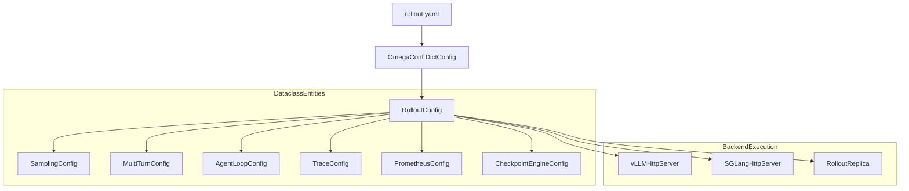
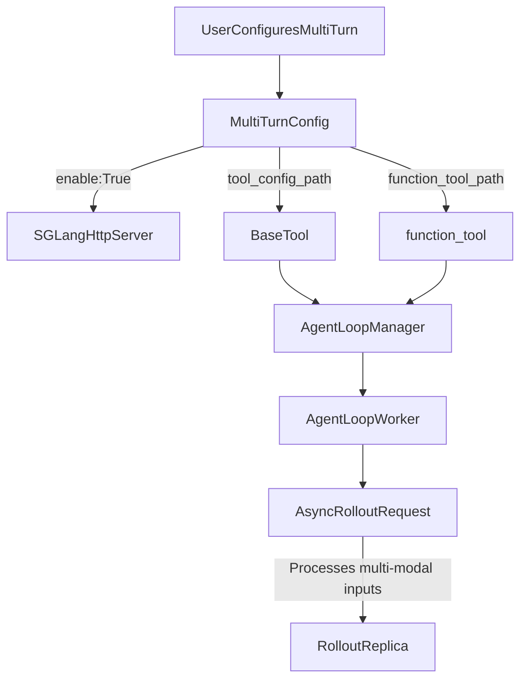
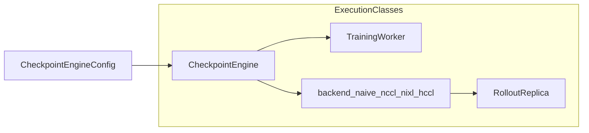

<!-- source: DeepWiki mcp.deepwiki.com · repo volcengine/verl · page 4.3 Rollout and Inference Configuration · fetched 2026-10-21 -->

# Rollout and Inference Configuration

Relevant source files

The following files were used as context for generating this wiki page:

- [docs/sglang_multiturn/multiturn.rst](docs/sglang_multiturn/multiturn.rst)
- [tests/workers/rollout/test_sglang_async_rollout_multimodal_delta.py](tests/workers/rollout/test_sglang_async_rollout_multimodal_delta.py)
- [verl/tools/base_tool.py](verl/tools/base_tool.py)
- [verl/tools/schemas.py](verl/tools/schemas.py)
- [verl/trainer/config/_generated_ppo_megatron_trainer.yaml](verl/trainer/config/_generated_ppo_megatron_trainer.yaml)
- [verl/trainer/config/_generated_ppo_torchtitan_trainer.yaml](verl/trainer/config/_generated_ppo_torchtitan_trainer.yaml)
- [verl/trainer/config/_generated_ppo_trainer.yaml](verl/trainer/config/_generated_ppo_trainer.yaml)
- [verl/trainer/config/_generated_ppo_veomni_trainer.yaml](verl/trainer/config/_generated_ppo_veomni_trainer.yaml)
- [verl/trainer/config/rollout/rollout.yaml](verl/trainer/config/rollout/rollout.yaml)
- [verl/workers/config/rollout.py](verl/workers/config/rollout.py)
- [verl/workers/rollout/schemas.py](verl/workers/rollout/schemas.py)

This document covers the configuration of rollout (generation) and inference components in `verl`. Rollout configuration controls how the policy model generates responses during training, including sampling parameters, inference engine selection (`vLLM`, `SGLang`, `TRTLLM`), parallelism settings, multi-turn interaction capabilities, and weight synchronization strategies.

---

## 1. Overview and Configuration Structure

Rollout configuration is defined in the `actor_rollout_ref.rollout` section of the trainer configuration. The configuration system uses Hydra composition with dataclass-backed validation through `RolloutConfig` and related classes defined in `verl/workers/config/rollout.py`.

### Configuration Hierarchy and Code Entities

The diagram below bridges natural language rollout concepts to the underlying code entities and dataclasses defined in `verl/workers/config/rollout.py` and YAML templates.

Title: "Rollout Configuration Class Hierarchy"

Sources: [verl/workers/config/rollout.py:25-35](), [verl/workers/config/rollout.py:145-205](), [verl/trainer/config/rollout/rollout.yaml:1-5]()

---

## 2. Core Rollout Settings

### Basic Sampling Parameters

The `RolloutConfig` class [verl/workers/config/rollout.py:145-205]() and `SamplingConfig` [verl/workers/config/rollout.py:39-45]() define fundamental sampling parameters for generation:

| Parameter | Type | Default | Description |
|-----------|------|---------|-------------|
| `temperature` | float | 1.0 | Sampling temperature for randomness control |
| `top_k` | int | -1 | Top-k sampling parameter (-1 for vLLM, 0 for HF) |
| `top_p` | float | 1.0 | Top-p sampling parameter |
| `do_sample` | bool | True | Whether to sample during training rollout |
| `n` | int | 1 | Number of responses per prompt (> 1 for GRPO/RLOO) |
| `repetition_penalty` | float | 1.0 | Penalty for repeated tokens |

**Validation Sampling Configuration**

The `val_kwargs` field contains a `SamplingConfig` for validation-specific parameters [verl/trainer/config/rollout/rollout.yaml:158-179](). Typically uses `temperature: 0` and `do_sample: False` for deterministic evaluation.
Sources: [verl/workers/config/rollout.py:39-45](), [verl/workers/config/rollout.py:203](), [verl/trainer/config/rollout/rollout.yaml:16-23](), [verl/trainer/config/rollout/rollout.yaml:158-179]()

### Sequence Length Configuration

| Parameter | Type | Default | Description |
|-----------|------|---------|-------------|
| `prompt_length` | int | 512 | Maximum prompt token length |
| `response_length` | int | 512 | Maximum response token length |
| `max_model_len` | int | null | Total context length for the engine |

The `prompt_length` and `response_length` are interpolated from the dataset configuration to ensure consistency using Hydra syntax `${oc.select:data.max_prompt_length,512}` [verl/trainer/config/rollout/rollout.yaml:35-39]().
Sources: [verl/workers/config/rollout.py:181-182](), [verl/trainer/config/rollout/rollout.yaml:35-39](), [verl/trainer/config/rollout/rollout.yaml:84]()

### Parallelism Configuration

Verl supports complex parallelism for rollout engines, which can differ from training parallelism. This is crucial for MoE models or extremely large models.

| Parameter | Type | Default | Description |
|-----------|------|---------|-------------|
| `tensor_model_parallel_size` | int | 2 | Tensor parallelism size for rollout |
| `data_parallel_size` | int | 1 | Data parallelism size for rollout |
| `expert_parallel_size` | int | 1 | Expert parallelism for MoE models |
| `pipeline_model_parallel_size` | int | 1 | Pipeline parallelism size for rollout |
| `moe_tensor_parallel_size` | int | 1 | Specific TP size for MoE experts |

For MoE models in vLLM, `expert_parallel_size` > 1 refers to EP parallel in `fused_moe` with `TP*DP` weight splits [verl/trainer/config/rollout/rollout.yaml:72-75]().
Sources: [verl/workers/config/rollout.py:190-195](), [verl/trainer/config/rollout/rollout.yaml:67-75]()

---

## 3. Inference Engine Backends

### vLLM Backend
The `vLLM` backend is the primary engine for standard LLM rollouts. The system manages the engine and handles communication via Ray.

| Engine Argument | Description |
|-----------|-------------|
| `gpu_memory_utilization` | Fraction of GPU memory used for KV cache (default 0.5) |
| `enforce_eager` | Whether to disable CUDA graph (default False) |
| `free_cache_engine` | Whether to free engine KVCache after generation |
| `cudagraph_capture_sizes` | Batch sizes of cudagraph to capture to save memory |
| `enable_chunked_prefill` | Higher throughput optimization (default True) |
| `enable_prefix_caching` | Cache prompt prefixes to avoid redundant computation |

Sources: [verl/trainer/config/rollout/rollout.yaml:45-64](), [verl/trainer/config/rollout/rollout.yaml:95-98](), [verl/workers/config/rollout.py:185-189]()

### SGLang Backend
The `SGLang` backend is optimized for multi-turn interactions and complex prompts using RadixAttention.

| Parameter | Type | Description |
|-----------|------|-------------|
| `multi_stage_wake_up` | bool | Gradual wake up of workers to reduce peak memory |
| `over_sample_rate` | float | Early termination threshold for training rollouts |

Sources: [verl/workers/config/rollout.py:177-179](), [verl/trainer/config/rollout/rollout.yaml:137-144]()

---

## 4. Multi-Turn and Tool Configuration

Verl provides extensive support for multi-turn interactions, including tool-use and simulated user interactions via `MultiTurnConfig` [verl/workers/config/rollout.py:48-63]() and `AgentLoopConfig` [verl/workers/config/rollout.py:72-80]().

### Multi-Turn Orchestration
The `MultiTurnConfig` controls the behavior of conversations that span multiple assistant and user turns.

| Field | Description |
|-------|-------------|
| `max_assistant_turns` | Limit on the number of turns the model can take |
| `tool_config_path` | Path to YAML defining stateful tools |
| `function_tool_path` | Path to Python file with function tools |
| `use_inference_chat_template` | Uses model's default chat template vs. raw token IDs |
| `max_parallel_calls` | Max parallel call for tools in single turn |
| `format` | Chat template format (e.g., "hermes") |

Sources: [verl/workers/config/rollout.py:48-63](), [verl/trainer/config/rollout/rollout.yaml:184-196]()

### Custom Tool Configuration

For custom environment interaction tools, users can implement their own tools based on `verl.tools.base_tool.BaseTool` [verl/tools/base_tool.py:24](). The tool configurations are specified in a YAML file and referenced by `tool_config_path` in the `MultiTurnConfig` [docs/sglang_multiturn/multiturn.rst:20-44]().

For stateless tools, the `@function_tool` decorator can be used to register plain Python functions as tools. Verl delegates schema inference to `transformers.utils.get_json_schema`, which reads the function signature and Google-style docstrings [docs/sglang_multiturn/multiturn.rst:78-139](). This is configured via `function_tool_path` in `MultiTurnConfig` [docs/sglang_multiturn/multiturn.rst:92]().

The `AsyncRolloutRequest` class [verl/workers/rollout/schemas.py:81]() handles the processing of multi-modal inputs from tools. If a tool creates multi-modal inputs, it should return a list of multi-modal inputs in its `execute()` implementation [docs/sglang_multiturn/multiturn.rst:46-73]().

### Multi-Turn Tool Configuration Flow

Title: "Multi-Turn Tool Configuration Flow"

Sources: [verl/workers/config/rollout.py:48-63](), [verl/tools/base_tool.py:24](), [docs/sglang_multiturn/multiturn.rst:20-139](), [verl/workers/rollout/schemas.py:81]()

---

## 5. Advanced Rollout Optimizations

### Multi-Token Prediction (MTP) and Speculative Decoding
Verl supports Multi-Token Prediction (MTP) architectures to accelerate rollout via speculative decoding, configured via `MtpConfig` [verl/workers/config/rollout.py:23]().

| Parameter | Type | Default | Description |
|-----------|------|---------|-------------|
| `enable_rollout` | bool | False | Whether to enable MTP parameters during rollout |
| `method` | str | "mtp" | Speculative decoding method for vLLM |
| `num_speculative_tokens` | int | 1 | Number of tokens to speculate per step |

Sources: [verl/workers/config/rollout.py:23]()

### Low-Precision Rollout (FP8)
To reduce GPU memory and increase throughput, verl supports FP8 rollout configurations via engine settings.
Sources: [verl/trainer/config/rollout/rollout.yaml:146-156]()

---

## 6. Weight Synchronization and Checkpoint Engines

The `CheckpointEngine` [verl/workers/config/rollout.py:125-143]() is responsible for transferring weights from training workers to rollout workers, configured via `CheckpointEngineConfig`.

| Parameter | Type | Default | Description |
|-----------|------|---------|-------------|
| `backend` | str | "naive" | Backend for transfer (`naive`, `nccl`, `nixl`, `hccl`) |
| `update_weights_bucket_megabytes` | int | 2048 | Bucket size to transfer multiple weights at once |
| `custom_backend_module` | str | null | Module to import for custom backend registration |

### Weight Transfer Code Entity Flow

The diagram below maps the checkpoint engine configuration to execution classes involved in weight synchronization across workers.

Title: "CheckpointEngine Execution Flow"

Sources: [verl/workers/config/rollout.py:125-143]()

---

## 7. Log Probability Computation

Log probability calculations for rollout tokens are handled by the Actor. Configuration options include:

| Parameter | Type | Default | Description |
|-----------|------|---------|-------------|
| `log_prob_micro_batch_size_per_gpu` | int | null | Local batch size for log_prob forward pass |
| `log_prob_use_dynamic_bsz` | bool | false | Enable sequence packing for log_prob |
| `log_prob_max_token_len_per_gpu` | int | 16384 | Max token length for log_prob computation |

Sources: [verl/workers/config/rollout.py:113-125]()

---

