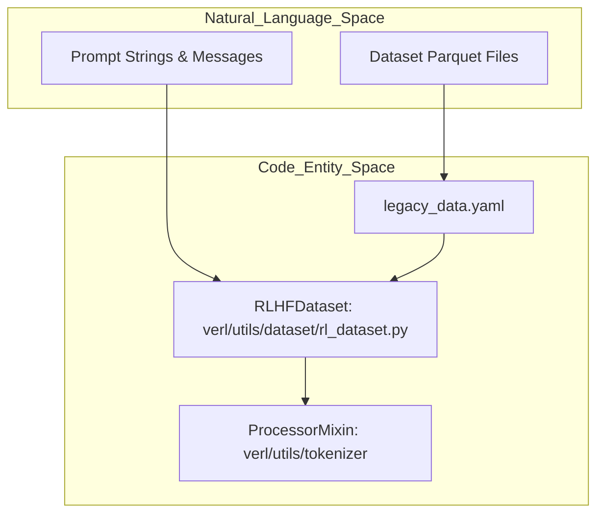
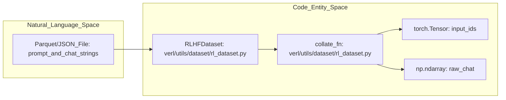
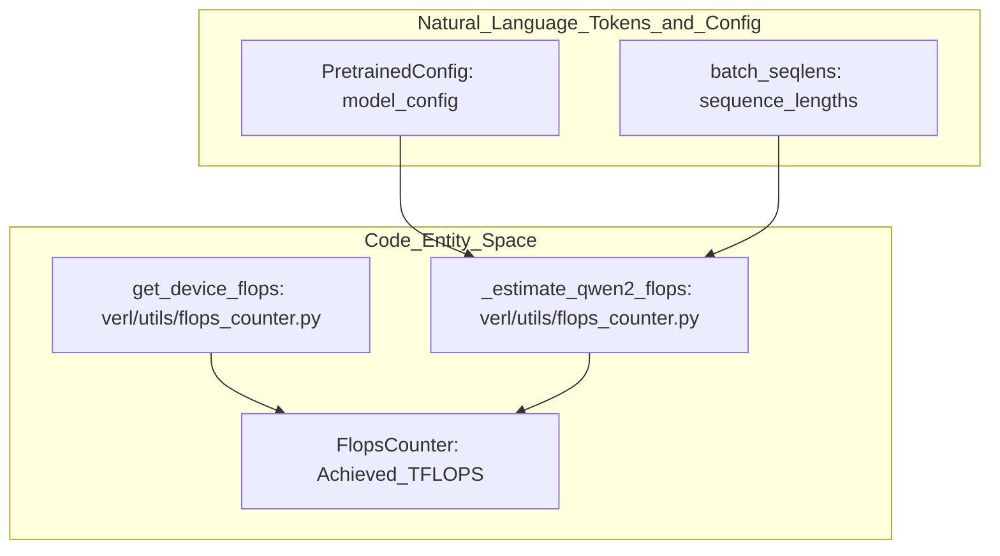

<!-- source: DeepWiki mcp.deepwiki.com · repo volcengine/verl · page 4.4 Data and Dataset Configuration · fetched 2026-10-21 -->

# Data and Dataset Configuration

Relevant source files

The following files were used as context for generating this wiki page:

- [docs/advance/mtp.md](docs/advance/mtp.md)
- [tests/utils/dataset/test_rl_dataset_on_cpu.py](tests/utils/dataset/test_rl_dataset_on_cpu.py)
- [tests/utils/test_flops_counter.py](tests/utils/test_flops_counter.py)
- [verl/models/mcore/mtp_patch.py](verl/models/mcore/mtp_patch.py)
- [verl/models/transformers/apertus.py](verl/models/transformers/apertus.py)
- [verl/trainer/config/data/legacy_data.yaml](verl/trainer/config/data/legacy_data.yaml)
- [verl/trainer/config/model/hf_model.yaml](verl/trainer/config/model/hf_model.yaml)
- [verl/utils/dataset/rl_dataset.py](verl/utils/dataset/rl_dataset.py)
- [verl/utils/dataset/vision_utils.py](verl/utils/dataset/vision_utils.py)
- [verl/utils/flops_counter.py](verl/utils/flops_counter.py)
- [verl/workers/config/model.py](verl/workers/config/model.py)

This page describes the data and dataset configuration options in `verl`, including how to specify training/validation data paths, configure batch sizes and sampling, prepare data in the required format, and extend the system with custom datasets. For information about other configuration aspects, see [Configuration Structure and Hydra Framework](#4.1), [Actor, Critic, and Reference Model Configuration](#4.2), and [Rollout and Inference Configuration](#4.3).

---

## Overview

Data configuration in `verl` controls how training and validation datasets are loaded, tokenized, batched, and sampled during RL training (PPO, GRPO) or Supervised Fine-Tuning (SFT). The configuration is specified in the `data` section of the Hydra config and supports:

- Loading parquet or JSON format datasets from local or HDFS paths `[verl/trainer/config/data/legacy_data.yaml:7-14]()`.
- Configuring prompt and response length constraints `[verl/trainer/config/data/legacy_data.yaml:35-39]()`.
- Multi-turn conversation handling for SFT and RLHF `[verl/trainer/config/data/legacy_data.yaml:61-62]()`.
- Multi-modal data processing (text + images/video/audio) `[verl/utils/dataset/vision_utils.py:22-106]()`.
- Custom dataset classes registered via configuration `[verl/trainer/config/data/legacy_data.yaml:107-114]()`.
- Integrated tool schema loading for agentic RL tasks `[verl/utils/dataset/rl_dataset.py:125-135]()`.
- Dynamic batch sizing and sequence balancing `[verl/trainer/config/data/legacy_data.yaml:42-48]`.

Sources: `[verl/trainer/config/data/legacy_data.yaml:2-122]()`, `[verl/utils/dataset/rl_dataset.py:106-158]()`

---

## Data Configuration Fields

The `data` section in configuration files contains all dataset-related parameters. Below is the structure used for RLHF and SFT:

### Data Configuration Architecture

Title: "Data Configuration Structure and Code Mapping"

Sources: `[verl/trainer/config/data/legacy_data.yaml:2-122]`, `[verl/utils/dataset/rl_dataset.py:106-158]()`

### Core Fields

| Field | Type | Default | Description |
|-------|------|---------|-------------|
| `train_files` | str/list | Required | Path(s) to training files (Parquet/JSON/JSONL) `[verl/trainer/config/data/legacy_data.yaml:11]()`. |
| `val_files` | str/list | null | Path(s) to validation files `[verl/trainer/config/data/legacy_data.yaml:14]()`. |
| `train_batch_size` | int | 1024 | Global batch size for training `[verl/trainer/config/data/legacy_data.yaml:42]()`. |
| `max_prompt_length` | int | 512 | Maximum prompt length in tokens `[verl/trainer/config/data/legacy_data.yaml:35]()`. |
| `max_response_length` | int | 512 | Maximum response length generated during rollout `[verl/trainer/config/data/legacy_data.yaml:39]()`. |
| `truncation` | str | "error" | Strategy for overlong sequences: `error`, `left`, `right`, `middle` `[verl/trainer/config/data/legacy_data.yaml:92]()`. |
| `filter_overlong_prompts` | bool | False | Whether to filter out prompts exceeding `max_prompt_length` `[verl/trainer/config/data/legacy_data.yaml:83]()`. |
| `prompt_key` | str | "prompt" | The field in the dataset where the prompt is located `[verl/trainer/config/data/legacy_data.yaml:27]()`. |

Sources: `[verl/trainer/config/data/legacy_data.yaml:2-122]()`, `[verl/utils/dataset/rl_dataset.py:106-122]()`

---

## Dataset Implementations

`verl` provides specialized dataset classes for different training stages.

### 1. RLHFDataset
Used for RL algorithms like PPO and GRPO (`RLHFDataset`). It focuses on loading prompts and metadata for the rollout engine, supporting local caching and multi-modal inputs `[verl/utils/dataset/rl_dataset.py:72-87]()`.

- **Key Functions**:
    - `_read_files_and_tokenize`: Loads Parquet/JSON into HuggingFace Datasets and tokenizes the prompt key `[verl/utils/dataset/rl_dataset.py:160]()`.
    - `_download`: Downloads or copies files to a local cache directory defined in the config via utility functions `[verl/utils/dataset/rl_dataset.py:162-168]()`.
    - **Tool Integration**: Mirrors tool loading so length filtering sees the same schemas the rollout will use `[verl/utils/dataset/rl_dataset.py:125-135]()`.

Sources: `[verl/utils/dataset/rl_dataset.py:72-168]()`

### 2. Custom Dataset Overrides
Users can specify custom dataset classes via configuration under the `custom_cls` block, providing a custom Python file `path` and class `name` to override default dataset loading behavior `[verl/trainer/config/data/legacy_data.yaml:107-114]()`.

Sources: `[verl/trainer/config/data/legacy_data.yaml:107-114]()`

---

## Data Flow and Batch Processing

`verl` uses a standard `collate_fn` to stack sample dictionaries into batched tensors and object arrays `[verl/utils/dataset/rl_dataset.py:41-69]()`. Tensors are stacked using `torch.stack`, while non-tensor entries are converted to `np.ndarray` of dtype object `[verl/utils/dataset/rl_dataset.py:63-68]()`.

Title: "Data Flow from Natural Language Space to Code Entity Space"

Sources: `[verl/utils/dataset/rl_dataset.py:41-69]()`

---

## Multimodal Data Processing

`verl` supports vision-language models (VLM) by processing images, videos, and audio during data loading via the `vision_utils` module `[verl/utils/dataset/vision_utils.py:15-131]()`.

- **Image Processing**: `process_image` handles PIL images or raw bytes, converting them to RGB format and applying patch size adjustments `[verl/utils/dataset/vision_utils.py:22-36]()`.
- **Video Processing**: `process_video` converts video dictionaries (paths or frame lists) into `[n_frames, 3, H, W]` tensors, supporting sampling rules like `fps` or `nframes` `[verl/utils/dataset/vision_utils.py:67-106]()`.
- **MiniCPM-o Support**: `process_multi_modal_inputs_for_minicpmo` provides specific logic for adjusting image bounds based on padding and cumulative sequence lengths for vision-language alignment `[verl/utils/dataset/vision_utils.py:109-131]()`.

Sources: `[verl/utils/dataset/vision_utils.py:22-131]()`

---

## Performance: FLOPs Counting

To monitor training efficiency, `verl` includes a `FlopsCounter` that estimates achieved TFLOPS based on model architecture and sequence lengths `[verl/utils/flops_counter.py:47-90]()`. It supports various hardware including NVIDIA (A100, H100, L20), AMD (MI300X), and Ascend units `[verl/utils/flops_counter.py:22-44]()`.

Title: "FLOPs Counter Logic and Device Mapping"

Sources: `[verl/utils/flops_counter.py:22-90]()`, `[verl/utils/flops_counter.py:92-124]()`

### Supported Architectures for FLOPs Counting
The system provides specific estimators for various architectures:
- **Llama/Qwen2**: Estimates dense FLOPs for SwiGLU MLPs and attention layers `[verl/utils/flops_counter.py:92-124]()`.
- **Qwen3-VL**: Includes vision transformer (ViT) FLOPs estimation via `_estimate_qwen3_vl_flops` `[verl/utils/flops_counter.py:127-168]()`.
- **MoE Models**: Accounts for experts, routing, and shared experts in MoE configurations `[verl/utils/flops_counter.py:171-210]()`.

Sources: `[verl/utils/flops_counter.py:92-210]()`, `[tests/utils/test_flops_counter.py:21-32]()`

---

