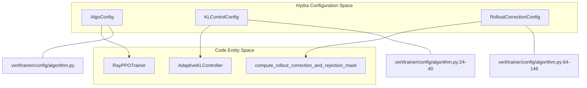
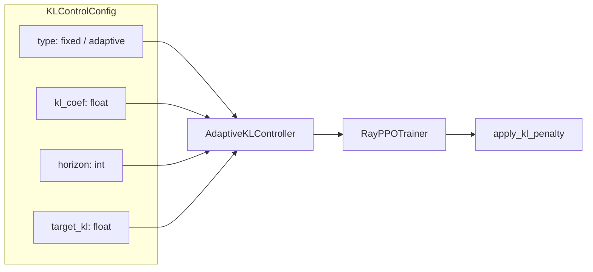
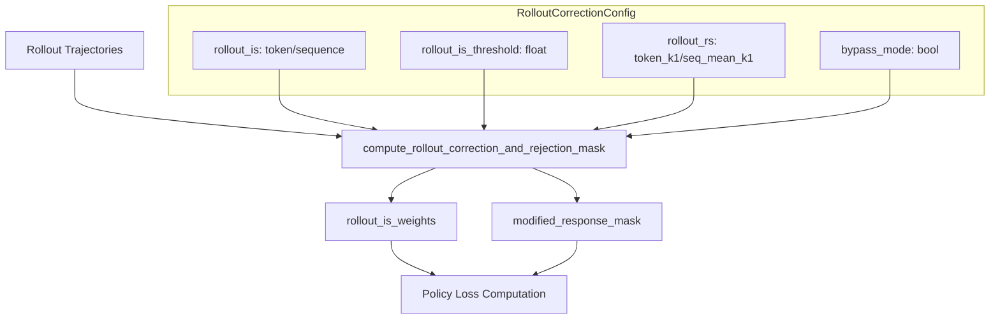

<!-- source: DeepWiki mcp.deepwiki.com · repo volcengine/verl · page 4.5 Algorithm and Training Configuration · fetched 2026-10-21 -->

# Algorithm and Training Configuration

Relevant source files

The following files were used as context for generating this wiki page:

- [docs/algo/rollout_corr.md](docs/algo/rollout_corr.md)
- [docs/algo/rollout_corr_math.md](docs/algo/rollout_corr_math.md)
- [tests/checkpoint_engine/test_special_server_adapter.py](tests/checkpoint_engine/test_special_server_adapter.py)
- [tests/trainer/ppo/test_rollout_corr.py](tests/trainer/ppo/test_rollout_corr.py)
- [tests/trainer/ppo/test_rollout_corr_integration.py](tests/trainer/ppo/test_rollout_corr_integration.py)
- [tests/workers/rollout/rollout_trtllm/test_trtllm_abort.py](tests/workers/rollout/rollout_trtllm/test_trtllm_abort.py)
- [verl/experimental/fully_async_policy/shell/grpo_30b_a3b_base_math_megatron_8_8_mis_trtllm.sh](verl/experimental/fully_async_policy/shell/grpo_30b_a3b_base_math_megatron_8_8_mis_trtllm.sh)
- [verl/experimental/fully_async_policy/shell/grpo_8b_base_math_megatron_4_4_trtllm.sh](verl/experimental/fully_async_policy/shell/grpo_8b_base_math_megatron_4_4_trtllm.sh)
- [verl/trainer/config/algorithm.py](verl/trainer/config/algorithm.py)
- [verl/trainer/config/algorithm/rollout_correction.yaml](verl/trainer/config/algorithm/rollout_correction.yaml)
- [verl/trainer/constants_ppo.py](verl/trainer/constants_ppo.py)
- [verl/trainer/ppo/rollout_corr_helper.py](verl/trainer/ppo/rollout_corr_helper.py)
- [verl/trainer/runtime_env.yaml](verl/trainer/runtime_env.yaml)

This page documents algorithm-specific parameters, training orchestration settings, and resource allocation configurations that control the reinforcement learning (RL) training process in `verl`. These settings are defined via Hydra-based configuration schemas and structured dataclasses under `verl.trainer.config`.

**Scope**: This page covers algorithm configuration structures (`AlgoConfig`, `KLControlConfig`, `RolloutCorrectionConfig`), advantage estimation options, KL divergence control, rollout correction pipelines for off-policy mitigation, optimization parameters, and runtime environment settings.

---

## Configuration Hierarchy and Data Classes

The algorithm and training configurations are organized into hierarchical sections in trainer configuration files. `verl` uses Hydra and OmegaConf to compose modular configuration groups, supporting different engine backends (e.g., FSDP, Megatron, TorchTitan, VeOmni).

Title: "Configuration Hierarchy to Code Entity Mapping"

Sources: `verl/trainer/config/algorithm.py:23-146`(), `verl/trainer/config/algorithm/rollout_correction.yaml:1-32`()

---

## Algorithm Configuration and Advantage Estimation

The `AlgoConfig` class defines top-level RL algorithmic choices, including the advantage estimator, discount factors, and GAE lambdas `[verl/trainer/config/algorithm.py:23-146]()`.

### Advantage Estimation Settings

The advantage estimator determines how advantages are derived from reward signals and value estimates across different algorithms (e.g., PPO, GRPO, RLOO, DAPO, REINFORCE++).

| Parameter | Type | Default | Description |
|-----------|------|---------|-------------|
| `adv_estimator` | `str` | `"gae"` | Advantage estimation method. Supported: `gae`, `grpo`, `reinforce_plus_plus`, `rloo`, `remax`, `gdpo`, `optimal_token_baseline`, etc. |
| `gamma` | `float` | `1.0` | Discount factor for future rewards. |
| `lam` | `float` | `1.0` | GAE lambda parameter balancing bias and variance. |
| `norm_adv_by_std_in_grpo` | `bool` | `true` | Whether to normalize advantages by standard deviation in GRPO. |

Sources: `verl/trainer/config/algorithm.py:23-146`()

### KL Divergence Control

KL divergence regularization between the trained policy and the reference model is managed via the `KLControlConfig` class `[verl/trainer/config/algorithm.py:24-40]()`.

Title: "KL Control Logic Flow"

**KL Control Parameters**:

| Parameter | Type | Default | Description |
|-----------|------|---------|-------------|
| `type` | `str` | `"fixed"` | KL coefficient control strategy: `"fixed"` or `"adaptive"`. |
| `kl_coef` | `float` | `0.001` | Initial or fixed KL penalty coefficient. |
| `horizon` | `int` | `10000` | Horizon steps for the adaptive KL controller. |
| `target_kl` | `float` | `0.1` | Target KL divergence value for adaptive scaling. |

Sources: `verl/trainer/config/algorithm.py:24-40`()

---

## Rollout Correction and Off-Policy Handling

The `RolloutCorrectionConfig` system addresses off-policy distribution shifts arising from implementation mismatches (e.g., vLLM BF16 vs FSDP FP32), model update staleness, and asynchronous rollout pipelines `[verl/trainer/config/algorithm.py:63-137]()`, `[verl/trainer/ppo/rollout_corr_helper.py:14-60]()`.

*   **Importance Sampling (IS)**: Controlled by `rollout_is` (`"token"` or `"sequence"`). Token-level IS provides lower variance with architectural bias, whereas sequence-level IS is unbiased but exhibits higher variance `[verl/trainer/config/algorithm.py:84-88]()`.
*   **Thresholds & Rejection Sampling (RS)**: `rollout_is_threshold` applies Truncated Importance Sampling (TIS) or IcePop bounds `[verl/trainer/config/algorithm.py:91-95]()`. Rejection sampling (`rollout_rs`) filters outliers using divergence modes like `token_k1`, `seq_mean_k1`, or `seq_mean_k3` implemented in `verl/trainer/ppo/rollout_corr_helper.py` `[verl/trainer/ppo/rollout_corr_helper.py:77-89]()`, `[verl/trainer/config/algorithm.py:104-118]()`.
*   **Bypass vs Decoupled Modes**: `bypass_mode` dictates whether a 2-policy bypass (`π_rollout = π_old`) or standard 3-policy decoupled layout is used `[verl/trainer/config/algorithm.py:126-132]()`.

Title: "Rollout Correction Pipeline"

Sources: `verl/trainer/config/algorithm.py:63-137`(), `verl/trainer/ppo/rollout_corr_helper.py:14-130`(), `verl/trainer/config/algorithm/rollout_correction.yaml:1-32`()

---

## Runtime Environment and Distributed Variables

Distributed execution parameters and hardware-specific environment variables are initialized via `PPO_RAY_RUNTIME_ENV` and filtered at runtime using `get_ppo_ray_runtime_env()` in `verl/trainer/constants_ppo.py` `[verl/trainer/constants_ppo.py:85-152]()`.

*   **NCCL and HCCL Settings**: Automatically configures timeout, thread safety (`TOKENIZERS_PARALLELISM="true"`), logging levels, and NPU/GPU socket ranges `[verl/trainer/constants_ppo.py:85-99]()`.
*   **Engine-Specific Overrides**: Dynamically sets `CUDA_DEVICE_MAX_CONNECTIONS="1"` for Hopper/Ampere GPUs when using the Megatron engine strategy `[verl/trainer/constants_ppo.py:42-50]`, `[verl/trainer/constants_ppo.py:119-121]()`.
*   **Profiler Integration**: Injects or bypasses NVTX hooks (`VERL_KEEP_NVTX_INJECTION`) when `global_profiler.tool=torch` is active `[verl/trainer/constants_ppo.py:127-136]()`.

Sources: `verl/trainer/constants_ppo.py:19-152`()

---

