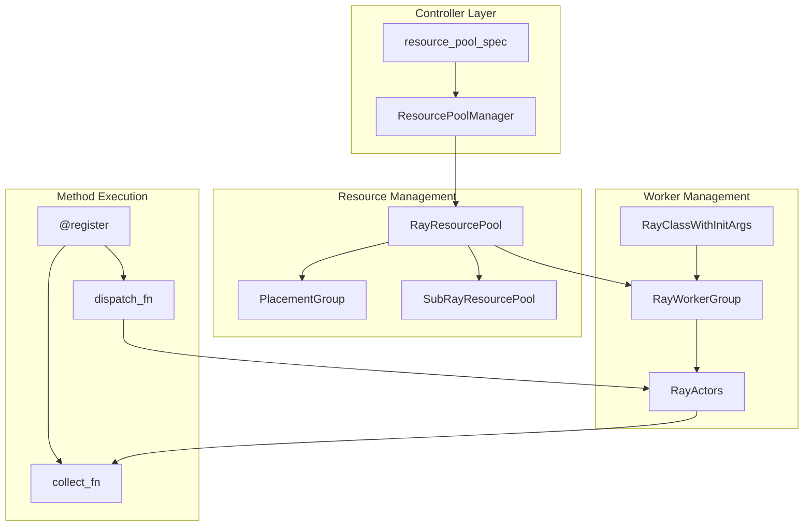
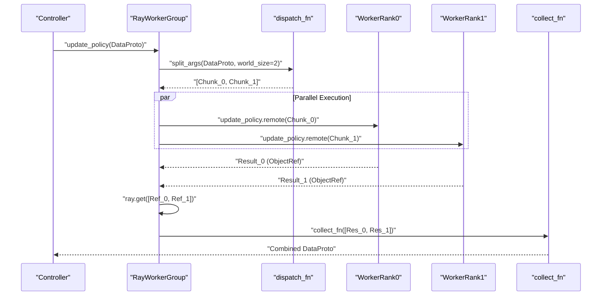

<!-- source: DeepWiki mcp.deepwiki.com · repo volcengine/verl · page 5 Ray Distributed Execution Framework · fetched 2026-10-21 -->

# Ray Distributed Execution Framework

Relevant source files

The following files were used as context for generating this wiki page:

- [tests/single_controller/test_data_transfer.py](tests/single_controller/test_data_transfer.py)
- [tests/single_controller/test_device_mesh_register.py](tests/single_controller/test_device_mesh_register.py)
- [tests/single_controller/test_high_level_scheduling_api.py](tests/single_controller/test_high_level_scheduling_api.py)
- [tests/single_controller/test_ray_collectives.py](tests/single_controller/test_ray_collectives.py)
- [tests/single_controller/test_split_resource_pool.py](tests/single_controller/test_split_resource_pool.py)
- [tests/single_controller/test_worker_group_basics.py](tests/single_controller/test_worker_group_basics.py)
- [verl/single_controller/base/worker.py](verl/single_controller/base/worker.py)
- [verl/single_controller/base/worker_group.py](verl/single_controller/base/worker_group.py)
- [verl/single_controller/ray/__init__.py](verl/single_controller/ray/__init__.py)
- [verl/single_controller/ray/base.py](verl/single_controller/ray/base.py)

This document describes `verl`'s Ray-based distributed execution infrastructure that coordinates workers across multiple GPUs and nodes. The framework provides abstractions for resource allocation, method dispatch, and data distribution across distributed training and inference workers.

For configuration of resource pools and GPU allocation strategies, see [RayWorkerGroup and Resource Management](#5.1). For worker implementations, see [Worker Roles and Communication Patterns](#5.2). For data structures used in distributed operations, see [DataProto and TensorDict Distribution](#5.3). For the lifecycle of workers, see [Worker Initialization and Lifecycle](#5.4).

---

## Core Architecture

The Ray distributed execution framework consists of three main layers that manage the transition from logical resource requirements to physical execution on a cluster. The system uses a single-controller paradigm where a central controller orchestrates groups of remote actors.

Title: Ray Distributed Execution Architecture

Sources: [verl/single_controller/ray/base.py:113-163](), [verl/single_controller/base/decorator.py:31-31]()

### RayWorkerGroup and Resource Management

The `RayWorkerGroup` defined in `verl/single_controller/ray/base.py` is the primary interface for managing a collection of Ray actor instances. It handles the creation of actors, environment variable injection, and lifecycle monitoring via `check_workers_alive` [verl/single_controller/base/worker_group.py:102-121](). Resources are managed via `RayResourcePool` [verl/single_controller/ray/base.py:113-163](), which abstracts Ray `PlacementGroup` creation to ensure that workers are correctly co-located on physical nodes, supporting strategies like `STRICT_PACK` for high-performance communication.

For details, see [RayWorkerGroup and Resource Management](#5.1).

Sources: [verl/single_controller/ray/base.py:113-163](), [verl/single_controller/base/worker_group.py:102-121]()

### Worker Roles and Communication Patterns

Verl uses a single-controller pattern where a driver script orchestrates multiple worker groups. Each worker inherits from the `Worker` base class [verl/single_controller/base/worker.py:76-180](). Communication is handled through Ray's remote method calls, augmented by verl's `@register` decorator [verl/single_controller/base/decorator.py:31-31]() which defines how data is dispatched and collected.

For details, see [Worker Roles and Communication Patterns](#5.2).

Sources: [verl/single_controller/base/worker.py:35-49](), [verl/single_controller/base/worker.py:76-180](), [verl/single_controller/base/decorator.py:31-31]()

### DataProto and TensorDict Distribution

Data movement between the controller and workers is optimized using `DataProto` and `TensorDict`. The framework supports automatic chunking of these objects based on the `world_size` of the worker group via dispatch functions and decorators [verl/single_controller/base/decorator.py:26-47](). Verl utilizes tensordict utilities to handle complex nested structures and non-tensor data distribution.

For details, see [DataProto and TensorDict Distribution](#5.3).

Sources: [verl/single_controller/ray/base.py:53-64](), [verl/single_controller/base/decorator.py:26-47]()

### Worker Initialization and Lifecycle

Worker initialization involves setting up `torch.distributed` process groups within Ray actors. The `RayWorkerGroup` ensures that `MASTER_ADDR` and `MASTER_PORT` are synchronized across all workers using `get_master_addr_port` [verl/single_controller/ray/base.py:91-110](). It also provides mechanisms for monitoring worker aliveness [verl/single_controller/base/worker_group.py:102-121]() and managing detached actors.

For details, see [Worker Initialization and Lifecycle](#5.4).

Sources: [verl/single_controller/ray/base.py:91-110](), [verl/single_controller/base/worker.py:181-189](), [verl/single_controller/base/worker_group.py:102-121]()

---

## High-Level Data Flow

The following diagram illustrates how a single method call on a `RayWorkerGroup` is transformed into a distributed operation across multiple Ray actors using `func_generator` [verl/single_controller/ray/base.py:49-68]().

Title: Distributed Method Dispatch Sequence

Sources: [verl/single_controller/ray/base.py:49-68](), [verl/single_controller/base/decorator.py:26-47]()

---

## Summary of Core Entities

| Class/Function | File Path | Role |
|:---|:---|:---|
| `RayWorkerGroup` | [verl/single_controller/ray/__init__.py:29-29]() | Orchestrates a group of Ray actors as a single logical unit. |
| `RayResourcePool` | [verl/single_controller/ray/base.py:113-163]() | Manages Ray PlacementGroups and physical GPU/CPU bundles. |
| `Worker` | [verl/single_controller/base/worker.py:76-180]() | Base class for all distributed workers. |
| `@register` | [verl/single_controller/base/decorator.py:31-31]() | Decorator defining dispatch and execution modes for worker methods. |
| `ResourcePoolManager` | [verl/single_controller/ray/__init__.py:30-30]() | Partitioning and initialization of physical resource pools. |
| `Dispatch` | [verl/single_controller/base/decorator.py:26-47]() | Enum defining data distribution strategies. |

Sources: [verl/single_controller/ray/base.py:113-163](), [verl/single_controller/base/worker.py:76-180](), [verl/single_controller/base/decorator.py:26-47](), [verl/single_controller/ray/__init__.py:29-30]()

---

