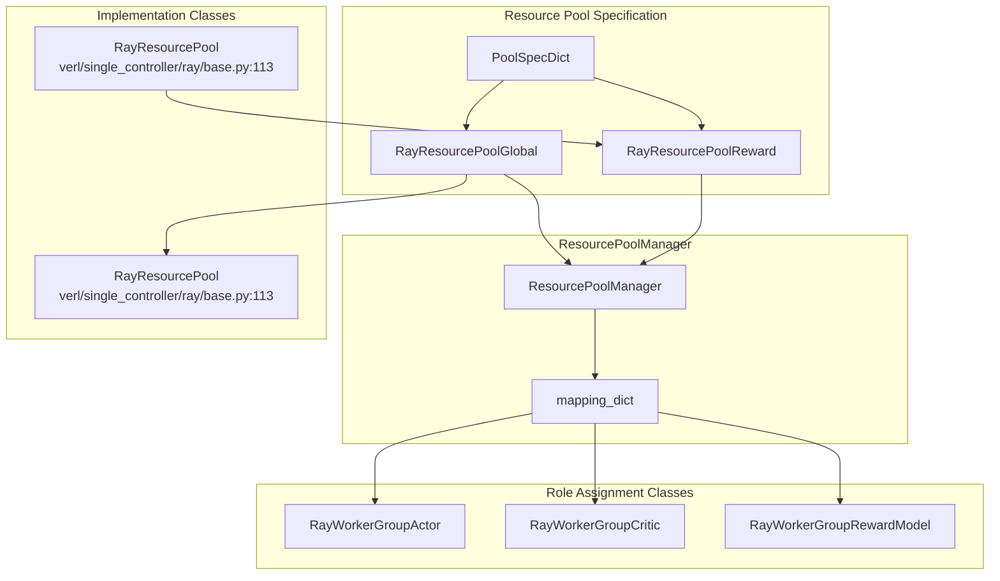
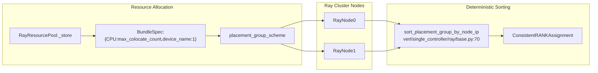
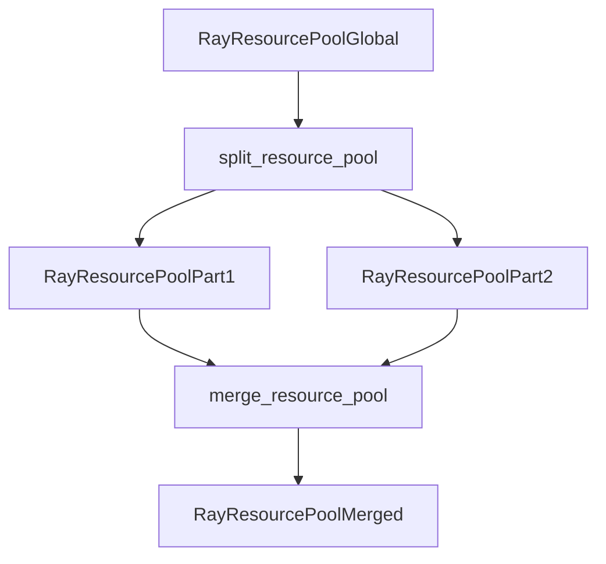
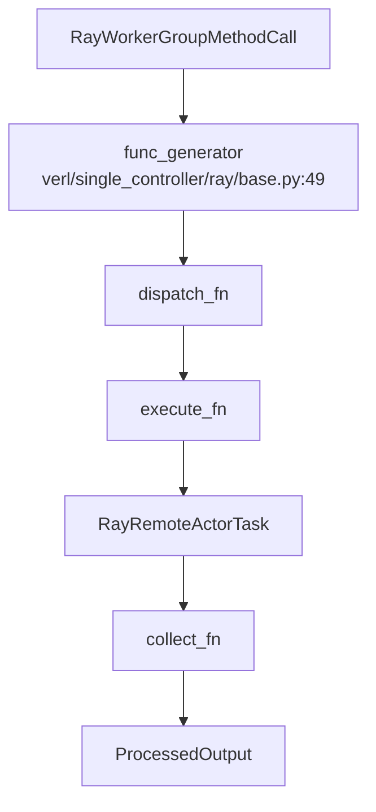
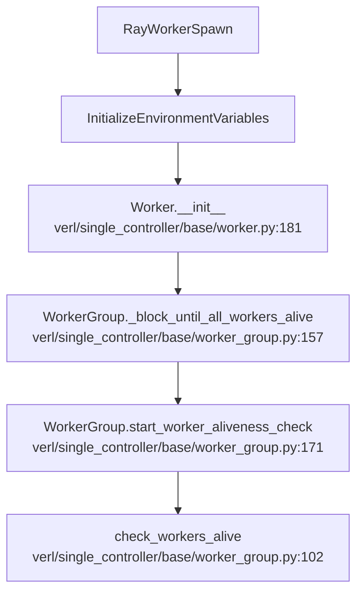

<!-- source: DeepWiki mcp.deepwiki.com · repo volcengine/verl · page 5.1 RayWorkerGroup and Resource Management · fetched 2026-10-21 -->

# RayWorkerGroup and Resource Management

<details>
<summary>Relevant source files</summary>

The following files were used as context for generating this wiki page:

- [tests/single_controller/test_data_transfer.py](tests/single_controller/test_data_transfer.py)
- [tests/single_controller/test_device_mesh_register.py](tests/single_controller/test_device_mesh_register.py)
- [tests/single_controller/test_high_level_scheduling_api.py](tests/single_controller/test_high_level_scheduling_api.py)
- [tests/single_controller/test_ray_collectives.py](tests/single_controller/test_ray_collectives.py)
- [tests/single_controller/test_split_resource_pool.py](tests/single_controller/test_split_resource_pool.py)
- [tests/single_controller/test_worker_group_basics.py](tests/single_controller/test_worker_group_basics.py)
- [verl/single_controller/base/worker.py](verl/single_controller/base/worker.py)
- [verl/single_controller/base/worker_group.py](verl/single_controller/base/worker_group.py)
- [verl/single_controller/ray/__init__.py](verl/single_controller/ray/__init__.py)
- [verl/single_controller/ray/base.py](verl/single_controller/ray/base.py)

</details>


## Purpose and Scope

This page documents `verl`'s distributed execution foundation built on Ray, focusing on resource allocation and worker group management. The `RayWorkerGroup` class and its resource management machinery defined in `[verl/single_controller/ray/base.py:1-171]()` bridge high-level RL training orchestration and Ray's distributed primitives, enabling flexible deployment of actor, critic, and rollout workers across GPU/NPU clusters.

The system implements the **HybridFlow** programming model, where a single controller orchestrates multiple remote worker groups colocated or distributed via Ray placement groups `[verl/single_controller/ray/base.py:113-161]()`.

Sources: `[verl/single_controller/ray/base.py:1-171]`, `[verl/single_controller/base/worker_group.py:123-184]()`

---

## Resource Pool Architecture and RayResourcePool

`verl` organizes cluster resources into **resource pools** that map physical hardware topologies to computational roles. Each pool defines processes per node, leveraging Ray `PlacementGroup` objects to enforce colocation constraints `[verl/single_controller/ray/base.py:113-161]()`.

Title: Resource Pool Mapping and Code Entities

Sources: `[verl/single_controller/ray/base.py:113-171]`, `[verl/single_controller/base/worker_group.py:27-50]()`, `[verl/single_controller/ray/__init__.py:15-24]()`

The `RayResourcePool` class initialized in `[verl/single_controller/ray/base.py:113-130]()` encapsulates process layouts across nodes.

| Attribute | Type | Description |
|-----------|------|-------------|
| `_store` | `list[int]` | Number of processes per node `[verl/single_controller/base/worker_group.py:44]()` |
| `use_gpu` | `bool` | Whether to allocate GPU resources `[verl/single_controller/ray/base.py:124]()` |
| `max_colocate_count` | `int` | Maximum process colocation limit `[verl/single_controller/ray/base.py:119]()` |
| `pgs` | `list[PlacementGroup]` | Cached Ray PlacementGroups `[verl/single_controller/ray/base.py:127]()` |
| `accelerator_type` | `str` | Custom resource hardware specifier `[verl/single_controller/ray/base.py:129]()` |

Sources: `[verl/single_controller/ray/base.py:113-171]`, `[verl/single_controller/base/worker_group.py:27-74]()`

---

## Placement Group Allocation and Node IP Sorting

Placement groups ensure that execution bundles land on correct hardware nodes. `verl` applies the `STRICT_PACK` strategy and sorts placement groups by node IP address via `sort_placement_group_by_node_ip` to guarantee rank persistence across job restarts `[verl/single_controller/ray/base.py:70-87]`, `[verl/single_controller/ray/base.py:131-163]()`.

Title: Placement Group Resource Bundling and Sorting

Sources: `[verl/single_controller/ray/base.py:70-87]`, `[verl/single_controller/ray/base.py:131-163]()`

The sorting function queries Ray node metadata to order placement groups deterministically:
```python
def sort_placement_group_by_node_ip(pgs: list[PlacementGroup]) -> list[PlacementGroup]:
    """Sort the placement groups by node ip..."""
```
`[verl/single_controller/ray/base.py:70-87]()`

Sources: `[verl/single_controller/ray/base.py:70-87]()`

---

## Resource Pool Splitting and Merging

Resource pools can be partitioned or combined dynamically to support complex workflows like separate actor and critic topologies or hybrid engine configurations.

Title: Resource Pool Splitting and Merging Data Flow

Sources: `[tests/single_controller/test_split_resource_pool.py:54-170]`, `[tests/single_controller/test_high_level_scheduling_api.py:75-78]()`

Using functions such as `split_resource_pool` and `merge_resource_pool`, developers can carve out precise slices of accelerator clusters for distinct components like reference models and reward models without re-initializing the Ray runtime `[tests/single_controller/test_split_resource_pool.py:62-64]`, `[tests/single_controller/test_high_level_scheduling_api.py:75-78]()`.

Sources: `[tests/single_controller/test_split_resource_pool.py:54-170]`, `[tests/single_controller/test_high_level_scheduling_api.py:34-97]()`

---

## RayWorkerGroup Abstraction and Method Binding

`RayWorkerGroup` manages Ray actor lifecycles, environment variables (`RANK`, `WORLD_SIZE`, `MASTER_ADDR`, `MASTER_PORT`), and remote method execution `[verl/single_controller/ray/base.py:237-430]()`.

Worker methods use `func_generator` for dynamic binding, executing dispatch, remote calls, and result collection transparently `[verl/single_controller/ray/base.py:49-68]()`.

Title: RayWorkerGroup Dynamic Method Binding and Execution

Sources: `[verl/single_controller/ray/base.py:49-68]`, `[verl/single_controller/ray/base.py:237-430]()`

---

## Worker Initialization and Lifecycle Management

Workers inherit from `Worker` `[verl/single_controller/base/worker.py:76]()`, which configures communication backends (such as NCCL) and handles rank metadata queries (`DistRankInfo`, `DistGlobalInfo`) `[verl/single_controller/base/worker.py:35-48]()`.

Title: Worker Lifecycle and Aliveness Monitoring

Sources: `[verl/single_controller/base/worker.py:35-189]`, `[verl/single_controller/base/worker_group.py:102-184]()`

The aliveness monitoring loop continuously checks worker health in a background thread and triggers error signals if any remote process dies unexpectedly `[verl/single_controller/base/worker_group.py:102-121]`.

Sources: `[verl/single_controller/base/worker.py:35-189]`, `[verl/single_controller/base/worker_group.py:102-184]()`

---

