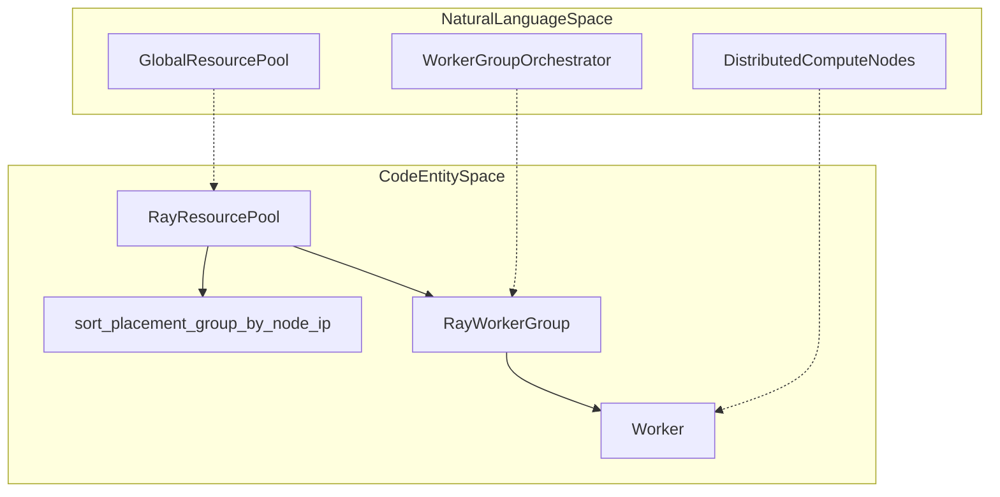
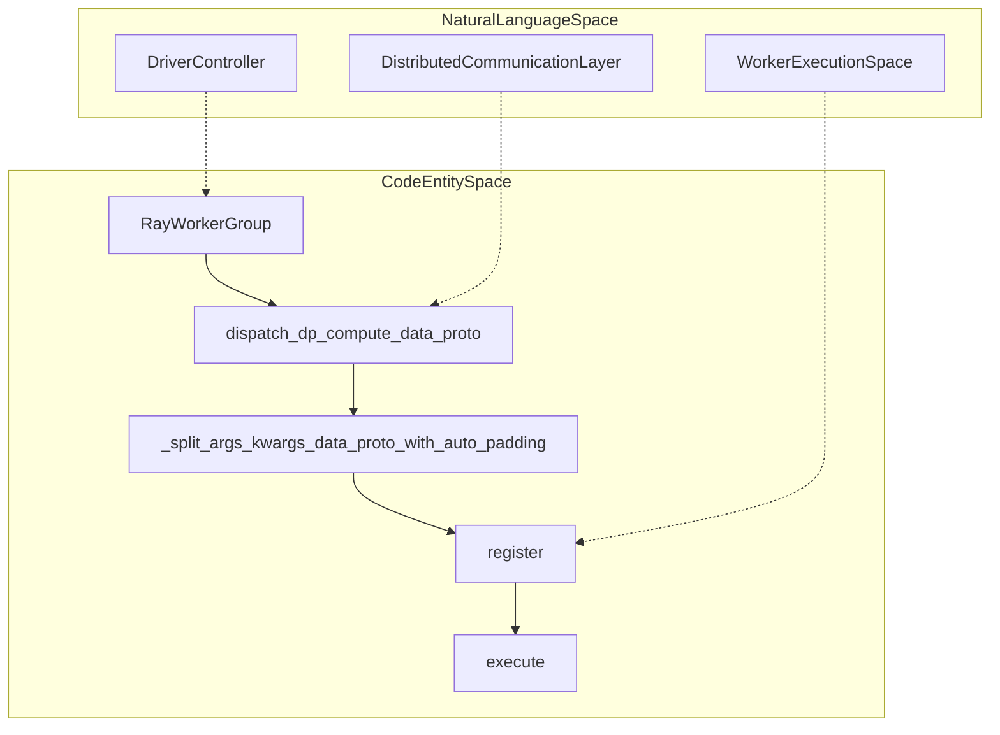
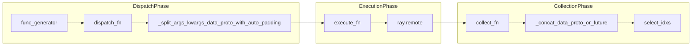
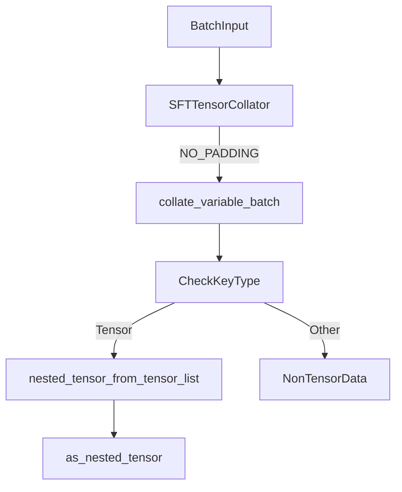

<!-- source: DeepWiki mcp.deepwiki.com · repo volcengine/verl · page 5.2 Worker Roles and Communication Patterns · fetched 2026-10-21 -->

# Worker Roles and Communication Patterns

Relevant source files

The following files were used as context for generating this wiki page:

- [tests/single_controller/test_data_transfer.py](tests/single_controller/test_data_transfer.py)
- [tests/single_controller/test_decorator_on_cpu.py](tests/single_controller/test_decorator_on_cpu.py)
- [tests/single_controller/test_device_mesh_register.py](tests/single_controller/test_device_mesh_register.py)
- [tests/single_controller/test_high_level_scheduling_api.py](tests/single_controller/test_high_level_scheduling_api.py)
- [tests/single_controller/test_ray_collectives.py](tests/single_controller/test_ray_collectives.py)
- [tests/single_controller/test_split_resource_pool.py](tests/single_controller/test_split_resource_pool.py)
- [tests/single_controller/test_worker_group_basics.py](tests/single_controller/test_worker_group_basics.py)
- [tests/special_e2e/sft/compare_sft_engine_results.py](tests/special_e2e/sft/compare_sft_engine_results.py)
- [tests/special_sanity/validate_structure.py](tests/special_sanity/validate_structure.py)
- [tests/test_protocol_on_cpu.py](tests/test_protocol_on_cpu.py)
- [tests/test_protocol_v2_on_cpu.py](tests/test_protocol_v2_on_cpu.py)
- [verl/protocol.py](verl/protocol.py)
- [verl/single_controller/base/decorator.py](verl/single_controller/base/decorator.py)
- [verl/single_controller/base/worker.py](verl/single_controller/base/worker.py)
- [verl/single_controller/base/worker_group.py](verl/single_controller/base/worker_group.py)
- [verl/single_controller/ray/__init__.py](verl/single_controller/ray/__init__.py)
- [verl/single_controller/ray/base.py](verl/single_controller/ray/base.py)
- [verl/utils/dataset/dataset_utils.py](verl/utils/dataset/dataset_utils.py)
- [verl/utils/tensordict_utils.py](verl/utils/tensordict_utils.py)

This page documents the worker role system and inter-worker communication patterns in `verl`'s distributed training architecture. It covers how different components of the RL training pipeline (Actor, Critic, Reference, Reward) are assigned to physical workers via Ray, how these workers communicate using specialized dispatch mechanisms, and how data structures like `DataProto` and `TensorDict` are partitioned and distributed across multi-dimensional device meshes.

Sources: [verl/single_controller/base/worker_group.py:123-151]()

## Worker Role Types

`verl` defines several role types that represent different components of the RL training pipeline. Each role has specific responsibilities in the training workflow.

### Core Roles

The system identifies roles and worker types to distinguish between different computational tasks across distributed nodes.

| Role | Primary Responsibility | Implementation |
|------|------------------------|----------------|
| `Actor` | Policy network training and gradient updates | `ActorRolloutRefWorker` (FSDP/Megatron) |
| `Rollout` | Trajectory generation via inference engines | `RolloutReplica` (vLLM, SGLang, etc.) |
| `RefPolicy` | Reference policy for KL divergence | Frozen policy for computing KL penalty |
| `Critic` | Value network training | `TrainingWorker` (FSDP/Megatron) |
| `RewardModel` | Reward score computation | `RewardModelWorker` or custom reward functions |

Sources: [verl/single_controller/base/worker.py:76-82]()

### Hybrid Roles

To optimize resource utilization and minimize communication overhead (specifically weight synchronization), `verl` supports hybrid roles that combine multiple responsibilities into a single process.

| Hybrid Role | Combined Components | Use Case |
|-------------|---------------------|----------|
| `ActorRollout` | Actor + Rollout | Share GPU memory between training and inference |
| `ActorRolloutRef` | Actor + Rollout + RefPolicy | Full hybrid mode; standard for PPO on limited resources |

The `Worker` class tracks fused worker components via the `fused_worker_attr_name` attribute [verl/single_controller/base/worker.py:84-85]().

Sources: [verl/single_controller/base/worker.py:84-85]()

## Role Assignment and Mapping

### Resource Pool Management

The distributed execution system uses resource pools to map logical roles to physical hardware allocations. The `RayResourcePool` class handles the physical allocation of resources (CPUs, GPUs, and platform-specific accelerators) via Ray placement groups [verl/single_controller/ray/base.py:113-130](), [verl/single_controller/ray/base.py:131-163]().

### Placement Group Synchronization

To ensure rank consistency across nodes—which is critical for distributed checkpointing and state synchronization—resource management utilities inspect node states and align placement group bundles by their physical node Internet Protocol addresses using `sort_placement_group_by_node_ip` [verl/single_controller/ray/base.py:70-87]().

**Resource Pool and Worker Allocation Bridge**

Sources: [verl/single_controller/ray/base.py:70-163](), [verl/single_controller/base/worker_group.py:123-151]()

## Worker Communication Patterns

### Worker Group Access

Workers are aggregated into `WorkerGroup` (base) and `RayWorkerGroup` (Ray-specific) instances, providing high-level interfaces for invoking methods across remote actor clusters [verl/single_controller/base/worker_group.py:123-151]().

### Method Invocation Pattern

Remote methods are invoked via dynamically generated functors (`func_generator`) that handle argument dispatching, remote execution handles, and result collection [verl/single_controller/ray/base.py:49-67]().

### Dispatch Mode System

The `@register` decorator configures how methods partition and route incoming data using predefined dispatch enums (`Dispatch`) [verl/single_controller/base/decorator.py:26-47]().

| Mode | Distribution Strategy | Implementation Function |
|------|----------------------|-------------------------|
| `ONE_TO_ALL` | Broadcast identical arguments to all workers | `dispatch_one_to_all` [verl/single_controller/base/decorator.py:120-123]() |
| `ALL_TO_ALL` | Pass argument lists directly (1-to-1 mapping) | `dispatch_all_to_all` [verl/single_controller/base/decorator.py:131]() |
| `DP_COMPUTE` | Split lists/tuples evenly across world size | `dispatch_dp_compute` [verl/single_controller/base/decorator.py:148-156]() |
| `DP_COMPUTE_PROTO` | Chunk `DataProto` objects with automatic padding | `dispatch_dp_compute_data_proto` [verl/single_controller/base/decorator.py:167-177]() |
| `RANK_ZERO` | Execute computation exclusively on rank 0 | `Execute.RANK_ZERO` [verl/single_controller/base/decorator.py:61-64]() |

Sources: [verl/single_controller/base/decorator.py:26-48](), [verl/single_controller/base/decorator.py:61-64](), [verl/single_controller/base/decorator.py:120-177]()

### Data Distribution Flow (Natural Language to Code Entity Space)

**Data Routing Architecture Bridge**

Sources: [verl/single_controller/base/decorator.py:91-117](), [verl/single_controller/ray/base.py:49-67](), [verl/single_controller/base/worker_group.py:129-151]()

### Dispatch Mode Logic and Data Flow

The function generator constructs an execution instance that runs a 3-phase transformation pipeline: dispatch argument splitting, remote execution, and output collection [verl/single_controller/ray/base.py:49-67]().

**Data Transformation Pipeline**

Sources: [verl/single_controller/ray/base.py:49-67](), [verl/single_controller/base/decorator.py:91-117]()

## Data Parallel Partitioning and Device Meshes

For `DP_COMPUTE_PROTO` mode, data partitioning is governed by worker registration parameters that bind device meshes (such as tensor parallel, data parallel, and pipeline parallel ranks) to specific dispatch domains via `_register_dispatch_collect_info` [verl/single_controller/base/worker.py:86-101]().

This registration enables proper routing across multi-dimensional device meshes combining tensor parallelism, data parallelism, and pipeline parallelism.

Sources: [verl/single_controller/base/worker.py:86-101]()

## Advanced Communication Patterns

### Colocated Workers
To reduce memory overhead and latency, `verl` supports colocated workers where multiple logical roles share a physical Ray actor. Sub-workers are managed through a unified dictionary, and execution requests are dispatched across the worker group [verl/single_controller/base/worker_group.py:129-135]().

### Driver Function Dispatch
Using `DP_COMPUTE_PROTO_WITH_FUNC`, the controller can dispatch both code objects (functions) and data partitions (`DataProto`) simultaneously to target worker groups [verl/single_controller/base/decorator.py:180-188]().

### TensorDict and Metadata Distribution
Internal data storage relies heavily on `TensorDict` and associated utility helpers (`tensordict_utils`) to manage complex layouts over Ray:
*   **Non-Tensor Data**: Strings, configs, and arbitrary metadata are encapsulated using `NonTensorData` [verl/utils/tensordict_utils.py:26-46]().
*   **Nested Collections**: Variable-length multi-turn conversation lists are preserved via `NonTensorStack` [verl/utils/tensordict_utils.py:48-74]().
*   **Slicing**: Index selection utilities partition distributed chunks while maintaining nested and jagged layouts.
*   **Union Operations**: Functions like `union_tensor_dict` merge `TensorDict` objects, ensuring that keys are unique or values are identical to prevent conflicts during merging.

Sources: [verl/utils/tensordict_utils.py:26-107]()

### Variable-Length Sequence Collating
The dataset utilities manage dynamic batching and padding across sequence lengths using specialized collators like `SFTTensorCollator` [verl/utils/dataset/dataset_utils.py:32-41]().

**Sequence Collating Logic**

Sources: [verl/utils/dataset/dataset_utils.py:32-80]()

---

