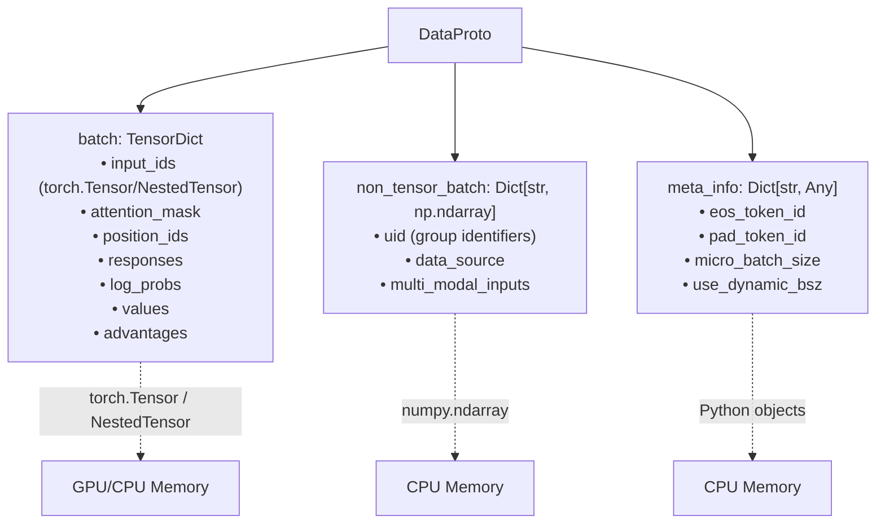
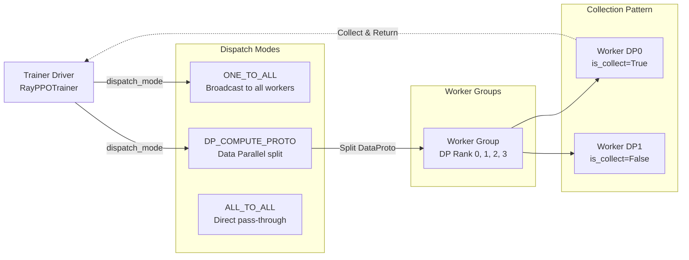
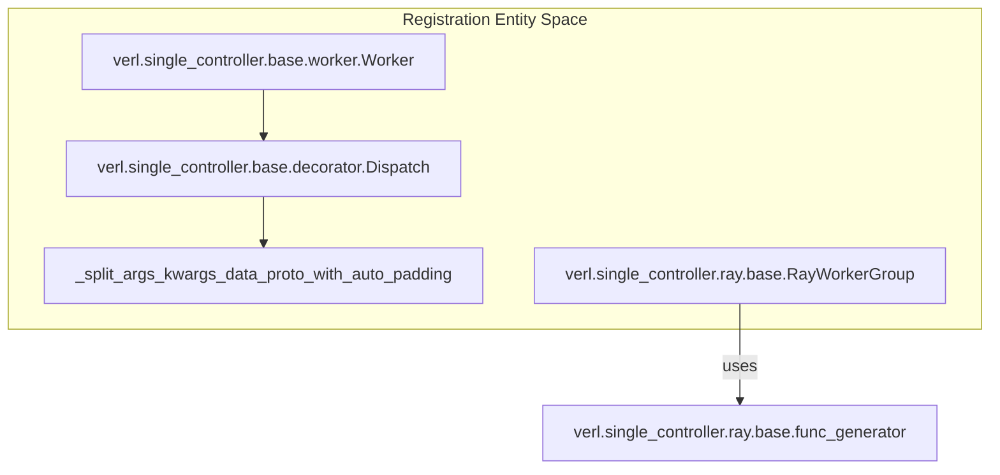
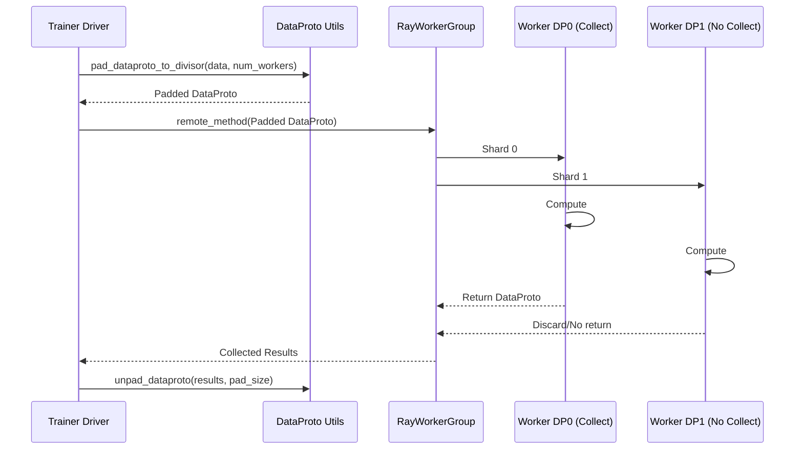
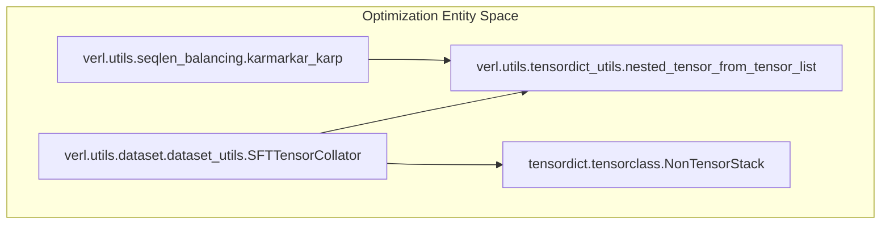

<!-- source: DeepWiki mcp.deepwiki.com · repo volcengine/verl · page 5.3 DataProto and TensorDict Distribution · fetched 2026-10-21 -->

# DataProto and TensorDict Distribution

Relevant source files

The following files were used as context for generating this wiki page:

- [tests/single_controller/test_decorator_on_cpu.py](tests/single_controller/test_decorator_on_cpu.py)
- [tests/special_e2e/sft/compare_sft_engine_results.py](tests/special_e2e/sft/compare_sft_engine_results.py)
- [tests/special_sanity/validate_structure.py](tests/special_sanity/validate_structure.py)
- [tests/test_protocol_on_cpu.py](tests/test_protocol_on_cpu.py)
- [tests/test_protocol_v2_on_cpu.py](tests/test_protocol_v2_on_cpu.py)
- [verl/protocol.py](verl/protocol.py)
- [verl/single_controller/base/decorator.py](verl/single_controller/base/decorator.py)
- [verl/utils/dataset/dataset_utils.py](verl/utils/dataset/dataset_utils.py)
- [verl/utils/tensordict_utils.py](verl/utils/tensordict_utils.py)

## Purpose and Scope

This document details how `DataProto` objects and tensor dictionaries are distributed across Ray workers in verl's distributed reinforcement learning and supervised fine-tuning (SFT) training systems. It covers the internal structure of `DataProto`, dispatch modes for data partitioning, worker registration patterns, padding and unpadding logic, and advanced optimizations such as sequence length balancing and asynchronous streaming via TransferQueue.

Sources: [verl/protocol.py:14-17](), [verl/single_controller/ray/base.py:53-64]()

## DataProto Structure and TensorDict Foundations

`DataProto` serves as the primary data container and transfer protocol across all worker boundaries and function calls in verl [verl/protocol.py:14-17](). It encapsulates three distinct categories of data to accommodate uniform tensor acceleration alongside flexible non-tensor metadata and operational flags:

**Figure 1: DataProto Structure**

### Field Categories

1.  **`batch` (Tensor Data)**: Contains PyTorch tensors or `tensordict.TensorDict` instances [verl/protocol.py:29-35](). Variable-length sequences (e.g., in `NO_PADDING` mode) are structured as `torch.NestedTensor` with `layout=torch.jagged` [verl/utils/tensordict_utils.py:171-172]().
2.  **`non_tensor_batch` (Non-Tensor Metadata)**: Stores NumPy arrays or complex nested Python objects (such as lists of dictionaries) wrapped using `tensordict.tensorclass.NonTensorStack` and `NonTensorData` [verl/utils/tensordict_utils.py:48-73](). This handles multi-modal inputs like vision arrays alongside text identifiers [tests/test_protocol_v2_on_cpu.py:152-174]().
3.  **`meta_info` (Operational Metadata)**: Manages execution configurations, padding size keys, and auto-padding status flags [verl/protocol.py:51-67]().

Sources: [verl/protocol.py:14-121](), [verl/utils/tensordict_utils.py:26-107](), [verl/utils/tensordict_utils.py:171-172](), [tests/test_protocol_v2_on_cpu.py:152-174]()

## Dispatch Modes and Distribution Patterns

Workers register methods with specific dispatch enums (`Dispatch`) that dictate how inputs are partitioned or broadcasted across ranks in a `WorkerGroup` [verl/single_controller/base/decorator.py:26-32]().

**Figure 2: Dispatch Modes and Collection Patterns**

### Dispatch Mode Types

-   **`Dispatch.ONE_TO_ALL`**: Broadcasts an identical copy of the arguments to every worker in the worker group [verl/single_controller/base/decorator.py:40](), [verl/single_controller/base/decorator.py:120-123]().
-   **`Dispatch.DP_COMPUTE_PROTO`**: Automatically checks length divisors, applies auto-padding if enabled, and shards the `DataProto` evenly across data parallel ranks [verl/single_controller/base/decorator.py:43](), [verl/single_controller/base/decorator.py:91-117](), [verl/single_controller/base/decorator.py:167-177]().
-   **`Dispatch.RANK_ZERO`**: Restricts execution to rank 0 [verl/single_controller/base/decorator.py:39]().
-   **`Dispatch.ALL_TO_ALL`**: Passes arguments through directly without modification [verl/single_controller/base/decorator.py:41](), [verl/single_controller/base/decorator.py:130-131]().

Sources: [verl/single_controller/base/decorator.py:26-48](), [verl/single_controller/base/decorator.py:91-117](), [verl/single_controller/base/decorator.py:120-123](), [verl/single_controller/base/decorator.py:167-177]()

## Worker Registration and Collection Logic

Workers establish their roles and interaction bindings during initialization. The single-controller framework leverages wrapper functions and dynamic enum definitions to manage remote execution routines.

**Figure 3: Registration Code Entity Space**

Sources: [verl/single_controller/base/decorator.py:26-68](), [verl/single_controller/base/worker.py:76-121](), [verl/single_controller/ray/base.py:49-68]()

## Data Distribution Flow through Training Loop

When a training iteration invokes a remote worker group method, `DataProto` objects undergo a standardized pipeline involving divisor padding, sharding, computation, collection, and final unpadding.

**Figure 4: Data Distribution Flow**

### Padding and Unpadding Mechanisms

`pad_dataproto_to_divisor` ensures that the total batch size is evenly divisible by `size_divisor` (world size) by appending replicated slices from the beginning of the dataset [verl/protocol.py:74-99](). Once workers complete processing, `unpad_dataproto` strips away the trailing padded items [verl/protocol.py:102-106]().

Sources: [verl/protocol.py:74-106](), [verl/single_controller/ray/base.py:53-64]()

## TransferQueue Integration

Verl incorporates **TransferQueue** to support asynchronous streaming architectures. This mechanism decouples heavy tensor transfers from control signals.

-   `tqbridge`: Decorator utilized to link `DataProto` processing functions with TransferQueue channels [verl/single_controller/base/decorator.py:20]().
-   `BatchMeta` & `KVBatchMeta`: Metadata objects describing chunked payloads inside queues without full tensor duplication [verl/protocol.py:41-42]().

Sources: [verl/single_controller/base/decorator.py:20](), [verl/protocol.py:41-42]()

## Sequence Length Balancing and Optimization

To eliminate straggler effects caused by variable sequence lengths across data-parallel ranks, verl provides utilities for workload estimation and batch partitioning.

**Figure 5: Optimization Code Entity Space**

### Core Partitioning and Collating Utilities

1.  **`SFTTensorCollator`**: Handles custom collation, mapping jagged sequences into `torch.NestedTensor` objects when `DatasetPadMode.NO_PADDING` is selected [verl/utils/dataset/dataset_utils.py:32-80]().
2.  **`karmarkar_karp`**: Implements the Largest Differencing Method to distribute workload partitions evenly across workers [verl/utils/seqlen_balancing.py:49-70]().
3.  **`calculate_workload`**: Approximates attention FLOPs based on sequence lengths (`workload ∝ 24576 * seqlen + seqlen²`) to guide balanced partitioning [verl/utils/seqlen_balancing.py:27-47]().

Sources: [verl/utils/dataset/dataset_utils.py:32-80](), [verl/utils/tensordict_utils.py:162-182](), [verl/utils/seqlen_balancing.py:27-70]()

## Summary Table: Distribution and Processing Utilities

| Function / Class | File Path | Description |
| :--- | :--- | :--- |
| `pad_dataproto_to_divisor` | [verl/protocol.py:74-99]() | Pads a DataProto to be divisible by the target size divisor. |
| `unpad_dataproto` | [verl/protocol.py:102-106]() | Truncates padding elements from a processed DataProto. |
| `union_tensor_dict` | [verl/protocol.py:109-122]() | Merges two TensorDicts with identical batch dimensions. |
| `assign_non_tensor` | [verl/utils/tensordict_utils.py:76-107]() | Wraps non-tensor metadata in `NonTensorData` or `NonTensorStack`. |
| `nested_tensor_from_tensor_list` | [verl/utils/tensordict_utils.py:162-182]() | Constructs jagged nested tensors from variable-length lists. |
| `SFTTensorCollator` | [verl/utils/dataset/dataset_utils.py:32-80]() | Custom collate function supporting packed and jagged SFT sequences. |
| `tqbridge` | [verl/single_controller/base/decorator.py:20]() | Bridge decorator for integrating DataProto workflows with TransferQueue. |

Sources: [verl/protocol.py:74-122](), [verl/utils/tensordict_utils.py:76-182](), [verl/utils/dataset/dataset_utils.py:32-80](), [verl/single_controller/base/decorator.py:20]()

---

