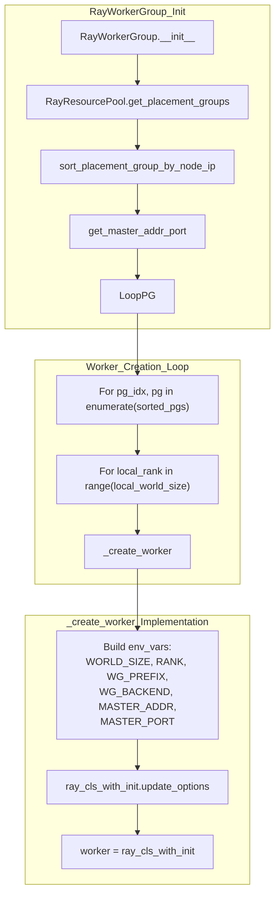
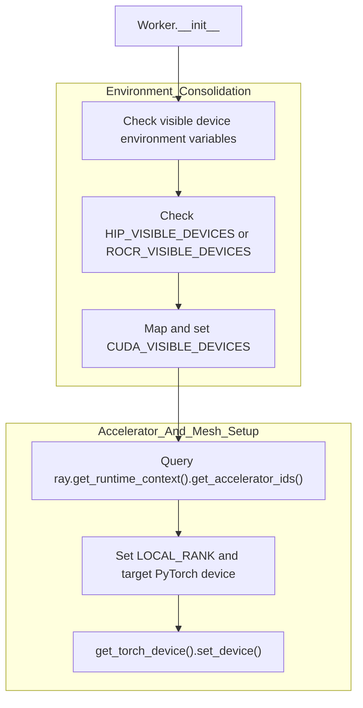
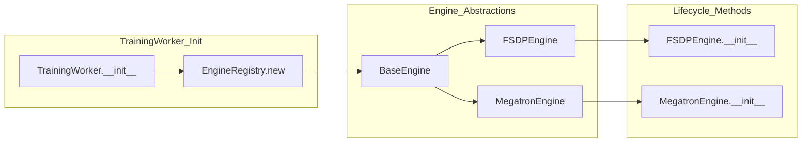
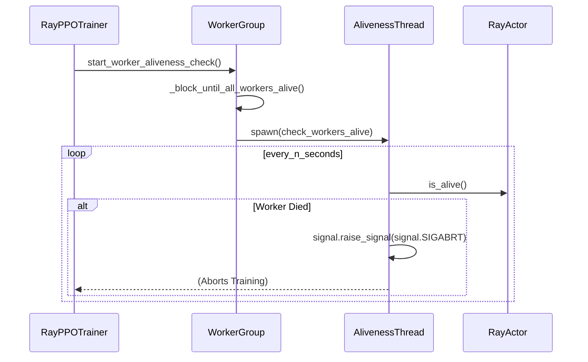

<!-- source: DeepWiki mcp.deepwiki.com · repo volcengine/verl · page 5.4 Worker Initialization and Lifecycle · fetched 2026-10-21 -->

# Worker Initialization and Lifecycle

Relevant source files

The following files were used as context for generating this wiki page:

- [tests/models/test_engine.py](tests/models/test_engine.py)
- [tests/single_controller/test_data_transfer.py](tests/single_controller/test_data_transfer.py)
- [tests/single_controller/test_device_mesh_register.py](tests/single_controller/test_device_mesh_register.py)
- [tests/single_controller/test_high_level_scheduling_api.py](tests/single_controller/test_high_level_scheduling_api.py)
- [tests/single_controller/test_ray_collectives.py](tests/single_controller/test_ray_collectives.py)
- [tests/single_controller/test_split_resource_pool.py](tests/single_controller/test_split_resource_pool.py)
- [tests/single_controller/test_worker_group_basics.py](tests/single_controller/test_worker_group_basics.py)
- [verl/single_controller/base/worker.py](verl/single_controller/base/worker.py)
- [verl/single_controller/base/worker_group.py](verl/single_controller/base/worker_group.py)
- [verl/single_controller/ray/__init__.py](verl/single_controller/ray/__init__.py)
- [verl/single_controller/ray/base.py](verl/single_controller/ray/base.py)
- [verl/workers/engine/base.py](verl/workers/engine/base.py)
- [verl/workers/engine/fsdp/transformer_impl.py](verl/workers/engine/fsdp/transformer_impl.py)
- [verl/workers/engine/utils.py](verl/workers/engine/utils.py)
- [verl/workers/engine_workers.py](verl/workers/engine_workers.py)
- [verl/workers/engine_workers_tinker.py](verl/workers/engine_workers_tinker.py)

This page describes the complete lifecycle of workers in `verl`'s distributed training system, from spawning to cleanup. It covers the worker creation process, initialization sequences for engine backends (such as `FSDPEngine` and `MegatronEngine`), environment configuration, state management, aliveness monitoring, and cleanup procedures.

For information about how `RayWorkerGroup` manages resources and placement groups, see **5.1 RayWorkerGroup and Resource Management**. For worker role assignment and communication patterns, see **5.2 Worker Roles and Communication Patterns**.

## Worker Spawning and Orchestration

The worker lifecycle is managed by the `RayWorkerGroup` abstraction, which orchestrates the creation of Ray actors across a distributed cluster based on resource pool configurations defined in `RayResourcePool` [verl/single_controller/ray/base.py:113-163]().

### Worker Group Creation Orchestration

The system uses a structured initialization sequence to spawn workers based on placement groups. This grouping allows multiple worker roles to share the same Ray actor when they use the same resource pool, reducing memory overhead.

Title: Worker Group Instantiation Flow

Sources: [verl/single_controller/ray/base.py:70-87](), [verl/single_controller/ray/base.py:113-163](), [verl/single_controller/base/worker.py:181-189]()

The placement groups are sorted by node IP via `sort_placement_group_by_node_ip` [verl/single_controller/ray/base.py:70-87]() to ensure consistent rank assignment across restarts. This is critical for checkpoint resumption with sharded states, as checkpoint managers store per-rank state in local storage [verl/single_controller/ray/base.py:70-79]().

Sources: [verl/single_controller/ray/base.py:70-87](), [verl/single_controller/ray/base.py:113-163]()

## Environment Variable Configuration

Each worker is created with a runtime environment containing essential distributed training variables. The worker initialization constructs and reads these environment variables to configure PyTorch distributed process groups and device bindings [verl/single_controller/base/worker.py:169-179]().

**Environment Variables Set for Workers**

| Variable | Purpose |
| :--- | :--- |
| `WORLD_SIZE` | Total number of workers in the group |
| `RANK` | Global index of the worker |
| `LOCAL_WORLD_SIZE` | Number of workers on the local node |
| `LOCAL_RANK` | Local index of the worker on the node |
| `WG_BACKEND` | Set to `"ray"` for distributed execution |
| `MASTER_ADDR` | IP address of the rank 0 node |
| `MASTER_PORT` | Port used for PyTorch distributed initialization |

Sources: [verl/single_controller/base/worker.py:169-179]()

## Worker Base Class Initialization and Device Setup

The `Worker` base class (inheriting from `WorkerHelper`) processes environment variables and configures the execution environment inside each Ray actor upon startup [verl/single_controller/base/worker.py:76-189]().

### Device Visibility and Setup

Device visibility configuration reconciles Ray's automatic device assignment with platform-specific requirements for CUDA, ROCm, and NPU architectures [verl/single_controller/base/worker.py:25-30]().

Title: Device Environment Normalization Flow

Sources: [verl/single_controller/base/worker.py:25-30]()

## TrainingWorker and Engine Initialization Sequence

`TrainingWorker` manages the lifecycle and initialization of the underlying compute engine (such as `FSDPEngine` or `MegatronEngine`) [verl/workers/engine_workers.py:77-144]().

### Engine Initialization and Registration

When `TrainingWorker` is instantiated, it initializes the global PyTorch distributed process group via `initialize_global_process_group_ray` [verl/workers/engine_workers.py:89-89](), sets NUMA affinity via `set_numa_affinity` [verl/workers/engine_workers.py:91-91](), and instantiates the engine via registry mechanisms [verl/workers/engine_workers.py:136-143]().

Title: Natural Language to Code Entity Space: Engine Initialization

Sources: [verl/workers/engine/base.py:30-44](), [verl/workers/engine_workers.py:77-144](), [verl/workers/engine/fsdp/transformer_impl.py:106-158]()

Concurrently, concrete engines like `FSDPEngine` set up device meshes for Ulysses sequence parallelism, configure offload policies (`param_offload`, `optimizer_offload`), and enforce full determinism when requested via `enable_full_determinism` [verl/workers/engine/fsdp/transformer_impl.py:113-158](). The `enable_full_determinism` function sets various environment variables and PyTorch flags to ensure reproducibility, including `PYTHONHASHSEED`, `CUBLAS_WORKSPACE_CONFIG`, `FLASH_ATTENTION_DETERMINISTIC`, `NCCL_DETERMINISTIC`, and `VERL_DISABLE_FLASH_ATTN_CE` [verl/workers/engine/utils.py:31-64](). For NPU devices, `HCCL_DETERMINISTIC` and `CLOSE_MATMUL_K_SHIFT` are also set [verl/workers/engine/utils.py:49-52]().

Workers also register their dispatch and collection data parallel ranks using `_register_dispatch_collect_info` [verl/single_controller/base/worker.py:86-101](), [verl/workers/engine_workers.py:146-150]().

Sources: [verl/single_controller/base/worker.py:86-101](), [verl/workers/engine_workers.py:77-150](), [verl/workers/engine/fsdp/transformer_impl.py:106-158](), [verl/workers/engine/utils.py:31-64]()

## State Management, Aliveness Monitoring, and Cleanup

### Master Address and Port Selection

The `get_master_addr_port` Ray remote function queries the node IP address and searches for an available port within an optional range (`master_port_range`) to avoid binding collisions between concurrent distributed training jobs [verl/single_controller/ray/base.py:91-110]().

Sources: [verl/single_controller/ray/base.py:91-110]()

### Worker Aliveness Monitoring

The `WorkerGroup` provides a background monitoring thread to ensure the distributed cluster remains healthy. The `start_worker_aliveness_check` method blocks until all workers are verified alive, then spawns `check_workers_alive` which periodically queries worker status and raises `signal.SIGABRT` if any worker dies [verl/single_controller/base/worker_group.py:102-121](), [verl/single_controller/base/worker_group.py:166-179]().

Title: Worker Aliveness Monitoring Flow

Sources: [verl/single_controller/base/worker_group.py:102-121](), [verl/single_controller/base/worker_group.py:166-179]()

### Worker Cleanup Procedures

When a `RayWorkerGroup` is torn down, Ray handles the cleanup of underlying actor processes unless they were explicitly configured as detached actors (`detached=True`) within the `RayResourcePool` [verl/single_controller/ray/base.py:113-156](). Detached workers persist beyond the lifetime of the main driver script for reuse across sessions [verl/single_controller/ray/base.py:128-129]().

Additionally, asynchronous bridging utilities manage background runtimes that shut down automatically via `atexit` hooks upon program termination, ensuring file descriptors and event loops are properly cleaned up.

Sources: [verl/single_controller/ray/base.py:113-156]()

---

