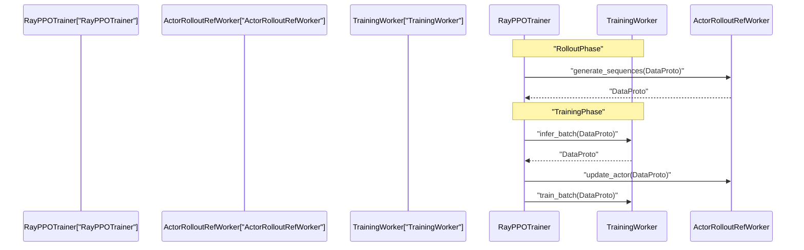

<!-- source: DeepWiki mcp.deepwiki.com · repo volcengine/verl · page 6 Worker Architecture · fetched 2026-10-21 -->

# Worker Architecture

<details>
<summary>Relevant source files</summary>

The following files were used as context for generating this wiki page:

- [tests/models/test_engine.py](tests/models/test_engine.py)
- [verl/workers/engine/base.py](verl/workers/engine/base.py)
- [verl/workers/engine/fsdp/transformer_impl.py](verl/workers/engine/fsdp/transformer_impl.py)
- [verl/workers/engine/utils.py](verl/workers/engine/utils.py)
- [verl/workers/engine_workers.py](verl/workers/engine_workers.py)
- [verl/workers/engine_workers_tinker.py](verl/workers/engine_workers_tinker.py)

</details>


Worker Architecture defines the abstraction layer between `verl`'s distributed execution framework (Ray) and the underlying training/inference engines (`FSDPEngine`, `MegatronEngine`, etc.). Workers encapsulate model instances, manage their lifecycle, and expose a uniform interface for distributed operations regardless of the backend engine used [verl/workers/engine_workers.py:76-142](), [verl/workers/engine/fsdp/transformer_impl.py:106-115]().

**Purpose**: This page provides a high-level overview of the worker architecture, detailing how different worker types integrate with training engines to provide a consistent API for model training, inference, and weight synchronization across distributed environments.

Sources: [verl/workers/engine_workers.py:76-142](), [verl/workers/engine/fsdp/transformer_impl.py:106-115]()

---

## Worker Class Hierarchy

Workers in `verl` inherit from the base `Worker` class and implement specific functionality depending on their distributed role. The framework provides a unified path for worker implementation through the Hybrid Engine design and specialized engine backends [verl/single_controller/base/decorator.py:32-33](), [verl/workers/engine_workers.py:76-84]().

Title: "Worker Hierarchy and Engine Bridge"
```mermaid
graph TB
    subgraph "Base_Abstractions"
        Worker["Worker"]
        BaseEngine["BaseEngine"]
    end

    subgraph "Worker_Entities"
        TrainingWorker["TrainingWorker"]
        ActorRolloutRefWorker["ActorRolloutRefWorker"]
    end

    subgraph "Engine_Implementations"
        FSDPEngine["FSDPEngine"]
    end

    Worker --> TrainingWorker
    Worker --> ActorRolloutRefWorker
    TrainingWorker -->|"wraps"| BaseEngine
    BaseEngine <|-- FSDPEngine
```

Sources: [verl/single_controller/base/decorator.py:32-33](), [verl/workers/engine_workers.py:76-142](), [verl/workers/engine/base.py:30-45](), [verl/workers/engine/fsdp/transformer_impl.py:106-115]()

---

## ActorRolloutRefWorker: Hybrid Engine Design

The `ActorRolloutRefWorker` is the centerpiece of `verl`'s hybrid engine design, allowing a single Ray worker to act as an Actor, a Rollout engine, and a Reference policy simultaneously or interchangeably [verl/workers/engine_workers.py:412-464](). By co-locating these roles within the same GPU memory space, the system eliminates expensive inter-process tensor transfers during rollout generation and policy evaluation.

Mode switching is managed dynamically via backend states, allowing the engine to transition seamlessly between generation mode (using inference backends like vLLM or SGLang) and training/reference computation mode (`FSDPEngine` or `MegatronEngine`) [verl/workers/engine_workers.py:412-464](). For details, see [ActorRolloutRefWorker: Hybrid Engine Design](#6.1).

Sources: [verl/workers/engine_workers.py:412-464]()

---

## TrainingWorker and Engine Integration

The `TrainingWorker` class acts as a high-level wrapper around the `BaseEngine`, abstracting away the complexities of distributed backends such as `FSDPEngine` or `MegatronEngine` [verl/workers/engine_workers.py:76-142](). It delegates core training steps like `train_batch` and `infer_batch` to the underlying engine interface defined in `BaseEngine` [verl/workers/engine/base.py:113-150]().

`TrainingWorker` registers dispatch routines using decorators like `@register(dispatch_mode=Dispatch.ONE_TO_ALL)` to coordinate execution across distributed worker groups, handling gradient updates, optimizer steps, and memory offloading policies [verl/workers/engine_workers.py:76-170](). For details, see [TrainingWorker and Engine Integration](#6.2).

Sources: [verl/workers/engine_workers.py:76-170](), [verl/workers/engine/base.py:113-150]()

---

## Actor and Policy Network Workers

Actor workers manage the policy network ($\pi$), handling log probability computations for actions and policy optimization using reinforcement learning loss functions [verl/workers/engine_workers.py:412-464](). They interface directly with policy optimization pipelines, executing forward passes to compute log probabilities under current and reference policies.

In addition to standard policy updates, actor workers support Parameter-Efficient Fine-Tuning (PEFT) integration, enabling LoRA adapter training and weight synchronization across distributed rollout replicas [verl/workers/engine/fsdp/transformer_impl.py:27-61](). For details, see [Actor and Policy Network Workers](#6.3).

Sources: [verl/workers/engine_workers.py:412-464](), [verl/workers/engine/fsdp/transformer_impl.py:27-61]()

---

## Critic and Value Network Workers

Critic workers manage the value network ($V$) to estimate expected returns from states, supporting advantage estimation algorithms [verl/workers/engine_workers.py:76-142](), [verl/workers/engine/base.py:134-150](). They implement value loss computation and gradient updates mirroring the actor structure but specialized for scalar value regression.

Value models share the same underlying engine backends (`FSDPEngine` or `MegatronEngine`) while utilizing distinct task heads (e.g., sequence classification or linear value heads) to map hidden representations to scalar value estimates [tests/models/test_engine.py:51-60](). For details, see [Critic and Value Network Workers](#6.4).

Sources: [verl/workers/engine_workers.py:76-142](), [verl/workers/engine/base.py:134-150](), [tests/models/test_engine.py:51-60]()

---

## Reward Model Workers

Reward Model (RM) workers provide scalar feedback signals used to guide policy optimization, supporting batch scoring and sequence length balancing via `TrainingWorker` or custom engine integrations [verl/workers/engine_workers.py:76-142](). They process completed rollouts to generate scalar rewards that feed directly into advantage calculation modules.

RM workers operate in evaluation mode (`infer_batch`), leveraging efficient batching and dynamic padding removal to process variable-length sequences without redundant computation [verl/workers/engine/base.py:134-150](). For details, see [Reward Model Workers](#6.5).

Sources: [verl/workers/engine_workers.py:76-142](), [verl/workers/engine/base.py:134-150]()

---

## Worker Communication and Data Flow

The following sequence diagram illustrates how data flows between different worker classes during distributed training iterations, bridging natural language workflow phases to code entities such as `TrainingWorker` and `ActorRolloutRefWorker`.

Title: "Distributed Execution Data Flow"


Sources: [verl/workers/engine_workers.py:76-142](), [verl/workers/engine_workers.py:412-464]()

---

