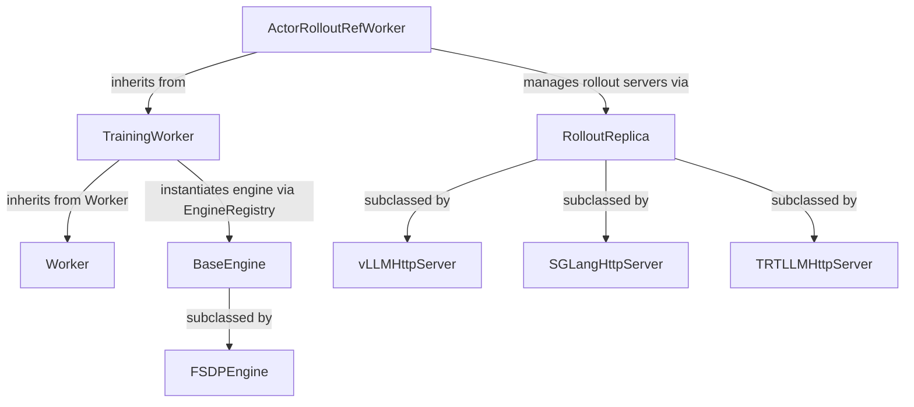

<!-- source: DeepWiki mcp.deepwiki.com · repo volcengine/verl · page 6.1 ActorRolloutRefWorker: Hybrid Engine Design · fetched 2026-10-21 -->

# ActorRolloutRefWorker: Hybrid Engine Design

Relevant source files

The following files were used as context for generating this wiki page:

- [tests/models/test_engine.py](tests/models/test_engine.py)
- [tests/workers/rollout/test_prometheus_rollout_targets_on_cpu.py](tests/workers/rollout/test_prometheus_rollout_targets_on_cpu.py)
- [verl/workers/engine/base.py](verl/workers/engine/base.py)
- [verl/workers/engine/fsdp/transformer_impl.py](verl/workers/engine/fsdp/transformer_impl.py)
- [verl/workers/engine/utils.py](verl/workers/engine/utils.py)
- [verl/workers/engine_workers.py](verl/workers/engine_workers.py)
- [verl/workers/engine_workers_tinker.py](verl/workers/engine_workers_tinker.py)
- [verl/workers/rollout/llm_server.py](verl/workers/rollout/llm_server.py)
- [verl/workers/rollout/replica.py](verl/workers/rollout/replica.py)
- [verl/workers/rollout/sglang_rollout/async_sglang_server.py](verl/workers/rollout/sglang_rollout/async_sglang_server.py)
- [verl/workers/rollout/sglang_rollout/sglang_rollout.py](verl/workers/rollout/sglang_rollout/sglang_rollout.py)
- [verl/workers/rollout/trtllm_rollout/trtllm_async_server.py](verl/workers/rollout/trtllm_rollout/trtllm_async_server.py)
- [verl/workers/rollout/utils.py](verl/workers/rollout/utils.py)
- [verl/workers/rollout/vllm_rollout/vllm_async_server.py](verl/workers/rollout/vllm_rollout/vllm_async_server.py)

## Purpose and Scope

The `ActorRolloutRefWorker` (implemented via the `TrainingWorker` class in [verl/workers/engine_workers.py:78-83]()) is a unified worker abstraction that manages actor training, rollout generation, and reference model computation within a single process group. This hybrid design co-locates training and inference capabilities on the same set of GPUs to optimize memory, communication overhead, and compute efficiency.

The hybrid engine enables:
- **On-policy training**: Rapidly switching between generating rollouts and updating weights without moving model parameters across separate physical training/inference clusters.
- **Unified Resource Management**: Utilizing a single `RayWorkerGroup` to manage the lifecycle of actor, rollout, and reference models [verl/workers/engine_workers.py:78-82]().
- **Memory Optimization**: Dynamic offloading of parameters and optimizer states between training and inference phases using `BaseEngineCtx` context managers [verl/workers/engine/base.py:58-76]().
- **Weight Synchronization**: Efficient transfer of trained weights to inference backends via the `CheckpointEngine` abstraction [verl/workers/engine_workers.py:30-31]() and bucketed ZMQ/IPC transfer mechanisms.

Sources: [verl/workers/engine_workers.py:30-84](), [verl/workers/engine/base.py:58-76]()

---

## Hybrid Engine Architecture and Code Entities

The hybrid architecture decouples the training backend (responsible for gradients, backward passes, and optimizer updates via `FSDPEngine` or `MegatronEngine`) from the inference backend (responsible for generation). The `TrainingWorker` acts as the orchestrator implementing the `Worker` interface [verl/workers/engine_workers.py:78-83]().

Title: "Hybrid Worker Architecture and Code Entities"

Sources: [verl/workers/engine_workers.py:76-144](), [verl/workers/engine/base.py:30-44](), [verl/workers/engine/fsdp/transformer_impl.py:106-111]()

---

## Engine Mode Switching and Lifecycle Management

The `TrainingWorker` orchestrates state transitions through `BaseEngine` interface methods, ensuring that models can toggle between training and inference roles cleanly. The `ActorRolloutRefWorker` extends this by integrating rollout and reference model capabilities.

| Operation / Feature | Training Mode (`train_mode`) | Evaluation / Rollout Mode (`eval_mode`) |
| :--- | :--- | :--- |
| **Interface Method** | `engine.train_mode()` [verl/workers/engine/base.py:58-66]() | `engine.eval_mode()` [verl/workers/engine/base.py:68-76]() |
| **Backend Implementation** | `FSDPEngine` or Megatron | vLLM, SGLang, or TRT-LLM |
| **Offload Controls** | Manages `param_offload` and `optimizer_offload` [verl/workers/engine/fsdp/transformer_impl.py:160-161]() | Frees gradient buffers; retains KV Cache |
| **Execution Primitives** | `forward_backward_batch()` [verl/workers/engine/base.py:99-111]() | `infer_batch()` [verl/workers/engine/base.py:134-150]() |

The `ActorRolloutRefWorker` specifically handles the `RolloutMode` enum, which defines how the rollout engine is deployed:
- `HYBRID`: Rollout engine and training engine are fused in the same process, sharing GPUs and switching context with weight synchronization [verl/workers/rollout/replica.py:50-54]().
- `COLOCATED`: Rollout engine is colocated with the hybrid engine in the same Ray placement group but in a separate process. They share GPUs and switch context without weight synchronization [verl/workers/rollout/replica.py:56-60]().
- `STANDALONE`: Rollout server runs with separate GPU resources in a disaggregated architecture [verl/workers/rollout/replica.py:62-63]().

Sources: [verl/workers/engine/base.py:58-150](), [verl/workers/engine/fsdp/transformer_impl.py:160-161](), [verl/workers/engine_workers.py:159-168](), [verl/workers/rollout/replica.py:49-63]()

---

## Weight Synchronization and Rollout Server Integration

When co-located or disaggregated rollout servers require updated weights from the actor trainer, the system uses efficient transfer mechanisms. The `RolloutReplica` abstraction manages the lifecycle of these servers [verl/workers/rollout/replica.py:65-85]().

Title: "Weight Synchronization and Rollout Server Data Flow"

```mermaid
graph LR
    TrainingWorkerEngine["TrainingWorker.engine"]
    RolloutReplicaLaunch["RolloutReplica.launch_servers"]
    InferenceServer["vLLMHttpServer/SGLangHttpServer/TRTLLMHttpServer"]
    RolloutOutput["Rollout Output"]

    TrainingWorkerEngine -->|"get_per_tensor_param / get_per_tensor_param_shard"| RolloutReplicaLaunch
    RolloutReplicaLaunch -->|"update_weights"| InferenceServer
    InferenceServer -->|"generates tokens"| RolloutOutput
```

Sources: [verl/workers/engine/base.py:151-181](), [verl/workers/rollout/replica.py:136-152](), [verl/workers/rollout/vllm_rollout/vllm_async_server.py:167-168](), [verl/workers/rollout/sglang_rollout/sglang_rollout.py:34-35](), [verl/workers/rollout/trtllm_rollout/trtllm_async_server.py:133-134]()

- **Rollout Server Initialization**: `RolloutReplica` initializes the appropriate HTTP server (`vLLMHttpServer`, `SGLangHttpServer`, or `TRTLLMHttpServer`) based on the configuration [verl/workers/rollout/replica.py:136-152](). These servers are responsible for handling generation requests.
- **Weight Update**: The `update_weights` method on the rollout servers is called to synchronize model parameters. For example, `vLLMHttpServer`'s `update_weights` method handles the transfer of new model weights [verl/workers/rollout/vllm_rollout/vllm_async_server.py:167-168](). Similarly, SGLang uses `sgl_update_weights` [verl/workers/rollout/sglang_rollout/sglang_rollout.py:34-35](). TRT-LLM also has a mechanism for weight updates [verl/workers/rollout/trtllm_rollout/trtllm_async_server.py:133-134]().
- **Tensor Bucketing**: For vLLM, `BucketedWeightSender` packs parameters into a fixed-size buffer (`bucket_size_mb`) to reduce RPC overhead during weight updates.
- **IPC / Shared Memory Fallback**: Supports zero-copy CUDA IPC where available, falling back to Python `shared_memory` when IPC is unsupported.
- **LoRA and Base-Layer Synchronization**: The `ServerAdapter` or `vLLMHttpServer` coordinates weight requests and updates directly from the training worker handle.

Sources: [verl/workers/engine/base.py:151-181](), [verl/workers/rollout/replica.py:136-152](), [verl/workers/rollout/vllm_rollout/vllm_async_server.py:167-168](), [verl/workers/rollout/sglang_rollout/sglang_rollout.py:34-35](), [verl/workers/rollout/trtllm_rollout/trtllm_async_server.py:133-134]()

---

## Routing Replay and MoE Integration

For Mixture-of-Experts (MoE) architectures, consistency between rollout token generation and training backprop is enforced via **Router Replay** [verl/workers/engine_workers.py:62-74]().

- **Routing Flag Decoration**: The `_with_routing_replay_flag` decorator intercepts data flows into `TrainingWorker` methods, assigning the `enable_routing_replay` flag to the underlying `TensorDict` [verl/workers/engine_workers.py:62-74]().
- **MoE Weight Loader Patching**: Specialized patching utilities ensure that un-aliased MoE expert weights map correctly onto execution graphs during weight synchronization.

Sources: [verl/workers/engine_workers.py:62-74]()

---

