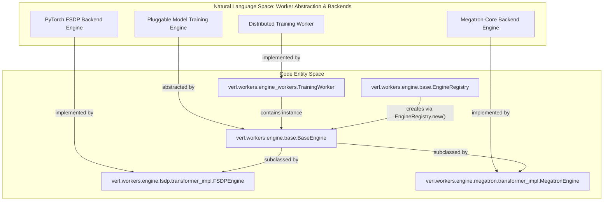
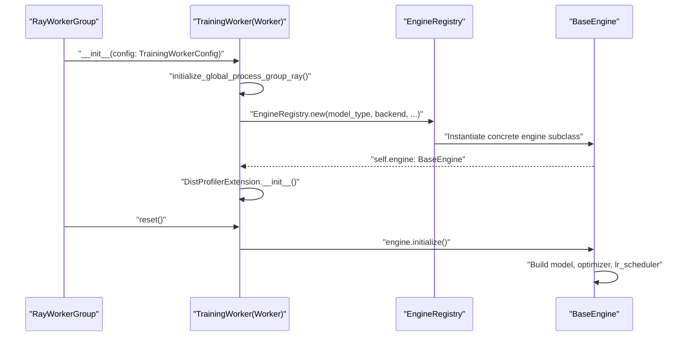
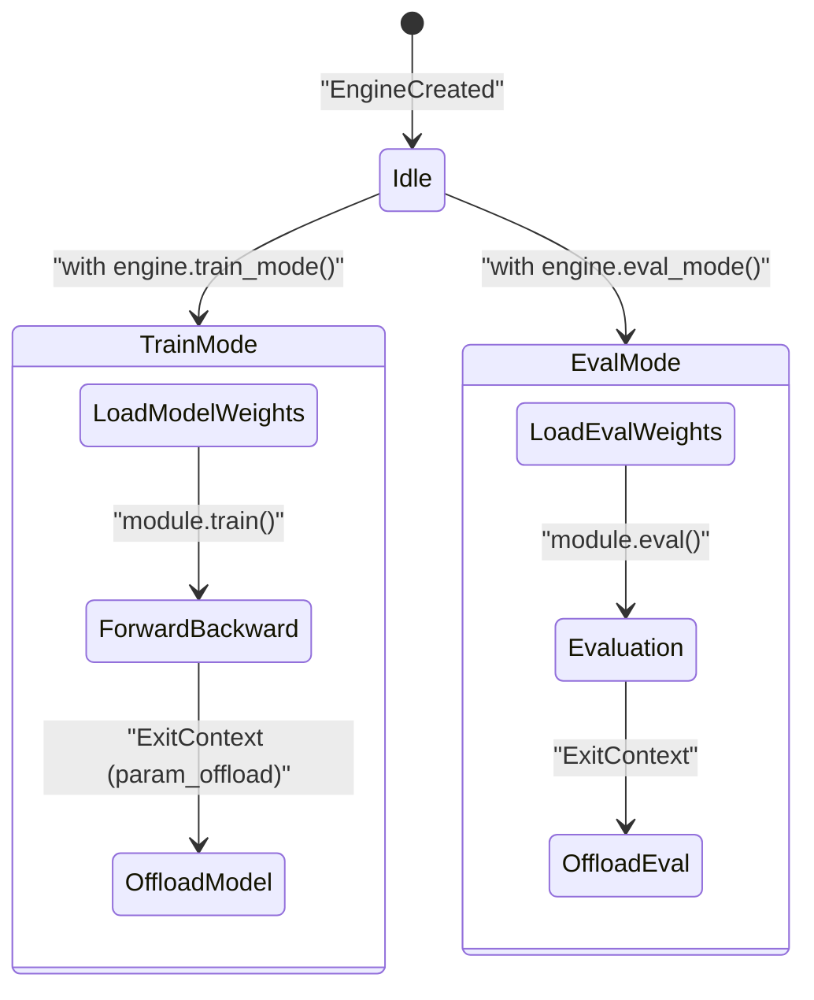

<!-- source: DeepWiki mcp.deepwiki.com · repo volcengine/verl · page 6.2 TrainingWorker and Engine Integration · fetched 2026-10-21 -->

# TrainingWorker and Engine Integration

Relevant source files

The following files were used as context for generating this wiki page:

- [docs/workers/engine_workers.rst](docs/workers/engine_workers.rst)
- [tests/models/test_engine.py](tests/models/test_engine.py)
- [tests/special_sanity/check_device_api_usage.py](tests/special_sanity/check_device_api_usage.py)
- [verl/workers/engine/__init__.py](verl/workers/engine/__init__.py)
- [verl/workers/engine/base.py](verl/workers/engine/base.py)
- [verl/workers/engine/fsdp/__init__.py](verl/workers/engine/fsdp/__init__.py)
- [verl/workers/engine/fsdp/transformer_impl.py](verl/workers/engine/fsdp/transformer_impl.py)
- [verl/workers/engine/megatron/__init__.py](verl/workers/engine/megatron/__init__.py)
- [verl/workers/engine/mindspeed/__init__.py](verl/workers/engine/mindspeed/__init__.py)
- [verl/workers/engine/mindspeed/transformer_impl.py](verl/workers/engine/mindspeed/transformer_impl.py)
- [verl/workers/engine/mindspeed/utils.py](verl/workers/engine/mindspeed/utils.py)
- [verl/workers/engine/utils.py](verl/workers/engine/utils.py)
- [verl/workers/engine_workers.py](verl/workers/engine_workers.py)
- [verl/workers/engine_workers_tinker.py](verl/workers/engine_workers_tinker.py)

## Purpose and Scope

This page documents the `TrainingWorker` class and its integration with the `BaseEngine` abstraction layer [verl/workers/engine_workers.py:108-164](), [verl/workers/engine/base.py:30-36](). The `TrainingWorker` serves as a high-level wrapper that provides a unified API for training and inference operations while delegating actual model execution to backend-specific `BaseEngine` implementations (such as `FSDPEngine`, `MegatronEngine`, `AutomodelEngine`, and `VeOmniEngine`) [verl/workers/engine_workers.py:118-144](), [verl/workers/engine/__init__.py:16-52](). It handles micro-batching orchestration, `DataProto` data flow, and integration with the distributed Ray execution framework [verl/workers/engine_workers.py:108-164](), [verl/workers/engine/utils.py:92-130]().

**Related Pages:**
- For the hybrid worker combining actor training and rollout generation, see [ActorRolloutRefWorker (6.1)]()
- For specific actor and critic implementations built on TrainingWorker, see [Actor and Policy Network Workers (6.3)]() and [Critic and Value Network Workers (6.4)]()
- For distributed execution and worker group management, see [RayWorkerGroup and Resource Management (5.1)]()
- For training engine parallelism strategies, see [Parallelism Strategies and Distributed Backends (8)]()

---

## TrainingWorker Architecture

The `TrainingWorker` acts as the primary interface for training orchestrators (e.g., `RayPPOTrainer`), delegating compute-intensive tasks to underlying engines. It inherits from `Worker` (Ray-managed entity base class) and `DistProfilerExtension` [verl/workers/engine_workers.py:108-164]().

### Class Structure and Hierarchy

This diagram bridges natural language concepts of distributed worker roles to precise code entities (`TrainingWorker`, `BaseEngine`, `EngineRegistry`, `FSDPEngine`, `MegatronEngine`) defined across the codebase.

Title: "TrainingWorker and Engine Hierarchy Mapping"

Sources: [verl/workers/engine_workers.py:108-144](), [verl/workers/engine/base.py:30-36](), [verl/workers/engine/fsdp/transformer_impl.py:106](), [verl/workers/engine/megatron/__init__.py:24]()

### Initialization Flow

The initialization sequence sets up global process groups, selects the appropriate training backend, and registers dispatch metadata:

1. **Configuration Resolution:** Parses `TrainingWorkerConfig`. If `engine_config` is absent, it invokes `auto_select_engine_optim_fn` to choose backend parameters [verl/workers/engine_workers.py:115-142]().
2. **Process Group Setup:** Initializes Ray-based distributed process groups via `initialize_global_process_group_ray` and configures NUMA affinity via `set_numa_affinity` [verl/workers/engine_workers.py:118-123]().
3. **Engine Factory Creation:** Instantiates the backend engine using `EngineRegistry` [verl/workers/engine_workers.py:118-142]().
4. **Profiling Extension Setup:** Wraps execution with `DistProfilerExtension` [verl/workers/engine_workers.py:154-164]().

Title: "TrainingWorker Initialization Sequence"

Sources: [verl/workers/engine_workers.py:108-164](), [verl/workers/engine/base.py:38-44](), [verl/workers/engine/fsdp/transformer_impl.py:113-134]()

Sources: [verl/workers/engine_workers.py:108-164](), [verl/workers/engine/base.py:30-44]()

---

## BaseEngine Interface

The `BaseEngine` abstract base class defines the standard protocol for all training backends [verl/workers/engine/base.py:30-36]().

### Core Abstract Methods

| Method | Purpose | Returns |
| :--- | :--- | :--- |
| `initialize()` | Instantiate model, optimizer, scheduler | `None` |
| `train_mode(**kwargs)` | Context manager switching engine to training mode | `ContextManager` |
| `eval_mode(**kwargs)` | Context manager switching engine to evaluation mode | `ContextManager` |
| `forward_backward_batch(data, loss_function, forward_only)` | Execute forward pass and optional backward pass | `Any` |
| `optimizer_zero_grad()` | Zero out accumulated optimizer gradients | `None` |
| `optimizer_step()` | Execute parameter optimization step | `float` (grad_norm) |
| `lr_scheduler_step()` | Advance learning rate scheduler | `float` or `list[float]` |
| `train_batch(data, loss_function)` | Complete training step (`zero_grad` -> `fwd_bwd` -> `step`) | `dict` |
| `infer_batch(data, loss_function)` | Inference step within `torch.no_grad()` | `Any` |
| `get_per_tensor_param()` | Yield per-tensor parameters and optional PEFT config | `tuple[Generator, Optional[dict]]` |
| `get_per_tensor_param_shard()` | Yield local parameter shards with placement specs | `tuple[Generator, Optional[dict]]` |

Sources: [verl/workers/engine/base.py:38-181]()

### Mode Management and Offload Control

Engines manage state transitions and CPU offloading through context managers to minimize peak GPU memory usage. This diagram maps natural language lifecycle actions to code functions like `train_mode()` and `eval_mode()`.

Title: "Engine Mode Transitions and Offloading Mapping"

Sources: [verl/workers/engine/base.py:58-76](), [verl/workers/engine/fsdp/transformer_impl.py:174-179]()

Sources: [verl/workers/engine/base.py:30-181]()

---

## Training and Inference Operations

### Micro-Batching and Execution

The `TrainingWorker` invokes backend methods wrapped around data structures:

- **Training Batch Execution:** `train_batch` executes `optimizer_zero_grad()`, calls `forward_backward_batch(data, loss_function, forward_only=False)`, and invokes `optimizer_step()` [verl/workers/engine/base.py:113-132]().
- **Inference Batch Execution:** `infer_batch` wraps `forward_backward_batch` in a `torch.no_grad()` context with `forward_only=True` [verl/workers/engine/base.py:134-149]().
- **Position IDs Correction:** Both methods normalize 3D position IDs via `maybe_fix_3d_position_ids` [verl/workers/engine/base.py:124-145]().
- **Micro-Batching:** Inputs are sliced into micro-batches according to `max_token_len_per_gpu` or `micro_batch_size_per_gpu` using `prepare_micro_batches` [verl/workers/engine/utils.py:92-130]().
- **Autograd Graph Detaching:** Tree structures are detached via `detach_tree` to prevent memory accumulation in delayed post-processing steps [verl/workers/engine/utils.py:133-155]().

Sources: [verl/workers/engine/base.py:113-149](), [verl/workers/engine/utils.py:92-155]()

### Split Training Primitives (Tinker Integration)

Specialized worker subclasses such as `TinkerTrainingWorker` extend `TrainingWorker` to expose split training primitives (`optimizer_zero_grad`, `forward_backward`, `optimizer_step`), allowing clients to explicitly separate gradient clearing, forward/backward passes, and step optimizations with runtime parameter overrides [verl/workers/engine_workers_tinker.py:110-157]().

Sources: [verl/workers/engine_workers_tinker.py:110-157]()

---

## Weight Synchronization and Checkpoint Operations

Verl employs declarative specifications for parameter shards to support weight synchronization across distributed backends and checkpoint engines.

- **ShardSpec & BlockPlacement:** The `ShardSpec` and `BlockPlacement` classes manage tensor distribution across a `DeviceMesh` and map local shard indices to global tensor locations [verl/workers/engine/spec.py:59-150]().
- **Delta Weight Sync:** In disaggregated setups, checkpoint engines compute sparse byte-level differences between local parameter shards and CPU snapshots, gathering changed slots to rank 0 for efficient broadcast [verl/checkpoint_engine/delta_checkpoint_engine.py:14-26](), [verl/checkpoint_engine/delta_sync/sparse_gather.py:25-27]().

Sources: [verl/workers/engine/spec.py:59-150](), [verl/checkpoint_engine/delta_checkpoint_engine.py:14-44]()

---

## Model FLOPs Utilization (MFU) and Profiling

The `TrainingWorker` integrates performance tracking tools:

1. **FlopsCounter:** Estimates computational workloads for transformer architectures using configuration properties [verl/workers/engine_workers.py:40]()
2. **Distributed Profiling:** Inherits `DistProfilerExtension` to record rank-level compute and communication profiles [verl/workers/engine_workers.py:108-164]().
3. **Deterministic Execution:** Supports full determinism via `enable_full_determinism`, setting random seeds and determinism flags across libraries [verl/workers/engine/utils.py:31-63]().

Sources: [verl/workers/engine_workers.py:40](), [verl/workers/engine_workers.py:108-164](), [verl/workers/engine/utils.py:31-63]()

---

## Configuration Summary

The execution parameters of the training worker and engines are managed through structured configurations:

| Configuration Component | Key Responsibilities |
| :--- | :--- |
| `TrainingWorkerConfig` | Top-level worker config grouping model, engine, optimizer, and profiler settings |
| `HFModelConfig` | Model path, tokenizer attributes, and precision configurations |
| `FSDPEngineConfig` | FSDP sharding parameters, activation offload flags, and Ulysses sequence parallelism size |
| `McoreEngineConfig` | Megatron-Core tensor, pipeline, and context parallelism settings |

Sources: [verl/workers/config.py](), [verl/workers/engine_workers.py:115-142]()

---

