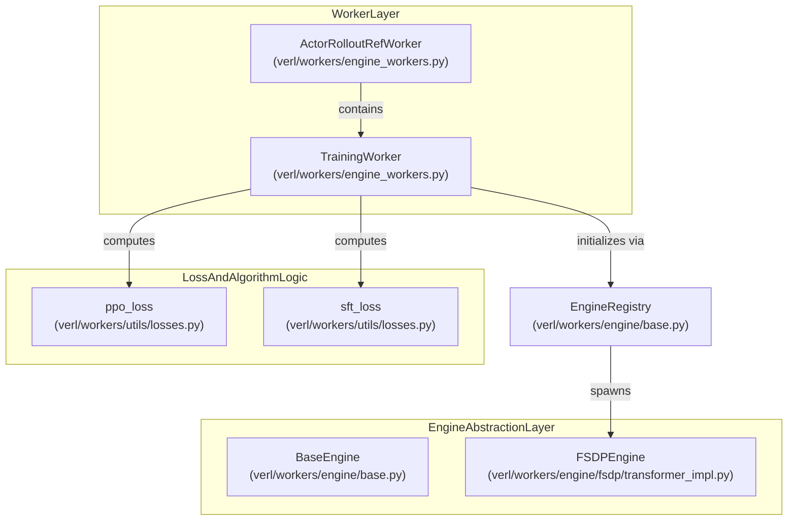
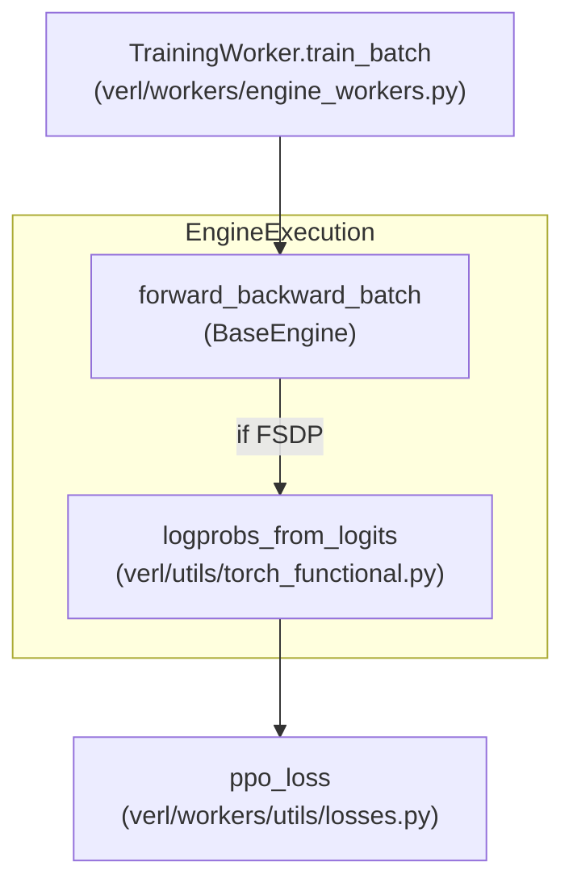

<!-- source: DeepWiki mcp.deepwiki.com · repo volcengine/verl · page 6.3 Actor and Policy Network Workers · fetched 2026-10-21 -->

# Actor and Policy Network Workers

Relevant source files

The following files were used as context for generating this wiki page:

- [docs/advance/ppo_lora.rst](docs/advance/ppo_lora.rst)
- [docs/perf/torch_profiling.md](docs/perf/torch_profiling.md)
- [tests/single_controller/test_device_agnostic_resources_on_cpu.py](tests/single_controller/test_device_agnostic_resources_on_cpu.py)
- [tests/special_distributed/run_all.sh](tests/special_distributed/run_all.sh)
- [tests/special_distributed/test_fsdp2_cpu_offload_state_dict.py](tests/special_distributed/test_fsdp2_cpu_offload_state_dict.py)
- [tests/special_distributed/test_fsdp2_pinned_model_transfer.py](tests/special_distributed/test_fsdp2_pinned_model_transfer.py)
- [tests/special_distributed/test_torch_functional.py](tests/special_distributed/test_torch_functional.py)
- [tests/special_sanity/check_license.py](tests/special_sanity/check_license.py)
- [tests/utils/test_fsdp2_model_transfer_on_cpu.py](tests/utils/test_fsdp2_model_transfer_on_cpu.py)
- [tests/utils/test_server_profiler.py](tests/utils/test_server_profiler.py)
- [tests/utils/test_torch_profile.py](tests/utils/test_torch_profile.py)
- [verl/trainer/config/actor/actor.yaml](verl/trainer/config/actor/actor.yaml)
- [verl/trainer/config/critic/critic.yaml](verl/trainer/config/critic/critic.yaml)
- [verl/trainer/config/profiler/profiler.yaml](verl/trainer/config/profiler/profiler.yaml)
- [verl/trainer/config/ref/ref.yaml](verl/trainer/config/ref/ref.yaml)
- [verl/utils/fsdp_utils.py](verl/utils/fsdp_utils.py)
- [verl/utils/profiler/config.py](verl/utils/profiler/config.py)
- [verl/utils/profiler/profile.py](verl/utils/profiler/profile.py)
- [verl/utils/profiler/torch_profile.py](verl/utils/profiler/torch_profile.py)
- [verl/workers/config/actor.py](verl/workers/config/actor.py)
- [verl/workers/config/critic.py](verl/workers/config/critic.py)

This document details the actor worker implementations that perform policy network training in verl's reinforcement learning training system. Actor workers are responsible for computing log probabilities of generated responses, calculating policy losses (such as PPO, GRPO, and distillation objectives), and updating policy parameters through gradient-based optimization.

**Scope**: This page covers actor-specific functionality within the distributed worker hierarchy, including `TrainingWorker`, underlying execution engines (`FSDPEngine`, `MegatronEngine`), policy loss computations, PEFT/LoRA integration, and configuration settings.

## Actor Worker Architecture

Actor workers in verl are designed to support multiple distributed backends (FSDP, Megatron-Core, TorchTitan, and VeOmni) while providing a uniform interface for training orchestration. The `TrainingWorker` class serves as the primary entry point for training operations, managing engine lifecycles and step execution [verl/workers/engine_workers.py:78-145]().

The following diagram bridges natural language system concepts to code entities within the worker and engine abstraction layers:

Sources: [verl/workers/engine_workers.py:76-145](), [verl/workers/engine/base.py:30-45]()

**Key Responsibilities**:
- **Log Probability Computation**: Executing forward passes to obtain $\log \pi(a|s)$. For instance, `FSDPEngine` utilizes `logprobs_from_logits` [verl/workers/engine/fsdp/transformer_impl.py:65]().
- **Policy Updates**: Executing mini-batch SGD and Adam updates via the underlying engine's `forward_backward_batch` method [verl/workers/engine/base.py:99-112]().
- **PEFT Integration**: Managing LoRA adapters, leveraging `peft` and `get_peft_model` during initialization [verl/workers/engine/fsdp/transformer_impl.py:27-28]().
- **Worker Lifecycle**: Managing Ray process groups, initialization sequences, and hardware affinity settings [verl/workers/engine_workers.py:85-93]().

Sources: [verl/workers/engine_workers.py:78-145](), [verl/workers/engine/fsdp/transformer_impl.py:27-65](), [verl/workers/engine/base.py:99-112]()

## Log Probability and Loss Computation

Computing action log probabilities and policy loss objectives forms the core of the actor update cycle. The `TrainingWorker` abstracts backend differences, routing batch execution through `BaseEngine` implementations [verl/workers/engine_workers.py:137-144]().

The data flow mapping natural language stages to code execution functions is illustrated below:

Sources: [verl/workers/engine_workers.py:113-132](), [verl/workers/utils/losses.py:57-58]()

**Key Features**:
- **Padding Removal**: `FSDPEngine` manages sequence parallelism and removes padding via `use_remove_padding` settings [verl/workers/engine/fsdp/transformer_impl.py:146-152]().
- **Entropy Calculation**: Supports computing token entropy directly from output logits, including memory-efficient chunked variations [verl/workers/engine/fsdp/transformer_impl.py:178-181]().
- **Policy Loss Functions**: The `ppo_loss` function in `verl/workers/utils/losses.py` computes the policy loss based on the configured `loss_mode` (e.g., "vanilla", "dppo_tv", "dppo_kl", "gpg", "clip_cov", "kl_cov", "dro", "cispo") [verl/workers/config/actor.py:82-83](). It also incorporates entropy regularization and KL divergence loss if enabled [verl/trainer/config/actor/actor.yaml:93-113]().

Sources: [verl/workers/engine/fsdp/transformer_impl.py:146-181](), [verl/workers/engine_workers.py:57-58](), [verl/workers/config/actor.py:76-102](), [verl/trainer/config/actor/actor.yaml:93-113]()

## Configuration and Algorithm Settings

The `ActorConfig` dataclass and its associated Hydra yaml files define hyperparameters for actor optimization, loss scaling, and MoE routing behavior [verl/workers/config/actor.py:104-138](), [verl/trainer/config/actor/actor.yaml:8-125]().

### Configuration Parameters
| Parameter | Description | Source |
| :--- | :--- | :--- |
| `ppo_mini_batch_size` | Split each sample into sub-batches of this size for PPO updates | [verl/trainer/config/actor/actor.yaml:18]() |
| `clip_ratio` | PPO clipping ratio for policy loss computation | [verl/workers/config/actor.py:157]() |
| `loss_agg_mode` | Loss reduction mode: `token-mean`, `token-sum`, `seq-mean-token-sum`, etc. | [verl/trainer/config/actor/actor.yaml:85-86]() |
| `router_replay` | MoE routing strategy configuration: `disabled`, `R2`, `R3` | [verl/workers/config/actor.py:47-62]() |
| `tau_pos` / `tau_neg` | Smoothing function coefficients for the SAPO algorithm | [verl/trainer/config/actor/actor.yaml:44-49]() |
| `profiler` | Configuration for profiling the actor model during `update_policy` | [verl/trainer/config/actor/actor.yaml:170-200]() |
| `policy_loss` | Configuration for policy loss computation, including `loss_mode`, `clip_cov_ratio`, `kl_cov_ratio`, `ppo_kl_coef`, and `dro_beta` | [verl/workers/config/actor.py:76-102]() |
| `use_kl_loss` | Whether to use KL divergence loss, typically for GRPO | [verl/workers/config/actor.py:128]() |

**Router Replay**: Configuration for Mixture of Experts (MoE) models enables deterministic training by recording and replaying expert routing decisions across multi-epoch PPO updates [verl/workers/config/actor.py:47-67]().

**Profiler Integration**: The `ActorConfig` includes a `profiler` field, allowing detailed performance analysis of the actor model during policy updates via `DistProfiler` [verl/utils/profiler/profile.py:88-125]().

Sources: [verl/workers/config/actor.py:47-138](), [verl/trainer/config/actor/actor.yaml:8-125](), [verl/utils/profiler/profile.py:88-125]()

## PEFT and LoRA Integration

Verl supports Low-Rank Adaptation (LoRA) for distributed training engines, significantly reducing memory overhead during fine-tuning across both FSDP and Megatron backends [docs/advance/ppo_lora.rst:6-8]().

### Implementation Details
- **FSDPEngine & Wrap Policies**: Utilizes HuggingFace `peft`. `FSDPEngine` initializes adapters via `get_peft_model` [verl/workers/engine/fsdp/transformer_impl.py:27](), [verl/workers/engine/fsdp/transformer_impl.py:162](). FSDP wrapping policies are constructed using `get_fsdp_wrap_policy`, which supports lambda policies for LoRA when `min_num_params == 0` via `lambda_auto_wrap_policy` [verl/utils/fsdp_utils.py:80-125]().
- **State Management & Synchronization**: Checkpoint managers and engines handle PEFT adapter state persistence through specialized collection and sharding hooks [verl/workers/engine/base.py:151-181](). Options such as `layered_summon` and `merge` control how adapter weights are synchronized with rollout backends like vLLM or SGLang [docs/advance/ppo_lora.rst:45-52]().

Sources: [verl/workers/engine/fsdp/transformer_impl.py:27-162](), [verl/utils/fsdp_utils.py:80-125](), [verl/workers/engine/base.py:151-181](), [docs/advance/ppo_lora.rst:6-52]()

---

