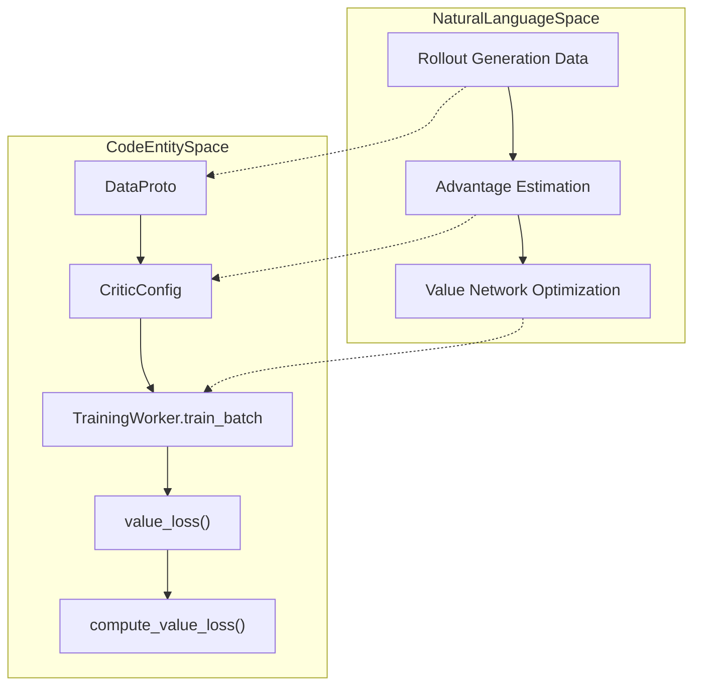
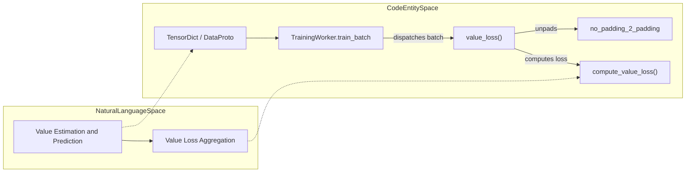

<!-- source: DeepWiki mcp.deepwiki.com · repo volcengine/verl · page 6.4 Critic and Value Network Workers · fetched 2026-10-21 -->

# Critic and Value Network Workers

<details>
<summary>Relevant source files</summary>

The following files were used as context for generating this wiki page:

- [docs/perf/torch_profiling.md](docs/perf/torch_profiling.md)
- [tests/models/test_fsdp_no_padding_on_gpu.py](tests/models/test_fsdp_no_padding_on_gpu.py)
- [tests/special_distributed/test_qwen35_linear_attention_ulysses_sp.py](tests/special_distributed/test_qwen35_linear_attention_ulysses_sp.py)
- [tests/utils/test_padding_on_cpu.py](tests/utils/test_padding_on_cpu.py)
- [tests/utils/test_server_profiler.py](tests/utils/test_server_profiler.py)
- [tests/utils/test_torch_profile.py](tests/utils/test_torch_profile.py)
- [verl/trainer/config/actor/actor.yaml](verl/trainer/config/actor/actor.yaml)
- [verl/trainer/config/critic/critic.yaml](verl/trainer/config/critic/critic.yaml)
- [verl/trainer/config/profiler/profiler.yaml](verl/trainer/config/profiler/profiler.yaml)
- [verl/trainer/config/ref/ref.yaml](verl/trainer/config/ref/ref.yaml)
- [verl/utils/profiler/config.py](verl/utils/profiler/config.py)
- [verl/utils/profiler/profile.py](verl/utils/profiler/profile.py)
- [verl/utils/profiler/torch_profile.py](verl/utils/profiler/torch_profile.py)
- [verl/workers/config/actor.py](verl/workers/config/actor.py)
- [verl/workers/config/critic.py](verl/workers/config/critic.py)
- [verl/workers/utils/losses.py](verl/workers/utils/losses.py)
- [verl/workers/utils/padding.py](verl/workers/utils/padding.py)

</details>


## Purpose and Scope

This document describes the critic (value network) worker implementations in `verl`, which are responsible for estimating state values during RL training (e.g., PPO). Critic workers learn a value function $V(s)$ that predicts the expected cumulative reward from each state, enabling advantage estimation via Generalized Advantage Estimation (GAE) or other methods.

Verl provides several critic worker implementations based on the distributed backend:
- **FSDPEngine**: FSDP-based implementation for data parallel training [verl/workers/config/critic.py:25-26]().
- **MegatronEngine**: Megatron-based implementation supporting pipeline and tensor parallelism [verl/workers/config/critic.py:26-27]().
- **TorchTitanEngine**: FSDP2-based implementation via the TorchTitan backend [verl/workers/config/critic.py:27-28]().
- **VeOmniEngine**: Support for multimodal value models [verl/workers/config/critic.py:28-29]().

These engines are orchestrated by the training infrastructure, which provides a unified API for training and inference across different backends [verl/workers/config/critic.py:44-69]().

Sources: [verl/workers/config/critic.py:25-69]()

## Critic Architecture and Worker Roles

The critic worker maintains the value network parameters, performs inference to estimate values for states generated during rollouts, and executes gradient updates based on value loss (e.g., clipped MSE loss).

### Critic System Architecture

Title: "Critic System Architecture"
```mermaid
graph TB
    subgraph "Training Infrastructure"
        TW["TrainingWorker"]
        BE["BaseEngine"]
        FSDPE["FSDPEngineConfig"]
        MGE["McoreEngineConfig"]
        
        TW --> BE
        BE <|-- FSDPE
        BE <|-- MGE
    end
    
    subgraph "Core Operations"
        InferBatch["infer_batch()"]
        TrainBatch["train_batch()"]
        VLoss["value_loss()"]
    end
    
    subgraph "Configuration Space"
        CCfg["CriticConfig"]
        HFCfg["HFModelConfig"]
        OCfg["OptimizerConfig"]
    end
    
    TW -- "calls" --> InferBatch
    TW -- "calls" --> TrainBatch
    TrainBatch -- "computes" --> VLoss
    
    TW -- "uses" --> CCfg
    CCfg -- "contains" --> HFCfg
    CCfg -- "contains" --> OCfg
```
Sources: [verl/workers/config/critic.py:44-101]()

### Natural Language to Code Entity Space: Critic Workflow

Title: "Natural Language to Code Entity Space: Critic Workflow"

Sources: [verl/workers/config/critic.py:44-101](), [verl/workers/utils/losses.py:158-163]()

Sources: [verl/workers/config/critic.py:44-101](), [verl/workers/utils/losses.py:158-163]()

## Critic Configuration and Validation

The critic worker is configured via `CriticConfig` and its subclasses (such as `McoreCriticConfig`), which define hyperparameters for value estimation and optimization [verl/workers/config/critic.py:44-69](), [verl/workers/config/critic.py:159-169]().

| Parameter | Purpose | Source |
|-----------|---------|--------|
| `strategy` | Backend strategy (`fsdp`, `fsdp2`, `megatron`, `torchtitan`, `veomni`) | [verl/workers/config/critic.py:78-78]() |
| `ppo_mini_batch_size` | Size of mini-batches for value function updates | [verl/workers/config/critic.py:82-82]() |
| `cliprange_value` | PPO value function clipping range | [verl/workers/config/critic.py:92-92]() |
| `ppo_max_token_len_per_gpu` | Max tokens per GPU to manage memory during training | [verl/workers/config/critic.py:84-84]() |
| `use_dynamic_bsz` | Automatically adjust batch size at runtime | [verl/workers/config/critic.py:83-83]() |

The `CriticConfig` class includes a `validate` method to ensure that the training batch size is compatible with the `ppo_mini_batch_size` [verl/workers/config/critic.py:116-130](). It also enforces mutual exclusivity between deprecated `ppo_micro_batch_size` and the current `ppo_micro_batch_size_per_gpu` via the `_check_mutually_exclusive` static method [verl/workers/config/critic.py:130-156]().

Initialization involves setting up the engine backend via configuration classes such as `FSDPEngineConfig` and `McoreEngineConfig` [verl/workers/config/critic.py:24-30]().

Sources: [verl/workers/config/critic.py:24-156]()

## Value Estimation and Loss Computation

Value estimation is performed through inference methods defined on the underlying engine [verl/workers/config/critic.py:44-101](). During training, the worker executes forward and backward passes using optimizer and loss configurations.

The value loss computation is implemented in `value_loss()` [verl/workers/utils/losses.py:158-163](), which interfaces with `compute_value_loss` from core algorithms [verl/trainer/ppo/core_algos.py:19-19]() and uses padding transformation utilities like `no_padding_2_padding` [verl/workers/utils/padding.py:97-108]() to handle unpadded sequences.

### Value Loss Data Flow and Code Entities

Title: "Value Loss Data Flow and Code Entities"

Sources: [verl/workers/utils/losses.py:158-163](), [verl/workers/utils/padding.py:97-108](), [verl/trainer/ppo/core_algos.py:19-19]()

The critic objective computes value loss by comparing predicted values against returns, applying clipping mechanisms controlled by `cliprange_value` [verl/workers/config/critic.py:92-92]() and loss aggregation modes like `loss_agg_mode` [verl/workers/config/critic.py:93-93]().

Sources: [verl/workers/config/critic.py:92-93](), [verl/workers/utils/losses.py:158-163](), [verl/trainer/ppo/core_algos.py:19-19]()

## Memory and Performance Optimization

To support large-scale critic models, `verl` implements several optimizations:

### Configuration for Scale
The `CriticConfig` sets `ppo_max_token_len_per_gpu` to manage memory limits [verl/workers/config/critic.py:84-84](). If `use_dynamic_bsz` is enabled, the engine adjusts the batch size based on this token limit to maximize GPU utilization without OOM [verl/workers/config/critic.py:83-83]().

### Profiler Integration
Each critic configuration includes a `ProfilerConfig` block to capture execution traces using tools like `nsys`, `npu`, `torch`, or `torch_memory` [verl/trainer/config/critic/critic.yaml:87-101](). The `DistProfiler` class acts as a dispatcher, delegating to specific profilers based on the `config.tool` setting [verl/utils/profiler/profile.py:88-97](). It supports `nsys`, `npu`, `torch`, `torch_memory`, and `precision_debugger` [verl/utils/profiler/profile.py:90-97](). Profiling can be enabled for specific ranks or all ranks, and results can be relocated to a specified `save_path` [verl/utils/profiler/profile.py:128-134]().

Sources: [verl/workers/config/critic.py:83-84](), [verl/trainer/config/critic/critic.yaml:87-101](), [verl/utils/profiler/profile.py:88-134]()

## Comparison: FSDP vs Megatron Engines

| Feature | FSDPCriticConfig | McoreCriticConfig |
|---------|------------------|-------------------|
| **Primary Strategy** | `fsdp` or `fsdp2` | `megatron` [verl/workers/config/critic.py:169-169]() |
| **Parallelism Control** | `FSDPEngineConfig` [verl/workers/config/critic.py:24-26]() | `McoreEngineConfig` [verl/workers/config/critic.py:25-27]() |
| **Checkpoint Config** | `CheckpointConfig` [verl/workers/config/critic.py:99-99]() | `CheckpointConfig` (inherited) [verl/workers/config/critic.py:159-167]() |

Sources: [verl/workers/config/critic.py:24-27](), [verl/workers/config/critic.py:99-99](), [verl/workers/config/critic.py:159-169]()

---

